# Custom BQ25798 charger board (CCB): design walkthrough and supporting files (2026-11-10)

This README is a guided tour of `docs/charger_bq25798_custom_board_2026-11-10.md` (the design; revision r2, about 5000
lines). It also indexes the supporting files of this folder (section 13). Section references such as "§3.7" point into
the design, which holds the full values, citations and derivations.

The figures in `figs/` come from one script, `figs/make_figs.py`. Diagrams are simplified redrawings of the design.
Plots are computed by importing the calculation scripts of this folder and re-running their models. Board geometry is
read from `mech_parse_out.json` and `tida_layout_parse_out.txt`; costs from `bom_cost.json`; ledger counts from
`ledger_table.md`. Every thermal and electrical value in the plots is therefore a model estimate, not a measurement.

---

## 0. Status and verdict

**Status.** Revision r2 of 2026-11-10 is a design on paper only. Nothing is ordered, no firmware is changed and no KiCad
capture exists (§0.1). Revision r1 applied review run 001: 22 findings and nine further corrections (§0.9). Revision r2
applies three operator facts of 2026-11-10 and has not been reviewed.

The three r2 facts are the following (§0.1 item 6):

1. The vehicle is a stationary testbench that drives flywheels; road vibration no longer applies.
2. A fan may be mounted on the CCB, supplied from the bench supply or its own regulator.
3. The CCB has no height restriction; the free height H_env is a record-only value.

**What the CCB is.** The CCB is one 4-layer printed-circuit board in the 22 holes of the removed Silvertel Ag105 (CHG) on
the motherboard (MB) rev 20260622. It carries the BQ25798 power stage, the input eFuse, the round-3 carrier (CR)
interlock logic and the round-3 EVM interface board (EIB) drivers. It removes the off-board BQ25798EVM, its 0.3 m leads,
the EIB ribbon and the EVM modifications (§0.1).

**Verdict.** The CCB is feasible on paper but not shown feasible in hardware (§0.3). It is not the next step: Path A
(modified EVM, CR and EIB) stays the next step. The CCB removes the root cause of 29 of the 203 round-3 review findings,
including the one blocker and 11 majors. However, it costs about 70-155 h more effort than Path A and moves the first
bench charge from about 1-3 weeks to about 7-13 weeks. Cost does not favour it: the four boards that the test plan
needs cost USD 652-927, which is USD 112-422 above Path A (§7.1.3).

The operator can choose the CCB when all four verdict conditions hold (§0.3):

1. The IC is fixed by bench evidence: T-B-06, T-B-09, T-B-10, T-B-12 and T-B-21 pass, and the parallel IC search keeps
   the BQ25798. Four of these gates need the Path A rig (§7.1.9).
2. The seated stack gives an underside air gap g of 5 mm or more, preferably 5-8 mm (T-K-04, M3).
3. The fan-on and fan-off soak T-K-20 passes: TDIE is 100 C or less at 2.9 W with the fan on, and the FR-50 trip acts
   before TREG_STAT sets with the fan stopped.
4. A PCBA service with an inspection method for the hidden U501 joints is available (B-7).

Three more conditions apply before the CCB PCB is ordered: the capture closes L-1, L-11 and L-12 in a courtyard DRC;
the header pins and socket contacts are rated 3 A or more on pins 4 and 10 and 2.0 A or more on pins 14, 15, 18 and 19
(O-10); and a review loop on the design closes without an open blocker. If T-K-20 or T-K-17 fails, Path B1 (an MB
re-spin) is preferred (§7.3.2).

---

## 1. What the board must achieve

The design rests on the constraints of §0.1. The following are the ones that shape the board:

- **Battery.** The pack is 2S, 7.4-8.4 V, and pack negative is PCB GND by design.
- **Input voltage.** V-MOT reaches 21.2-21.5 V measured, with a design clamp of 21.98-22.28 V. Every external input-side
  part is therefore rated 35 V or more (§2.1.4).
- **Charge current.** The charge current is 2.5 A today and 3.10 A in the regen image. With the +3.5 % ICHG tolerance,
  the battery-side copper is sized for 3.21 A.
- **FC charging.** The operator ruling of 2026-11-08 applies unchanged: no FC charging during or just before a purge, a
  preemptive share shift to the battery, and EMS-requested charging between purges (FR-14 to FR-17).
- **Neighbours.** The LM1084 (REG-5V) courtyard is 1.75 mm from the CHG silk outline; the LM1084 is 4.83 mm tall and runs
  hot. J-NTC and J-BL lie to the left, and J-BL must stay serviceable.
- **IC substitution.** A parallel study searches for other charger ICs. The design therefore separates IC-independent
  content [I] from BQ25798-specific content [S]; mixed content is labelled [M] (§0.4, §0.6).

The CCB meets the study requirements HR1-HR5 through the round-3 interlock, which carries over unchanged (§1.12). The
designators follow one rule (§0.5): 3xx are ex-CR parts, 4xx are ex-EIB stages, 5xx are the ex-EVM power stage, and
H301 is the 22-pad header.

---

## 2. Power path

Figure 1 shows the power path from the MB sources through the CCB to the pack, with the signals that permit or inhibit
charging.

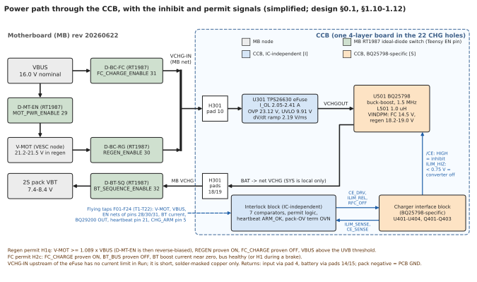

The MB part of the path is unchanged from the Ag105 era. Two RT1987 ideal-diode switches feed the MB net VCHG-IN:
D-BC-FC from VBUS (FC_CHARGE_ENABLE, pin 31) and D-BC-RG from V-MOT (REGEN_ENABLE, pin 30). VCHG-IN enters the CCB at
H301 pad 10. Upstream of the eFuse it has no current limit in Run, so it stays short, solder-masked copper (§1.11.1).

On the CCB, the eFuse U301 (TPS26630) converts VCHG-IN into the protected net VCHGOUT. Its settings carry over from round
3: I_OL 2.05-2.41 A, OVP 23.12 V, UVLO 9.91 V and a 2.19 V/ms dV/dt ramp (§1.11.1). VCHGOUT drives the U501 VBUS pins
directly, with 51.3 uF of nominal capacitance and a 0.11 A inrush (§1.11.2). U501 charges from the BAT pins into net
VCHG, which leaves through pads 18/19 to the MB VCHG node, D-BT-SQ and the pack. SYS is local only (decision D7).

Three facts make this path legal and safe:

- **Ground.** The BQ25798 senses input and charge current high-side internally. A common VIN- and VBAT- ground is
  therefore legal, where it was forbidden for the Ag105 (§1.13.1).
- **Input protection.** The ACFET/RBFET pair of the EVM is omitted. Reverse blocking already exists in the RT1987
  switches, and the eFuse OVP is the only protection between 23.63 V and the IC's own 25.2 V thresholds (D2, §2.1.1).
- **Charge only above VINDPM.** The charger draws power only while VBUS is at or above VINDPM: 14.5 V in the FC image and
  18.2-19.0 V in the regen image. Charge power therefore always flows in buck mode (§2.1.3).

The regen permit H1q requires V-MOT at or above 1.089 x VBUS. D-MT-EN, the MB bus-to-motor switch ([WD]), is then
reverse-biased, so the bus cannot feed the charger. The FC permit H2c requires BT_BUS proven off, so the pack is off the bus during an
FC window. Section 6 gives the logic.

---

## 3. Where the board sits on the MB

Figure 2 shows the MB around the CHG footprint to scale, drawn from the parsed MB board file. It marks the chosen
overhang, the feet, the power-cell zone and the fan inlet.

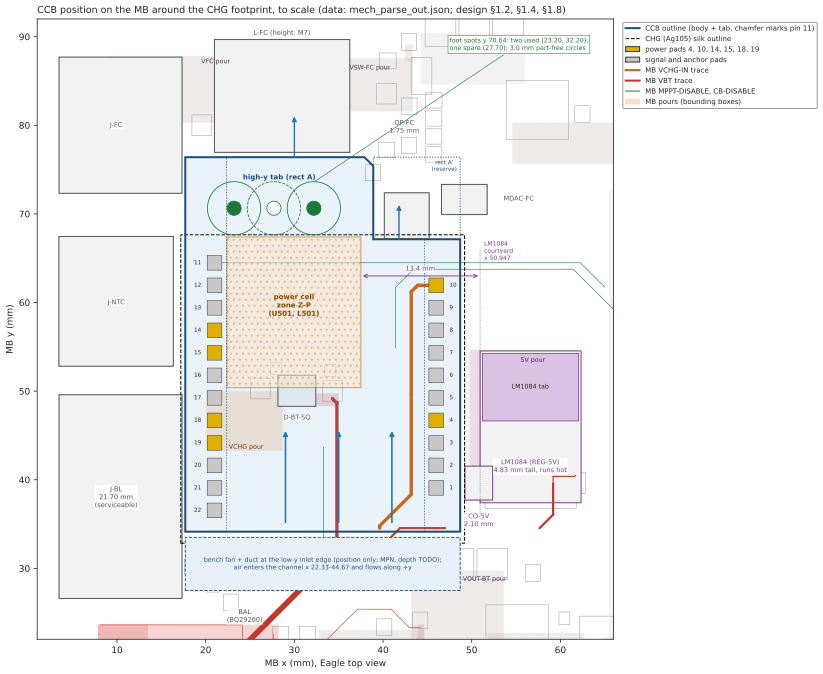

The CCB is the CR outline plus a high-y tab (§1.8). The body spans x 17.70-48.70, y 34.14-67.14; the tab (rect A)
spans x 17.70-38.90, y 67.14-76.40. The total is about 1219 mm² per side. A 1.0 mm chamfer at (38.90, 76.40) marks pin 11,
so that a print check can catch a y-mirrored capture (§1.1, §1.8).

The high-y side is the only side that is free of parts and power copper and away from the LM1084 (Table 1.2). The other
three sides are rejected for these reasons:

- **Low-y.** It covers BAL (BQ29200) and RB1A, the probe sites of the battery-isolation gates, and VBT copper. It has no
  foot spot.
- **Right (+x).** It faces the LM1084 and CO-5V. The CCB edge stays at x 48.70 or less, 2.86 mm from the LM1084 body.
- **Left (-x).** The J-BL, J-NTC and J-FC terminal blocks (21.70 mm tall) are serviced from above, so the edge stays at
  x 17.70 or more.

The tab is a cantilever that reaches 11.9 mm past pin 11. Two bonded nylon M3 feet at (23.20, 70.64) and (32.20, 70.64)
cut the free length to 5.8 mm and give positive retention for the socketed header (§1.4). No existing MB hole is
within reach, so the feet are bonded to solder mask, with no MB rework.

The power-cell zone Z-P (x 22.4-37.5, y 50.4-67.4) lies in the half of the board away from the LM1084. Its edge is
13.4 mm from the LM1084 courtyard (§1.6.1). The fan sits at the low-y body edge and blows along +y (§1.2.3). The header
columns at x 21.0 and x 46.0 bound a channel 22.34 mm wide, with 891 mm² of the 1219 mm² underside in the flow. The air
leaves at the tab end and at the open body edge, away from the LM1084.

The fan rules of §1.2.3 that matter most are the following:

1. Keep the fan frame and mount inside x 17.70-48.70, and keep its lowest edge 2.35 mm or more above the MB.
2. Supply the fan from the bench supply or its own regulator, never from the LM1084 / CO-5V rail. A 0.05-0.20 A fan on
   that rail would add 0.12-0.68 W to the LM1084 ([LC] §8.10).
3. Remove the fan before the battery-isolation gates BG-17a/b and B-PKN, because RB1A and BAL OUT lie under it.

---

## 4. Side view, stack-up and the gap rule

Figure 3 shows two sections to scale. Panel (a) runs along the flow through the power cell. Panel (b) runs across the
board at y 49.0 and compares the r1 and r2 heights.

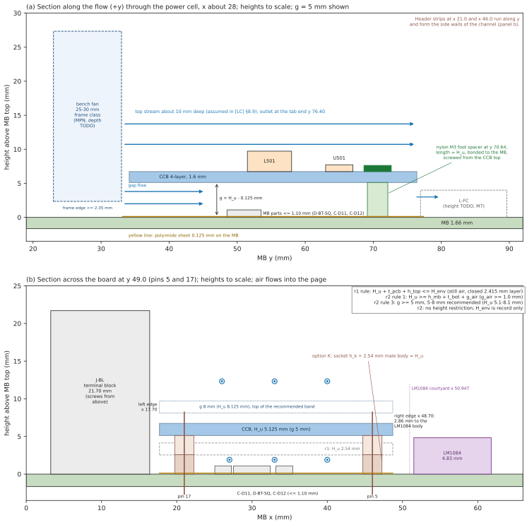

The design uses these terms (§1.3.1). H_u is the CCB underside height above the MB top. The channel gap g is H_u minus
the 0.125 mm polyimide sheet. h_k is the socket seat height of header option K.

Revision r1 placed the CCB on a standard header at H_u 2.54 mm, over a closed air layer, and bounded its top by H_env.
Revision r2 replaces the envelope rule with a gap rule (§1.3.2):

- **Rule 1 (kept).** H_u covers the tallest MB part, the tallest CCB underside part and an air gap of at least 1.0 mm.
- **Rule 2 (superseded).** The envelope rule is record only, because the CCB has no height restriction.
- **Rule 3 (new).** g is 5 mm or more, and 5-8 mm (H_u 5.1-8.1 mm) is the recommended band.

The lower bound comes from obstacle clearance. A 1.0 mm CCB part over a 1.10 mm MB part blocks 42 % of the channel at
g 5 mm and 70 % at g 3 mm ([LC] §8.1). The upper bound comes from the thermal model of section 8: a taller gap does not
help with the fan on and is worse with the fan off.

The design recommends option K: socket strips soldered once into the MB, a male header on the CCB, and screwed feet
(§1.3.4). The socket avoids repeated desoldering on the solid-GND MB pads and allows the Ag105 to plug back in. Within
rule 3, h_k is 2.6-5.6 mm. Because 2.59 mm is below common socket seat heights, H_u of about 8 mm is the practical point.
Its fan-off cost over H_u 5 mm is about +10 C ([LC] §8.7).

The taller stack has small electrical and larger mechanical costs ([TS]):

- Each pin gains 0.66-1.47 mOhm at H_u 5-8 mm, and the six power pins gain 11.2-24.8 mW. Even at H_u 12 mm the extra
  loss is at most 1.6 % of the 2.7 W board loss (§3.3.2).
- The pad-10 / pad-4 loop gains up to 5.2 nH at H_u 5 mm and 10.8 nH at 8 mm (section 9).
- The I2C lines gain at most 0.47 pF at H_u 8 mm, that is 1.08 ns of rise time.
- The foot-bond moment grows by the factor H_u / 2.54, that is 2.0-3.2 in the band. A 10 N force at the tab edge puts
  18.6-22.1 N on the two feet (§1.4).

---

## 5. Board architecture

Figure 4 shows the five blocks of the CCB and labels each as IC-independent [I] or BQ25798-specific [S].

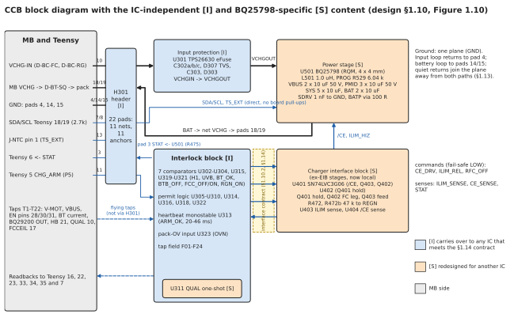

The blocks are the header H301, the input protection, the interlock block, the charger interface block and the power
stage (§1.10.1). The header and the input protection are entirely [I]. The interlock block is [I] except the QUAL
one-shot U311, which exists only for the BQ25798 ILIM_HIZ power-on ADC read. The charger interface block and the power
stage are [S].

The interlock block and the charger meet at an interface contract (§1.10.2). The interlock sends three commands,
CE_DRV, ILIM_REL and RFC_OFF; each is LOW in its fail-safe state. It receives two pin senses, ILIM_SENSE and CE_SENSE,
plus STAT. A replacement IC keeps every [I] block only if it meets the 15 rows of Table 1.14. These rows include an
inhibit pin that inhibits when undriven, a converter-off pin that keeps a bias rail alive, and a 3.10 A continuous
charge current at 2S.

Of the 22 header pads, 11 carry nets and 11 are soldered anchors with no MB copper (§2.5.2). The comparator taps do not
pass through H301: the round-3 flying taps T1-T22 reach the tap field F01-F24 on top-side pads (§1.12.2). The board has
one ground net on a continuous inner plane. The input loop returns to pad 4 and the battery loop to pads 14/15 (§1.13).

The netlist is complete in §2.5. It holds about 174 fitted parts plus 16 test points and the header, and about 28 DNP
footprints (§2.5.12).

---

## 6. Interlock, ex-EIB stages and EVM modifications

Figure 5 draws the permit logic as gates, with the comparator and timing inputs on the left and the effect of each
command at U501 below.

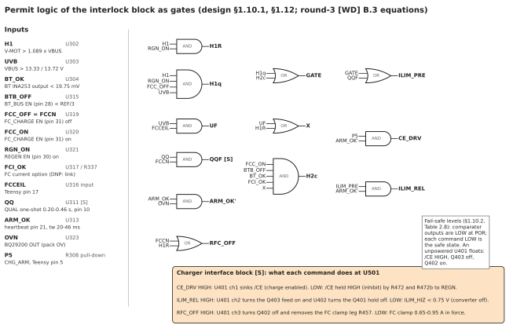

Every round-3 CR function carries over with unchanged values and equations (§1.12.1). The charger converts only when
CE_DRV and ILIM_REL are both HIGH. Both also need ARM_OK', which combines a live heartbeat from Teensy pin 21 and the
pack over-voltage term OVN from the BQ29200. GATE is H1q OR H2c, so either the regen permit or the FC permit can release
the converter. RFC_OFF removes the FC current clamp only when FC_CHARGE is off (FCCN) or when H1R holds, that is a
brake with REGEN proven on.

Comparators, not logic gates, read the RT1987 enable nets. An enable net at an intermediate level therefore reads as
neither on nor off, and both permits stay at 0 (Table 2.8). The heartbeat monostable U313 drops ARM_OK within 20-46 ms
when the heartbeat edges stop, so a hung Teensy inhibits the charger in every mode.

**What was deleted and what was kept.** The merge rule of §2.3.1 is: delete only what compensated for the 0.30 m leads,
the ribbon or the EVM, and keep every part that serves single-fault safety. Table 2.6 applies it as follows:

- **Deleted:** the ribbon damping resistors R130-R132, J101, R176/R177, the EIB sense series resistors R264/R265, the
  driver input series resistors R250/R251/R253/R266, the single ground link R273, C205 and all inter-board wiring.
- **Kept as local drivers:** U401 and U402 (open drain, because /CE and the gate nets are referenced to REGN), the
  two-switch release Q403 + Q401, the FC clamp leg Q402 + R457, and the pin senses U403/U404.
- **Kept and re-justified:** the input pull-downs R467-R470 (a cracked trace then reads LOW), the 3V3 bleed R474 and the
  STAT series resistor R475.

The merge adds two fault classes (§2.3.2). A cracked on-board trace fails safe through R467-R470. A solder bridge
between adjacent U501 pins is credible, because the joints are hidden at 0.4 mm pitch. Table 2.6b lists seven
safety-relevant pairs. The ILIM_HIZ-BATP bridge (pins 17-18) has no interlock or firmware detection, so T-K-06 step (1)
measures every pair before any source is connected.

**EVM modifications.** Round 3 needed 25 EVM modifications EM1-EM25, of which 17 are physical (§0.3). On the CCB,
by count of Table 2.7:

- 13 disappear, because their footprint or jumper does not exist (for example EM1, the /CE jumper JP17).
- 10 become BOM choices, for example R523 49.9 kOhm (EM4), the 50 V input capacitors (EM14) and PROG R529 (EM19).
- EM24 stays as a rule: VCHGOUT is ceramic only, with no electrolytic.
- EM25 is replaced by a REGN check at TP503.

EM13 is corrected rather than copied. Data sheet revision C deleted the SDRV-to-BAT option, so the CCB fits a 1 nF 50 V
C0G capacitor from SDRV to GND (D6). The round-3 owner is flagged (O-14).

---

## 7. Power stage and layout

### 7.1 Component choices

Table 2.1 records twelve power-stage decisions D1-D12. The main ones are the following:

- **Frequency and inductor (D4, D5).** The stage runs at 1.5 MHz with PROG R529 6.04 kOhm (2S) and L501 1.0 uH, as on the
  EVM, so the T-B bench results transfer. 750 kHz with 2.2 uH is the documented alternate if the thermal test fails.
- **Saturation criterion (§2.1.3).** L501 must hold 0.70 uH or more at 6.5 A at its maximum temperature. Until O-4
  closes, L501 is restricted to the EVM part TDK SPM6530T-1R0M120.
- **Input capacitors (§2.1.4).** Every input-side capacitor is a 50 V part: C511/C512 (VBUS) and C529-C531 (PMID),
  10 uF X7R each. The PMID ripple current reaches 1.61 A rms in total at the D = 0.5 point.
- **Omitted parts.** The ACFET pair (D2), the ship FET (D6), the BAT TVS (D11) and backup mode (D12) are omitted. The
  snubbers are DNP footprints (D9, D10).

### 7.2 Layer stack and copper

The CCB needs four copper layers (§3.1.1). TI routes SW1 and SW2 through vias under the IC to an inner layer, and a
solid ground layer must shield the MB logic traces under the board. The assignment is the following:

- L1 carries every part, the power pours and the tap pads.
- L2 is a solid GND plane, voided only under the L501 terminal footprint.
- L3 carries the SW1 and SW2 strips inside the power cell and routing outside it.
- L4 is a GND pour under the whole power cell and carries the battery path outside it.

Stack ST1 (1 oz outer, 1 oz inner) is the baseline; ST2 (1 oz outer, 2 oz inner) is preferred if a prototype fab offers
it (§3.1.3). The 0.2 mm gaps of the RQM land pattern rule out 2 oz outer copper unless a fab confirms them. The battery
path therefore uses pours of 2.5 mm or more, and the input path pours of 1.5 mm or more (§3.1.4).

### 7.3 Floor plan and the power cell

Figure 6 shows the floor plan in panel (a) and the power-loop placement in panel (b). Panel (b) is drawn from the
parsed TIDA-050047 layout, with the CCB designators at the TIDA positions.

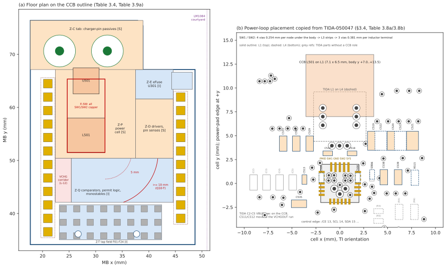

U501 sits at about (28.2, 65.0), rotated 180 degrees (§3.4.5). Its power edge then faces L501 and the logic zone, VBUS
faces the eFuse, BAT faces pins 18/19 and the control pins face the tab. The other zones follow from §1.6.1: drivers
and pin senses in Z-D beside the LM1084, the eFuse in Z-E near pad 10, and the logic in Z-Q next to the taps. Table 3.4
gives every zone extent except Z-E; panel (a) reads the Z-E extent from the not-to-scale Figure 3.1.

TI publishes no EVM layout files. The TIDA-050047 reference design, however, publishes a 4-layer Altium project and
Gerbers of a BQ2579x power stage in the same package (§3.4.7). The CCB copies its land pattern and stencil, which match
the data sheet to 0.0006 mm. It also copies the absence of via-in-pad, the 0.1 uF orientation and the SW routing on L3
between solid L2 and L4. The CCB departs in three ways (§3.4.8):

1. L501 stays on L1, because the CCB underside faces the MB; the L3 strips grow by about 1-3 mm.
2. The PMID bulk capacitors are 1210 50 V parts instead of 0603 25 V parts, so the row is about twice as wide.
3. The AGND net tie of TIDA-050047 is a capture option only; the CCB keeps one GND net.

The plan does not fit as drawn. It books 1532 mm² of courtyard against 1514 mm² usable, that is 101 %, or 103 % with
the battery-path corridor reserved (§3.2.3). The remedies of Table 3.6 bring this to 79-86 %. In addition, the
power-cell sketch overlaps the header keep-out when rotated into place (L-11). The route of the 3.5 A path past L501 is
not chosen (L-12).

Panel (a) also shows the switch-node envelope E-SW and its separation classes (§3.6.1). MOhm comparator nodes and the
0.1 % dividers must sit 10 mm or more from E-SW; logic gates 5 mm or more. Only 32.7 mm² of top-side Z-Q meets the 10 mm
class, against 52.2 mm² needed, so part of this class moves to the bottom side (L-13). These distances are planning
values without a source; T-K-09 measures the plane noise.

---

## 8. Thermal design

The charger dissipates 2.54 W at the regen point (VBUS 20 V, ICHG 3.10 A, 1.5 MHz, 90.7 % efficiency read from the data
sheet curve). With the eFuse and the logic, the CCB dissipates about 2.7 W (§3.7.1). The data sheet curves stop at VBUS
20 V, so the loss at 21.5 V is unmeasured. The design target is T_J of 100 C or less at ICHG 3.10 A, 20 C below the
default TREG of 120 C (§3.7.3).

### 8.1 Fan on: the design case

Figure 7 shows the junction rise over room air at 2.7 W from the forced-air model of [LC] §8. Panels (a) and (b) sweep
the air velocity for four gaps. Panel (c) sweeps the gap at 2 m/s.

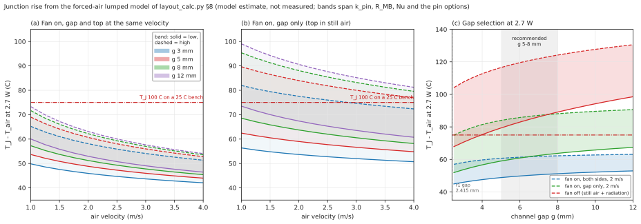

With air over both sides at 2 m/s and g 5 mm, T_J is 49-61 C above room air, that is 74-86 C on a 25 C bench. At
2.9 W it is 78-90 C (§3.7.2a). With air through the gap only, the band rises to 59-84 C, so the duct must cover the gap
and the top. Panel (c) shows why the gap rule has an upper bound. With the fan on, the band rises slowly with g. With the
fan off, it rises from 79-117 C at g 5 mm to 99-131 C at g 12 mm.

The band of each curve spans the pin conductivity, the MB resistance, the one-wall and two-wall Nusselt numbers and the
pin options. The model is lumped. It ignores spreading inside the CCB, credits no obstacle mixing and assumes the
emissivities and the duct capture fraction (§3.7.3a). With the fan on, T_J moves by only 0.15-0.30 C per C of MB idle
offset, so the r1 gate on T_MB,0 is record only.

### 8.2 Fan off: the fault case

Figure 8 shows the fan-off case. Panel (a) gives the steady state against the board loss. Panel (b) gives the response
after the fan stops at 2.7 W.

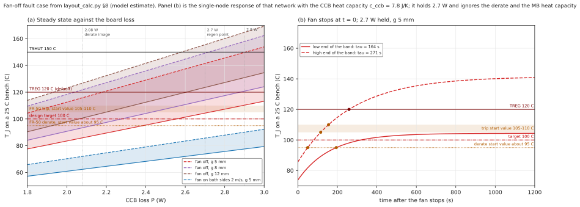

With the fan stopped at g 5 mm, T_J reaches 104-142 C on a 25 C bench at 2.7 W and 86-116 C at the 2.08 W derate image
([LC] §8.7). The derate alone therefore does not hold 100 C, and the FR-50 trip must act (§5.6). FR-50 reads the
BQ25798 die temperature TDIE over I2C. Above `CHG_TDIE_DERATE_C` it lowers ICHG to the 2.50 A image and closes FC windows;
above `CHG_TDIE_TRIP_C` it drops P5 and latches until Idle. The starting values are about 95 C and 105-110 C, both
TODO(calibrate) by T-K-20.

Panel (b) is a recomputation, not an output of [LC]. It solves the [LC] §8 network as a single node with the CCB heat
capacity of 7.8 J/K. The resulting time constants, 164 s and 271 s at g 5 mm, equal the [LC] §8.7 figures. The panel
holds 2.7 W and ignores the derate and the MB heat capacity, so it overstates both the speed and the final value of
the rise. The guard has minutes to
act, which is why the fan needs no tachometer (§5.4.1).

### 8.3 Configurations compared

Figure 9 places the r1 still-air case and the r2 cases on one axis at the 2.7 W regen point.

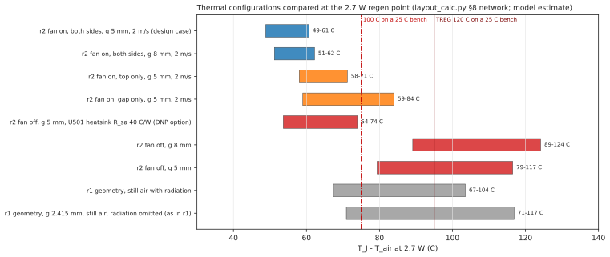

The two "both sides" rows have the lowest bands, 49-61 C and 51-62 C over room air. The top-only row (58-71 C) also stays
below the 100 C line on a 25 C bench, but with less margin; the gap-only row does not. The r1 still-air band (67-117 C)
is the reason r1 relied on a gap pad for option K and on a gate on T_MB,0. The r2 fan-on case meets the target without a
pad, so the pad is a not-fitted BOM line (§3.7.4). A top-side heatsink on U501 of R_sa 40 C/W brings the fan-off case to 54-74 C over
room air. It is a DNP backstop, not part of the design case (§3.7.4a).

---

## 9. Electrical checks

Figure 10 shows two checks. Panel (a) gives the L501 peak and ripple current against VBUS. Panel (b) gives the eFuse
hard-short spike at U301 IN against the OUT-loop inductance.

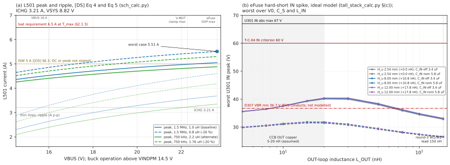

**Inductor current.** At ICHG 3.21 A and VSYS 8.82 V, the peak reaches 5.51 A at the eFuse OVP maximum of 23.63 V with
L501 at -20 % (§2.1.3). The requirement Isat 6.5 A keeps an 18 % margin over that peak. The peak exceeds the data
sheet figure ISW 5 A, which does not state whether it is a DC or a peak value (TODO(verify: TI E2E), N-15). The 750 kHz
alternate lowers the peak by only about 0.2 A.

**eFuse hard-short spike.** Round 3 had a 150 nH lead (W1/W2) between the eFuse and the EVM. On the CCB, 5-20 nH of OUT
copper raises the ideal turn-off current from 65 A to 103-117 A. The ideal U301 IN peak then rises from 32.8 V to
35.5-40.0 V (§1.11.2 item 4, [TS] §(c)). At 10-20 nH the peak exceeds the D307 VBR minimum of 36.7 V, so the TVS
conducts. The margins to the 60 V T-C-04 criterion and the 67 V U301 maximum remain.

The tall header adds 0-0.3 V, so the stack height does not change this result. Panel (b) evaluates the [TS] model at
intermediate inductances that [TS] does not tabulate; its tabulated points (5, 10, 20 and 150 nH) agree with
`tall_stack_calc_out.txt`. The model is ideal: it has no ESR, no FET linear region and no TVS conduction. The OUT copper
inductance and the D307 energy are TODO(calc) (L-15, N-25).

---

## 10. Cost, effort and schedule

Figure 11 compares the paths in cash, effort and time to the first bench charge. Path A-C is the CCB.

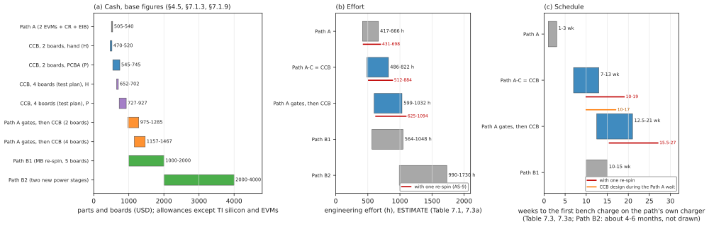

Two CCBs cost USD 470-520 with hand assembly and USD 545-745 with a PCBA service, against USD 505-540 for Path A (§4.5.3).
The test plan needs four boards: the vehicle board, a spare, the fault-injection unit FI1 and LOOP1. These cost USD
652-702 (hand) or 727-927 (PCBA) (§4.5.2). Only the TI silicon is a verified price (USD 101.94 of build 2). The PCBA
range is the largest single uncertainty.

The CCB needs 486-822 h against 417-666 h for Path A (Table 7.1). Firmware dominates every path: it is 47-51 % of the CCB
total. The route that verdict condition 1 requires builds the Path A rig first. It needs 599-1032 h and reaches the
first CCB bench charge after about 12.5-21 weeks, or 10-17 weeks if the CCB design runs during the Path A wait
(§7.1.9). One re-spin (AS-9) is booked outside the base figures: about 26-62 h, 3-6 weeks and USD 95-370 plus parts.

---

## 11. Tests and the finding ledger

### 11.1 Test-registry delta

The CCB keeps the round-3 registry of 112 tests and adds 20 new tests, T-K-01 to T-K-20 (§6.2). Table 1 gives the
disposition of the round-3 tests by group.

**Table 1. Disposition of the round-3 tests (design Table 6.1)**

| Group | IDs | Retires | Unchanged | Modified |
|---|---|---|---|---|
| T-A parts and incoming | 12 | 1 | 7 | 4 |
| T-B charger standalone | 26 | 0 | 20 | 6 |
| T-C logic and bench rig | 17 | 1 | 13 | 3 |
| T-D failure injection | 15 | 0 | 11 | 4 |
| T-E vehicle measurements | 14 | 0 | 14 | 0 |
| T-F board integration | 19 | 0 | 15 | 4 |
| T-G drive cycles on the testbench | 7 | 0 | 7 | 0 |
| T-W watchdog | 2 | 0 | 2 | 0 |
| **Total** | **112** | **2** | **89** | **21** |

Only two tests retire, because most round-3 tests check charger behaviour, carrier logic or MB facts. In r2, T-K-19
(road retention) is not applicable and T-K-02 is record only, so 18 T-K tests gate the design. The new tests fall into
four groups (§6.4):

- **Pre-layout and incoming:** the mechanical envelope with the Ag105 fitted (T-K-01), the bare-board check (T-K-03) and
  the seated clearances after the Ag105 removal (T-K-04).
- **Staged bring-up:** stage-1 values and first power (T-K-05), the power stage at reduced voltage (T-K-06), the switch
  nodes (T-K-07) and the inductor peak on LOOP1 (T-K-08).
- **Same-board coupling:** no false comparator or logic transition under switching (T-K-09, T-K-10), the safety chain
  with a live REGN (T-K-11), and conducted ripple and MB disturbance (T-K-12, T-K-13).
- **On the MB:** the thermal soak (T-K-14 with T-K-20), the FR-50 and FR-51 guards (T-K-15, T-K-16), and header contact
  resistance and support (T-K-17, T-K-18).

The CCB adds three test boards and fixtures: FIX1 (a bench header fixture), FI1 (a second CCB for open-joint tests) and
LOOP1 (a CCB with a current-probe loop in series with L501) (§6.1.4).

### 11.2 Order of the gates and the ledger counts

Figure 12 shows the r2 phase sequence in panel (a) and the 203-key ledger in panels (b) and (c), counted from
`ledger_table.md`.

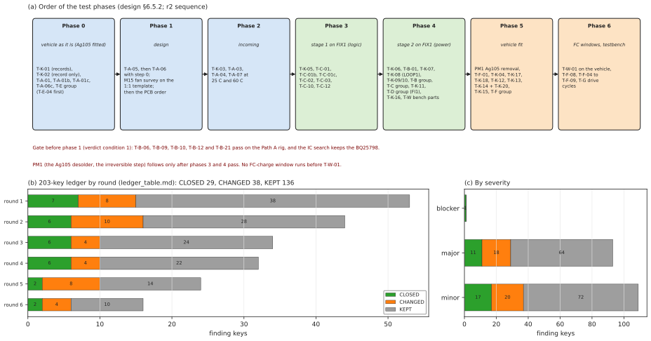

The sequence proves the interlock logic on stage 1 before the power stage is fitted (§6.5.2). The Ag105 desolder PM1 is
the single irreversible MB step, and it follows only after phases 3 and 4 pass. Every round-3 ordering gate stays in
force; in particular, no FC-charge window runs before the watchdog test T-W-01 (Table 6.2).

The ledger gives each round-3 finding a status for the CCB (§7.2.1): CLOSED (root cause absent), KEPT (applies
unchanged) or CHANGED (applies in an altered form). The counts are 29 CLOSED, 38 CHANGED and 136 KEPT (Table 7.5). The
one blocker, `evm-jp14-feed-joint-floating`, is CLOSED; of the 93 majors, 11 are CLOSED, 18 CHANGED and 64 KEPT. The
CLOSED set is the EVM-modification, ribbon, EIB and lead keys. The CHANGED set is mainly layout.

The CCB also opens new findings with proposed severities (Table 7.7). The table lists 27 (N-01 to N-27), of which 12 are
proposed as major; §0.3 still states the r1 count of 24. The r2 additions are the IN-side transient (N-25), the
dependence on the bench fan (N-26) and the tall header stack (N-27). Revision r2 does not regenerate
`ledger_table.md`, and one proposed status change (key `tc04-in-spike-criterion-omits-mb-vchgin-ratings`) awaits review.

---

## 12. Open items and the operator measurement list

Section 8.1 ranks 36 open items. Items 1-6 and 31 gate the path decision or the PCB order:

1. A review round on revision r2, including the proposed ledger change and the severities of N-01 to N-27.
2. The path and IC decision: the five BQ25798 behaviour gates and the result of the parallel IC search.
3. Board area and power-cell fit: 101 % area as drawn, the cell overlap (L-11), the battery corridor (L-12) and the
   10 mm separation class (L-13).
4. The LM1084 tab temperature and junction margin (OT-4, N-06) and the efficiency above VBUS 20 V (L-8).
5. The header and socket current rating, contact resistance, retention force and MPNs, including the tall-stack classes.
6. Supply and cost: two fab quotes, a stencil quote, a PCBA quote with U501 inspection, and non-TI prices.
7. Item 31: the fan MPN, duct and supply, the M15 velocity survey and the T-K-20 soak that sets the FR-50 thresholds.

Items 7-16 and 32-34 gate the capture or the bring-up. They include the L501 saturation curve and the TI cycle-by-cycle
limit (O-2, O-4), the 50 V capacitor MPN, the round-3 calculations re-run with CCB values, the pin-11 marker and the
IN-side transient without the W1/W2 lead.

Section 8.2 lists 24 operator measurements in the order in which they become possible:

- **Items 1-10, with the Ag105 still fitted:** the standoff and module records, the LM1084 thermal state, the heights
  of the neighbours, the J-BL screwdriver envelope, the foot spots and the MB thickness. Items 3, 4 and 10 are record
  only or not applicable in r2.
- **Items 11-13, after the Ag105 removal:** hole condition, header and socket seat height (which sets g), and hole
  positions.
- **Items 14-21, on a built CCB:** efficiency above 20 V, I2C rise time, plane noise, D303 leakage, header contact
  resistance, in-situ temperatures, monostable widths and REGN delay.
- **Items 22-24, for the bench fan (r2):** fan delivery and gap velocity (M15, first on a 1:1 template), the fan-on
  and fan-off soak (M16) and the bench room air (M17).

M16 decides the thermal design. The model figures of section 8 are its predictions, not its replacement.

---

## 13. Files

The design document cites the files of this folder by the keys in the right-hand column.

| File | Content | Cited in the design document as |
|---|---|---|
| `figs/make_figs.py` | Generator of the twelve figures of this README. It imports `layout_calc.py`, `sch_calc.py` and `tall_stack_calc.py` and re-runs their models; it reads `mech_parse_out.json`, `tida_layout_parse_out.txt`, `bom_cost.json` and `ledger_table.md`. Run: `C:/Users/ricky/miniforge3/python.exe -I figs/make_figs.py [--png <folder>] [--only 1,7,...]` | - |
| `figs/fig01_power_path.svg` ... `figs/fig12_tests_and_ledger.svg` | The figures of sections 2-11 of this README (diagrams are simplified redrawings; plots are model output) | - |
| `bom.csv` | Machine-readable BOM: 111 part lines plus the PCB line (review run 001 fixes applied; r2 adds the bench fan, its lead, mount and DNP regulator, the soak thermocouples, the anemometer (tool), a DNP U501 heatsink and the not-fitted r1 gap pad, and re-classes the headers and option-K sockets as tall-stack parts). Columns include `class_IC` (I, S or M) and `carried_over_from_round3_refdes` | Section 4, [BOMGEN] |
| `make_bom.py` | Generator of the BOM and of the cost roll-up. It writes `bom.csv` and `bom_cost.json` | [BOMGEN] |
| `bom_cost.json` | Cost roll-up for builds 1, 2, 4 and 5 (option P nets the stencil once) (verified, round-3 allowance and new allowance classes; unpriced placement counts) | §4.5 |
| `ti_prices.json` | TI store prices of 2026-11-10, 1-99 tier, parsed from the TI part-details pages | [TI-PD] |
| `schematic_blocks.txt` | Figure 1.10, the block diagram of the CCB, as a separate text file | §1.10.1 |
| `mech_parse.py` | Parser of `references/Scale Car Board PCB 20260625.brd` (EAGLE XML): CHG pads, neighbours, MB copper under the footprint, foot spots | [MECH] |
| `mech_parse_out.txt`, `mech_parse_out.json` | Output of `mech_parse.py` | [MECH] |
| `digest_mechanics.md` | Mechanical facts extracted from the parse: pad table, neighbours, J-BL envelope, MB copper, foot spots, overhang ranking | [MECH] |
| `digest_ti.md` | Transcribed facts of SLUSDV2C (BQ25798 data sheet) and SLUUCB5E (EVM user guide): pin table, EVM designators, layer reading, rev-C changes | [TID] |
| `digest_study_reviews.md` | Operator rulings, requirements HR1-HR5, the round 1-6 finding table with tags, gate D-2 and the mechanical unknowns | [STUDY] |
| `layout_calc.py`, `layout_calc_out.txt` | Layout arithmetic: conductor widths, vias, losses, lumped thermal model, area budget, pin heating; section 8 (r2) adds forced air on the testbench, the fan-off case, the U501 heatsink option, gap selection, fan flow and fan supply. Output lines 1-173 are unchanged from r1 | [LC] |
| `tall_stack_calc.py`, `tall_stack_calc_out.txt` | r2 tall header stack checks: pin resistance and I2R, input-loop inductance, eFuse hard-short spike, signal loading, mechanical loads | [TS] |
| `sch_calc.py`, `sch_calc_out.txt` | Schematic arithmetic: inductor ripple and peak, VCHGOUT capacitance, inrush, PMID ripple current, header-pin currents | [CALC] |
| `make_ledger.py`, `ledger_table.md` | Generator of the 203-key review-finding ledger and its output | §7.A, [LEDG] |
| `tida_layout_parse.py` | Parser of the TIDA-050047 Altium outputs (`references/TI_BQ25798_design_files/TIDA-050047/altium_TIDM752/REV_A1`): layer stack and placements from the `.PcbDoc` text records, U1 pads, mask and paste openings, vias and pours from the Gerbers (gerbonara), drill sizes, the `.RUL` rule export and the schematic pin records. Positions are in the cell coordinates of §3.4. Run: `python -I tida_layout_parse.py <REV_A1 folder> [<png folder>]`; the optional second argument writes layer renders | [TLP], §3.4.6-3.4.8 |
| `tida_layout_parse_out.txt` | Output of `tida_layout_parse.py` (run without renders) | [TLP] |
| `pre_assembly_critique.md` | Critique of the section drafts before assembly, with the fixes applied. Items 22 and 23 became open items B-11 and A-2 of the design document | - |

---

## 14. Notes

1. The scripts and digests name the section drafts from which the design document was assembled. The drafts map to the
   design document as follows: `sec_mechanics.md` to §1.1-1.9; `sec_schematic.md` to §1.10-1.13 and section 2 (draft
   sections 1, 3, 5 and 10 to §1.10-1.13; draft sections 2, 4, 6, 7, 8 and 9 to §2.1-2.6; draft section 11 to §8.3.1);
   `sec_layout.md` to section 3; `sec_bom.md` to section 4; `sec_firmware_io.md` to section 5; `sec_tests.md` to section
   6; `sec_compare.md` to section 7.
2. The scripts and digests carry absolute paths of the working directory in which they were run. They are kept as a
   record of the calculations; re-running them needs those paths changed.
3. `bom.csv` and `make_bom.py` book 21 tap pins (open item B-11 is closed). In `bom.csv` the copper stacks are named ST1 and ST2,
   as in §3.1.3 of the design document.
4. TI reference material for the power stage (SLUSDV2C, SLUUCB5E and the TIDA-050047 reference design) is held in
   `references/TI_BQ25798_design_files/`, not in this folder.
5. `tida_layout_parse.py` reads the TIDA-050047 files as data only. It needs `gerbonara` (1.6.3 in the miniforge
   environment used) and, for the renders, `matplotlib`. The renders are not kept in this folder.
6. Revision r2 does not regenerate `ledger_table.md`. The design document (§7.2.3) proposes that round-6 key
   `tc04-in-spike-criterion-omits-mb-vchgin-ratings` changes from KEPT to CHANGED, after the tall-stack check of
   `tall_stack_calc_out.txt` section (c). `make_ledger.py` keeps the r1 status until a review round confirms the change.
7. `figs/make_figs.py` imports the three calculation scripts by path, so it runs from any working directory. Importing
   them re-runs their own calculations with their console output suppressed; a full run takes about 20 s. The
   `--png` option writes PNG copies for a visual check; the PNGs are not kept in this folder.
8. Figure 8 panel (b) and the intermediate points of Figure 10 panel (b) are recomputations with the scripts' own
   models at points that the scripts do not print. Every other plotted band reproduces a printed value of
   `layout_calc_out.txt`, `sch_calc_out.txt` or `tall_stack_calc_out.txt` at the tabulated points.

---

## 15. Adversarial review (2026-11-10)

| File | Content |
|---|---|
| `ledger.md` | Review ledger, prefix CCB: 22 round-1 findings and 9 counter-review positions, all accepted; proposed registry row for `docs/reviews/README.md` |
| `run-001-2026-11-10.md` | Run record: the Codex deviation, round-1 findings verbatim, verifier verdicts, round-2 counter-review, adjudication table |
