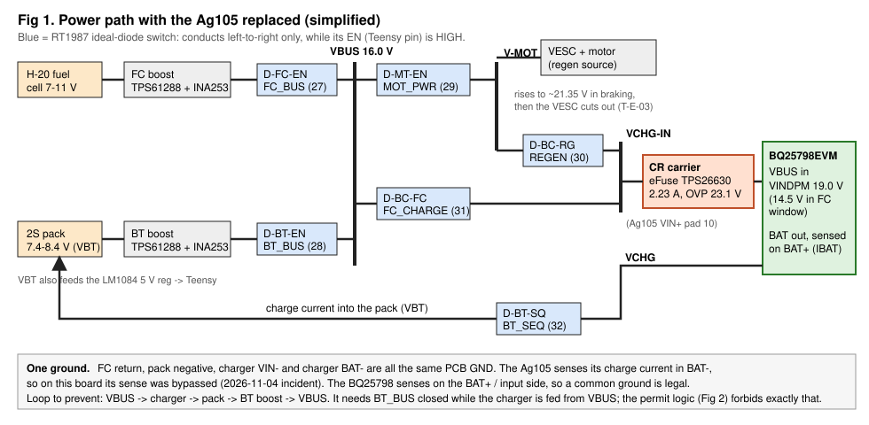
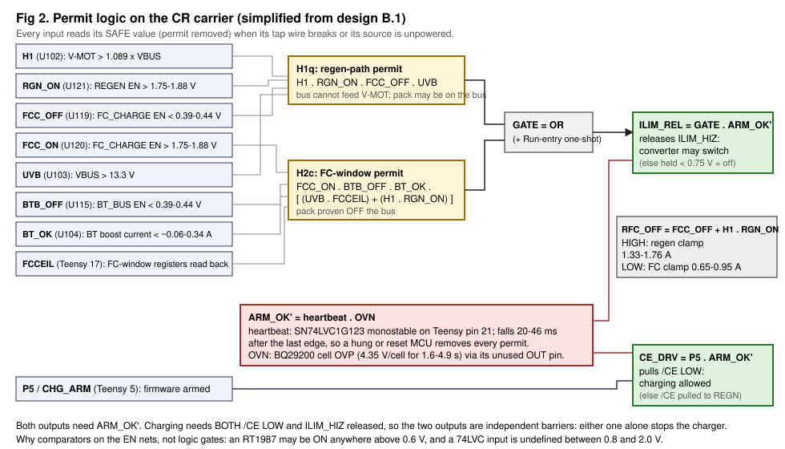
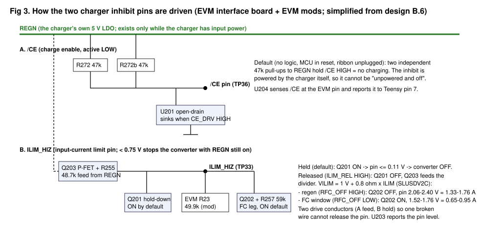
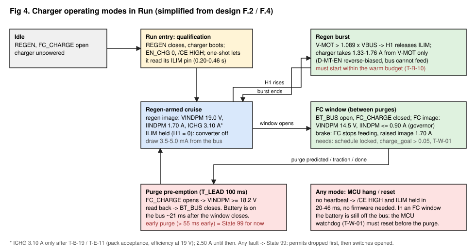

# BQ25798EVM in place of the Ag105: design walkthrough (2026-11-09)

A short guided tour of `docs/charger_bq25798_wiring_design_2026-11-05.md` (the "design"; ~2,700 lines). It covers what was
built, why each choice was made, and how the design can still fail. Section references such as "B.1" point into the design,
which holds the full values, citations and calculations. The figures in this folder are simplified redrawings. The full
drawings are `../wiring_bq25798.svg` and `../carrier_schematic.svg`.

**Status.** The design is on paper only. It went through six independent review rounds; the verified findings per round were
53, 44, 34, 32, 24, 16. All were applied. Round 6 still found majors, and the final independent audit has not run. Nothing has been
ordered or built.

---

## 1. What the design has to achieve

Operator rulings R1-R9 (design 0.1), in short:

1. **Regen harvesting and FC charging both work.** Both are hard requirements.
2. **No circular loop.** The path VBUS -> charger -> pack -> BT boost -> VBUS must be impossible.
3. **No runaway charge current.** This is what happened on 2026-11-04.
4. **Fail-safe.** A dead, resetting or hung Teensy means no charging.
5. **FC charging only between H-20 purges, and regen + FC charging may overlap.**
6. **Runs on the current PCB.** The Ag105 is removed and nothing is re-spun. The keep-alive resistor is a last resort.

## 2. The power path (Fig 1)



The board's power path is unchanged. The EVM takes the Ag105's place electrically:
- The charger input is still the VCHG-IN node, fed by two RT1987 switches. D-BC-FC feeds it from VBUS; D-BC-RG feeds it from
  the motor node V-MOT.
- The charger output still goes through D-BT-SQ into the pack.

What is new sits between those two points:
- **The CR carrier.** A small 4-layer board, 31 x 33 mm, that plugs into the 22 Ag105 holes. It holds the input eFuse and all
  of the permit logic.
- **The EIB.** A 2-layer board, 36 x 24 mm, beside the EVM. It drives the charger's two stop pins.
- **The BQ25798EVM itself**, on standoffs.

Leads are 20 AWG for the input and 18 AWG for the battery, each pair twisted and at most 0.30 m long.

### Why each part of the power path is the way it is

**Why a BQ25798, and why it fixes the incident.** It measures charge current on the input and BAT+ side, never in the battery
return. A common ground is therefore legal for it, where it was forbidden for the Ag105.

Of the nine candidates checked against their primary datasheets (study §1), it is the only one with all four of these:

| Property | Why it matters |
|---|---|
| Input-voltage threshold VINDPM is programmable 3.6-22 V in 100 mV steps. The chip does **not** reset it on a watchdog or register reset (SLUSDV2C Table 7-17). | The regen design depends on this threshold staying where firmware put it. |
| Two hardware stop pins: /CE stops charging; ILIM_HIZ < 0.75 V stops the converter while its 5 V rail stays up. | Two independent barriers, both driven outside firmware's register writes. |
| 1 mA current and 1 mV voltage readback over I2C. | The EMS needs charge accounting. |
| In stock: 162 EVMs at USD 156.45 at the time of the study. | Can be bought now. |

The runner-up, the BQ25713, does not say whether its threshold survives a stop/restart cycle. The MP2759 and BQ24650 have no
fast hard stop or no current readback.

**Why the charger stays powered through Run, with a 19.0 V threshold.** Regen bursts last tens of milliseconds before the VESC
cuts out. A charger that has to boot when braking starts (150 ms or more) misses them. So REGEN stays closed through Run, the
charger idles on V-MOT, and the threshold decides when it may draw. The voltages that matter, at VBUS 15.9 V:

```
 15.9    16.39   17.0 / 17.3     17.5       18.3-19.5       18.62-19.38       20.5          21.35        22.6-23.6
  |        |          |            |             |                |              |              |              |
 VBUS   bus max   H1 fall/rise  fw OV_BUS   TPS61288 HW     VINDPM (regen)   design limit   VESC cut-out   eFuse OVP
 nom.             (1.089 x VBUS)  latch      OVP (boost)     charger draws   for V-MOT      (measured,     (charger
                                                             above this                      UNCONFIRMED)   disconnected)
```

Why these values:
- **The threshold sits above everything the bus can do in normal operation.** So a powered, enabled charger draws nothing at
  bus voltage.
- **It sits below the VESC cut-out with 2 V to spare.** So braking is absorbed before the VESC trips.
- **A boost whose feedback has failed can push VBUS to its 18.3-19.5 V OVP, overlapping the threshold.** That case is not left
  to the threshold. H1 compares V-MOT with VBUS as a ratio, not with a fixed voltage, so a high bus never looks like regen
  (section 3).

**Why an eFuse (TPS26630) on the carrier.** The design keeps the charger input live for all of Run. A charger that fails short
inside would then connect the bus to the pack. No chip-level stop pin can open that path, and the RT1987's own current limit
is active only during its soft start.

The eFuse settings and their reasons:
- **2.23 A current limit** (2.05-2.41 A). Above the 1.76 A regen ceiling.
- **23.1 V over-voltage cut.** Above the VESC cut-out, below the charger's own 24 V rating.
- **7.3 ms soft ramp.** It charges the EVM's ~51 µF input at 0.11 A, so closing REGEN is never a Death-5-style hot plug.

**Why D-BT-SQ is kept and the keep-alive is not fitted (R9).** D-BT-SQ blocks the pack from back-feeding the charger output.
Without it, a chafed battery lead or a cracked capacitor on that net becomes an unfused pack short.

The cost is that with the converter held off in cruise, the charger output decays below the RT1987's under-voltage threshold
in 0.17-0.66 s. The next brake may then start from a colder state. Test T-B-09 decides whether that matters. If it fails, a
Run-only keep-alive is already on the carrier as a do-not-populate option: a load switch on REGEN plus 680 Ω from the 5 V rail.
It draws 0.65-1.28 mA in Run and 0.5-2.3 µA parked.

## 3. How charging is prevented (Fig 2, Fig 3)



The charger converts only when **both** of these hold, each enforced in hardware:
- **/CE is LOW.** Driven by `CE_DRV`.
- **ILIM_HIZ is released.** Driven by `ILIM_REL`.

Both also need `ARM_OK'`: a live heartbeat from the Teensy and no pack over-voltage. The decision rests on two permits.

**H1q, the regen permit.** The converter may run from V-MOT only while all of these hold:
- V-MOT is at least 1.089 x VBUS (H1). D-MT-EN, the bus-to-motor switch, is then reverse-biased, so the bus physically cannot
  feed the charger.
- REGEN is proven ON.
- FC_CHARGE is proven OFF.
- The bus is above 13.3 V.

**This is the loop barrier in normal Run, with the pack on the bus.** The charger's energy can only come from the motor.

**H2c, the FC-window permit.** The converter may run from VBUS only while all of these hold:
- BT_BUS is proven OFF (EN < 0.44 V).
- The BT boost current is near zero.
- FC_CHARGE is proven ON.
- The bus is healthy and the FC-window registers have been read back, or a brake is in progress (H1).

**With the pack off the bus, there is no loop to close.** BT_OK backs up the BT_BUS check by measuring current, not just the
switch command.

### Design choices behind the permits

**Comparators on the switch enable nets, not logic gates.**
- An RT1987 can switch on anywhere above 0.6 V and is guaranteed off only below it. A 74LVC input is undefined between
  0.8 and 2.0 V.
- Every enable net therefore goes to a TLV3012 comparator. Its threshold sits on the safe side for that use: "off" only below
  0.44 V, "on" only above 1.75 V.
- Round 6 added three more comparators (U119-U121) for FC_CHARGE and REGEN after a review showed the gate-based version could
  misread an intermediate level, for example a pin left in `INPUT_PULLUP`.

**Heartbeat monostable instead of trusting firmware.**
- The Teensy toggles pin 21 only after its 1 kHz safety checks complete. If the edges stop for 20-46 ms, both stop pins return
  to "stop".
- This makes a hang or reset safe without the MCU watchdog. The watchdog is still needed for FC windows (section 4).

**Pack over-voltage term (OVN).**
- I2C has no CRC. One bit error in an address can turn a routine threshold write into a 16 V charge-voltage setting. The
  charger's own over-voltage protection follows that setting, so it moves up with it.
- The design therefore wires the board's BQ29200 cell protector into the permit, through its previously unused OUT pin. It
  trips at a fixed 4.35 V per cell after 1.6-4.9 s.
- Cost: charging needs the balance lead plugged in.



**How the stop pins are driven.**
- **/CE is pulled HIGH, meaning stop, from the charger's own 5 V rail (REGN)** through two separate 47 kΩ resistors. Logic can
  only pull it LOW. If the logic is unpowered, the ribbon unplugged or the Teensy in reset, the charger stops itself.
- **ILIM_HIZ is held low by a transistor (Q201) that is ON by default.** Releasing the pin takes two separate conductors (feed
  and hold), so one broken wire cannot release it.
- **The released level sets the hardware current ceiling.** It is 1.33-1.76 A for regen. For FC windows a second leg switches
  in for 0.65-0.95 A, which keeps the FC within OC_FC 1.4 A and the H-20 power limit even if the charger resets and loses its
  register limits.
- **Comparators on the EIB read both pins at the EVM and report them to Teensy pins 7 and 33.** The firmware sees what the
  charger sees, not what it commanded.

## 4. Operating modes, concurrency and purges (Fig 4)



**Regen-armed cruise.** This is where the charger spends most of Run. It is powered and configured, but held off until H1. It
costs 3.5-5.0 mA from the bus (56-80 mW) for all of Run, which the energy statistics must carry (H.15).

**Concurrent regen + FC charging (R7).** The operator's understanding was confirmed against the RT1987 datasheet (F.3). When
regen lifts V-MOT above VBUS:
- D-MT-EN blocks.
- D-BC-FC's ideal-diode control turns it off once VCHG-IN is within about 35 mV of VBUS, typical figures only.
- From then on the FC stops feeding the charger.

The catch is that a strong brake (up to 18.9 W) exceeds the FC-window ceiling (about 11 W), so V-MOT would climb to the VESC
cut-out. The design handles this in two steps:
- When H1 rises inside a window, firmware writes a **raised register image** (1.70 A input), and the hardware switches to the
  regen clamp.
- So that the raise lands in time, a **brake feed-forward** at the single `vesc.setCurrent()` call raises the input limit on
  the same tick a brake command below -1.0 A is issued (F.3, FR-41).

**Purge windows (R6).**
- The H-20 purges every **10.34 s** (Pi bags), dropping to about 2 V for 100-140 ms.
- The scheduler predicts the next purge from the last five intervals and opens a window only once the schedule is "locked".
- **100 ms before the predicted purge** it opens FC_CHARGE, writes the regen threshold and reads it back, then closes BT_BUS.
  The battery is on the bus about 21 ms after the window closes.
- A purge more than 55 ms early beats this hand-off and ends in State 99. The battery "rescue" close is compiled out until
  bench data shows it is safe.

**Why FC windows need the MCU watchdog (R5 promoted to a gate).** If the Teensy hangs inside a window:
- The heartbeat stops the charger.
- But the battery stays off the bus, and the next purge collapses the FC-only bus with a frozen MCU.

Only a watchdog reset that drops every switch before the purge prevents that. So **no FC window runs until the forced-hang
test T-W-01 passes**. Regen does not depend on it.

## 5. How it can still fail

Ranked by how much each would hurt the project. "Test" is the registry entry (design section I) that settles it.

### A. Could kill or cripple regen harvesting (R1)

| # | Failure | Why it might happen | Test | If it fails |
|---|---|---|---|---|
| A1 | **The VESC cuts out regardless** | The measured 19-47 ms pulse plus a 0.53 s dead time looks like the VESC over-voltage fault. If braking also stops with V-MOT held at 19 V, no charger on this board can harvest. | **T-E-03** (VESC Tool settings and fault log, then an electronic load at 19 V on V-MOT during a decel). Do this first. | A VESC setting change, if it is the over-voltage limit. Otherwise a drivetrain question, not a charger one. |
| A2 | **The charger is too slow from cruise** | Once released, the converter must absorb before braking current lifts V-MOT from 19.4 V to 20.5 V. The budget is **0.33 ms at 0.4 mF, 0.80 ms at 0.97 mF** of V-MOT capacitance (H.7). TI publishes no start-up time. This is the tightest number in the design. | **T-E-04** (measure C_VMOT), **T-B-10** (warm response), **T-B-09** (start from a decayed output) | Fit the keep-alive. Add V-MOT capacitance, which also widens the budget but must not break the Death-5 pre-charge rule. Or raise the VESC limit (A1). |
| A3 | The raise inside an FC window lands late | The 1.5 ms firmware latency plus a threshold reload that TI does not specify. | T-B-12, T-G-02d | Larger feed-forward; harvest lost on hard brakes in windows (safe). |
| A4 | Pack or charger cannot take 3.10 A | Regen margin at 18.9 W needs ICHG above 2.51 A; 2.50 A gives -0.5 %. | T-B-19, T-E-11 | Run at 2.50 A and accept slight regen clipping on the hardest brake. |
| A5 | Input-path resistance higher than estimated | 0.12-0.19 Ω from V-MOT to the charger pin eats about 20 % of the A2 budget. | T-F-13 | Shorter or heavier leads. |

### B. Could limit FC charging (R1)

| # | Failure | Test | If it fails |
|---|---|---|---|
| B1 | Purge timing is load-dependent or jittery. The 10.34 s comes from 50 Hz data at low load, while a window roughly doubles stack power. | T-E-01 (at least 20 intervals at window load, 1 kHz) | Charge-based or load-bin predictor (already specified); fewer, shorter windows. |
| B2 | Early purges cause State 99 too often | T-E-01, T-F-07 | Battery hot-standby option, an operator ruling; or a longer lead time (less duty). |
| B3 | Closing BT_BUS onto an FC-only bus gives a transient up to 8.5 A, which the OC_BT single-sample latch may catch | T-F-08 | Lever 3(i) or 3(ii) in F.4, an operator ruling. |
| B4 | The charge never "terminates" under the FC input limit | T-B-15 | Firmware end-of-charge from the current taper (specified). |
| B5 | Duty in practice. The governor keeps FC total below 1.10-1.20 A, so cruise windows are budget-limited. | T-G-04 | An EMS modelling input, not a defect. Use the governor numbers, not 2 A. |
| B6 | The MCU watchdog cannot be made to work (pin conflicts, EEPROM/SD blocking) | T-W-01, T-W-02 | No FC windows until it does. |

### C. Safety residuals that remain by design

| # | Residual | Why accepted | Watch |
|---|---|---|---|
| C1 | A loop of up to about 0.29 A, below the INA253 floor (R8) | Operator ruling | Firmware power-balance cross-check |
| C2 | Latent single faults with no in-service observable: Q201 open, Q203 short, one /CE pull-up open, BTB_OFF stuck HIGH, BQ29200 OUT stuck LOW | Each is still covered by a second barrier | T-C-05, T-C-12, T-F-17 at every rebuild and every 6 months |
| C3 | A D-BT-SQ short makes the battery lead pack-fed and unfused | Detected within one cruise second or one boot (FR-48); a fuse would cost regen resistance | T-D-15 |
| C4 | VCHG-IN upstream of the eFuse has no current limit in Run | Short, solder-masked copper only; no flying lead | Inspection T-F-12 |
| C5 | ILIM_HIZ as a hard stop assumes an internal setting (EN_EXTILIM = 1) is never corrupted | Never written, verified every 20 ms | T-B-21 (does it stop with EN_EXTILIM = 0?) |

### D. Practical

| # | Risk | Test |
|---|---|---|
| D1 | The carrier is hand-built: VQFN-24 by hot air, 4-layer, double-sided, plugged into a working board | T-A-06 dry fit and pin-identity gate before anything is soldered to the motherboard |
| D2 | No spare Teensy pin is left; pins 2 and 8 sit on old encoder nets | T-A-01b |
| D3 | Some part choices are criteria, not MPNs yet (TVS D107, Schottky D103, BAV199 pinout) | T-A-05 |
| D4 | Non-TI distributor stock and prices are unverified | Check before ordering |

## 6. What it costs

**Hardware.**
- Two EVMs, USD 312.90.
- Two small PCBs with their carrier/EIB parts, a budget allowance of USD 190-225. Total about USD 505-540.

**Rework.**
- About 25 EVM modifications (EM1-EM25): mostly jumpers and resistor swaps, plus five 35 V input capacitors.
- Motherboard modifications: Ag105 removal, two 35 V capacitor swaps, I2C pull-ups changed to 2.7 kΩ, and the signal taps to the carrier (A.1, A.4).
- An IO CSV amendment, which must come first, and a CLAUDE.md bodge record.

**Energy.** 56-80 mW of standby in all of Run, plus 0.65-1.28 mA if the keep-alive becomes necessary.

**Firmware.** A firmware round covering:
- the charger driver, mode manager and purge scheduler;
- the 1 kHz timer domain, interlock monitor and brake feed-forward;
- telemetry protocol v5 (Pi bridge in lockstep);
- the MCU watchdog.

The design lists the firmware requirements as FR-01 to FR-49 (G.2). This is the largest single cost.

## 7. Suggested order

1. **T-E-03 and T-E-04, on the current board, with no new parts.** They decide whether regen can work at all and how much time
   the charger gets. If T-E-03 fails, stop: the problem is the VESC, not the charger.
2. Run one more review round plus the independent audit on the design.
3. Buy the EVMs. Do the off-board bench gates T-B-xx with a bench supply, an electronic load and an RT1987 stand-in. These
   settle the response-time numbers TI does not publish (A2, A3).
4. Build the carrier and EIB, then the T-C fault-injection tests: every stop path, with power, before the motherboard.
5. Integrate on the motherboard: T-F, then T-E, then T-G.

The Ag105 stays on the board until step 4 passes.

## 8. Where to find the detail

| Topic | Design section |
|---|---|
| Wiring, pin table, leads, grounding | A |
| Permit logic, comparators, eFuse, EIB, netlists | B |
| EVM and motherboard modifications | C, D |
| Bill of materials | E |
| Mode table, loop proof, purge scheduler, transitions | F |
| Registers, firmware requirements, watchdog | G |
| All calculations | H, `../calc/r3_calc.py` |
| Test registry | I |
| Risks | J |
| Why a review finding was applied differently | L, `../review_loop.md` |
