# BQ25798EVM in place of the Ag105: round-4 design walkthrough (r7, 2026-11-10)

This walkthrough is a guided tour of revision r7 of
[`docs/charger_bq25798_wiring_design_2026-11-05.md`](../../../../charger_bq25798_wiring_design_2026-11-05.md) (the
**design**, about 3,600 lines). It covers the round-4 change: the carrier (CR) may now extend past the Ag105 footprint. Section
references such as "H.23(l)" point into the design, which holds the full values, citations and calculations. The numbers in
this walkthrough come from four sources:

- the design;
- the round-4 calculation outputs [`../calc/r7_calc_out.txt`](../calc/r7_calc_out.txt) and
  [`../calc/r7_calc_out.json`](../calc/r7_calc_out.json) (calc revision 4);
- the review records [`../review_loop.md`](../review_loop.md),
  [`../../../charger-design/run-001-2026-11-10.md`](../../../charger-design/run-001-2026-11-10.md) and
  [`../../../charger-design/ledger.md`](../../../charger-design/ledger.md) (review scores, finding counts, audit values);
- recomputations in [`make_figs_r7.py`](make_figs_r7.py) with the unchanged functions of `r7_calc.py` (the P1 values at
  lengths and inductances that the calc does not tabulate, section 4.4).

The figures in this folder are simplified redrawings; the full drawings are listed in section 9.

Coordinates are Eagle board coordinates in mm, top view, +y up (design A.2). Heights are in mm above the MB top unless stated
otherwise.

## 1. Status

The design is at revision r7 and exists on paper only. Nothing has been ordered, desoldered or flashed (design status line).
The bench board keeps fw v37 rev 2 with `AG105_VBATN_ISOLATED 0`, so it does no regen charging.

The review history of r7 is as follows:

- Review round 7 produced 60 verified findings (10 major, 50 minor, no blocker) and 7 unverified nits; all are applied (design 0.3, 0.4).
- A closing pass re-ran `r7_calc.py` as revision 4 and applied the operator statement D-H that the MB and its PCBs have no maximum height.
- The final independent audit (run 001) accepted 13 findings: 3 major and 10 minor, no blocker, no refutation.

The 13 audit fixes are not yet in the design. Revision r8 will apply them (section 7.2).

## 2. What round 4 changed and why

### 2.1 The extension rule

The round-3 design (r1-r6) confined the CR to the 31 x 33 mm Ag105 footprint. On 2026-11-10 the operator relaxed that
constraint: the CR still plugs into the 22 Ag105 holes, but it may extend sideways past the footprint (design 0.3, round 4 r7
table). The operator added one condition: a cantilever on 22 x 0.64 mm pins needs support at its far end
([`../work/r7_design_basis.md`](../work/r7_design_basis.md) D3).

The EVM stays the power stage, and the EIB stays a separate board. Every fail-safe argument of r1-r6 holds unchanged (design
0.2). The only EIB circuit change is the damping resistor R276 in series with E1 (section 4.6). Revision r7 moves no net,
threshold or timing, so `teensy_controller.ino` and the IO CSV need no change for r7 (design D.5).

### 2.2 The six round-4 questions

Round 4 began with a design phase before any review. Four fact-finding notes and three candidate layouts were written. Two
independent assessors scored the candidates against six questions. Both chose the minimal proposal, which scored 41/50 and 36/50.
The long +x arm (tapside) scored 32 and 30, and the EVM on the CR (evm_on_cr) scored 22 and 22 ( [`../review_loop.md`](../review_loop.md) 1.2). The decisions D1-D11 in
`r7_design_basis.md` answer the six questions, and design 0.2 states the result.

| Question | Answer in r7 | Where |
|---|---|---|
| Q1: side, extent and far-end support of the CR | Two tabs: **tab X** (x 48.70-65.00, y 56.30-68.30) toward the Teensy and **tab Y** (x 17.70-37.56, y 67.14-76.00) toward L-FC; 1394.06 mm² r7 outline; a bonded foot under each tab (FT1, FT2) | A.7, H.23(a), H.23(i) |
| Q2: EVM on or beside the CR | No. The 88.90 x 88.90 mm EVM fits neither on the CR nor beside it on the MB. It stands on the **EVM plate** past the MB +y edge | A.7, H.23(l) |
| Q3: EIB merged onto the CR | No. The EVM plate stands on the chassis and the CR sits on the MB, so they are not one rigid co-mount. A merge would export the unbuffered ILIM_HIZ node, REGN, /CE and STAT over 55.8-129.4 mm | B.6, J.2 item 60 |
| Q4: layer count | The CR stays 4-layer, 1.6 mm, double-sided: 73.55 % top and 69.04 % bottom use, against 101.8-109.9 % single-sided | H.23(e) |
| Q5: round-3 constraints | The footprint confinement, the r6 area budget, the named bottom keep-out and the MB power-copper shadow retire. The **bottom clearance rule** replaces the last two. The polyimide sheet stays | A.7, H.23(d) |
| Q6: EVM and MB modifications | Every EM and PM item stays necessary. EM5 and EM23 change text, and PM0, PM1, PM3, PM4, PM6 and PM7 gain r7 steps | C, D.1 |

The calculation H.23 changed four decisions of the design basis ([`../review_loop.md`](../review_loop.md) 1.3):

- No 4 x 4 mm foot in tab X meets the copper rule, so FT1 is 4.0 x 1.6 mm.
- FT2 sits at the tab Y far edge with a 1.0 mm fill hole, because L-FC blocks a syringe lane from +y.
- The T18 pad moves to the footprint low row at (41.68, 35.80).
- R175 and the six 0.1 % divider resistors move to the top side.

The calculation also found three errors in r6 itself. The MB vias are not tented (368 of 368 have a mask opening), the r6
polyimide sheet overlapped the CO-5V body by 1.48 mm², and the E1 load was misattributed (design 0.3, r7-12 to r7-14).

## 3. Power path and electronics

### 3.1 Recap

Figure 1 shows the power path of r7. It follows round-3 Fig 1 and marks the items that are new or changed in r7 with a purple
outline and an "r7" badge.

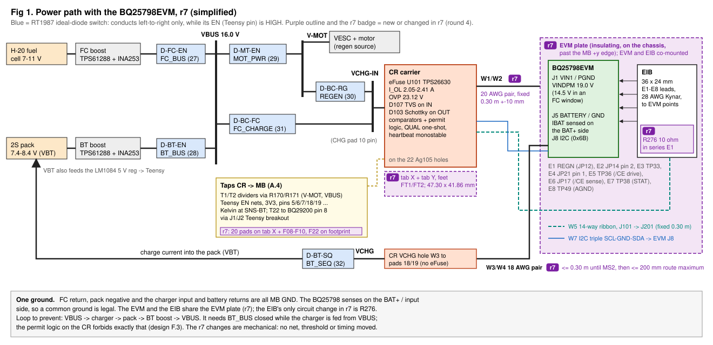

The electrical path is the round-3 path. The charger input is the VCHG-IN node, fed from VBUS through D-BC-FC and from V-MOT
through D-BC-RG. On the CR, the TPS26630 eFuse U101 (current limit 2.05-2.41 A, OVP 22.6-23.6 V) protects the charger input,
and the W1/W2 pair carries it to EVM J1. The charger output returns on W3/W4 through D-BT-SQ to the pack. The permit logic,
the QUAL one-shot and the heartbeat monostable sit on the CR. The EIB drives the two EVM stop pins through the E leads E1-E8.

The figure shows that r7 changes the mechanics around this path, not the path itself. The r7 items are the two tabs and their
feet, the fixed W1/W2 length, the W3/W4 route maximum after MS2, the EVM plate, R276 and the 20-pad tap field on tab X.

The round-3 walkthrough explains the electronics, and r7 leaves them unchanged:

- the permit logic H1q / H2c and the comparator thresholds: [round-3 Fig 2](../../round3/walkthrough/fig2_permit_logic.svg) and its section 3;
- the /CE and ILIM_HIZ drivers on the EIB: [round-3 Fig 3](../../round3/walkthrough/fig3_evm_drivers.svg);
- the operating modes, concurrency and purge windows: [round-3 Fig 4](../../round3/walkthrough/fig4_modes.svg) and its section 4;
- the failure ranking A1-D4: [round-3 walkthrough](../../round3/walkthrough/README.md) section 5.

## 4. Carrier mechanics

### 4.1 Outline and area booking

Figure 2 shows the MB region around the CR in plan. It shows the r7 outline over the dashed Ag105 footprint, the feet, the tap
field, the comparator band, the W-lead dressing path and its anchors.

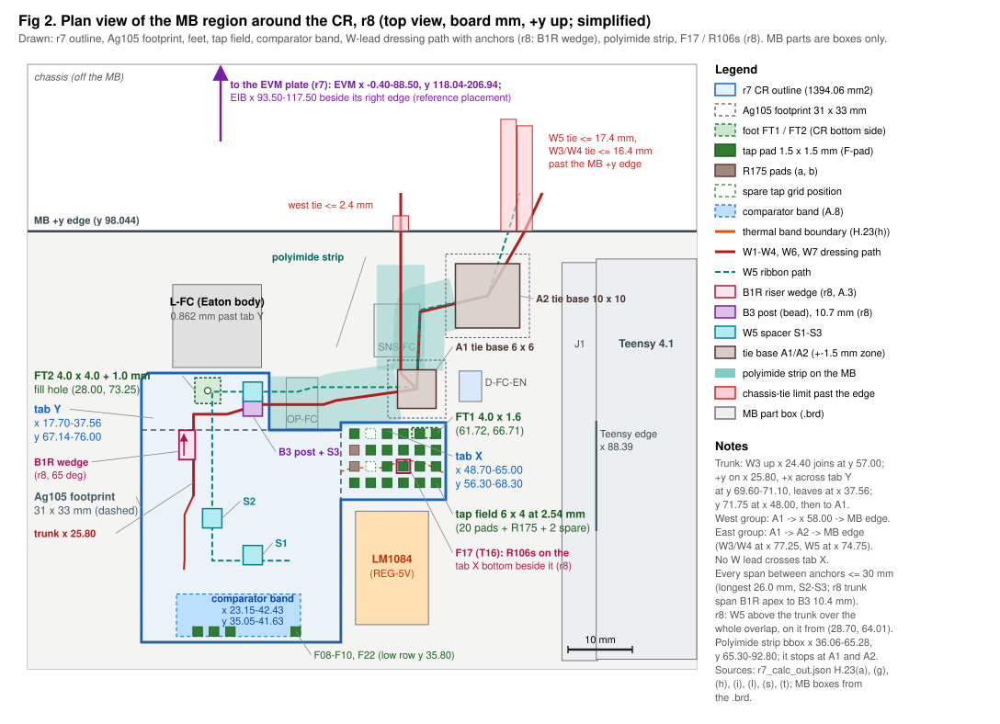

The r7 outline is the r6 rectangle (x 17.70-48.70, y 34.14-67.14) plus tab X and tab Y: 1394.06 mm² gross, bounding box
47.30 x 41.86 mm (H.23(a)). Tab Y was trimmed from the proposal's x 39.72 / y 76.51 to x 37.56 / y 76.00. The trim keeps
ROP1-FC 0.501 mm clear and puts the tab Y top edge 0.862 mm from the 12.9 mm Eaton L-FC body (H.23(b)). No MB part lies under
either tab. The 1.0 mm pin-11 chamfer moves to the tab Y corner (17.70, 76.00) and stays the only chamfered corner.

The figure also shows where the r7 content sits. The comparators U102-U104, U115 and U119-U121 move to the footprint low-y band
(x 23.15-42.43, y 35.05-41.63), the area freed by the r6 tap field. The band is 10.40 mm from the U101 commutation loop and
8.54-27.82 mm from the LM1084 box (H.23(f)). The six 0.1 % dividers sit in the divider strip directly above the band. Tab Y
top carries the LVC gates. Tab X carries the tap field and R175, and its part within 6.4 mm of the MB 5V copper rim is the
**thermal band** (boundary y 60.5-62.34, 84.9 mm²; H.23(h)). The thermal band holds only pads, wires, the RTV bead and
temperature-insensitive passives.

Plot P4 shows the top-side courtyard booking per region against the 75 % target of H.23(e2).

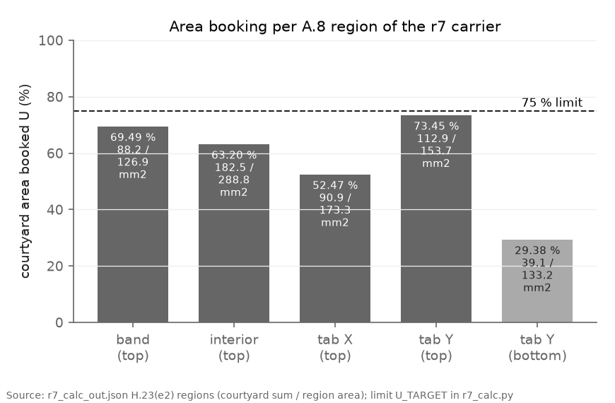

Every region passes. Tab Y top is the tightest region at 73.45 %, 1.5 points under the target; it passes only because U108 and
U109 moved to the footprint interior (with U108 kept on tab Y it books 78.00 %, H.23(e2)). The band books 69.5 %, the interior
63.2 %, tab X 52.5 % and the tab Y bottom 29.4 %. Over each whole side the use is 73.55 % top (795.1 mm²) and 69.04 % bottom
(392.9 of 569.1 mm²; H.23(e)). The farthest outline point lies 25.66 mm from the U101 loop, against the 36.5 mm that a 2-layer
build would need for the same coupling, so the 4-layer build stays (H.23(f)).

Two layers keep the CR underside off the MB copper. The 0.125 mm polyimide sheet stays, cut to the r7 outline + 1 mm and
trimmed to >= 0.5 mm from the CO-5V, J-NTC, L-FC, OP-FC and ROP1-FC bodies and pads (29 vertices, 1554.6 mm²; H.23(m)). The
bottom clearance rule keeps every CR bottom courtyard >= 1.0 mm in plan from every non-GND MB layer-1 feature and every MB part
box, measured on copper rims (H.23(d)).

### 4.2 Stack and feet

Figure 3 shows a side section along +y at x 36.00, through the controlling trunk point, the B3 post and the W5 run. FT2, its fill
hole and the 1x12 header body are projected onto the section plane. Plan and height share one scale; only the sheet, bed and
tape are drawn thicker than scale.

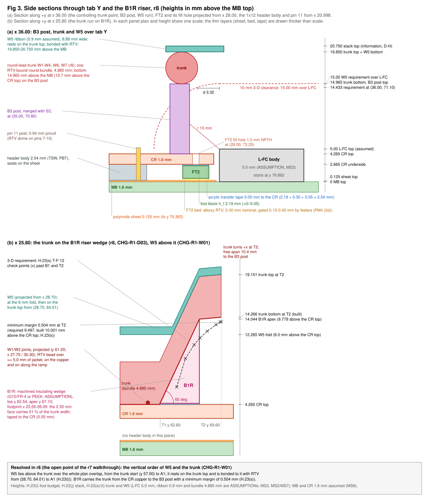

The header bodies (2.54 mm, PBT) seat on the 0.125 mm sheet, so the CR underside is at 2.665 mm and the CR top at 4.265 mm. The
post tips stand 0.940 mm proud of the CR top (H.23(j)). Each foot fills the same 2.54 mm gap: a 2.19 mm block (+0/-0.05 mm),
a 0.05 mm acrylic transfer tape to the CR, and a 0.30 mm alkoxy-cure RTV bed to the sheet. PM4 (2d) gates the dry bed gap at
0.15-0.45 mm with feelers before any MB joint is soldered (H.23(i)). FT1 is 4.0 x 1.6 mm at (61.72, 66.705); FT2 is 4.0 x 4.0
mm at (28.00, 73.250) with a 1.0 mm fill hole.

The figure carries one open point: the design states no vertical order of W5 and the trunk. With the calc half-widths (trunk
2.37 mm, ribbon 8.89 mm wide), the two runs overlap in plan on their +y runs (x 25.80 and x 28.70) from y 57.00, and on the whole
+x run across tab Y and off the CR to A1 (H.23(l) paths). Their centre lines cross at (28.70, 69.60). The heights conflict from
B1 (25.80, 64.50), where the trunk rises, to A1. Both heights are H.23(l) minimums, and B3/S3 is one merged spot. A stacked
height needs the vertical thickness of the bundle, which neither the design nor the calc states. Section 8 lists this as a check
item.

Plot P5 shows the bed stiffness and the T-A-09 pull load of the feet.

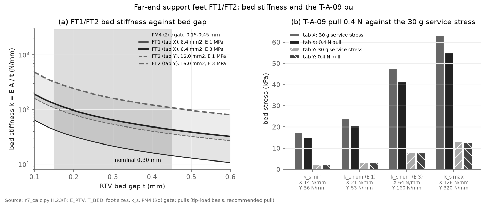

Panel (a) gives the bed stiffness k = EA/t for E_RTV 1-3 MPa, an assumed modulus (J.2 item 55). At the 0.30 mm nominal bed, FT1
gives 21-64 N/mm and FT2 53-160 N/mm. Across the gated 0.15-0.45 mm band and the calc range the figures are 14-128 N/mm (FT1)
and 36-320 N/mm (FT2; H.23(i)). Panel (b) compares the bed stress under the 0.4 N T-A-09 pull with the 30 g service stress at
the tab tip. The ratio is 0.87 for tab X and 0.97 for tab Y, so tab Y governs with a 0.413 N tip-load limit. On the
distributed-load basis the ratios are 1.93 and 1.92, so the 0.4 N pull lies inside the service range only on the tip-load basis
(design I, T-A-09).

The feet reduce the pin loads by a modest amount. At 30 g the worst-pin load falls by 7-21 %. Under a 10 N push at the tab X tip
the worst pin carries 2.69 N without the foot and 0.52-1.99 N with it. All pin-load and first-mode figures are ORDER OF
MAGNITUDE estimates (H.23(i)); MS5 and T-F-18 decide.

### 4.3 W-lead dressing and the 3-D switched-conductor rule

Every W lead leaves its CR joint and joins the **trunk**, which runs +y along x 25.80 (design A.3, r7 review 7 note). The trunk
crosses tab Y at y 69.60-71.10 and leaves the CR at the tab Y +x edge (x 37.56). Off the CR it reaches y 71.75 at x 48.00 and
then the MB tie base A1 at (60.50, 73.50) (H.23(l) path).
From A1 the west group (W1, W2, W6, W7) runs up x 58.00 to the MB +y edge. The east group (W3, W4, W5) runs via the tie base A2
at (71.50, 88.00). No W lead crosses tab X. The dressing rule keeps every lead >= 2 mm in plan from the pin-10 joint, the IN
strip, the U101 courtyard, the +x pocket, every post tip and every tap pad. W5 is the exception. Over the J101 region its ribbon
edge lies 0.775 mm in plan from C102b, and its route passes 1.79 mm from the tap-field courtyard (design A.3; H.23(l)).

The anchor rule limits each unsupported span to 30 mm along the lead. The anchors are the RTV spacer posts B1 (25.80, 64.50) and
B3 (35.00, 70.80), the W5 spacer beads S1 (35.00, 47.69), S2 (28.70, 53.42) and S3 (35.00, 73.10), and the MB tie bases A1 and
A2. The longest span is 26.0 mm (S2-S3). The chassis tie past the MB +y edge closes the last span: <= 2.4 mm for the west
group, <= 16.4 mm for W3/W4 and <= 17.4 mm for W5 (H.23(l)). A polyimide strip on the MB (x 36.06-65.28, y 65.30-92.80) covers
the crossed MB parts and 11 untented non-GND vias.

No exit from the CR meets the 10 mm switched-conductor clearance in plan: the best raster path gives 5.12 mm for the bundle and
9.34 mm for one lead (J.2 item 62). The rule is therefore applied as a 3-D distance (decision of 2026-11-10, with D-H). Where
the plan distance d to a switched conductor of top height H is < 10 mm, the jacket bottom must be >= H + sqrt(10² - d²). The
L-FC body controls every lead, with H = 5.0 mm as an ASSUMPTION from the size code (TODO(verify: Eaton HCM1A1305V3 drawing),
MS3).

Plot P2 shows the resulting jacket-bottom requirement along the shared run of the round leads, from B1 (25.80, 64.50) to
(50.45, 72.09).

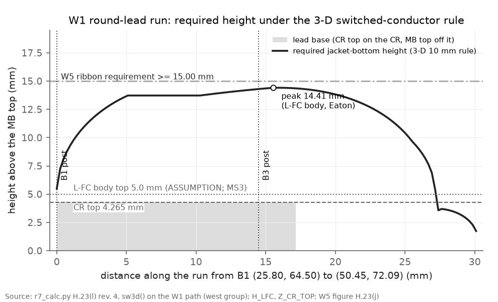

The requirement rises from 5.48 mm at B1 to 14.41 mm at the controlling point (36.00, 71.10), 3.39 mm in plan from L-FC. It
falls to 1.74 mm at the run end. One profile covers W1, W2, W3, W4, W6 and W7, because they share the path. On the CR the trunk
jacket bottom is held >= 14.41 mm (10.14 mm above the CR top) by B1 and B3, and off the CR it must stay >= 14.35 mm. The W5
ribbon bottom must be >= 15.00 mm over tab Y, 10.735 mm above the CR top (H.23(l)). The requirement reaches 7.56 mm above the
CR top only 2.7 mm past B1, which is why B1 and B3 are posts and not low beads.

A straight lead from B3 down to A1 would stand at about 10.8 mm at x 41.5, against 13.45 mm required (design A.3). An
insulating support therefore holds the runs between x 37.75 and x 46.7. Its position and form are TODO(design: T-A-06 dry fit);
it is not drawn in Fig 2 or Fig 3.

### 4.4 W1/W2 at a fixed length

Plot P1 shows the worst-case U101 IN peak at a hard short at EVM J1 against the W1/W2 lead length. The model is the H.19(b)
`in_spike()` corner sweep (V0 16/22 V, C_S 5/20 µF, L_IN 50/150 nH, C_IN 3.4 µF).

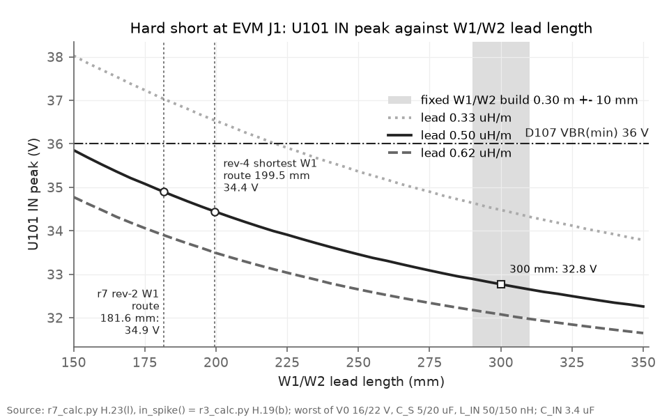

The lead inductance limits the short-circuit current rise, so a shorter W1/W2 raises the IN peak. At the 0.5 µH/m calc basis
(H.5), the 0.30 m +- 10 mm build gives 32.65-32.90 V. A W1 cut to its 199.5 mm route gives 34.4 V, and a cut to the r7 rev-2
route of 181.6 mm gives 34.9 V, 1.1 V below the D107 VBR(min) of 36 V (H.23(l)). W1 and W2 therefore keep a fixed build length
of 0.30 m +- 10 mm at every placement (D-F3); the slack of about 100 mm is a service loop anchored on the EVM plate.

The 0.33 and 0.62 µH/m curves are sensitivity bounds, not design values. They come from the audit finding CHG-R1-D04, whose
verifier gives 0.33-0.62 µH/m for 20 AWG pairs. At 0.33 µH/m the curve crosses 36 V at about 221 mm, but the 0.30 m build band
stays at 34.3-34.6 V. At 0.62 µH/m the band gives 31.98-32.18 V. These sensitivity values, and the 32.65 V at 310 mm above, are
recomputed by `make_figs_r7.py` with the unchanged `in_spike()`; the calc tabulates only the 0.5 µH/m rows. The 0.5 µH/m basis is unsourced in the design; r8 specifies the
wire geometry and sweeps the inductance (section 7.2).

The other leads take their route-rule maxima after MS2 (1.25 x the routed length, rounded up to 10 mm): W3 200, W4 200, W6 140,
W7 SCL 160 and W7 SDA 160 mm at the reference placement (H.23(l)). Until MS2, they keep the 0.30 m cap. W5 is the fixed 304.8
mm factory cable with a 222.7 mm minimum fit.

### 4.5 Taps

Tab X carries 20 SMT tap pads of 1.5 x 1.5 mm (F01-F07, F11-F21, F23, F24) on a 6 x 4 grid at 2.54 mm pitch, with R175 and two
spare positions. Four residual pads stay on the footprint low row y 35.80: F08 (T22), F09 (T8), F10 (T9) and F22 (T18) (design
A.4, H.23(g)). Plot P3 compares the r6 tap lengths (straight basis) with the r7 dressed lengths for the 20-tap set of the calc.

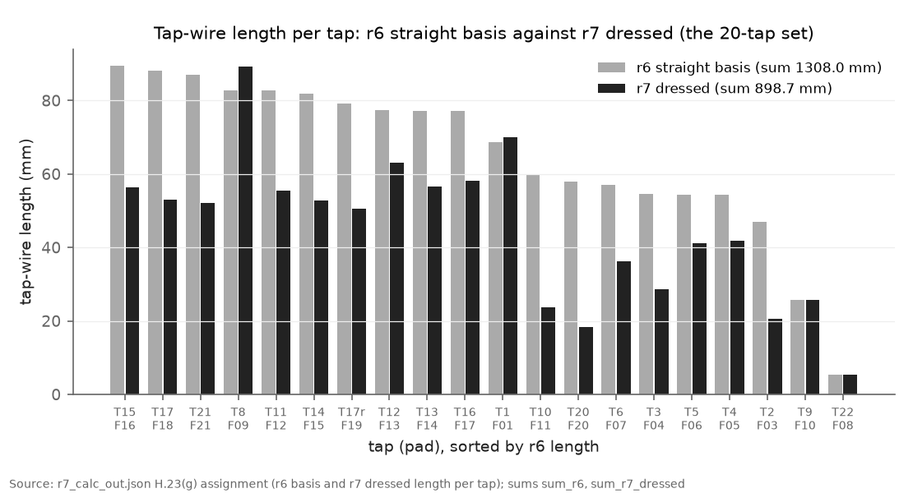

The sum falls from 1308.0 mm (r6) to 859.3 mm straight and 898.7 mm dressed (-31.3 %). Against the r6 straight basis, only T1
and T8 grow in dressed length: T1 from 68.6 to 70.1 mm and T8 from 82.8 to 89.2 mm. On the straight basis T1 falls to 63.4 mm
and T8 is unchanged at 82.8 mm (H.23(g)). T8 takes an upper
lane at y 37.55 over the residual row and then y 34.64 to x 63.50, which makes it the longest r7 tap at 89.2 mm; a low-edge lane
is infeasible by 0.59 mm. Each tab X wire runs from its pad into the adjacent inter-row gap and toward +x to x 64.77; no wire
crosses the REG-5V box (design PM6).

The assignment minimises the straight-length sum under six adjacency exclusions, and none is violated (H.23(g)). Three pairs
remain without an in-service detector (J.2 item 63):

- F05-F12 holds the REGEN EN net at 1.647 V, above the VEN_R maximum of 1.4 V, with 41.2 mA of contention;
- F07-F12 drives 82.5 mA into the pin-17 driver;
- F08-F09 can mask the BQ29200 pack-OV term (OVN).

A candidate with no violation of the extended exclusion set costs +1.2 mm on the sum; the F12/F24 swap also satisfies it.
Until the operator rules, the T-F-12 tap-to-tap check before power-up is the only detector of the three. The audit added a
fourth adjacency hazard, F05-F17 and F06-F17 (CHG-R1-01, section 7.2).

### 4.6 EVM plate, EIB and E1 damping

The EVM rests on its stock bumpons on an insulating EVM plate past the MB +y edge, held by edge clamps with silicone pads
(design A.7, C EM23). The EVM has no mounting holes; its corner circles are fiducials. The EIB stands on its two M3 nylon
standoffs on the same plate. At the reference placement the EVM spans x -0.40-88.50, 4.97 mm from the Teensy USB corridor, and
the EIB spans x 93.50-117.50 (H.23(l)). Corridor fallback (i) shifts both by -27.03 mm and needs 45.3 mm of chassis room past
the MB -x edge. MS2 decides between them; the plate, clamp and stop geometry is TODO(design: from MS2, MS5 and MS7) (J.2 item
54).

The E-lead maxima re-run on the vector EVM positions: E8 20, E3 25, E4 30, E2 35, E7 40, E1 90, E5 65 and E6 60 mm. E1 takes a
bent route below U1 and L2 of 70.8 mm against its 90 mm maximum (H.23(k)). With its E8 return and the 100 nF C205, the E1 lead
forms a series LC near the 1.5 MHz BQ25798 switching frequency.

Plot P6 shows the series-loop impedance for E1 at 85 mm and 90 mm, with and without R276.

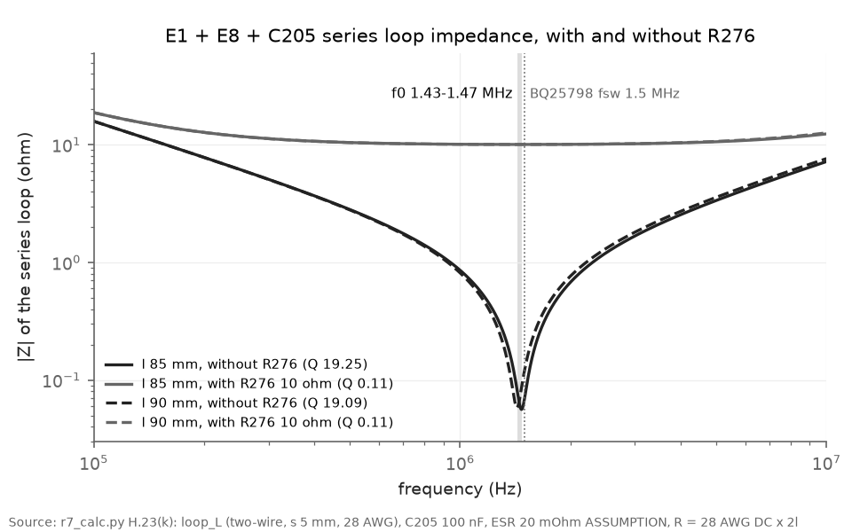

Without R276 the loop resonates at 1.471 MHz (85 mm) and 1.430 MHz (90 mm), with Q 19.3 and 19.1. These Q values use the DC
resistance of 28 AWG and are upper bounds; with skin effect Q is about 13.0-13.1 (H.23(k)). With R276 (10.0 Ω, 1 %, 0603) Q is
0.108-0.111, so the loop is overdamped. The cost is a static drop of 1.02 mV held and 3.96 mV worst. The release level falls by
1.786 mV, which lowers IINDPM by 2.23 mA, the safe direction for the converter and the eFuse. T-C-16 measures the ring with
and without R276.

## 5. Build order and measurement gates

### 5.1 Build order

Figure 4 shows the build order from D.1 (PM0-PM6) and the gates of section I. Purple chips mark the operator measurements
MS1-MS8. A solid arrow points to the step that a measurement gates; a dashed arrow points to a later step that uses its result.

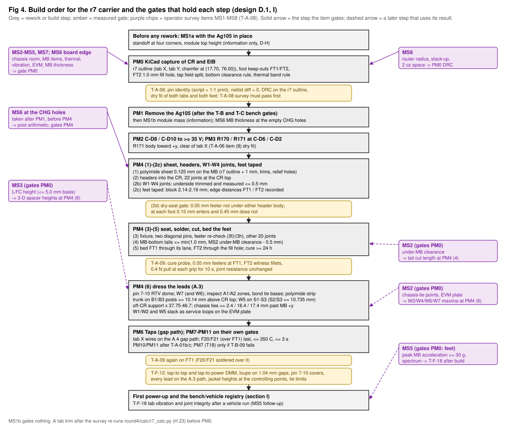

The order rests on one constraint: the W1-W4 tails on the CR underside can be trimmed only before the CR is seated (PM4 (2b)).
The steps are:

1. PM0: capture the CR on the r7 outline in KiCad; gate T-A-06 (pin identity, DRC with the bottom clearance rule, tab dry fit).
2. PM1: remove the Ag105 after MS1a; then PM2 (C-D8/C-D10 swap) and PM3 (R170/R171).
3. PM4 (1)-(2c): bond the sheet, solder the headers into the CR, fit and trim W1-W4, tape the feet.
4. PM4 (2d): dry-seat the CR and gate the bed gap at 0.15-0.45 mm with feelers.
5. PM4 (3)-(5): solder the 22 MB joints with both tabs supported, cut the tails, bed and cure the feet; gate T-A-09.
6. PM4 (6): dress the W leads on the dressing path at the 3-D heights and within the tie limits.
7. PM6: fit the taps; solder F20/F21 last because they lie over FT1, then repeat T-A-09 on FT1.
   PM7-PM11 follow on their own gates: PM10 and PM11 (which land T20 and T22) come after T-A-01b/c, and PM7 (T18) is done only
   if T-B-09 fails.
8. T-F-12 (tap isolation, lead heights), then first power-up and T-F-18.

A tab trim at any gate re-runs `r7_calc.py` (design I, T-A-08).

### 5.2 Operator measurements MS1-MS8

The r7 outline is not frozen before the survey T-A-08 passes (design 0.2). The table lists what each measurement decides and
what it gates (design I, T-A-08, and J.2 items 46-53).

| ID | Measurement | Decides | Gate |
|---|---|---|---|
| MS1a | Ag105 standoff at four corners; module top height | Seating reference (information since D-H) | None; taken before PM1 |
| MS1b | Module mass after removal | Information | None |
| MS2 | Chassis room past the MB +y and -x edges; under-MB clearance; USB plug and bend; W3/W4 channel width; chassis-tie positions | EVM plate position (reference or fallback (i)); W-lead route maxima; tail-cut target. Pass: under-MB clearance >= 1.5 mm, ties within 2.4 / 16.4 / 17.4 mm | PM0 |
| MS3 | Unrecorded MB items inside each tab + 0.5 mm, under each foot spot and along the W-lead path; L-FC body by caliper | Tab outlines; the 3-D spacer heights. Pass: L-FC >= 0.5 mm from the tab Y top edge and <= 5.0 mm tall | PM0 |
| MS4 | LM1084 thermal survey at 1, 5 and 10 mm from the 5V rim, with MS4a (CO-5V / T18 joint) and MS4b (band +x end) | Thermal-band split; R175 and F101/R172 derating; comparators at x > 39.53 (MS4b rise <= 14.9 C) | PM0 |
| MS5 | MB acceleration near the CHG footprint, 0.1-8 kHz | Whether the feet suffice. Pass: peak <= 30 g, the H.23(i) basis | PM0 |
| MS6 | MB thickness at the board edge and at the CHG holes; CR finished thickness; laminate modulus | Post arithmetic and first-mode estimates | Board edge: PM0; CHG holes: PM4 |
| MS7 | EVM as received: thickness, outline, mass, tail protrusion, connector and test-point heights | Clamp design and plate clearances | PM0 |
| MS8 | Fab stack-up, L4 tenting, inside-corner router radius, 2 oz minimum space | PM0 DFM check and DRC rules; the three concave tab-root corners | PM0 |

## 6. Cost

The bill of materials total rises to about USD 520-630 (design E). Revision r7 adds the CR on the larger outline, R276, the EVM
plate with its clamps, the two feet with transfer tape and bed RTV, and the W-lead anchors, spacers and strip. The four EVM M3
standoffs are deleted. Every EVM and MB modification of r6 stays.

## 7. Review history

### 7.1 Convergence

Plot P7 shows the verified findings per review round, stacked by severity where the record gives it.

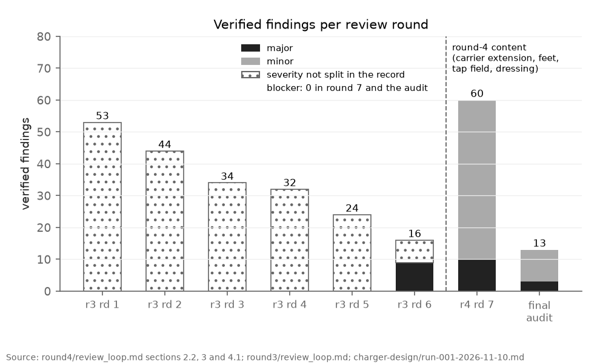

Rounds 1-6 (round 3, revisions r1-r6) produced 53, 44, 34, 32, 24 and 16 verified findings. Review round 7 rose to 60 (10
major, 50 minor), because round 4 added a large body of new mechanical and layout content: the carrier extension, the feet, the
tap field and the W-lead dressing. The final audit fell to 13 (3 major, 10 minor). Neither round 7 nor the audit found a blocker
([`../review_loop.md`](../review_loop.md) 4.1).

The design has not converged in the strict sense of a round with no major finding. However, every remaining item has an agreed,
local fix. Two of the three audit majors (CHG-R1-01, CHG-R1-D01) sit in round-3 content that rounds 1-6 did not catch, and
CHG-R1-D03 sits in content that the round-7 closing pass added.

### 7.2 Audit findings for r8

The final audit (run 001) used Codex as the reviewer, finding-verifier agents without the reviewer's severity, an independent
reviewer and a Codex counter-review. No severity remained in dispute after the counter-review. The table lists the 13 accepted
findings from the [ledger](../../../charger-design/ledger.md) and the
[run record](../../../charger-design/run-001-2026-11-10.md).

| ID | Severity | Finding | Agreed fix |
|---|---|---|---|
| CHG-R1-01 | major | A F05-F17 or F06-F17 pad bridge drives U101 FLT against a Teensy output; EN is guaranteed off only at >= 67.5 mA through FLT (10 mA abs max) | R106s 1.00 kOhm between U101 FLT and F17, bounded with tolerances; rewrite the A.8 rows; a bounded FLT-LOW diagnostic read in FR-23 |
| CHG-R1-02 | major | T3 with the FR-46 readbacks needs about 2.30 ms on the 100 kHz fallback, against the 1.5 ms FR-07 deadline | Write first, read back after, in G.1 and FR-46 (a mismatch takes the P5-LOW path); reconcile with the transaction cap; recompute H.16 |
| CHG-R1-D01 | major | The FR-43 flash/SD predicate needs FC_BUS LOW, which normal Idle never has, and contradicts itself on State 99 | Battery-supported Idle admission; separate flash and SD gates with explicit State-99 handling |
| CHG-R1-D04 | minor | The W1/W2 0.5 µH/m is unsourced; thin-wall PTFE at 290 mm gives 34.68 V / 140.95 A | Specify conductor, insulation OD and twist; sweep L' in `r7_calc.py`; update H.5, H.23(l), L.7 |
| CHG-R1-03 | minor | The FR-48 Idle probe conflicts with the FR-23 I2C gate (V_chg < 3 V against > 10.2 V) | An explicit FR-23 exception for the probe; exercise T-D-15 through the real gate; state whether ADC_EN is cleared |
| CHG-R1-04 | minor | T1 step 8b leaves P5 LOW and states 70 ms against a >= 200 ms one-shot | Split step 8b; check P5 / CE_DRV HIGH at the end of T1; extend T-F-03 and T9 |
| CHG-R1-D03 | minor | The B1 post at >= 10.14 mm conflicts with the >= 5 mm jacket bead; the profile rises 1.215 -> 7.555 mm within 2.67 mm | Redesign the local riser and strain relief with intermediate support; verify the full profile in T-F-12 |
| CHG-R1-05 | minor | The foot-bond fallback grows the bed by the removed sheet stack; stiffness falls to 0.78 x the gated minimum | A re-made foot at h_f + the measured removed stack (2.315 mm at 0.125 mm); repeat the PM4 (2d) gate; describe repair access |
| CHG-R1-D02 | minor | FR-12(b) "V_chg < 3 V within 2 s" against a 1.65-2.52 s decay below UVLO | Separate the stuck-path test from full discharge; 12 V after 0.5 s as a proposed criterion, to verify |
| CHG-R1-08 | minor | T-B-16: 0.6 s bursts at 1 Hz is 60 % duty, not 30 % | 0.6 s on / 1.4 s off with the inter-burst current stated; synchronise T-F-16 |
| CHG-R1-06 | minor | Superseded markers leave old instructions live (A.3 line 501, line 1536, PM4) | One live instruction per location; obsolete text in historical blocks |
| CHG-R1-07 | minor | Hand calculations lie outside the calc outputs (all reproduce) | Add the rows to `r7_calc.py` and its outputs |
| CHG-R1-A02 | minor | No TPS26630 (SLVSE94G) datasheet in `references/Datasheets` | Add the datasheet to `references/Datasheets` |

None of the three majors is a hardware-destruction path on the design as written. CHG-R1-01 and CHG-R1-02 fail toward a missed
or late inhibit that the ISR path covers, and CHG-R1-D01 refuses flash and SD operations ([`../review_loop.md`](../review_loop.md)
4). CHG-R1-06 matters most to a reader of the design. The superseded marker is used in both directions, so no uniform rule
identifies the live text (run 001, A-06). Until r8 applies the fix, the reader must check each marker at A.3 line 501, line
1536 and PM4 (line ~1850). Where a marker is ambiguous, this walkthrough follows the H.23 outputs.

## 8. How to review this design

The following decisions and checks are open. They are ordered so that the decisions which change the layout come first.

1. **Approve the r8 audit fixes.** Read the three majors in section 7.2 and their rows in the
   [run record](../../../charger-design/run-001-2026-11-10.md) (Adjudication). CHG-R1-01 adds a part (R106s) to the CR.
2. **Rule on the tab X tap assignment (J.2 item 63).** Choose between the adopted assignment, the extended-exclusion candidate
   (+1.2 mm) and the F12/F24 swap, and decide the measure for the F08-F09 pair (TODO(design)). Look at section 4.5, design A.8
   (short table) and H.23(g). A change re-runs H.23(g) and replaces the A.8 map, the PM6 dressing and the T-F-12 pair list.
3. **Rule on the C102b exception (J.2 item 62).** W5 lies 0.775 mm in plan from C102b over the J101 region, at >= 8 mm above
   the CR top, that is >= 5.5 mm above the about 2.5 mm C102b body. The W5 route also passes 1.79 mm from the tap-field courtyard
   (H.23(l)). Look at design A.3 (W5 exceptions). The 10 mm
   switched-conductor figure itself still has no stated pickup basis.
4. **Design the off-CR lead support between x 37.75 and x 46.7** (TODO(design: T-A-06 dry fit)). The options in design A.3 are a
   support on the MB clear of the OP-FC box (x 40.22-45.12, y 67.30-75.28) or a rigid insulating bridge from the tab Y +x edge to
   past x 46.7. Plot P2 gives the heights it must hold. At the same time, state which run lies above the other from B1 to A1, where
   W5 and the trunk overlap in plan, and the bundle thickness that sets the upper run's height (Fig 3, section 4.2); r8 also
   redesigns the B1 riser (CHG-R1-D03).
5. **Measure the L-FC body height (MS3).** The 5.0 mm value is an ASSUMPTION that sets every 3-D spacer height. A taller body
   re-runs H.23(l) and resets the A.3 spacer heights (design I, T-A-08; J.2 item 56).
6. **Check the TPS26630 datasheet (CHG-R1-A02).** The file `references/Datasheets/tps2663.pdf` is in the working tree but is not
   committed and not cited in design K. Confirm the 10 mA FLT sink rating (SLVSE94G §6.1) that CHG-R1-01 rests on, and the current
   limit and OVP values of design B.4.
7. **Confirm the remaining operator options.** These are the FT1 relaxed 4 x 4 mm option (J.2 item 58, not recommended by the
   calc), the EVM placement after MS2 (J.2 item 57), and the T-F-18 transmissibility criterion (<= 3, proposed).

## 9. Where to find the detail

### 9.1 Full drawings

| Drawing | Content |
|---|---|
| [`../carrier_layout_r7.svg`](../carrier_layout_r7.svg) | Top view of the CR on the r7 outline over the MB, with the EVM reference placement as a second panel |
| [`../wiring_bq25798.svg`](../wiring_bq25798.svg) | Wiring diagram: MB, CR, EIB, EVM, every lead and tap (supersedes the round-3 drawing for r7) |
| [`../carrier_schematic.svg`](../carrier_schematic.svg) | CR and EIB schematic with R276 (supersedes the round-3 drawing for r7) |
| [`../work/svg_png/`](../work/svg_png/) | PNG renders of the three drawings |

### 9.2 Design sections

| Topic | Design section |
|---|---|
| Rulings, verdict, change tables r1-r7 and review round 7 | [0.1-0.4](../../../../charger_bq25798_wiring_design_2026-11-05.md) |
| Leads, dressing path, anchors, 3-D rule | A.3 |
| Taps and tap field | A.4, A.8 |
| E leads and EIB wiring | A.5, A.9, B.6 |
| Outline, feet, sheet, bottom clearance rule, EVM plate | A.7 |
| Carrier layout regions and booking | A.8 |
| Permit logic, comparators, eFuse | B.1-B.4 (unchanged in r7) |
| EVM and MB modifications, build procedure PM0-PM11 | C, D.1 |
| Bill of materials | E |
| Modes, purge scheduler, transitions | F (unchanged in r7) |
| Registers and firmware requirements | G |
| Round-4 calculation | H.23, [`../calc/r7_calc.py`](../calc/r7_calc.py), [`../calc/r7_calc_out.txt`](../calc/r7_calc_out.txt) |
| Test registry, including T-A-08, T-A-09, T-C-16, T-F-18 | I |
| Open items 46-63 | J.2 |
| Review dispositions of round 7 | L.7, [`../review_loop.md`](../review_loop.md), [`../work/r7_review7_dispositions.md`](../work/r7_review7_dispositions.md) |
| Round-4 decisions D1-D11 | [`../work/r7_design_basis.md`](../work/r7_design_basis.md) |

### 9.3 Figure sources

The plots P1-P7 are generated by [`make_figs_r7.py`](make_figs_r7.py), which reads `r7_calc_out.json` and calls the functions
of `r7_calc.py` without rewriting any calc output. The diagrams Fig 1-Fig 4 are generated by
[`make_diagrams_r7.py`](make_diagrams_r7.py) from `r7_calc_out.json` and `mb_neighbours_out.json`. The P7 counts come from the
review records, because no calculation holds them. Each plot is also available as an SVG beside its PNG.
