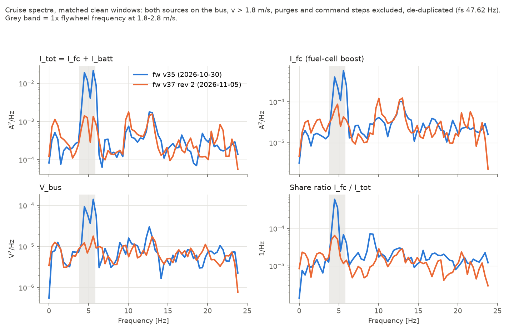
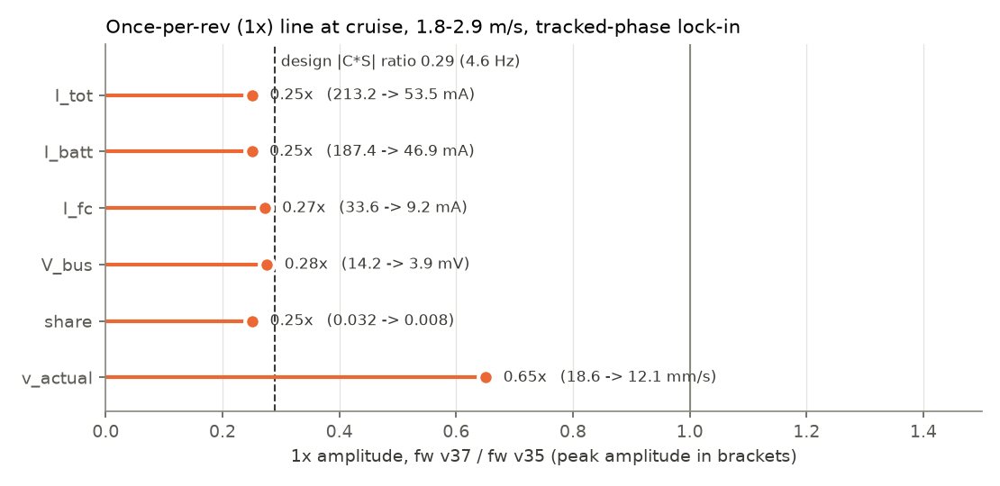
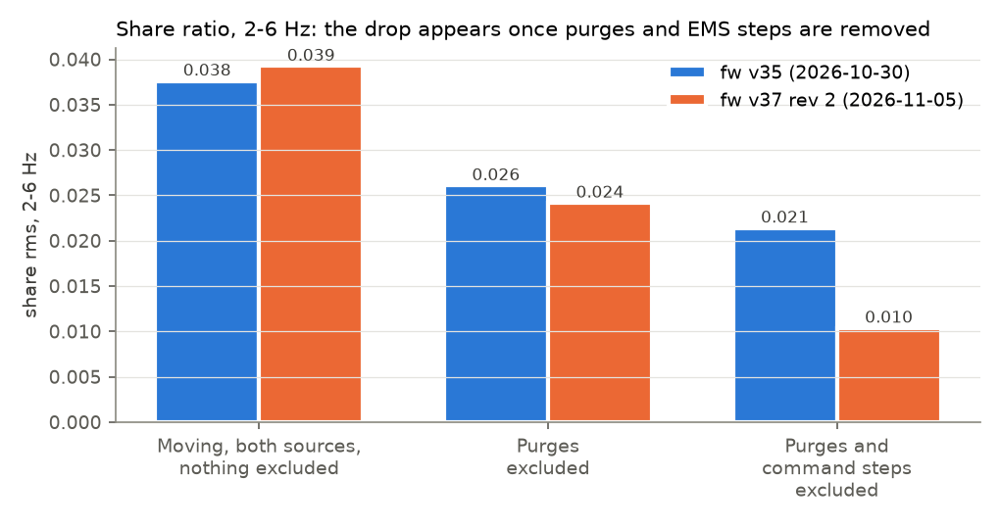
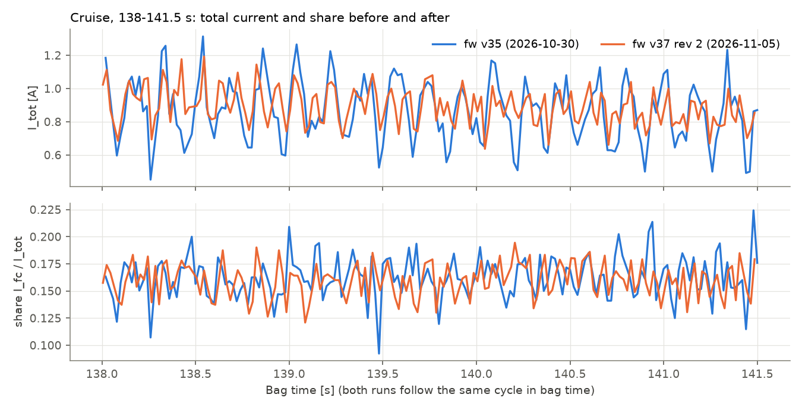

# Drive-law noise reduction, fw v35 vs fw v37: short write-up (2026-11-05)

This note summarizes the before/after noise comparison of the lower-crossover drive law. The full
analysis is in [`README.md`](README.md). The plots in this note were generated from the bags with
one script, so all numbers below share one set of masks.

## 1. Data and method

The comparison uses two runs of the same SDP drive cycle:
- **Before:** `rosbag_sdp_2026-10-30_01-49-38`, fw v35, drive-loop crossover 2.76 Hz.
- **After:** `rosbag_sdp_2026-11-05_20-09-52`, fw v37 rev 2, drive-loop crossover 1.04 Hz
  (6.55 rad/s).

The share path and every other Run-path function are identical in the two builds. The runs follow
the same `v_setpoint` trace (0.35 mm/s rms difference) and the same 44-step share-command
staircase.

All statistics use clean windows: both sources on the bus (`switch_state` 0x27), I_tot > 0.3 A,
±0.5 s excluded around each H-20 purge, and −0.2/+1.0 s excluded around each share-command step.
One repeated row in every 21 is removed, and the sample rate is 47.62 Hz. The share is
s = I_fc / (I_fc + I_batt).

## 2. Results

### 2.1 Spectra

Figure 1 shows the cruise spectra (v > 1.8 m/s) of total current, FC current, bus voltage and
share ratio.

**Figure 1.** Cruise PSDs, fw v35 (blue) and fw v37 (orange). The grey band is the 1x flywheel
frequency at 1.8–2.8 m/s (3.8–5.8 Hz). Window: all clean cruise samples (815 before, 1015 after)
of the 167–188 s runs.

The 1x peak falls by about one decade in power on every channel, including the share ratio.
Above about 7 Hz the two runs overlap. Table 1 gives the band rms values.

**Table 1.** Band rms, cruise clean windows, fw v35 → fw v37.

| Channel | 2–6 Hz | 6–12 Hz | 12–23.8 Hz |
|---|---|---|---|
| I_tot (A) | 0.155 → 0.048 | 0.040 → 0.049 | 0.064 → 0.062 |
| I_fc (A) | 0.024 → 0.012 | 0.012 → 0.013 | 0.018 → 0.018 |
| V_bus (mV) | 12.2 → 5.7 | 6.7 → 6.2 | 9.1 → 8.7 |
| Share | 0.021 → 0.010 | 0.012 → 0.008 | 0.014 → 0.012 |

The drive law moved the noise only in the 1x band. The 6–24 Hz content did not change. The small
rise of I_tot at 6–12 Hz comes from speed-locked lines near 10 Hz, which are not rotation orders
(README, Section 5.5).

### 2.2 The 1x line

Figure 2 gives the 1x amplitude ratio for each channel from a tracked-phase lock-in at
1.8–2.9 m/s.

**Figure 2.** 1x amplitude, fw v37 / fw v35, with the peak amplitudes in brackets. The dashed line
is the design rotation-band ratio |C·S| new/old at 4.6 Hz. Window: 1160 (before) and 1264 (after)
clean samples at 1.8–2.9 m/s.

The currents, bus voltage and share fall to 0.25–0.28x. The design predicts 0.29x. The bus-side
gain |I_tot 1x / v_actual 1x| fell by 0.33x, against the design |C_new / C_old| of 0.34, so the
board runs the new law as designed. The extra reduction comes from v_actual 1x, which fell to
0.65x, against the 0.84–0.86x that the change in |S| predicts. The once-per-rev disturbance
itself therefore appears smaller in the fw v37 run. The bags cannot say why.

The share 1x falls by the same factor as the total current (0.25x). The share loop did not
prevent the reduction from reaching the share.

### 2.3 Why the share appeared not to improve

Figure 3 shows the share 2–6 Hz rms under successive masks.

**Figure 3.** Share-ratio rms, 2–6 Hz, all moving samples with both sources on the bus.

With nothing excluded, the share band is 0.038 before and 0.039 after. With the purges excluded,
it is 0.026 and 0.024. With the command steps also excluded, it is 0.021 and 0.010, a 0.49x
fall. The H-20 purges and the SDP command staircase dominate the unmasked share variance, and the
drive law changes neither. The purge term is about 67 % of the unmasked 2–6 Hz variance in
fw v37.

### 2.4 Time trace

Figure 4 shows 3.5 s of cruise at 2.7 m/s with `power_share_cmd` 0.16, at the same point of the
cycle in both runs.

**Figure 4.** Total current and share ratio, bag time 138.0–141.5 s. No purge or command step
falls in this window.

The total-current swing is visibly smaller after the change. Its 1x component falls from 0.21 A
to 0.054 A peak (Figure 2), and the remaining swing is mostly the content above 7 Hz. In
this window the share is above the governor floor knee, so its 1x content is small in both runs.
The visible share noise is mostly the flat 6–24 Hz content, which fw v37 did not change.

### 2.5 V_bus and the droop

The bus voltage follows V_bus ≈ V0 − Z·I_tot, where Z is the bus impedance that the two droops set
in parallel. At the 1x line, V_bus/I_tot is 67 mΩ before and 73 mΩ after, so the V_bus 1x
reduction is the I_tot 1x reduction passed through an unchanged droop. This impedance is about
0.2 of the design droop (0.30–0.36 Ω). With the battery alone it is 159 mΩ.

The remaining V_bus noise in fw v37 does not come through the droop. I_tot explains 21 % of the
V_bus variance at 2–6 Hz and 5–7 % above 6 Hz (67 % and 9–12 % in fw v35). The origin of the
remainder is open (README, Section 2.4).

## 3. Conclusions

- The lower drive-loop crossover reduced the 1x line to 0.25–0.28x on I_tot, I_batt, I_fc,
  V_bus and the share ratio. This matches the design ratio of 0.29.
- V_bus at 1x is the droop image of I_tot through about 70 mΩ. Most of the remaining V_bus noise
  is not droop-driven.
- The share ratio did improve. Its 1x reduction is hidden in unmasked data by the H-20 purges and
  the SDP command staircase.
- Content above about 7 Hz did not change. Its largest share component, a flat floor of about
  0.012 rms, is the next item to explain. A 1 kHz BLG run with synchronous current reads decides
  whether it is a sampling artefact (README, Section 7).
- The tracking cost is visible: the speed-error rms below 0.7 Hz rose from 5.0 to 9.8 mm/s
  (README, Section 2.5).

The figures come from `make_brief_figs.py` in this folder. To regenerate them, run
`python make_brief_figs.py <cache> figs 138 141.5`, where `<cache>` holds the `.npz` files that
`tools/rosbag_analysis/scout_bags.py --npz` writes. The full review explains how
the remaining share noise divides between the governor floor, purge windup and the 6–24 Hz floor.
