# Morning review 2026-11-14/15: CR and EIB review, simulations, board update and second review

This document summarizes the overnight round of 2026-11-14/15 on the charge-regulator board (CR) and the EVM
interface board (EIB). The round had five steps:

1. a read-only holistic review (`REVIEW_2026-11-14.md`, 88 findings and VR-1 to VR-4);
2. five circuit simulations (`sim/`);
3. an in-place update of both boards, the BOM set and the documents (phases A and B);
4. a second read-only holistic review (findings R2-*);
5. a fix round on the second review (phase C), followed by two independent checks.

Nothing is committed and nothing is ordered. No operator decision was taken in the round; section 3 lists the open
decisions. On 2026-11-15 the operator ruled on J.2 item 74 (section 3.1): the charger dropout on hard brakes is
accepted, and the Mouser file is unchanged. On 2026-11-16 the operator ruled on three layout items of section 3.4. J.2
item 83 is closed by a D-36 exemption for /CHG_ARM with a build check (D-94). The EIB reference rule set and the CR W6
"GND" label are accepted as they are (D-95). Neither ruling changes copper or a package. The W5 grid item is closed
by a third ruling: the copper stays, and the staged T-A-06 metering is the mitigation (D-80 ruling; design r9-29).
(**Superseded 2026-11-16, D-80 ruling:** "The W5 grid item stays open; D-80 carries a 2026-11-16 addendum with the
findings of a deep-dive (design r9-28).")

Sections 3 and 4 carry 20 figures of the simulation results. Twelve of them (Figures 1, 2, 4, 6-9, 11, 12 and 16-18) come from `sim/review_figures/`, whose scripts read the existing simulation CSVs; no simulation was re-run for them. The other eight are plots of the simulation reports, among them Figure 2A from sim 6 (`sim/regen_nocut/`), which was added for the item 74 ruling.

## 1. Files to order from

The current manufacturing and ordering files are:

- CR (quantity 6): `fab/cr_2026-11-14/` (`cr_gerbers_drill.zip`, `drill/`, `gerbers/`, `assembly/`, `kikit_oshpark/`).
- EIB (quantity 3): `fab/eib_2026-11-14/` (`eib_gerbers_drill.zip` and the same subfolders).
- BOM set: `bom_2026-11-14/`.
  - `digikey_import.csv` holds 62 main lines, USD 91.49.
  - `digikey_optional.csv` holds 9 opt-in lines (about USD 25.80): four alternate or bench lines and five SPARE lines.
  - `mouser_import.csv` holds 4 lines. The J.2 item 74 ruling of 2026-11-15 (section 3.1) keeps R101, R103 and R104, so this file is unchanged. The spare-U101 question of J.2 item 84 can still add a line.

Each package README compares the package with the superseded packages `fab/cr_2026-11-13f/` and
`fab/eib_2026-11-13c/` and gives a reason for every changed file. The superseded packages and `bom_2026-11-13/` are
unchanged.

The pre-round state is preserved in two places: the git tag `charger-r8-pre-review-2026-11-14` (commit `014c745`)
and the folder `snapshots/2026-11-14_pre_review/`.

## 2. State of the boards

### 2.1 Copper and checks

Both boards were edited in place; no copper was re-routed. `gen/pcbdiff.py` against `014c745` gives these counts,
with no item added or removed on either board:

- CR: 692 / 692 segments and 420 / 420 vias.
- EIB: 332 / 332 segments and 93 / 93 vias.

Zone outlines are unchanged; two pour fills changed:

- the CR F.Cu pour at J1 pin 18 now has a solid connection (D-75);
- the EIB pour now keeps clearance at J201 (D-70).

The checks give these results:

- ERC is 0 on both schematics.
- DRC with `--severity-all --schematic-parity` gives 0 violations, 0 unconnected pads and 0 footprint errors on both boards. Two checkers and the orchestrator each re-ran it on 2026-11-15.
- The CR constraint check has 129 rows: 107 pass, 1 pass with listed exceptions, 3 exemption rows, 18 information rows and 0 FAIL.
- The EIB constraint check has 6 pass rows and 2 information rows.
- CR F.Paste is identical to `fab/cr_2026-11-13f/`. EIB F.Paste has 62 apertures, because the DNP pads lost their paste (D-71).
- Position files are identical to 13f/13c in reference, footprint, X, Y, rotation and side. Only the Value field differs, on 13 CR rows and 5 EIB rows (D-82).

### 2.2 Board changes made in the round

The board changes are silkscreen, fields, stack-up text and the two pour fills. LAYOUT_DECISIONS D-70 to D-92 record
each change. The list below gives the changes:

- pin-1 and cathode marks on both boards (D-72);
- the J101 and J201 wire-pad maps and the W-lead and E labels (D-73, D-86);
- reference positions and the board markings "CR r8 2026-11-14" and the EIB marking (D-74, D-78);
- the stack-up and ENIG notes in the job files (D-76);
- on the CR, the labels "VIN1" beside W1 and "GND" under W2, with the W1 reference moved (D-85). These close R2-INT-0 (section 6.1).
- on the EIB, top-side E-pad numbers (E8, E3, "4", E2, E7, E1, E5, E6), bottom E labels at least 0.80 mm from the references, and the bottom label "E1 JP12.1" (D-86);
- part fields synchronized with the ordered MPNs (D-82), and corrected or added Note fields (D-88).

### 2.3 Hand adjustments to the CR

The operator's hand adjustments to the CR are kept. The edits were applied by in-place scripts on the routed board,
never by regeneration. Re-running the HANDOFF section 9a sequence from `014c745` with the new scripts gives a board
with 0 text or field differences from the working tree. The run order is in LAYOUT_DECISIONS section 2. Three tool
residuals apply to a full replay:

- `gen/cr_silk_refs_r2.py` stops on the current CR, so the CR sequence can be replayed only from `014c745`.
- Re-running `gen/cr_lead_labels.py` deletes the W2 "GND" text; `gen/cr_silk_fix_r4.py` then places it again.
- Running `gen/eib_silk_refs_r2.py` would overwrite the hand-kept prose sections of `eib/silk_refs.md`.

## 3. Operator decisions

LAYOUT_DECISIONS section 1 holds the full 13-item list. This section gives the items in order of urgency.

### 3.1 Before the Mouser order

J.2 item 74 concerns the U101 OVP band against the VESC regen limit. The phase C re-run of sim 2 (section 5.8)
includes the leakage of both the OVP pin and the UVLO pin. With both leaks, the fitted divider gives these bands:

- OVP rising: 21.588-25.019 V.
- OVP falling: 19.899-22.927 V.

The rising minimum is inside the 21.35-23.10 V chopper onset band. A charger dropout on a hard brake is therefore
possible.

Figure 1 shows the U101 OVP rising band of each divider option against the chopper onset band and the BQ25798 VBUS_OVP band. Panel (b) decomposes the rising minimum of the fitted divider.

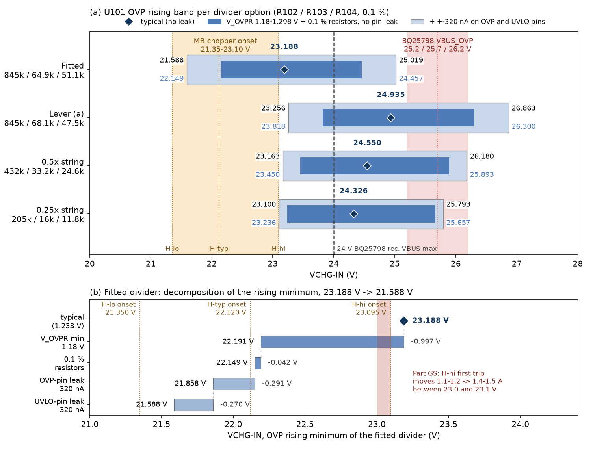

*Figure 1: (a) U101 OVP rising band at VCHG-IN per divider option, R102 / R103 / R104 at 0.1 %. Diamond: the typical point. Blue end labels: V_OVPR 1.18-1.298 V with resistor tolerance and no pin leakage. Black end labels: the same with +-320 nA on the OVP and UVLO pins. (b) Decomposition of the fitted rising minimum from 23.188 V to 21.588 V. Static thresholds, TCKE1401NM Table 10.1 limits; sim 2 and sim 5 CSVs.*

Of the 1.600 V between the typical 23.188 V and the 21.588 V minimum, the V_OVPR spread contributes 0.997 V. The 0.1 % resistors contribute 0.042 V and the pin leakage 0.561 V. The no-leak minimum of 22.149 V lies 0.95 V below the 23.10 V H-hi onset, so an early trip does not need pin leakage. In addition, 320 nA is the datasheet limit; the typical leakage at 25 C moves the typical threshold by 6.8 mV only (`sim/efuse_decay/results/a_bands_corners.csv`). A buffered divider therefore removes only the 0.561 V leakage term, and the V_OVPR term remains.

Figure 2 shows the regen current at the first U101 OVP trip for each healthy chopper state and OVP corner. H-lo, H-typ and H-hi are the healthy MB chopper at its low, typical and high onset corners. Panel (b) shows the Part GS sweep that locates the H-hi boundary; the part letters are those of `sim/chopper/RESULTS.md`.

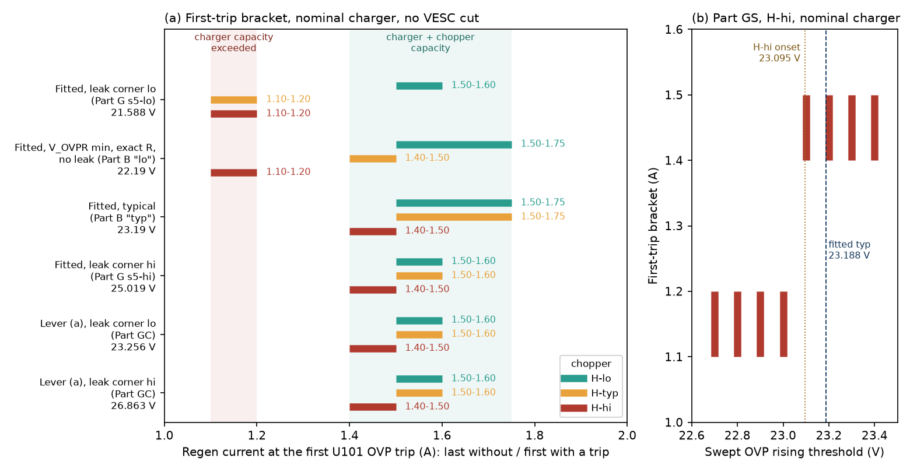

*Figure 2: (a) First U101 OVP trip current bracket (last current without a trip, first current with a trip) for H-lo, H-typ and H-hi at six OVP rising thresholds. (b) H-hi bracket against the rising threshold, Part GS swept from 22.7 V to 23.4 V. Nominal charger, 0.97 mF, 0.6 s current bursts, no VESC cut. Parts G and GC use 0.1 A steps and Part B a 1.5 / 1.75 A step; the Part B "lo" corner is 22.19 V with exact resistors.*

H-hi trips at 1.1-1.2 A instead of 1.4-1.5 A at the no-leak V_OVPR minimum as well as at the leak corner. With the leak (21.588 V), H-typ also trips at 1.1-1.2 A. An early trip therefore needs a low-threshold U101, the H-hi or H-typ chopper state and a regen current above 1.1-1.2 A. The physical brakes of 11.1-23 W draw about 0.5-1.2 A (sim 2 conclusion 2). On H-hi, the 23 W brake settles V-MOT at 23.09-23.10 V at OVP typical (`sim/chopper/results_power_brakes.csv`), above both low OVP corners. No constant-power run exists at those corners, so the 23 W brake is expected to trip U101 there; this is not simulated. Lever (a) below (R103 68.1 kOhm, R104 47.5 kOhm) moves every healthy first trip to 1.4-1.6 A.

The consequence of a trip depends on the VESC over-voltage cut. With the cut, U101 stays open until VCHG-IN falls below the OVP falling threshold, about 0.12 s with a healthy chopper. The charger then draws again only after the 300 ms re-qualification, and this repeats once per VESC pulse, three times per 1.2 s brake (sim 2 section 5.6). A tripped brake loses at most its own V-MOT energy, 2.0-5.5 J for the measured hard brakes (sim 6). Without a cut, U101 stays open for the rest of the burst. Under the constant-current bursts of Figure 2, V-MOT then reaches 35 V or more and the RT1987 D-BC-RG OVP latches (sim 2 section 5.2); a power-limited brake of 18.9-23 W settles at 28.7-31.6 V on H-hi with sustained chopper overstress, and 35 V follows only from about 30 W (sim 2 Part D). (**Superseded 2026-11-15, sim 6 section 8 item 4:** "At the H-hi / OVP-lo corner with a 24.0-25.2 V cut, the charger then takes about 2.0 J per brake instead of 26.4 J (sim 2 Table 5.4). Without a cut, U101 stays open for the rest of the burst, V-MOT reaches 35 V or more and the RT1987 D-BC-RG OVP latches (sim 2 section 5.2).") Figure 2 shows the no-cut first trips of the constant-current bursts.

The three levers are:

- (a) Retune the OVP divider. With R102 845 kOhm kept, R103 68.1 kOhm and R104 47.5 kOhm (0.1 %) give:
  - OVP rising 23.256-26.863 V;
  - OVP falling 21.439-24.614 V;
  - UVLO rising 9.092-10.571 V.

  With either this divider or 69.8k/46.4k, sim 2 gives every healthy first trip at the charger-plus-chopper
  capacity (1.4-1.6 A).
- (b) Set the VESC regen limit below the OVP rising minimum.
- (c) Accept the dropout.

Lever (a) has a cost. Its 26.863 V maximum lies 0.66 V above the BQ25798 VBUS_OVP maximum of 26.2 V (SLUSDV2C section
6.5). The conflict is structural: the TCKE1401NM V_OVPR spread of 1.100 forces a maximum of at least 25.41 V for a
23.10 V minimum. Scaling the string down reduces the leakage term:

- 0.5x (432k / 33.2k / 24.6k) gives 23.163-26.180 V;
- 0.25x gives 23.100-25.793 V.

However, a scaled string changes the VCHG-IN decay of sim 5, which is not yet re-evaluated (TODO(recalc: sim 5 part
b)). The 0.1 % stock of 68.1k and 47.5k is TODO(verify: distributor stock).

FR-50, the `OV_CHG` threshold, response and filter, was to be set with this ruling; the ruling below leaves it for the
firmware round. The firmware keeps its single-sample 24.0 V latch until then.

**Ruling (operator, 2026-11-15; LAYOUT_DECISIONS D-93; design r9-27):** lever (c) is taken. The charger dropout on hard
brakes is accepted, and R102, R103, R104, R101 and `mouser_import.csv` stay as they are. FR-50 and the FR-30 threshold
stay open for the firmware round, on the as-fitted OVP bands. The ruling rests on the decomposition above and on sim 6
(`sim/regen_nocut/RESULTS.md`), a mechanical motor model of the measured hard brakes. Sim 6 refines the sim 2 brake
range of 11.1-23 W: the 8 measured hard brakes (12 A from 3.00 m/s or below, no VESC cut) deliver 10.9-19.0 W peak
and 2.0-5.5 J to V-MOT in 0.17-0.42 s.

Figure 2A shows the peak regen power of a 12 A brake against its start speed, the energy above each charger capacity
corner of sim 2 against the energy that lifts V-MOT from VINDPM to the 21.588 V OVP minimum, and the V-MOT transient
of a 3.00 m/s brake when the charger absorbs in stages before T3 lands (design FR-41).

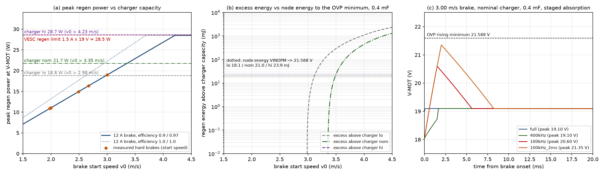

*Figure 2A: (a) peak regen power at V-MOT of a 12 A brake against the start speed, at gear efficiency 0.9 and inverter
efficiency 0.97 (solid) and at 1.0 / 1.0 (dotted), with the 8 measured hard brakes and the lo (18.8 W), nom (21.7 W)
and hi (28.7 W) charger capacities and the 28.5 W VESC regen limit; (b) regen energy above each charger capacity against the
node energy to 21.588 V at 0.4 mF (dotted), sweep 1.5-4.5 m/s; (c) V-MOT of the 3.00 m/s brake with the nominal charger at 0.4 mF in four
absorption modes, first 20 ms of a 0.31 s brake. Sim 6.*

Below the charger capacity, the VINDPM loop holds V-MOT near 19 V, and no U101 OVP corner can trip. The brakes from
3.00 m/s exceed the lo capacity by 0.42 mJ, against the 18.09 mJ that lifts a 0.4 mF node to 21.588 V. With the
nominal 21.739 W charger they do not trip at any drivetrain efficiency up to 1.0. An early trip with a converting
charger therefore needs a low-threshold U101 and the H-hi chopper corner (or H-typ with leakage), together with one of
these brakes:

- a 12 A brake from 3.11 m/s (lo charger) or 3.49 m/s (nominal charger); the RegenTest_decel_sweep cycle brakes from
  3.50 m/s;
- a 25 A brake of the State-98 'T' ramp (TRAP_I_ABS_MAX) from 2.51-2.70 m/s;
- a 3.00 m/s brake in the 100 kHz degraded mode of FR-41 at 0.4 mF, where the margin is 0.96-0.99 V, or 0.22-0.24 V
  if the staged phase lasts 2.0 ms, and less at a drivetrain efficiency near 1.0.

The VESC regen limit of 1.5 A blocks the hi charger corner.

The limits of this basis are these:

- The gear efficiency 0.9 is unverified (TODO(verify)). At 1.0, the 3.00 m/s brakes exceed the lo corner by 123 mJ and
  can trip U101 at the early-trip corners.
- A charger that does not convert (CV taper near a full pack, EN_CHG 0, P5 LOW) trips U101 on ordinary brakes at any
  OVP corner, whatever the divider.
- With a VESC cut, a trip costs the harvest of that brake (at most 2.0-5.5 J at V-MOT for the measured brakes) and a
  0.5 s loss of regen braking; a cut at 25.2 V or above also gives millisecond chopper pulse overstress. Without a cut, V-MOT settles at 28.7-31.6 V with
  sustained chopper overstress, and reaches 35 V only from about 30 W. The VESC `l_max_vin` bench item stays required.

J.2 item 84 concerns the T-C-04 repetitions and a spare U101. The TCKE1401NM turns on again into current-limit
regulation for up to 190 ms after a fast trip or an SCP trip. The bound is 23.8-65.4 W and up to 12.4 J per event
(sim 1 revision 3, section 5.7). The bound assumes I_LIM 1.97-2.77 A, an unverified extrapolation.

Design r9-26 therefore makes these test changes:

- T-C-04 step (1) measures I_LIM at VIN - VOUT = 1 V;
- the fast trip is tested only above 3.94-5.54 A;
- the repetitions on the only U101 drop to 5 / 5 / 3 / at most 1.

The open decision is whether to add a spare U101 to the Mouser order. Whether the dwell also follows an SCP trip is
TODO(verify: Toshiba).

### 3.2 Before assembly

J.2 item 77 is the T2-interruption option. Sim 4 section 5.6a (4116 decks, all converged) gives the trade-off below,
worst case over all decks:

| Option | Hazardous interruptions | Worst peak, time above 1.0 V | T-B-06 budget at 1.25 / 1.80 A | False H1 trip at 12 V/ms |
|---|---|---|---|---|
| As built (C106 = C107 = 470 pF, C108 = 1.0 nF) | 5-30 us | 1.810 V, 50.7 us | 219.1 / 139.1 us | none |
| C108 = 470 pF | 5-20 us | 1.545 V, 27.9 us | 219.1 / 139.1 us | none |
| C107 alone = 4.7 nF | 30 us and longer | 2.254 V, up to 481 us | 219.1 / 139.1 us | yes |
| C106 = C107 = 4.7 nF | 30 us and longer | 2.254 V, up to 481 us | 16.1 / -54.0 us (fails) | none |
| C106 = C107 = 10 nF | 50 us and longer | 2.254 V, up to 1230 us | -199.2 / -280.2 us (fails) | none |

No option removes the hazard; the larger capacitors move it to longer interruptions. C108 = 470 pF is the only
option that narrows the band and reduces the peak without a new failure. However, it is worse than as built in 49 of
576 matched decks, by at most 5.0 mV and 0.34 us. D-81 is qualified accordingly.

Figure 3 shows the worst ILIM_HIZ peak and the worst time above VIH 1.0 V against the T2 interruption for the five options.

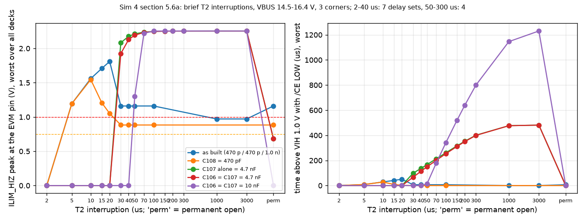

*Figure 3: Worst ILIM_HIZ peak (left) and worst time above VIH 1.0 V with /CE LOW (right) against the T2 interruption, 2 us to 3 ms and permanent open, logarithmic axis. Worst case over VBUS 14.5-16.4 V, three corners and up to seven comparator-delay sets (sim 4 Figure 5.5b, `sim/permit/results/agg_t2int.csv`). As built and C108 = 470 pF have no 70-300 us rows except 100 us, and C108 = 470 pF has no 1 ms or 3 ms row.*

No option removes the hazard. The as-built worst case is 1.810 V for 50.7 us at 20 us, on the overdrive delay model; C108 = 470 pF lowers it to 1.545 V for 27.9 us (at 10 us). The 4.7 nF and 10 nF options move the hazard to interruptions of 30 us and 50 us or longer. There the peak rises with the interruption length, from 1.92-2.08 V at 30 us (4.7 nF) and 1.30 V at 50 us (10 nF) to the full release of 2.254 V at 0.3-1 ms. The time above 1.0 V reaches 481 us (4.7 nF) and 1230 us (10 nF). A permanent open is not hazardous for these options.

In addition, the as-built H.13 budget at 1.80 A falls below the T-B-06 150 us under the comparator-overdrive model:

- 139.1 us on the sim 3 basis;
- 149.6 us on the r3 basis.

The overdrive figure rests on an extrapolation, TODO(verify: SBOS300C tPD at about 0.5 mV/us). This is recorded, not
changed.

Figure 4 shows the H1 inhibit latency on the H.13 V-MOT ramps and the T-B-06 budget that remains for each option.

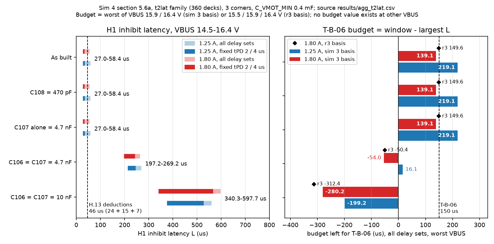

*Figure 4: Left: H1 inhibit latency over VBUS 14.5-16.4 V; dashed line: the H.13 deductions of 46 us. Right: T-B-06 budget against the 150 us limit at 1.25 A and 1.80 A; bars on the sim 3 basis, diamonds on the r3 basis at 1.80 A. t2lat family, 360 decks, three corners, C_VMOT_MIN 0.4 mF.*

The matched 4.7 nF and 10 nF options raise the latency to 197-269 us and 340-598 us. Both fail the 150 us budget at both currents. The as-built budget at 1.80 A is 139.1 us on the sim 3 basis and 149.6 us on the r3 basis.

J.2 item 85: C103 stays 1.0 uF or becomes a 4.7 uF part.

D103 (D-79): keep the ordered STPS2H100A or fit the MBRA2H100T3G alternate. Sim 1 gives OUT below the TCKE1401NM
-0.3 V limit for 3.0-11.2 us with either SMA part, so the alternate is offered only as an opt-in line.

The five opt-in SPARE lines (D-89) contain:

- 2 x TLV3012BIDBVR;
- 5 x GMC21X5R106K50NT;
- TSW-112, SSQ-110 and SSQ-112 for a second matched header set.

The GMC line resolves a conflict: section E promises "2 (+2)" and "5 (+3)", but the main order holds exactly 7. Add
the line, or change section E to "2" and "5" with no spare.

One inspection item of LAYOUT_DECISIONS section 11 item 29 stays open after D-95: whether the J1 post hides the W3
reference, which overlaps the J1 courtyard ring by about 0.2 mm. This is TODO(verify: assembled board), an inspection
of the assembled CR and not a gerber decision.

### 3.3 Before the firmware round

The items below wait for the firmware round:

- FW-0: the `CLAUDE.md` REGEN / FC_CHARGE conflicts (design D.5). This is a precondition of the firmware round. `CLAUDE.md` was not edited.
- FR-50 and the FR-30 threshold: the `OV_CHG` threshold, response and filter, on the as-fitted OVP bands that the J.2 item 74 ruling keeps (section 3.1; D-93).
- FR-51: the detection of a latched U101 in Run is defined. Recovery inside a Run, (A) or (B), is an operator decision.
- J.2 item 78: the H1 fall worst case of 17.843 V (sim 3, with resistor TCR) lies 3 mV above the VINDPM_STAGE1 minimum of 17.84 V.
- IO CSV row 22 is the one pending CSV edit. The CSV was not edited.

### 3.4 Layout items with a copper option

The items below give a copper change as one option. Only J.2 item 82 is still open. The last item is closed and is
silkscreen only; D-95 records that it has no copper option.

- W5 grids (D-80): the staged T-A-06 metering of design r9-26, or a grid reorder, which is a copper change. The item
  is closed (operator, 2026-11-16, "Keep copper, meter"; D-80 ruling; design r9-29): the copper stays, the T-A-06
  metering is the mitigation, and the grid reorder and the CR J101 pour clearance are declined. (**Superseded
  2026-11-16, D-80 ruling:** "The item is open.") The D-80 addendum of 2026-11-16 records that the J101 and J201 pads are plated through-holes (1.0 mm drill,
  1.8 mm pad), so a bridge can form on both outer layers. It also records five masked-copper paths near the grids that
  no earlier record names. The worst pair is CE_DRV_J to ILIM_REL_A during qualification, where EN_CHG = 0 is the
  only remaining barrier. No full reorder makes every orthogonal pair benign.
- J.2 item 82: the strap at 2.77 A. H.25 passes at 2.41 A only. The 190 ms current-limit dwell makes 2.77 A a transient load. Acceptance is open.
- J.2 item 83 is closed (operator, 2026-11-16; D-94; design r9-28). /CHG_ARM keeps its 5.25 mm of F.Cu track in the
  D-36 zone, 0.224 mm from R114 pad 2 (/N_UVP), under a D-36 exemption. The exemption requires a cold resistance
  check from J1.11 to R114 pad 2 on every assembled CR; a reading below about 1 kOhm indicates a short. C108 stays
  fitted, the flux around R114, C108 and D106 is cleaned after reflow, and R114 pad 2 is inspected under
  magnification. A CR copper re-spin for any other reason routes /CHG_ARM out of the zone. (**Superseded 2026-11-16, D-94:** "J.2 item
  83: /CHG_ARM has 5.25 mm of F.Cu track in the D-36 zone, 0.224 mm from R114.2. Exempt it or re-route it; a re-route
  is a copper change.")
- The EIB reference rule set and the W6 "GND" label are closed (operator, 2026-11-16; D-95). The phase B rule set
  stays, with 18 of 26 fitted EIB references on top, and the EIB is not exported again. The W6 label is on the CR,
  not the EIB, and stays as it is. Both items are silkscreen only and have no copper option. (**Superseded
  2026-11-16, D-95:** "The EIB reference rule set (D-78), and the W6 "GND" label at 0.086 mm from a mask opening
  (D-73).")

### 3.5 Housekeeping

The items below need a decision on where they go or a check at submission:

- The untracked files `cr/cr.kicad_pcb_RTbackup.*` date from 2026-11-13. They are not from this round and are left in place.
- The KiKit JLCPCB and PCBWay presets fail on the CR, as before this round. The OSH Park package is complete.
- Whether OSH Park clips silkscreen near mask openings is TODO(verify: OSH Park).
- The schematic title blocks still read EIB "r8-capture-1" 2026-11-11 and CR "r8-capture-2" 2026-11-12 (`gen/sch.py` line 241). A fix regenerates both schematics and re-exports both packages, so it is deferred; HANDOFF.md lists the procedure.

## 4. Simulation results

Five simulations run on KiCad 9.0's ngspice through `sim/common/ngspice_run.py`. Each `RESULTS.md` ends with a
"Check and corrections" section, and `sim/README.md` gives the overview. Phase C re-ran three of them.

### 4.1 Sim 1, `hardshort/`

In the T-C-04 step (2) hard short, U101 OUT reaches -3.8 to -7.8 V. OUT stays below the TCKE1401NM -0.3 V limit for
3.0-11.2 us with either SMA D103 (2.9-11.2 us over the three SMA candidates of the grid).

Figure 5 shows the hard-short waveforms of the vehicle-feed case at VCHG-IN 23.6 V for both SMA D103 parts.

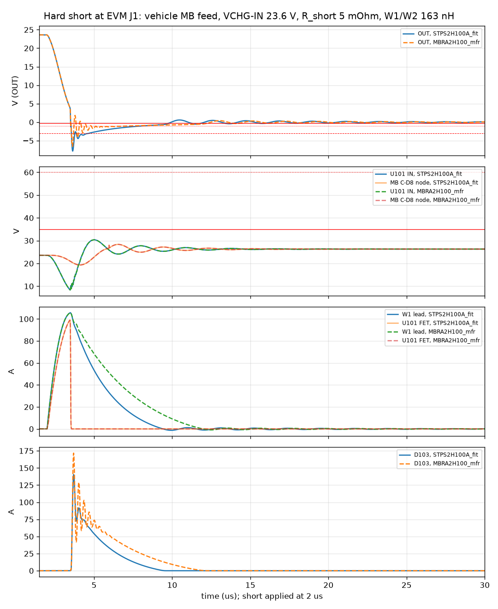

*Figure 5: Hard short at EVM J1, vehicle MB feed, VCHG-IN 23.6 V (upper-tolerance OVP part), R_short 5 mOhm, W1/W2 162.2 nH (the plot title gives 163 nH). Window 1.5-30 us of a 60 us run, short at 2 us. Red lines: -0.3, -1 and -3 V in the OUT panel; the 35 V MB-end and 60 V U101 VIN limits in the IN panel (sim 1 Figure 1).*

The SCP path opens the FET 1.49 us after the short, with 81 A in it. OUT then reaches -7.83 V (STPS2H100A fit) or -6.54 V (MBRA2H100T3G). OUT stays below -0.3 V for 7.8 us and 8.9 us respectively.

Figure 6 shows the OUT minimum and the time below -0.3 V for every grid case, grouped by D103 candidate.

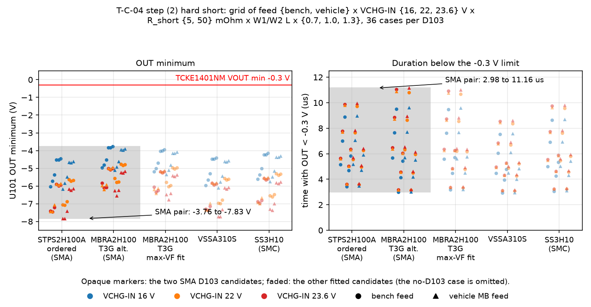

*Figure 6: Hard-short grid of revision 2, 36 cases per D103 (bench and vehicle feed, VCHG-IN 16 / 22 / 23.6 V, R_short 5 / 50 mOhm, W1/W2 inductance x 0.7 / 1.0 / 1.3): OUT minimum (left) and time with OUT below -0.3 V (right). The two SMA candidates are opaque, and the no-D103 case is omitted. The 23.6 V points apply to an upper-tolerance OVP part only.*

With either SMA D103, OUT reaches -3.76 to -7.83 V and stays below -0.3 V for 2.98-11.16 us in every grid case. The choice of SMA part changes the OUT minimum by up to 1.6 V in a given case and does not remove the exceedance.

Revision 3 re-runs the fast-trip shorts at the datasheet tFASTTRIP of 3-8 us (DS Table 10.3), with 528 runs and 0
failed. It gives the following OUT minima:

- 2 ohm: +0.72 to +1.39 V;
- 1.5 ohm: +0.25 to +0.53 V;
- 1 ohm: +0.030 to +0.078 V.

At 0.5 ohm, OUT is negative at every delay. It falls below -0.3 V at 3-4 us on every corner and at 6-8 us on both
vehicle corners. The 6 us basis overstated the 2 ohm margin by 0.07-0.11 V. The
hard-short headline does not change, because SCP or UVLO opens the FET 1.26-2.11 us after the short. Revision 3 also
bounds the current-limit dwell (section 3.1). The dwell bound is analytical; sim 1 does not model it.

Figure 7 shows the OUT minimum of the revision 3 fast-trip check against tFASTTRIP for the 2, 1.5, 1 and 0.5 ohm shorts.

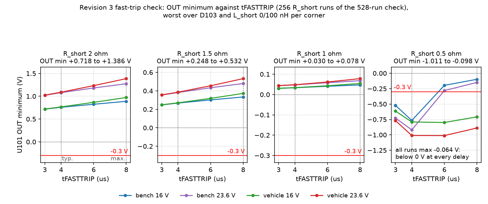

*Figure 7: Revision 3 fast-trip check at tFASTTRIP 3, 4, 6 and 8 us: OUT minimum per corner, the worst over the two SMA D103 parts and L_short 0 / 100 nH (256 of the 528 runs). Dashed verticals: DS Table 10.3 typical (4 us) and maximum (8 us); red line: the -0.3 V limit.*

Shorts of 1 ohm or more keep OUT above 0 V at every delay, with a 2 ohm margin of +0.72 to +1.39 V. At 0.5 ohm the bench corners recover above -0.3 V at 6-8 us, but the vehicle corners stay below it.

### 4.2 Sim 2, `chopper/`

The healthy MB chopper onset band is 21.35-23.10 V, and the U101 OVP band overlaps it. In phase C the band is
restated as an onset, not a V-MOT ceiling.

The logged V_rgn readings are consistent with the fitted knee sink (VR-1). Under that sink, the logged 18.26 V peak
is a true V-MOT of 23.4-25.2 V. This is "consistent with", not a confirmation.

Figure 8 shows the static chopper current against a forced V-MOT and the pin-39 V_rgn reading against the true V-MOT.

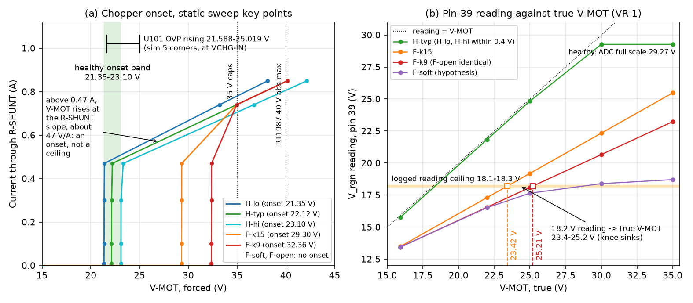

*Figure 8: (a) R-SHUNT current against a forced V-MOT at the Part A key points (1 mA to 0.85 A), with the healthy onset band 21.35-23.10 V and the U101 OVP rising band 21.588-25.019 V. (b) Pin-39 reading at V-MOT 15.93, 22, 25, 30 and 35 V, with the logged 18.1-18.3 V ceiling. DC operating points joined by straight lines (`sim/chopper/results_static_iv.csv`).*

The healthy band is a conduction onset. Above 0.47 A of R-SHUNT current, V-MOT rises at about 47 V/A, so the band is not a V-MOT ceiling. Under the fitted knee sinks of VR-1 (F-k15 and F-k9), an 18.2 V reading corresponds to a true V-MOT of 23.42 V or 25.21 V.

Phase C also re-ran 1304 cases with the U101 body diode added. No trip, cut or latch count changed. The largest
change is 11.9 mV in the V-MOT peak.

Figure 9 shows the per-run change in the V-MOT peak and in the U101 off time when the body diode is added.

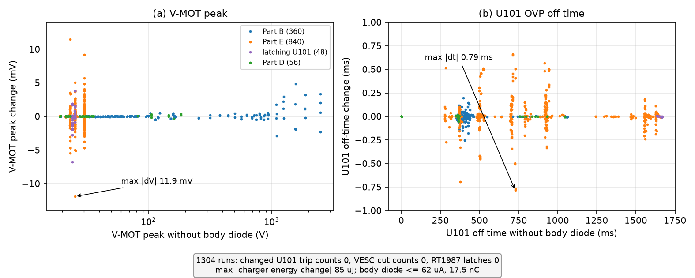

*Figure 9: Change in (a) the V-MOT peak and (b) the U101 OVP off time per run, body diode added minus the 2026-11-14 run, for the 1304 repeated cases of Parts B, D and E and the latching variant. Peaks above 35 V are no-VESC-cut runs of Parts B (204) and D (18). Per-run scalar metrics, no time axis (`sim/chopper/r2_body_compare.csv`).*

No run changes its U101 trip count, VESC cut count or RT1987 latch state. The largest changes are 11.9 mV in the V-MOT peak and 0.79 ms in the U101 off time.

OVP self-release is a model input. Whether MODE open also latches an OVP event is TODO(verify: Toshiba).

Figure 10 shows four 1.2 s brakes with the VESC over-voltage cut, for the self-releasing and the latching U101 OVP model inputs.

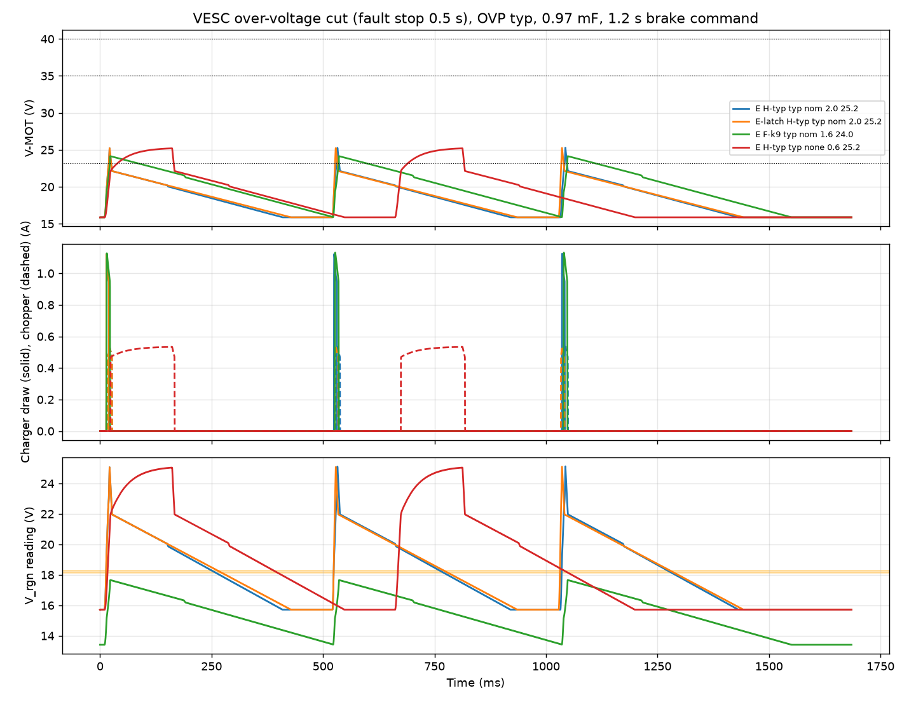

*Figure 10: V-MOT (top), charger draw and chopper current (middle) and the pin-39 reading (bottom), 0.97 mF. Cases: H-typ at 2.0 A with a 25.2 V cut (self-releasing and latching U101), F-k9 at 1.6 A with a 24.0 V cut, and H-typ at 0.6 A without a converting charger. Dotted: OVP typical 23.19 V, and 35 V and 40 V (capacitor rating, RT1987 absolute maximum); shaded: the logged 18.1-18.3 V reading ceiling. The full simulated window of 1.69 s is shown (sim 2 2026-11-14 run).*

In the H-typ 2.0 A case, U101 trips once per VESC pulse and releases between pulses. This gives three trips per 1.2 s brake under the self-releasing model input.

### 4.3 Sim 3, `comparators/`

Sim 3 reproduces the H1, UVB, FCC_OFF and FCC_ON bands of design B.2, H.1, H.2 and H.22. With resistor TCR, the H1
fall worst case is 17.843 V (J.2 item 78). The TLV3012B does not need the VR-4 0.08 ratio.

Figure 11 shows the H1 fall trip at VBUS 16.39 V against the VINDPM_STAGE1 minimum of 17.84 V.

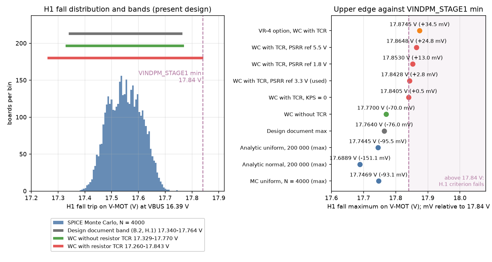

*Figure 11: H1 fall trip on V-MOT at VBUS 16.39 V, present design (R110 56.2 kOhm), -20 to +70 C. Left: SPICE Monte Carlo (N = 4000) with the design-document band and the worst-case bands with and without resistor TCR. Right: each upper-edge estimate against 17.84 V.*

Every Monte Carlo board stays below 17.84 V; the Monte Carlo maximum is 17.747 V. Only the deterministic worst case with resistor TCR reaches 17.843 V, 3 mV above the criterion (J.2 item 78). Its PSRR variants reach up to 17.865 V, and the VR-4 option 17.875 V.

Figure 12 shows each simulated worst-case band edge of H1, UVB, FCC_OFF and FCC_ON minus the design-document edge.

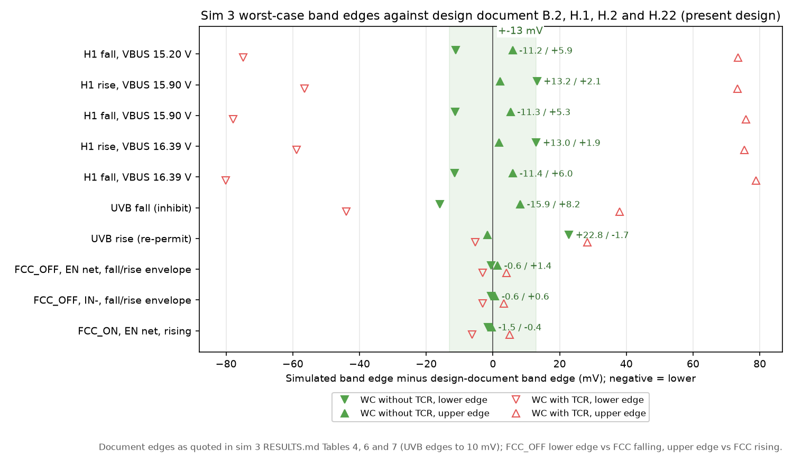

*Figure 12: Sim 3 worst-case band edges minus the edges of design B.2, H.1, H.2 and H.22, in mV, present design, with and without resistor TCR over -20 to +70 C. The FCC_OFF lower edge is compared with the falling worst case and the upper edge with the rising worst case.*

Without resistor TCR, the H1 edges agree with the design document to within 13.2 mV and the FCC edges to within 1.5 mV. The UVB edges agree to within 23 mV, against document values quoted to 10 mV. Resistor TCR widens each H1 edge by about 70 mV.

Figure 13 shows the H1 output and its inputs for V-MOT from 0 V to 40 V, for the present design and the VR-4 option.

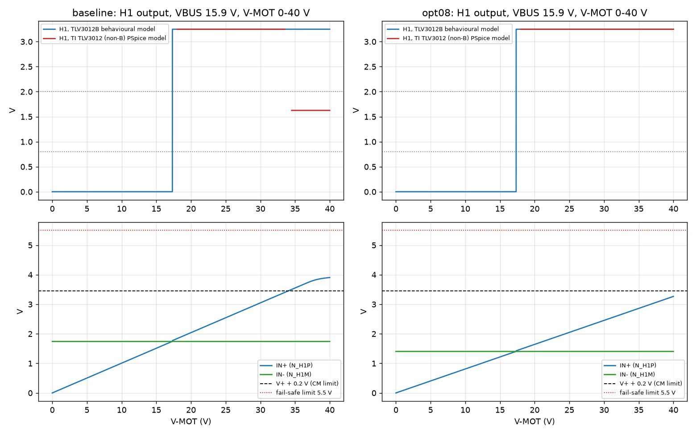

*Figure 13: H1 output (top) and the IN+ and IN- nodes (bottom), DC sweep of V-MOT from 0 V to 40 V at VBUS 15.9 V and the nominal CR rail. Left: present design; right: VR-4 option (opt08). Behavioural TLV3012B and TI non-B models (sim 3 Figure 5).*

With the fitted TLV3012B, H1 stays HIGH to 40 V, because IN- stays inside the common-mode range and IN+ below the 5.5 V fail-safe limit. The VR-4 0.08 ratio is therefore not required.

### 4.4 Sim 4, `permit/`

The permit gate implements the B.1 equations in all 64 input states. A lost T2 tap gives a release pulse of 3-47 us
before UVB drops it.

Figure 14 shows the SPICE cross-check of the permit gate over all 64 input states.

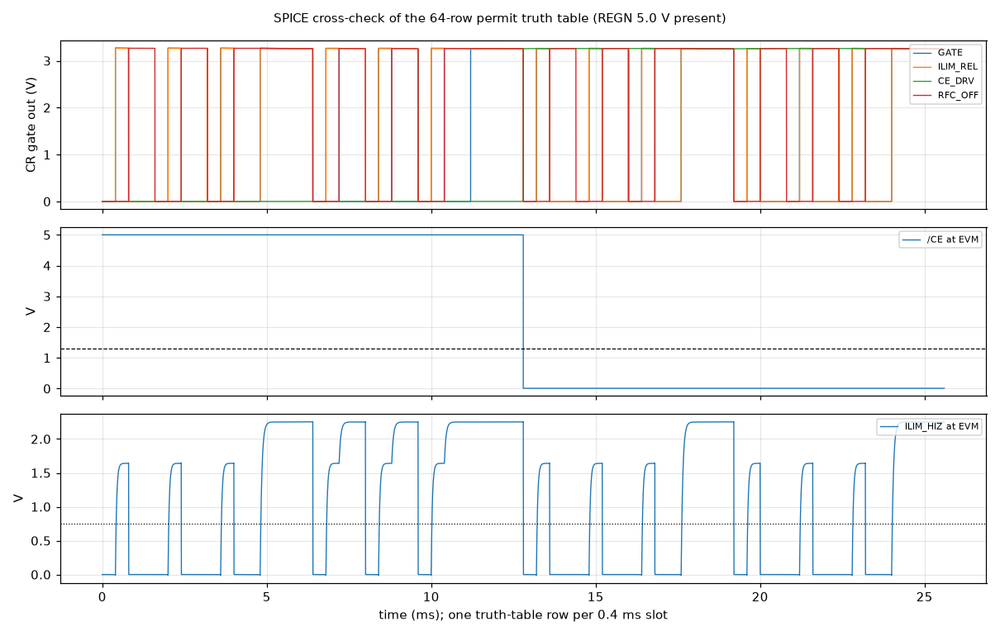

*Figure 14: SPICE cross-check of the 64-row permit truth table with REGN 5.0 V present, one row per 0.4 ms slot: CR gate outputs, /CE and ILIM_HIZ at the EVM. The unlabelled reference lines lie at about 1.3 V and 0.75 V. The full 25.6 ms run is shown (sim 4 Figure 5.1).*

In every input state, ILIM_HIZ settles at 0 V, 1.641 V or 2.250 V, and /CE at 5.0 V or 0.008 V, as the B.1 equations require.

Phase C added the formal brief-interruption sweep (section 5.6a, 2-40 us, then 50 us to 3 ms). The sweep found
these results:

- The as-built hazard band is 5-30 us, not 10-20 us.
- The H.13 inhibit latency is 197-269 us at 4.7 nF and 340-598 us at 10 nF. The earlier "134/232 us" figures had no source.

Figure 15 shows the mechanism of a brief-interruption pulse on the as-built board, with T2 interrupted for 20 us.

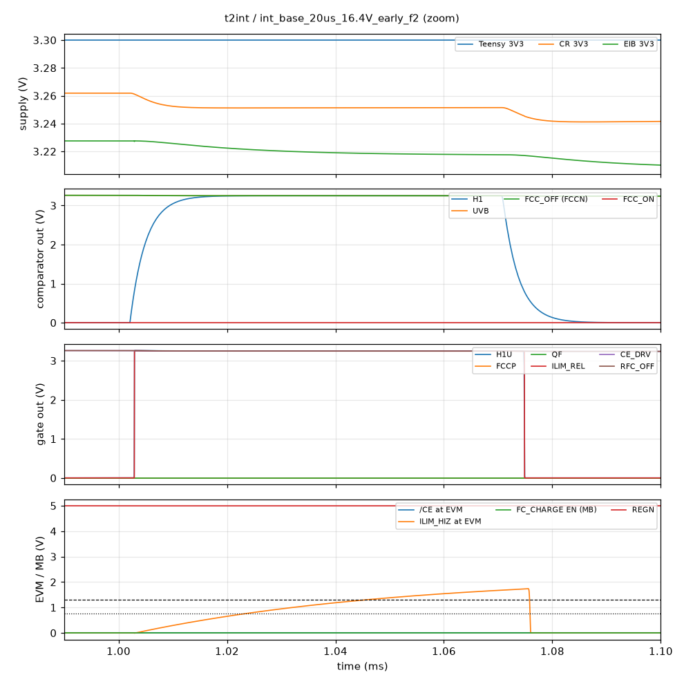

*Figure 15: As built, T2 interrupted for 20 us at 1.000 ms, VBUS 16.4 V, early corner, fixed tPD 2 us (deck int_base_20us_16.4V_early_f2). Window 0.99-1.10 ms of a 2 ms run. The UVB trace lies under the FCC_OFF trace and stays HIGH throughout (sim 4 Figure 5.5a).*

H1 stays HIGH for about 72 us while UVB stays HIGH, so ILIM_HIZ climbs to 1.74 V with /CE at 0.008 V until H1 falls. This typical-delay deck stays 43.5 us above 1.0 V; the bound over all decks is 1.810 V and 50.7 us.

Halving the time step moves the peak by at most 0.5 mV. Run the scripts in this order, because `run.py` deletes all
outputs at its start: `run.py`, then `t2brief.py`, then `t2brief_check.py`.

### 4.5 Sim 5, `efuse_decay/`

With pin leakage, the U101 UVLO rising band is 9.055-10.548 V. Sim 5 recommends a slope test for FR-12(b1), and k =
0.2 with dV_bus >= 2 V for FR-12(a2). The FR-12(b1) zero-draw worst case is 4.021 s.

Figure 16 shows the U101 UVLO and OVP threshold bands at VCHG-IN, with and without the +-320 nA pin leakage.

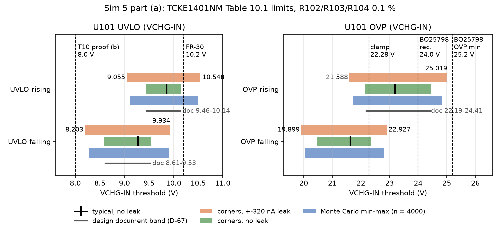

*Figure 16: U101 (TCKE1401NM) UVLO and OVP threshold bands at VCHG-IN from the Table 10.1 corners, R102 / R103 / R104 at 0.1 %, with and without +-320 nA pin leakage. The illustrative uniform Monte Carlo range (4000 draws) and the D-67 design-document bands are shown for comparison (sim 5 part (a)).*

With pin leakage, the UVLO rising band is 9.055-10.548 V; its maximum lies 0.348 V above the FR-30 10.2 V threshold. The UVLO falling minimum of 8.203 V stays above the 8.0 V T10 proof (b) level. The OVP rising maximum of 25.019 V stays below the 25.2 V BQ25798 VBUS_OVP minimum.

Figure 17 shows the FR-12(a2) ratio dV_rgn/dV_bus for a shorted D-MT-EN against k = 0.5, 0.3 and 0.2.

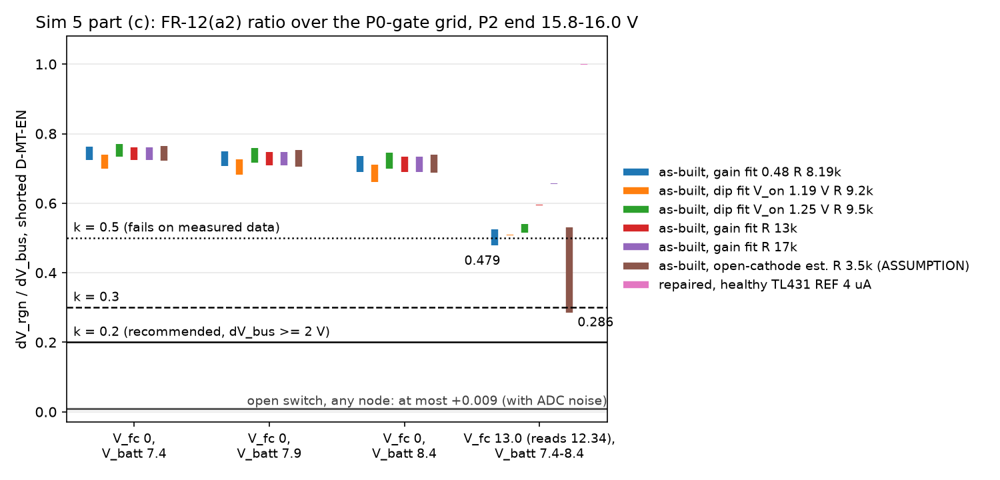

*Figure 17: FR-12(a2) ratio dV_rgn/dV_bus for a shorted D-MT-EN, range over the P0-gate grid with the P2 end at 15.8-16.0 V, for seven RGN-V node sets and four supply scenarios. The open-switch upper bound of +0.009 includes the +-2 count ADC noise bound (sim 5 part (c)).*

With the fuel cell live, the lowest measured node set reads 0.479, so k = 0.5 fails on measured data. The open-cathode estimate reads 0.286, so k = 0.3 fails under that estimate. The recommended k = 0.2 keeps 0.086 of margin to that estimate and 0.19 to the open-switch bound.

On the sim 5 basis and with no RT1987 forward leakage, the T10 proof (b) decay from 16.0 V to 8.0 V takes 0.083-4.39 s, or 0.083-1.38 s with an EVM draw at or above
0.391 mA. A forward leak above 98.5 uA holds VCHG-IN above 8.0 V at any EVM draw (H.21), and smaller leaks lengthen the decay. The earlier hand estimate was 55-181 ms. A single fault in that window before the
purge now takes the F.5 T10 step-4 controlled T7. The cost is availability, not safety. T-C-04 measures the EVM Idle
draw that bounds the decay (TODO(calibrate)).

Figure 18 shows the worst FR-12(b1) time to 12.0 V against the EVM Idle draw, and the T10 proof (b) decay ranges.

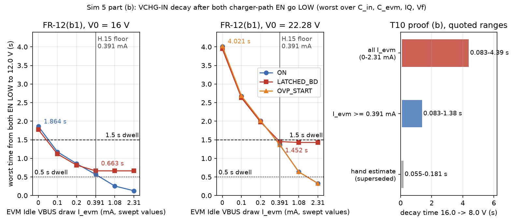

*Figure 18: Worst time from both charger-path EN LOW to VCHG-IN = 12.0 V per eFuse state against the swept EVM Idle draw (0-2.31 mA), at V0 = 16.0 V (left) and 22.28 V (centre); ngspice, 40 s runs. Each point is maximised over C_in, C_evm, U101 IQ and body-diode Vf. Right: the 16.0 -> 8.0 V T10 proof (b) decay ranges of the separate recompute with no RT1987 forward leakage (`update_2026-11-14/notes_phaseC_doc_fw.md` appendix A).*

From 0.391 mA upward, every case reaches 12.0 V within 1.452 s. The 1.5 s dwell is exceeded only at 0.2 mA or less from 22.28 V and only at zero draw from 16.0 V. The zero-draw worst case is 4.021 s.

Figure 19 shows the slowest VCHG-IN decay of each eFuse state from 16.0 V and 22.28 V.

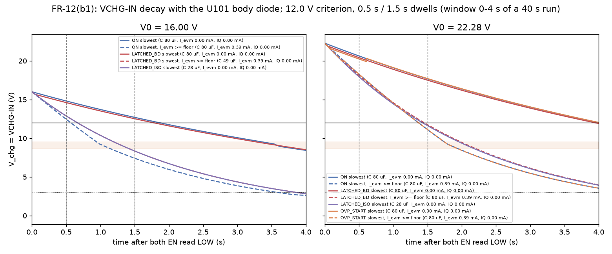

*Figure 19: Slowest VCHG-IN decay of each eFuse state (ON, LATCHED_BD, OVP_START, LATCHED_ISO reference) over the full sweep and over EVM draws at or above 0.391 mA, from V0 = 16.0 V and 22.28 V. Lines: the 12.0 V criterion, the 0.5 s and 1.5 s dwells and the 3.0 V reference (dotted); shaded: the design-document UVLO falling band 8.61-9.53 V. Window 0-4 s of a 40 s run; the zero-draw ON and OVP_START traces from 22.28 V cross 12.0 V at 4.010 s and 4.021 s, just outside the window (sim 5 Figure 2).*

The U101 body diode couples the EVM capacitance to VCHG-IN, so the LATCHED_BD traces follow the ON traces. From 22.28 V, each coupled state is 2.7-2.9 times slower at zero draw than at the 0.391 mA floor.

## 5. Records and documents changed

The round changed these records and documents:

- Design document `docs/charger_bq25798_wiring_design_2026-11-05.md`: revisions r9-25 and r9-26. They add the J.2 items 74-85, FR-50 and FR-51, and restate T-C-04, T-D-11, H.21, B.1-B.9 and F.5 T10. Every replaced statement is kept in the superseded form.
- Companion document `docs/charger_bq25798_custom_board_2026-11-10.md`: revision r4.
- `LAYOUT_DECISIONS.md`: D-70 to D-92, the 2026-11-15 status table and items 35-45 of section 11.
- `README.md`, `HANDOFF.md` and `RESPIN_HANDOFF_2026-11-13.md`: updated to the 2026-11-15 state. The two README figures are regenerated (D-92).
- `update_2026-11-14/`: the work notes of every agent, indexed by `update_2026-11-14/README.md`.
- `sim/`: the five simulations with their decks, outputs and reports.
- `sim/review_figures/`: six plotting scripts (`ovp`, `hardshort`, `chopper`, `comparators`, `permit`, `efuse`), each a `make_figs.py` that reads the existing CSVs and writes the new figures of sections 3 and 4.

Two edits were made after the second check (section 6.2): F.5 T10 and H.21 in the design document, and the
companion CCB mapping table.

The round did not change `CLAUDE.md`, `teensy_controller.ino`, `WORK_QUEUE.md`, the IO CSV, `round3/`,
`snapshots/`, `bom_2026-11-11/`, `bom_2026-11-13/`, the older fab packages or `REVIEW_2026-11-14.md`. A git diff
against the tag confirms this.

## 6. Review findings and their status

### 6.1 First review (`REVIEW_2026-11-14.md`)

Phase B sorted the 88 findings and VR-1 to VR-4 into 92 items:

- 39 design-document fixes;
- 18 BOM fixes;
- 14 fixed in phase A;
- 11 record fixes;
- 1 bench item (EIL-8);
- 9 operator decisions (EIB-0, FW-0, INT-4, BOM-7, BOM-13, BOM-14, FW-4, VR-2, VR-4).

The second review checked every first-review ID. It found no first-review finding that is open without a record.

### 6.2 Second review (findings R2-*)

The second review had ten area reviewers, one verifier for each area and a completeness critic. It produced 86
findings: 6 at S2, 80 at S3 and none at S1. None was refuted. The six S2 findings and their status are:

| ID | Finding | Status |
|---|---|---|
| R2-INT-0 | The CR W1 (VCHGOUT) reference sat under the W2 GND pad, so the 20 AWG input pair could be wired swapped, which is a hard short at the first power-up | FIXED: "VIN1" and "GND" labels and the W1 reference moved (D-85, rendered at 1200 dpi); a meter check before soldering (PM4 (2b), T-A-06) |
| R2-PWR-0 | The U101 current-limit dwell after a fast trip (31-65 W for 130-190 ms) is unaccounted, and T-C-04 step (1) sat inside the current-limit band | FIXED in the documents (B.4, T-C-04 items (j)-(l)); the spare U101 is J.2 item 84 |
| R2-LOG-0 | The brief-T2-interruption figures existed only in a scratch folder | FIXED: sim 4 section 5.6a, with committed decks and CSVs |
| R2-DOC-0 | The operator-question lists omitted J.2 items 74 and 78 and FW-0 | FIXED: every list carries items 74, 77, 78, 82-85, FW-0, FR-50 and FR-51 |
| R2-FW-0 | The single-sample `OV_CHG` latch at 24.0 V was not addressed with REGEN held HIGH through Run | OPERATOR: FR-50 is defined; J.2 item 74 was ruled on 2026-11-15 (D-93), and the FR-50 values stay open for the firmware round |
| R2-SIM-0 | Lever (a) "OVP rising minimum >= 23.40 V" omitted the UVLO-pin leak | OPERATOR: corrected numbers in section 3.1; lever (a) not taken, the dropout accepted on 2026-11-15 (D-93) |

The second check (check 2, PASS_WITH_ISSUES) gives this final status of the 86 IDs:

- 74 FIXED.
- 7 RECORDED_OPEN: R2-EIB-4 (the title blocks), R2-EIB-5 (REGN loading, bench), R2-CRL-3, R2-CRL-4 (package inductance, TODO(verify)), R2-DOC-12, R2-CRT-0 and R2-CRT-2.
- 5 OPERATOR: R2-CRL-0, R2-FW-0, R2-FW-1, R2-SIM-0 and R2-CRT-1.
- None NOT_FIXED or WRONGLY_FIXED.

R2-CRT-0 is the Toshiba IMON capacitor question. The TCKE1401NM datasheet prohibits a capacitor on IMON, and R129
10k + C129 1 nF load IMON through a series resistor. C129 is unchanged, and the bench check T-B-14 / T-C-04 is
recorded (TODO(verify: Toshiba IMON)).

Check 2 reported five minor issues:

- Two live r9-25 "55-181 ms" sentences remained in the design F.5 T10 row. They were fixed after the check and are now in the superseded form.
- The H.21 "+ turn-off + 2 ms" placement and a TODO(recalc) that the sim 5 recompute had met. Fixed after the check; H.21 now carries TODO(calibrate: EVM Idle draw, T-C-04).
- The companion CCB mapping table named "Q201/Q202 2N7002K". Fixed after the check: 2N7002BK,215, with the old text superseded.
- The EIB fab README shares one silkscreen reason string between the two layers. This is accurate and is left as it is.
- Several cells of README Tables 7.3 and 11.4 exceed 25 words. They are not split.

## 7. Incidents and process records

Two incidents occurred in the round:

- An agent's script inserted a duplicate, older copy of `dc_deck()` and `dc_trip()` into `sim/comparators/run.py`. The block was removed and the simulation re-run in full; all 11 CSVs are byte-identical to the earlier run. `sim/README.md` and `sim/comparators/RESULTS.md` section 10.1 record the incident. The removed block was not preserved.
- Phase B agents added "superseded" banners to `fab/eib_2026-11-11/README.md` and `bom_2026-11-11/README.md`. Both were reverted with `git checkout`. The banners on `DESIGN_STATE_2026-11-12.md` and `MORNING_REVIEW_2026-11-13.md` stay. D-90 records the revert.

## 8. Verification

The evidence for this document is:

- Check 2 re-ran DRC, the pcbdiff, the Gerber and drill export, the zip contents, the NPTH check (CR 6 holes, EIB 2), `gen/bom_split.py` (all 7 CSVs byte-identical) and `gen/fab_readme.py` (both READMEs byte-identical). It also rendered both boards at 1200 dpi.
- The orchestrator re-ran DRC with schematic parity on both boards on 2026-11-15: 0 violations, 0 unconnected pads, 0 footprint errors.
- A git diff against `charger-r8-pre-review-2026-11-14` shows no change to the forbidden files.
- An independent agent checked every figure of sections 3 and 4 against its CSV and `RESULTS.md`, and a second check followed each repair. The orchestrator then corrected the remaining caption and text items.

The figure checks found six statements in the simulation reports that the data do not support. The `RESULTS.md` files are not edited; the figure text of this document uses the data values:

- `sim/permit/RESULTS.md` section 6 item 4 gives the 1.810 V / 50.7 us worst case at the typical delay without skew. The deck is `int_base_20us_15.9V_early_od4`, on the overdrive delay model; the typical-delay worst case at 20 us is 1.739 V.
- `sim/efuse_decay/RESULTS.md` Table 5 gives the open-switch ratio as -0.003 to +0.009. `c_ratio_open_switch.csv` gives a minimum of -0.0737 (-0.0831 with the noise bound); the +0.009 upper end is correct.
- `sim/comparators/RESULTS.md` section 5.3 gives the UVB worst case without TCR as within 13 mV on the fall band. The CSV gives -15.9 mV (12.8741 V against 12.89 V).
- `sim/hardshort/RESULTS.md` section 5.1 says the two SMA parts differ by at most 1.3 V. That holds between the worst cases only; matched cases differ by up to 1.58 V.
- The "2.9-11.2 us below -0.3 V" range of sim 1 covers the three SMA candidates. For the ordered STPS2H100A and the MBRA2H100T3G alternate it is 2.98-11.16 us; this document now quotes 3.0-11.2 us.
- `sim/chopper/RESULTS.md` conclusion 2 states that the physical brakes keep U101 conducting. Every constant-power run is at OVP typical; on H-hi the 23 W brake reaches 23.09-23.10 V, above the 22.149 V and 21.588 V low OVP corners.

The items below are not verified:

- The silkscreen labels are checked on renders only. Whether OSH Park prints labels near mask openings without clipping is not verified.
- No simulation replaces the bench tests that each `RESULTS.md` names. T-C-04, T-B-14, T-D-04 and T-D-11 confirm the simulated figures.
