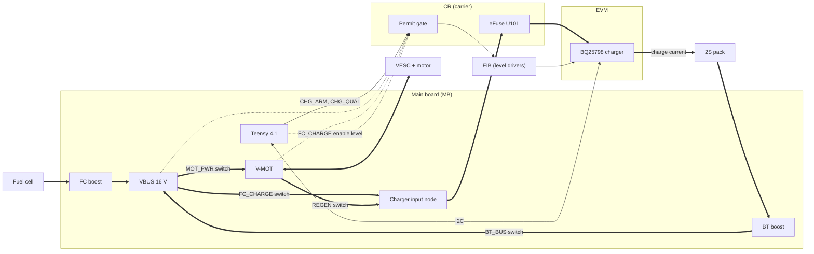
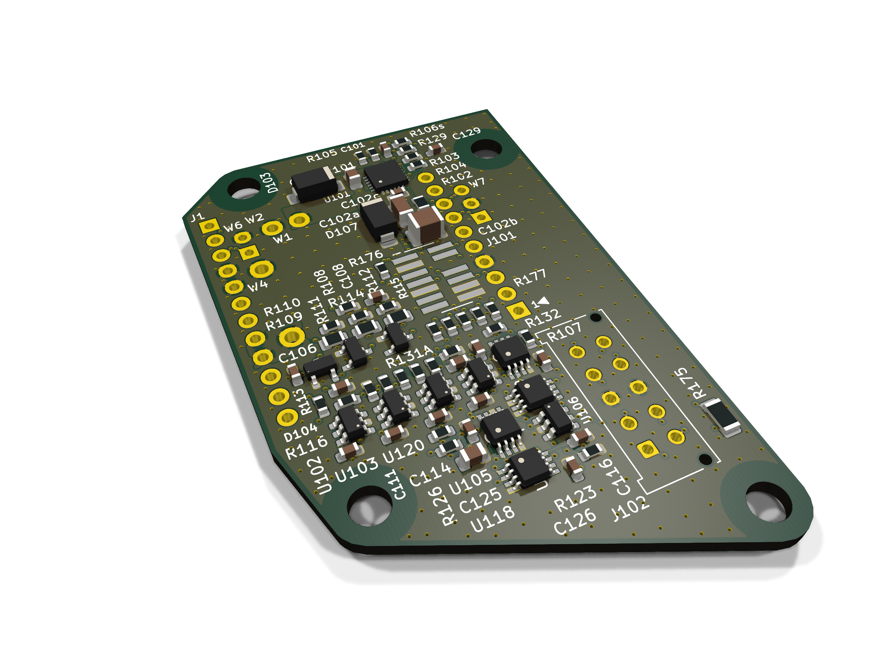

# Fuel-Cell Car Charger Retrofit: Design Overview

Status: 2026-11-16, design revision r9. This overview introduces the charger retrofit to readers who are new to the
project. Two documents hold the full detail:

- [README.md](README.md) in this folder is the full design review guide.
- [docs/charger_bq25798_wiring_design_2026-11-05.md](../../docs/charger_bq25798_wiring_design_2026-11-05.md) is the
  authoritative design record. It governs wherever the two disagree.

## 1. Context

### 1.1 The vehicle

The scale car is a fuel-cell hybrid with two power sources:

- a Horizon H-20 fuel cell (**FC**);
- a 2S Li-ion battery pack (two cells in series, 7.4-8.4 V), called **BT** in signal names.

Each source feeds a common 16 V DC bus (**VBUS**) through its own TPS61288 boost converter. The motor controller (a
VESC) is fed from **V-MOT**, a switched copy of VBUS. During braking the motor acts as a generator and drives V-MOT
above VBUS; this is **regen**. The boost converters, the power-path switches and a Teensy 4.1 microcontroller are on one
printed circuit board, the **main board (MB)**, revision 20260622.

Every power-path switch on the MB is an RT1987 **ideal-diode switch**: a MOSFET with a controller that conducts
forward like a low-loss diode when its enable pin is high, and blocks in both directions when the pin is low. The
Teensy drives each enable pin. Table 1 names the switches that matter here.

Table 1. MB power-path switches used by the charger (Teensy signal names).

| Switch | Connects | Role for the charger |
|---|---|---|
| BT_BUS | Battery boost output to VBUS | Lets the pack support the bus; must be OFF while the fuel cell charges the pack |
| FC_CHARGE | VBUS to the charger input | Fuel-cell charging path |
| REGEN | V-MOT to the charger input | Regen charging path |
| MOT_PWR | VBUS to V-MOT | Motor supply |

### 1.2 The problem

The pack must be charged from two sources while the car runs:

- from the fuel cell, through VBUS (**FC charging**);
- from the motor during braking, through V-MOT (**regen charging**).

The MB was built with a Silvertel Ag105 charger module for this job. The Ag105 is not usable on this board: it has no
charge-enable pin or register, and the MB ties its battery-negative pin to ground, which its datasheet forbids. During
the first bench test of the Ag105 path (2026-11-04) the bench supply delivered about 11 A that the Ag105 did not report.
The cause of that event is not confirmed.

### 1.3 The proposed solution

The design replaces the Ag105 with a TI **BQ25798EVM**, a commercially available evaluation module of the BQ25798
buck-boost charger. The EVM is modified for this interface. Two small custom boards connect it to the MB and add a
hardware safety gate. The MB keeps all of its traces; some MB parts and all charger interconnects change.

**Implementation status:** both custom boards are designed and ready to order. Nothing is ordered or built, no MB part
has been removed, and the charger firmware does not exist yet (section 8).

## 2. The three assemblies

Table 2 lists the three assemblies, and Figure 1 shows how they connect to the MB.

Table 2. Assemblies.

| Assembly | What it is | Where it sits | Main job |
|---|---|---|---|
| **CR** (carrier) | Custom 4-layer board, 40 x 65 mm, 78 parts | Plugs into the 22 holes left by the Ag105, 11 mm above the MB | Input protection (an eFuse) and the **permit gate**, which decides when the charger may convert |
| **EIB** (EVM interface board) | Custom 2-layer board, 24 x 38 mm | On nylon standoffs beside the EVM | Converts the CR logic signals into the drive levels of the EVM control pins |
| **EVM** | BQ25798EVM with modifications | On an insulating plate fixed to the chassis | The charger itself, controlled over I2C (address 0x6B) |

In Figure 1, thick arrows carry power, thin arrows carry commands and data, and dotted arrows are voltage senses.



Figure 1. Charger path, simplified. [figures/fig2_1_block_diagram.png](figures/fig2_1_block_diagram.png) is the
detailed interconnect diagram.

## 3. How power flows

### 3.1 Path

Charger power follows one path:

1. Two switches feed one charger input node: FC_CHARGE from VBUS and REGEN from V-MOT. Both may be on at the same time.
   Because they are ideal diodes, the higher of VBUS and V-MOT supplies the charger and the other path blocks.
2. The input node reaches the CR through one pin of the 22-pin CR header (CR J1).
3. The CR eFuse U101 (TCKE1401NM) limits the input current and disconnects the input outside a voltage window
   (Table 3).
4. A twisted pair carries the protected input to the EVM, and the BQ25798 converts it to the pack charge voltage.
5. A second twisted pair returns the charge current to the CR, and two CR J1 pins pass it to the MB and the pack.

### 3.2 Operating limits

Table 3 gives the main electrical limits. The charger input and pack charge currents differ because the BQ25798
converts a 16-24 V input down to the 8.3 V pack.

Table 3. Operating limits (typical values unless a range is given).

| Quantity | Value |
|---|---|
| Pack charge voltage target | 8.320 V (interim) |
| Charger input current limit, regen | 1.70 A register; hardware clamp 1.33-1.75 A |
| Charger input current limit, FC charging | at most 0.90 A |
| Pack charge current, regen | 2.50 A (3.10 A after qualification tests) |
| Pack charge current, FC charging | 1.60 A |
| eFuse current limit (fault level, not a charge setting) | 2.37 A typical, about 1.97-2.77 A |
| eFuse input window | turns on above 9.86 V; trips above 23.19 V (rising thresholds; 9.06-10.55 V and 21.59-25.02 V with tolerances) |

Hard braking can drive V-MOT above the eFuse trip level. The charger then drops out for the rest of the brake. This
loss of harvest is accepted.

## 4. Safety concept

### 4.1 Hazards

The governing hazard is a circular charging loop. VBUS feeds the charger, the charger feeds the pack, and the pack feeds
VBUS again through the battery boost. Power then recirculates through lossy converters, and the currents and heating
can grow without a limit set by the load. A second hazard is current flowing backwards into a disabled boost converter
through its internal body diode, which can damage the converter.

### 4.2 Defence layers

Table 4 lists the four defence layers. Their coverage differs by operating mode.

Table 4. Defence layers.

| Layer | What it does | Status |
|---|---|---|
| Charger registers | During regen-armed driving, the BQ25798 input-voltage floor (about 19 V) sits above the 16 V bus, so the charger does not draw from a normal bus; input current is capped | Designed |
| Firmware | Rules that the Teensy enforces, for example "FC_CHARGE and BT_BUS are never on together" | Designed; not written |
| Permit gate (hardware, on the CR) | Comparators and logic that hold the converter off unless a measured condition allows it | Designed; not built |
| MCU watchdog | A Teensy hardware watchdog is to reset the controller within about 50 ms of a firmware hang; the reset drops the charger commands and every switch enable through pull-down resistors | Planned; no charging is allowed until its forced-hang test passes |

The hardware gate does not cover every mode:

- **Regen-armed driving:** the gate holds the converter off until V-MOT is measurably above VBUS, so a bus-fed loop
  through REGEN is blocked even with hung firmware.
- **FC charging:** the loop barrier is firmware only. The firmware turns BT_BUS off before it turns FC_CHARGE on.
- **Pack overvoltage:** the barrier is firmware only (an 8.5 V pack trip on a Teensy ADC channel).

The gate's converter-off state also depends on one BQ25798 register setting. Whether it survives a wrong register value
is a bench test that has not run.

### 4.3 What "released" means

The BQ25798 charges the pack only when all three of these conditions hold:

1. **Input power reaches the EVM:** an enabled FC_CHARGE or REGEN path supplies a voltage inside the eFuse window, and
   the eFuse conducts.
2. **The converter is released:** the permit gate output **ILIM_REL** is HIGH, which un-holds the BQ25798 input pin
   ILIM_HIZ.
3. **Charging is enabled:** the chip-enable pin **/CE** is LOW (driven from CHG_ARM) and the charge-enable register bit
   EN_CHG is 1.

"Released" in this document means condition 2 only. A released converter with /CE HIGH draws a small quiescent current
but does not charge the pack.

### 4.4 The permit gate

The gate has six inputs. Four come from comparators on the CR and two are Teensy commands. Table 5 lists them.

Table 5. Permit gate inputs.

| Input | Source | HIGH means |
|---|---|---|
| H1 | Comparator on V-MOT and VBUS | V-MOT is above 1.089 x VBUS (with hysteresis: rises at 17.31 V and falls at 17.01 V when VBUS is 15.9 V) |
| UVB | Comparator on VBUS | The bus is healthy (rises at 13.72 V, falls at 13.33 V) |
| FCC_ON | Comparator on the FC_CHARGE enable voltage | The FC_CHARGE switch is validly commanded on (enable voltage above its guaranteed-on level) |
| FCC_OFF | Comparator on the same enable voltage | The FC_CHARGE switch is guaranteed off (enable voltage below its guaranteed-off level) |
| CHG_ARM | Teensy pin 5 | Charging allowed; drives /CE LOW |
| CHG_QUAL | Teensy pin 33 | A start-up check is requested |

FCC_ON and FCC_OFF sense the enable command, not the current through the switch. An enable voltage between the two
levels reads as neither on nor off.

The gate is combinational logic with no memory. Its two outputs are:

```text
ILIM_REL = (H1 AND UVB)                           regen: V-MOT is above the bus
        OR (FCC_ON AND NOT FCC_OFF)               FC charging: FC_CHARGE validly commanded on
        OR (CHG_QUAL AND FCC_OFF AND NOT CHG_ARM) start-up check, with /CE HIGH
/CE      = NOT CHG_ARM
```

A third output removes an extra FC-charging current clamp on the EVM whenever FC charging is off or regen is
released. [figures/fig5_1_permit_gate.png](figures/fig5_1_permit_gate.png) shows the gate at the component level.

### 4.5 Reset and start-up behaviour

Two different events put the gate in a safe state:

- **Teensy reset or boot:** pull-down resistors hold CHG_ARM and CHG_QUAL LOW, so /CE is HIGH and no charging occurs.
  The same reset drops every switch enable, so the charger has no input power. This assumes that the microcontroller pin
  keeper does not hold pins 5 and 33 HIGH, which is not yet verified.
- **Comparator power-up (up to 1.9 ms):** all four comparator outputs are LOW, so no release term is true.

## 5. Operating modes

Table 6 shows the charger state in each vehicle mode. The mode names are the Teensy state-machine names.

Table 6. Charger state per vehicle mode.

| Vehicle mode | Charger input path (switch commands) | Converter released (ILIM_REL) | Pack charging |
|---|---|---|---|
| Init, Idle | None (FC_CHARGE and REGEN off) | May follow H1 AND UVB | No (/CE HIGH, no input) |
| Run entry | REGEN on | Yes, for at most 0.46 s (start-up check) | No (/CE HIGH, EN_CHG 0) |
| Driving, regen armed | REGEN on, CHG_ARM HIGH | Only while H1 AND UVB (braking) | Only while released |
| FC charging window | FC_CHARGE and REGEN on, BT_BUS off | While FCC_ON AND NOT FCC_OFF | Yes |
| Fault (State 99) | Removed in order after the inhibit | May follow H1 AND UVB | No: CHG_ARM and CHG_QUAL go LOW first, then the switches open in sequence |
| Teensy reset | None (all enables LOW) | May follow H1 AND UVB | No |

The **start-up check** is a short read of the charger's input-voltage measurement at the start of each run, taken with
charging disabled. It draws about 50-90 mW from the bus.

FC charging happens in **windows**. During a window BT_BUS is off, so the fuel cell supports the bus alone. The H-20
fuel cell **purges** periodically: it vents briefly, and its output collapses during the purge. The firmware predicts
each purge from a locked schedule and closes the window 100 ms before the predicted time, so the battery can support
the bus again before the fuel-cell output falls.

## 6. Physical build

### 6.1 Mounting

The CR plugs into Samtec sockets that are soldered into the 22 former Ag105 holes on the MB. The pins form two columns
of 10 and 12. Friction of the 22 pins holds the CR, and four mounting holes accept an optional 3D-printed support. The
CR sits over the MB boost converters, so its bottom copper layer is a solid ground plane that faces them. The CR outline
is shaped so that a CR turned 180 degrees lands on the MB terminal blocks before its pins can engage.

Figure 2 shows the routed CR. The eFuse is at the upper end, the permit-gate comparators and logic fill the lower
centre, and the 10-way tap header (J102) is at the lower right.



Figure 2. Routed CR, 3D render from the board files.

### 6.2 Connections

In the board files, J numbers are connectors, W numbers are leads from the CR, and E numbers are leads from the EIB.
Table 7 lists the connections. Every W lead is soldered at the CR.

Table 7. Connections.

| Name | Between | Carries |
|---|---|---|
| CR J1 (22 pins, two columns) | MB and CR | Charger input and output, ground, CHG_ARM, charger status, I2C |
| J-TAP (J102, 10-way Molex Micro-Fit) | MB and CR | V-MOT and VBUS senses, the FC_CHARGE enable level, CHG_QUAL, the 3.3 V logic supply, and three readbacks to the Teensy (H1, eFuse fault, charger input current) |
| W1/W2 | CR and EVM | Charger input power |
| W3/W4 | CR and EVM | Charge current to the pack |
| W5 (nine wires) | CR and EIB | Gate outputs and 3.3 V to the EIB; charger status back to the CR; ground |
| W6 | CR and EVM | Pack thermistor (fitted only if a thermistor is fitted) |
| W7 | CR and EVM | I2C |
| E leads | EIB and EVM | /CE, ILIM_HIZ, charger status, EVM regulator and ground test points |

### 6.3 Fabrication

Both boards pass KiCad's electrical rule check (ERC) and design rule check (DRC) with zero errors. The CR is a
4-layer, 1.6 mm OSH Park board with all surface-mount parts on the top side (one stencil, one reflow). The fab packages
are `fab/cr_2026-11-14/` and `fab/eib_2026-11-14/`.

## 7. Firmware impact

The present Teensy firmware has no BQ25798 support. A firmware round after the boards are built adds the BQ25798
driver, the hardware watchdog, the new pins and the telemetry fields. Two rules apply:

- No charging of any kind runs before the watchdog firmware exists and its forced-hang test has passed. FC windows
  also need a purge-emulator test.
- The EVM must not be connected to a board that runs the present firmware, because the present firmware toggles pin 5
  for the Ag105.

Table 8 lists the Teensy pins of the charger interface.

Table 8. Teensy pins of the charger interface (the other power-path switch pins are unchanged).

| Pin | Name | Use |
|---|---|---|
| 5 | CHG_ARM | Output: charging allowed (default LOW); replaces the Ag105 MPPT_DISABLE pin |
| 33 | CHG_QUAL | Output: start-up check request (default LOW) |
| 31 | FC_CHARGE_ENABLE | Output: FC_CHARGE switch enable; also sensed by the gate |
| 6 | CHARGER_STAT | Input: charger status (LOW = charging, the opposite of the Ag105) |
| 18, 19 | SDA, SCL | I2C to the BQ25798 |
| 22 | CHG_IIN | Analog input: charger input current, from the eFuse |
| 34 | CHG_H1_RB | Input: H1 comparator readback |
| 35 | CHG_EFUSE_FLT | Input: eFuse fault |
| 38 | CHG_VOLTAGE | Analog input: charger input voltage |

## 8. Status and next steps

### 8.1 Status

The schematics, layouts and fab packages of the CR and the EIB are complete. The planned order is 6 CR and 3 EIB boards
and one EVM.

### 8.2 Not yet demonstrated

- Every safety claim in section 4 is a design claim. No part of the charger path has been built or powered.
- The FC-charging loop barrier and pack-overvoltage protection rely on firmware that is not written.
- The converter-off hold depends on one BQ25798 register value until a bench test shows otherwise.
- The watchdog shutdown bound depends on an unverified microcontroller pin-keeper current.

Some behaviour is still undecided, not only untested: the firmware response to a charger input overvoltage, the recovery
after an eFuse latch-off during a run, and the mitigation for brief interruptions of the VBUS sense wire. README
Table 11.4 lists these decisions.

### 8.3 Next steps

1. Final pre-order review of both fab packages.
2. Order the parts and boards; assemble the CR and the EIB; modify the EVM and the MB.
3. Run unpowered and low-power checks: continuity, gate truth table, wiring isolation.
4. Write the charger firmware and pass the watchdog forced-hang test.
5. Connect the EVM and commission the charger: register setup and the start-up check first, then regen charging, then
   FC windows after the purge-emulator test.

### 8.4 Open layout question

The nine W5 wire pads sit on a 3 x 3 grid. A solder bridge between neighbouring pads can tie a gate output to ground or
to another output. No bridge damages a part, but the worst bridge forces /CE LOW during the start-up check and leaves
EN_CHG = 0 as the only charging inhibit. No pad order makes every neighbour pair harmless, so either layout needs a
post-solder isolation check. The open choice is whether to keep or reorder the grid.
