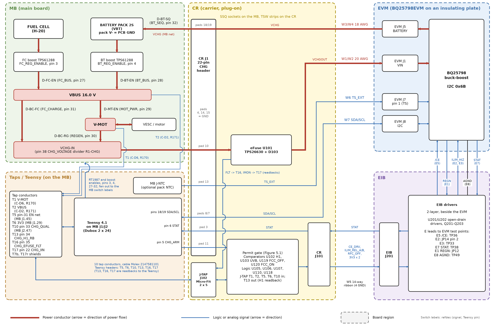
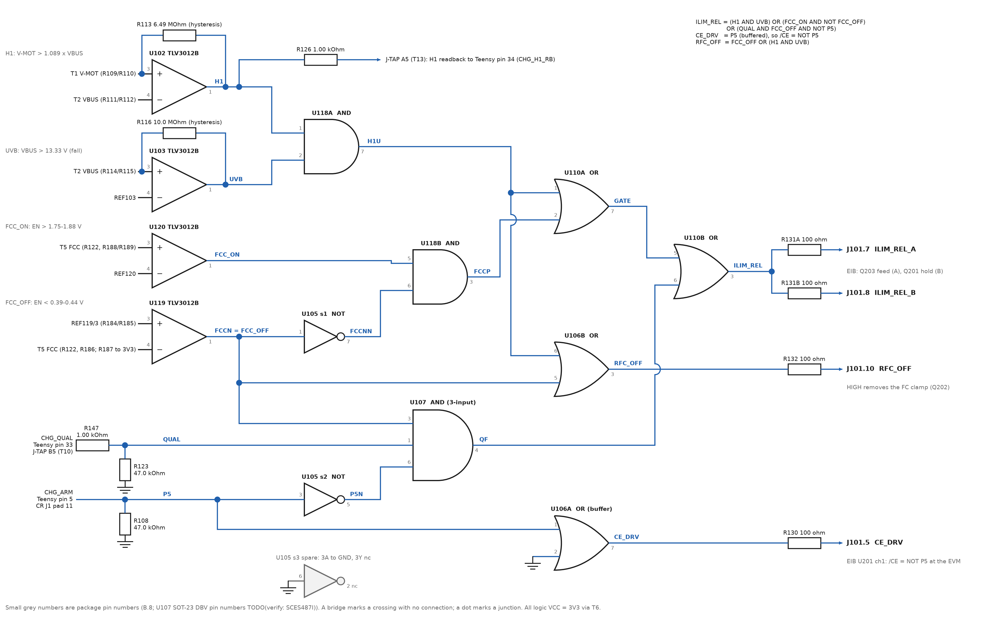
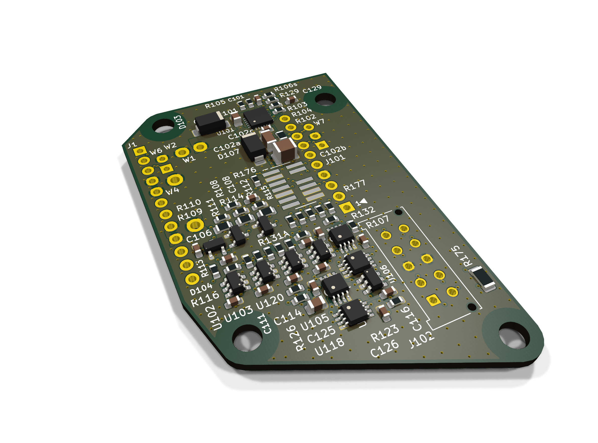

# Charger EVM r9: design review guide

## 1. Purpose and how to read this document

This README presents the r9 charger design for operator review, with progressive detail. Section 2 shows the overall
functional block diagram and the architecture. Section 3 lists what changed on 2026-11-12; a reader who needs only the
changes can read section 3 alone. Sections 4 to 7 explain the design concepts, the permit gate, the operating modes and the
firmware consequences. Sections 8 to 12 cover the physical implementation, status, plan, open items and the source
index. Appendix A defines the abbreviations and the identifier families.

The full record is the design document `docs/charger_bq25798_wiring_design_2026-11-05.md` (revision r9). Section 12 maps
each topic to its authoritative file and section. Neither text that the design document marks "superseded", "withdrawn"
or "history" nor the r7-outline work in `archive_r7_outline/` is the current design.

## 2. Architecture

### 2.1 Block diagram

Three different parts carry the refdes J1. In this document, **CR J1** is the 22-pin CHG header (TSW strips). **MB
J1/J2** are the Teensy 4.1 Dubox receptacles, and **EVM J1** is the charger VIN screw terminal.

Figure 2.1 shows the power and signal architecture of the charger path. Power flows from VBUS or V-MOT into the EVM and
returns to the pack through CR J1 pads 18/19.



Figure 2.1. Charger path, block diagram (r9).

The diagram is schematic and not to scale. Thick red conductors carry power and thin blue lines carry logic or analog
signals; a bridge marks a crossing with no connection. The source is `gen/readme_figures.py`. Only CR J1 pad 11 and the J-TAP conductors enter the permit gate. Table 2.2, section 8.6 and
design-document sections A.5 and C give the EIB-to-EVM leads and the EVM modifications.

### 2.2 Blocks

Table 2.1 lists each block, its role and its physical location.

Table 2.1. Blocks of the charger path.

| Block | Role | Physical location |
|---|---|---|
| MB RT1987 switches D-BC-FC, D-BC-RG | Route VBUS (FC charging) or V-MOT (regen) into VCHG-IN | MB, existing parts |
| MB D-BT-SQ (RT1987) | Connects the charger output net VCHG to the pack VBT | MB, existing part |
| CR J1 (22-pin CHG header) | Mates the CR to the 22 former Ag105 holes | CR underside, TSW strips in MB SSQ sockets |
| eFuse U101 TPS26630RGER | Input current limit 2.23 A nominal, UVLO 9.91 V, OVP 23.12 V; fault output and IMON | CR top |
| Permit gate | Four comparators and five LVC packages; holds the converter off unless a release term is true | CR top |
| J-TAP (J102) | Brings the ten tap conductors onto the CR | CR, THT header, +x side |
| EVM (BQ25798) | Buck-boost charger, I2C address 0x6B | Off-board, on an insulating plate fixed to the chassis |
| EIB | Converts CR logic levels into /CE, ILIM_HIZ hold/release and the FC current clamp at the EVM | 2-layer board on two M3 x 10 mm nylon standoffs on the EVM plate |
| Teensy 4.1 | Commands CHG_ARM, CHG_QUAL and the RT1987 enables; reads readbacks and I2C | MB, on J1/J2 receptacles |

Every block in Table 2.1 appears in Figure 2.1. Only the MB switches, the eFuse and the EVM carry charger power; the
other blocks carry logic.

### 2.3 Interfaces

Table 2.2 lists each interface, its connector and what crosses it.

Table 2.2. Interfaces of the charger path.

| Interface | Connector | What crosses it |
|---|---|---|
| MB to CR power and signals | MB SSQ-110/112-01-L-S sockets, CR TSW-110/112-07-L-S strips (CR J1) | Pad 10 VCHGIN; pads 18/19 VCHG; pads 4, 14, 15 GND; pad 11 CHG_ARM; pad 3 STAT; pads 8/7 SDA/SCL; pad 13 TS_EXT; 11 pads without a net |
| MB to CR taps | J-TAP (J102) Micro-Fit 3.0 2 x 5 (Molex 43045-1012), cable Molex 2147561101 | T1, T7b, T2, T5, T6, T10, T13, T16, T17, T17r |
| CR to EVM input | W1 (VCHGOUT), W2 (GND); CR plated holes to EVM J1 screw terminal | Charger input, <= 2.41 A for <= 202 ms (eFuse limit), normally <= 1.76 A |
| EVM to CR output | W3 (VCHG), W4 (GND); EVM J5 screw terminal to CR plated holes | Charger output, <= 3.21 A |
| CR to EVM I2C | W7 twisted triple; CR plated holes to EVM J8 (Molex KK 254 housing) | SCL, SDA; GND bonded at the CR end only |
| CR to EVM thermistor | W6 twisted pair to EVM J7 pin 1 | TS_EXT; fitted only if a pack NTC is fitted at J-NTC |
| CR to EIB | W5 14-way 0.635 mm flat cable, CR J101 to EIB J201 | 3V3 (two conductors), CE_DRV, ILIM_REL_A, ILIM_REL_B, RFC_OFF to the EIB; STAT to the CR; four GND |
| EIB to EVM | E leads, 28 AWG Kynar | E8 AGND to TP49, E3 to TP33, E2 to JP14 pin 2, E7 STAT to TP38, E1 REGN to JP12, E5 /CE to TP36 |

Every interface in Table 2.2 appears in Figure 2.1. The power interfaces are CR J1 pads 4, 10, 14, 15, 18 and 19 and the
leads W1-W4. All logic crosses CR J1, J-TAP, W5, W6, W7 or the E leads.

## 3. What changed on 2026-11-12

The thermocouple and the polyimide sheet are removed, T-F-16 is retired, and no charging of any kind runs before the R5 build flag
(section 7.2). Sections 3.1 to 3.3 give the full change record.

### 3.1 Physical and functional changes

The 2026-11-12 decisions removed parts, moved signals and replaced the carrier outline. Table 3.1 lists every change that
a reviewer could otherwise miss. The decision identifiers refer to `LAYOUT_DECISIONS.md` (D-38 to D-50) and to the
design-document change rows r8-17 and r9-1 to r9-8. The CR outline row and the standoffs row also give the 2026-11-13
outline trim and mounting holes of D-60, as amended by the D-62 outline. (**Superseded 2026-11-13, D-62:** "outline
trim and mounting holes of D-60.")

Table 3.1. Changes of 2026-11-12.

| Area | Before (r8 or r7) | Now (r9) | Record |
|---|---|---|---|
| Thermocouple on the MB VBT trace | Fitted under the polyimide sheet, read in T-F-16 | **Removed.** No replacement. The MB VBT trace, at its IPC-2221 10 C rise at 3.21 A on 1 oz, is accepted unmeasured; T-F-16 is retired (operator ruling 2026-11-12, design-document J.1 item 25) | D-43 |
| Polyimide sheet over 368 untented MB vias | 0.125 mm sheet bonded under the CR | **Retired.** Protection is the >= 1.5 mm air gap and the solder-masked L4 GND | D-43 |
| CR outline | r7 outline with tab X, tab Y, chamfer and feet FT1/FT2 | **Plug-on rectangle** x 18.584-67, y 7-94 (48.416 x 87 mm, 4212.2 mm2), removable; this rectangle stays the placement frame. 2026-11-13: after routing, the board is trimmed to the **D-62 outline** inside the rectangle: 10 corners, edges at 0, 30, 45, 60, 90, 120, 135 or 150 degrees, slanted edges of at least 2.0 mm, 1.0 mm corner fillets; 2327.7 mm2 (55 %), bounding box 40.02 x 64.81 mm, x 18.584-58.60, y 7.83-72.64. (**Superseded 2026-11-13, D-62:** "a **convex 18-vertex outline** inside the rectangle: 2241.6 mm2 (53 %) ... x 18.58-58.60", the D-60 trim.) | D-39, D-60, D-62 |
| MB parts under the CR | None of the switching parts | Both boost switching nodes, L-FC, L-BT, REG-5V: about 1.6-3.3 W, BT boost TODO(calc) (Table 8.1) | D-39 |
| MB-CR mating | TSW pins soldered into the MB | Samtec SSQ sockets on the MB, TSW strips on the CR, hard stop at 11.05 mm | D-41 |
| Standoffs, feet, key | Feet FT1/FT2 bonded with RTV | **No standoffs on the MB.** Friction fit of 22 contacts; J-BL and J-FC stop a flipped CR, and a +x key ear keeps that overlap; T-F-18 re-scoped to CR retention. 2026-11-13: four 6-32 NPTH holes MH1-MH4 on the CR hold a 3D-printed support. (**Superseded 2026-11-13, D-60:** "**None.**" and "the terminal blocks stop a flipped CR".) | D-41, D-42, D-60 |
| Assembly | SMT on both sides | **All SMT on the top**, one stencil, one reflow; THT hand-soldered last | D-44 |
| Copper weight | 2 oz outer / 1 oz inner | 1 oz outer / 0.5 oz inner (OSH Park); set on 2026-11-11, kept by the 2026-11-12 amendment | D-29 |
| L4 use | Signals, the VCHGOUT strap and a GND pour | Solid GND, no signals, no straps | D-20 |
| Finish method | Interactive finish from the r7 start board | Retired; full route-race on the new outline | D-36, D-50 |
| Tap conductors | 23 taps on SMT pads F01-F24 | **10 taps** on one Molex Micro-Fit 3.0 2 x 5 header J-TAP (J102) | D-46 |
| Permit gate logic | 11 LVC packages, two monostables | **5 LVC packages** (U105, U106, U107, U110, U118), no sequential element | D-47 |
| Comparators | Seven (incl. U104 BT_OK, U115 BTB_OFF, U121 RGN_ON) | **Four**: U102 H1, U103 UVB, U119 FCC_OFF, U120 FCC_ON | D-47 |
| QUAL timing | Hardware one-shot U111 (0.20-0.46 s) | Level input; firmware bound T_QUAL_MAX 0.46 s | D-47 |
| Hang defence | Heartbeat monostable U113 (ARM_OK) on pin 21 | **R5 watchdog only** (firmware); pin 21 freed | D-47, D2-2 |
| Pack OV | BQ29200 OUT tap T22 into a gate pack-OV input (OVN) | **Firmware only**: LIMIT_V_BATT_MAX 8.5 V, CHG_PACK_OV (FR-47(a)), OV_BATT | D-38 |
| Balance lead J-BL | Required to charge | Not required to charge | D-38 |
| CHG_QUAL | Teensy pin 10 (SPI CS0 default) | **Teensy pin 33**; pin 10 freed | D-48 |
| EIB far-end senses | U203 (ILIM_HIZ) and U204 (/CE) fitted | **DNP** with C203, C204, R258-R265; leads E4, E6 not built | D-49 |
| W5 ribbon conductors 11, 13 | ILIM_SENSE, CE_SENSE | **Not connected**; J101 stays 2 x 7; 9-10 and 8-9 shorts reach 33 mA (section 8.6) | D-49 |
| W6/W7 at the CR | SMT pads | Plated through-holes, soldered | D-45 |
| Chip sizes | Six 0402 parts | All chip passives 0603 or larger | D-44 |
| Teensy pin 7 readback (step PM10) | Planned (ROS removal) | Withdrawn; ROS stays fitted, pin 7 undriven | r9-4 |
| Keep-alive option (design-document B.5), U117 FC-current shed | DNP footprints | Withdrawn; no footprints. If T-F-04b fails, FC windows are restricted to standstill and coast (FR-14(e)). If T-B-09 fails, fallback 2 (fused VBT-VCHG link, PM8) or a later keep-alive redesign applies | r9-3 |
| Audit certification | Audit run 001 (L.8) | **Not certified** until audit run 002 (L.9) | r9-8 |
| Charging precondition | R5 needed for FC windows only | **No charging of any kind** before the R5 build flag (R5 firmware and T-W-01a) | D2-1 |

Most rows of Table 3.1 remove hardware and move its function into firmware or into a test. The plug-on outline is the
one change that adds new mechanical and thermal open items (sections 8.1 and 8.2).

### 3.2 Withdrawn and re-scoped tests, requirements and MB steps

Table 3.2 lists the tests, firmware requirements and MB steps that the 2026-11-12 decisions withdrew or re-scoped.

Table 3.2. Withdrawn or re-scoped tests, requirements and MB steps.

| Identifier | Status | Record |
|---|---|---|
| T-F-17, T-A-01c | Withdrawn | r8-17 |
| PM11 (BQ29200 OUT tap T22) | Deleted | r8-17 |
| T-B-03 | Withdrawn; its stray-shunt check and level criteria have no new home | r9-2 |
| T-C-05, T-C-07, T-C-13, T-C-16 | Re-scoped | r9-2 |
| PM7 (taps T18, T19) | Deleted | r9-3 |
| PM10, T-A-01b, T-E-02 | Withdrawn | r9-4 |
| T-A-09 | Withdrawn | r9-5 |
| T-F-16 | Withdrawn (operator ruling 2026-11-12; trace rise accepted unmeasured, J.1 item 25) | r9-5 |
| T-F-18 | Re-scoped to CR vibration and contact retention | r9-5 |
| FR-08(a), FR-08(c) | Withdrawn; FR-08(b) replaced by an I2C latch trip | r9-7 |
| FR-09, FR-34, FR-35, FR-47(b), I-7, T-C-10, T-D-09 | Withdrawn | r9-7 |

Table 3.2 matters most for test-plan and firmware review. The design document marks each of these identifiers withdrawn
or re-scoped in its own row.

### 3.3 Unchanged context

The project still replaces the Silvertel Ag105 module (refdes CHG) on motherboard rev 20260622 with a TI BQ25798EVM.
Nothing has been ordered, desoldered or flashed. The bench board still runs fw v37 rev 2 with `AG105_VBATN_ISOLATED` 0,
so the bench performs no regen charging. No firmware file is edited in this round.

## 4. Design concepts, high level

### 4.1 The problem the charger path solves

The charger path must harvest regen energy from V-MOT and charge the pack from the fuel cell through VBUS. Operator
ruling R1 makes both functions hard requirements. Ruling R6 allows FC charging only in windows between H-20 purges, and
ruling R7 allows regen and FC charging to run concurrently. The Ag105 module cannot meet these requirements safely.
Ruling R2 therefore selects the BQ25798EVM as the power stage on the current board.

Ruling R5 requires an MCU hardware watchdog before any charger arming. This document calls that watchdog the R5
watchdog.

### 4.2 Hazards

The governing safety requirement is ruling R3': no circular charging loop VBUS -> charger -> pack -> BT boost -> VBUS,
and no runaway. The charger may stay powered through Run only with a fail-safe Teensy-commanded hard inhibit plus a
hardware comparator backstop. Table 4.1 lists the four hazards that follow from this requirement.

Table 4.1. Hazards.

| Hazard | Mechanism |
|---|---|
| Bus feeds the charger | With MOT_PWR closed, V-MOT sits at bus level, so an open REGEN path feeds the charger from VBUS |
| Back-feed into a disabled boost | A disabled TPS61288 passes current through its body diode; the only pack-to-VBUS element is D-BT-EN |
| Pack overvoltage | A corrupted charger voltage register or a failed charge stop overcharges the 2S pack |
| Hung MCU | A frozen Teensy holds the last commanded switch and gate levels |

The first two hazards concern energy flow between the rails. The last two concern the pack and the controller, and
section 4.3 shows that firmware carries most of their defence.

### 4.3 Defence layers

The design defends each hazard with up to four layers. The register layer is the BQ25798 register image (VINDPM,
IINDPM, ICHG, VREG). The firmware layer is the set of invariants and trips in design-document sections F.5 and G.2. The
hardware layer is the CR permit gate. The watchdog layer is the R5 watchdog, implemented in firmware.

Table 4.2 uses three gate signals that section 5 defines in detail. H1 is HIGH when V-MOT exceeds 1.089 x VBUS, UVB is
HIGH when the bus is healthy, and FCCP is the FC-window release term. The table also uses t_WDT, the R5 watchdog timeout
(50 ms target).

Table 4.2. Defence layers per hazard.

| Hazard | Register layer | Firmware layer | Hardware permit gate | Watchdog |
|---|---|---|---|---|
| Bus feeds the charger (regen-armed cruise) | VINDPM 18.62-19.38 V above the 16.39 V bus maximum | I2C latch trip (FR-08(b)); H1 plausibility check (FR-08(d)) | The regen comparator pair (H1 AND UVB) holds ILIM_HIZ until V-MOT exceeds 1.089 x VBUS | R5 resets within t_WDT |
| Loop in an FC window | VINDPM 14.5 V, IINDPM <= 0.90 A | FC_CHARGE and BT_BUS never HIGH together (invariant I-9), FAULT_SWITCH_CONFLICT, BT-current trip (FR-10) | None in r9; the FC-window release term (FCCP) only releases the converter | R5 |
| Back-feed into a disabled boost | None | Switch ordering rules; reset release order checked in T-W-01 | None | Reset drops every EN through 10 kOhm pull-downs |
| Pack overvoltage | VREG 8.320 V interim; VBAT_OVP follows VREG (not independent) | Register read-back (FR-46), slot-5 verify, CHG_PACK_OV (FR-47(a)), OV_BATT at 8.5 V | None since D-38 | R5 bounds a hang to about 51 ms |
| Hung MCU | BQ25798 watchdog 0.5 s (never cited as a barrier) | Watchdog feed token from the 1 kHz monitor tick (FR-28) | None since D-47 | **R5 is the only hang defence** |

The operator stance behind the r9 gate is "trust firmware except the regen H1 AND UVB check". The no-loop claim
therefore holds only as a register- and firmware-backed claim. In regen-armed cruise the hardware keeps one check, H1
AND UVB. In an FC window the loop barrier is firmware only.

The BQ25798 watchdog stays at 0.5 s with STOP_WD_CHG = 1, read back in every register verify (FR-03, ruling D2-4). Bench
test T-B-08 settles three SLUSDV2C conflicts, among them the VREG value after a watchdog expiry. The fallback setting is
WATCHDOG = 00.

## 5. The permit gate

### 5.1 Concept

The BQ25798 converts only when three conditions hold together. /CE must be LOW, EN_CHG must be 1, and the converter must
be released (ILIM_REL HIGH). The permit gate controls the first and the third condition. EIB Q201 holds ILIM_HIZ below
0.75 V (converter off, REGN on) unless ILIM_REL_B is HIGH, so a release needs two healthy switches. The gate has no
sequential element in r9.

### 5.2 Inputs

The gate has six inputs: four comparator outputs and two Teensy commands. Table 5.1 lists them.

Table 5.1. Permit gate inputs.

| Input | Source | Meaning when HIGH | Thresholds |
|---|---|---|---|
| H1 | U102 TLV3012B; T1 (V-MOT) against T2 (VBUS) | V-MOT > 1.089 x VBUS; the bus cannot feed V-MOT | Rise 17.31 V, fall 17.01 V at VBUS 15.9 V; hysteresis 0.30 V |
| UVB | U103 TLV3012B; T2 against its own reference | Bus healthy | VBUS > 13.33 V fall, 13.72 V rise |
| FCC_OFF (net name FCCN) | U119; T5 (D-BC-FC EN net) | D-BC-FC guaranteed off | EN < 0.39-0.44 V (below RT1987 VEN_F 0.6 V) |
| FCC_ON | U120; T5 | D-BC-FC commanded on | EN > 1.75-1.88 V (above RT1987 VEN_R 1.4 V) |
| P5 | CHG_ARM, Teensy pin 5 via CR J1 pad 11; R108 47.0 kOhm pull-down | Charging allowed | Logic level |
| QUAL | CHG_QUAL, Teensy pin 33 via T10; R123 47 kOhm pull-down | Run-entry qualification read requested | Logic level |

P5 and QUAL are the gate-variable names of the Teensy commands CHG_ARM and CHG_QUAL. FCC uses two comparators because the
RT1987 may turn on anywhere up to 1.4 V and is guaranteed off only below 0.6 V. An intermediate EN level, an open T5 or
a comparator in power-on reset reads FCC_OFF = FCC_ON = 0. That state releases nothing through the FC or qualification
terms. An open T5 sits at about 0.97-1.0 V and announces itself at Run entry.

### 5.3 Logic

The design-document section B.1 defines the gate in three equations:

```text
ILIM_REL = (H1 AND UVB) OR (FCC_ON AND NOT FCC_OFF) OR (QUAL AND FCC_OFF AND NOT P5)
CE_DRV   = P5 (buffered), so /CE = NOT P5
RFC_OFF  = FCC_OFF OR (H1 AND UVB)
```

Figure 5.1 shows the same equations as a gate-level diagram, with the comparators, the package sections of Table 8.3,
the pull-downs and the output resistors to J101.



Figure 5.1. Permit gate, logic diagram (r9).

In Figure 5.1, the small grey numbers are package pin numbers from design-document B.8. The U107 DBV pin numbers are
still TODO(verify: SCES487I).

The first release term (H1U) is the regen release. The second term (FCCP) is the FC-window release; it needs both
comparators to agree, so a stuck-HIGH U120 alone does not release the converter. The third term (QF) releases the
converter for the Run-entry ADC read only while /CE is HIGH and FC charging is proven off.

RFC_OFF is HIGH whenever FC charging is proven off (FCC_OFF) or the regen release is active (H1 AND UVB). A HIGH
RFC_OFF removes the FC current clamp (0.65-0.95 A) at the EVM ILIM pin. The clamp therefore acts only in an FC window with no regen
release.

At Teensy reset or boot, the pull-downs give P5 LOW and QUAL LOW, and the buffer drives CE_DRV LOW, so /CE is HIGH. The
RT1987 EN pull-downs keep the charger unpowered. During comparator power-on reset (<= 1.9 ms) all four comparator outputs
are LOW, so no release term is true. Design-document section B.1 gives the full truth table, and section 8.4 maps the
terms onto packages.

### 5.4 Accepted latent faults

The operator accepted several single faults that no hardware detects in service. Table 5.2 lists them.

Table 5.2. Accepted latent faults of the r9 gate.

| J.1 item | Fault | Consequence | Remaining barrier |
|---|---|---|---|
| 18 | Stuck-HIGH output of U118A, U118B, U110A or U110B, or ILIM_REL shorted to 3V3 | Converter released in regen-armed cruise with /CE LOW | VINDPM 18.62-19.38 V only |
| 19 | QUAL stuck HIGH (pin 33 or T10) | Converter released whenever P5 and FCC are LOW | /CE HIGH and EN_CHG = 0 |
| 13 | /CE stuck LOW (U201 1Y, or R272 and R272b both open) | Charging whenever released; CHG_PACK_OV inhibit (FR-47(a)) lost | I2C latch trip while released (FR-08(b)); OV_BATT |
| 20 | QUAL stuck HIGH plus /CE stuck LOW | Full R3' loop | FR-08(b) with a live MCU; R5 under a hang |
| 21 | T5 node driven HIGH (short to T6, or pin 31 stuck HIGH) | FC_CHARGE may be on with BT_BUS HIGH | VINDPM only; J-TAP pin order |
| 22-24 | RFC_OFF blind to REGEN; no hardware loop barrier in an FC window; no arrival check at the EVM | See design document | Firmware |
| 15 | Open tap T13 (pin 34) | Pin 34 reads "no brake", so F.5-T3 never fires and harvest above the FC image is lost; safe direction | The hardware H1 on the CR |
| 16 | Open tap T16 (pin 35) | Pin 35 reads "no fault"; an eFuse trip is seen only as a V_chg collapse | None dedicated |

Most entries in Table 5.2 leave a register or firmware barrier only. UVB stuck HIGH is also latent, with no readback;
its acceptance against a readback on a freed pin is undecided. Section 8.4 gives the build tests that cover these faults.
In service, the J-TAP pin order is the only hardware mitigation: T5, T6 and T10 occupy pairwise non-adjacent cavities.

## 6. Operating modes and protections

### 6.1 Switch states per mode

Table 6.1 gives the switch state of each main mode. A full vector lists eight switches in the order FC_REG, BT_REG,
FC_BUS, BT_BUS, MOT_PWR, REGEN, FC_CHARGE, BT_SEQ. Rows without a full vector list only the switches and commands that
change. The mode names follow design-document section F.2.

Table 6.1. Modes, switch states and stop conditions.

| Mode | Switch state | What releases the converter | What stops it |
|---|---|---|---|
| Init (State 0) | Staged bring-up through several vectors; REGEN 0, FC_CHARGE 0 | Nothing; the charger has no input power | Not applicable |
| Idle (State 1) | 1 1 1 1 1 0 0 1; P5 0, QUAL 0 | Nothing; the charger has no input power | Not applicable |
| Run entry qualification (F.5-T1) | 1 1 1 1 1 1 0 1; P5 0 | QF (QUAL HIGH, raised only on PG_STAT = 1) | Firmware drops QUAL; T_QUAL_MAX 0.46 s backstop latches CHG_QUAL_OVERRUN |
| Regen-armed cruise | 1 1 1 1 1 1 0 1; P5 1 | Nothing; H1U = 0 holds ILIM_HIZ | Not applicable |
| Regen burst | As regen-armed cruise | H1U = 1 while V-MOT > 1.089 x VBUS | H1 falls; VINDPM 19.0 V; IINDPM 1.70 A; clamp 1.33-1.76 A |
| FC window (R6/R7) | 1 1 1 0 1 1 1 1; P5 1 | FCCP (FCC_ON agreeing with NOT FCC_OFF) | Closes at t_pred - T_LEAD before each purge; FR-42 backstop; IINDPM 0.90 A; raw I_fc > 1.20 A arm drop; OC_FC 1.4 A |
| Charger trip in a window (F.5-T10) | P5, QUAL, FC_CHARGE and REGEN LOW on the same tick | None | BT_BUS closes only after a no-conversion proof, else controlled State 99 |
| State 98 J | Stage 1: as F.5-T1. Stage 2: BT_BUS 0, FC_BUS 1, REGEN 1, FC_CHARGE 1 | Stage 1: QF. Stage 2: FCCP | G1-G3 guards (re-key open); reboot-only trip latch |
| State 99 (F.5-T7) | Phased teardown | None | Phase 0 drives P5 and QUAL LOW before any switch moves |
| Teensy reset | All EN LOW through 10 kOhm pull-downs | None | Not applicable |

In Table 6.1, t_pred is the predicted purge time and T_LEAD is the 100 ms purge lead time. Outside State 98, only three
modes can release the converter: qualification, a regen burst and an FC window.

### 6.2 Qualification and arming order

QUAL rises only with P5 LOW, and only after EN_CHG = 0 and REG11 = 0 are written and read back. On every P5 path, QUAL
is driven LOW and held LOW for at least one 1 kHz tick before P5 rises (invariant I-5). During qualification the bus
feeds the charger quiescent current, about 50-90 mW, for at most 0.46 s per Run entry. J.1 item 14 records this draw as
an explicit R3' exception.

### 6.3 FC windows

An FC window is admitted only with all of these conditions:

- charge_goal > 0.05;
- the chgFull latch (set when the charger reports charge done) clear;
- the purge schedule locked;
- no trip latch;
- the R5 build flag and the full-T-W-01 build flag set (section 7.2).

The FC image sets VINDPM 14.5 V, IINDPM = min(0.90 A, G) and ICHG 1.60 A. G is the traction-current governor limit of
design-document section F.4; it subtracts a 2 s peak-hold of traction current. BT_BUS stays LOW for the whole window,
which by itself removes the only pack-to-VBUS element. During a brake in a window, V-MOT > VBUS reverse-biases D-BC-FC,
so the charger draws only from the motor.

### 6.4 Hang behaviour

Under a hang the gate follows the frozen P5, QUAL and FCC levels. Charging continues as last commanded for at most
t_WDT + 1 ms, about 51 ms at the 50 ms target. The watchdog reset then drops P5, QUAL and every EN through the
pull-downs. This bound assumes that the i.MX RT1062 pad keeper does not hold pins 5 and 33 HIGH against the 47 kOhm
pull-downs. Keeper strength is TODO(verify: IMXRT1060RM). A hang inside an FC window can still meet one purge with a
frozen MCU, in about 1.5 % of window hangs. Only the bench characterises this case (T-D-14).

## 7. Firmware requirements this hardware creates

### 7.1 Scope

The firmware is not changed in this round. Every item below is a requirement for the future BQ25798 firmware round,
which follows the PCB design. The R5 watchdog firmware is built in that same round.

### 7.2 Preconditions for charging

The firmware records two build flags. The R5 build flag states that the R5 watchdog firmware exists and T-W-01a (forced
hangs without a purge) has passed. The full-T-W-01 build flag states that the full T-W-01, with the T-D-14
purge-emulator cases, has passed.

No charging of any kind (regen, qualification or FC windows), attended or not, runs before the R5 build flag is set. FC
windows additionally need the full-T-W-01 build flag. Run with the charger disarmed needs neither flag.

The EVM must not be connected until the IO CSV is amended and firmware with the new pin map is flashed. The reason is
that fw v37 State 98 key '4' toggles pin 5 directly.

### 7.3 Pin map

Table 7.1 lists the Teensy pins that the charger path uses or frees in r9.

Table 7.1. Teensy pins of the charger path.

| Pin | Code name | Direction and mode | Route |
|---|---|---|---|
| 5 | CHG_ARM (was MPPT_DISABLE) | OUTPUT, LOW early in setup(); HIGH = charging allowed | CR J1 pad 11 |
| 6 | CHARGER_STAT | INPUT; polarity inverted vs Ag105 (LOW = charging) | CR J1 pad 3 |
| 18, 19 | SDA, SCL | I2C 400 kHz (100 kHz fallback), MB pull-ups 2.7 kOhm | CR J1 pads 8, 7 |
| 20 | WDOG1_B_RSVD | Unconfigured until R5; no CR consumer | None |
| 22 | CHG_IIN | INPUT_DISABLE, analog, 0.764 V/A | T17 |
| 31 | FC_CHARGE_ENABLE | OUTPUT, never INPUT_PULLUP | T5 taps the EN net |
| 33 | CHG_QUAL | OUTPUT, LOW early in setup(); no peripheral may claim it | T10 |
| 34 | CHG_H1_RB | INPUT_PULLDOWN, GPIO only (never WDOG1_B) | T13 |
| 35 | CHG_EFUSE_FLT | INPUT_PULLUP (the only pull-up) | T16 |
| 38 | CHG_VOLTAGE | Analog, VCHG-IN through R1-CHG | MB |
| 10, 16, 17, 21, 23 | FREE_10, FREE_16, FREE_17, FREE_21, FREE_23 | INPUT_PULLDOWN, boot read, UNEXPECTED_LEAD on HIGH | None |

Pins 5 and 33 are the only charger commands, and both default LOW. Every other charger pin in Table 7.1 is an input or
an analog channel.

### 7.4 Principal requirements

The design document defines the requirements as FR-01 to FR-49 and invariants I-1 to I-9. Table 7.2 lists the items
that carry the r9 safety argument.

Table 7.2. Principal firmware requirements.

| Requirement | Content |
|---|---|
| R5 watchdog | RTWDOG 50 ms while rtwdogShort is TRUE (State 2, or any of P5, QUAL, FC_CHARGE, REGEN HIGH); WDOG1 1.0 s second stage; fed only by the FR-28 token in the 1 kHz monitor tick |
| T_QUAL_MAX backstop | An independent 1 kHz check drops QUAL, P5 and REGEN after 0.46 s of QUAL HIGH (FR-04, FR-45) |
| Invariant I-9 | FC_CHARGE and BT_BUS are never HIGH together; both setters refuse |
| FR-13 | FC_CHARGE + REGEN becomes legal; FC_CHARGE + BT_BUS stays a latched conflict |
| FR-49 | Outside State 98, the FC_CHARGE setter refuses HIGH while REGEN is LOW; RT1987 EN pads are checked at boot and before every Run entry |
| FR-07 | The pin-34 interrupt acts on both edges; the falling edge posts the F.5-T4 image restore at the queue head and re-reads H1 at service time |
| F.5-T3 gate | The raise of the charger image on a brake in an FC window requires REGEN read back HIGH |
| FR-08(b) | With P5 LOW for >= 20 ms, a charging status or IBAT > 50 mA on two fresh reads latches a trip |
| FR-47(a) CHG_PACK_OV | BT_VOLTAGE (pin 25) above 8.5 V on one sample drops P5 first; not yet implemented, so only OV_BATT acts today |
| FR-11 | CHG_IIN must agree with the I2C IBUS ADC; a sustained disagreement latches CHG_IIN_LEAD |
| F.5-T10 proof (d) | The no-conversion proof (d) is used only after CHG_IIN and IBUS agree in the same charger power cycle (lead-alive rule); otherwise F.5-T10 falls back to proof (b) |
| FR-18 | State 98 J becomes two stages: register commissioning, then a supervised FC-window charge |
| FR-20 | Telemetry protocol v5, bumped in lockstep with the Pi bridge |
| FR-02 | The Ag105 driver is removed; `AG105_VBATN_ISOLATED` is renamed `CHG_RETURN_VERIFIED` |

The lead-alive rule in Table 7.2 has a known gap. An open T17, or a T17r-T17 short, can make proof (d) pass falsely;
the lead-alive agreement is the only guard against this case.

### 7.5 IO CSV amendments

The D.3 rows are applied to `references/Scale Car Teensy IO - IO - 2026-11-12.csv`, which is now the authoritative Teensy pin map.
The orchestrator applied them on 2026-11-12 under the operator's delegation (design document D.3, change row r9-11). The
undated `references/Scale Car Teensy IO - IO.csv` is deleted.

The applied CSV replaces rows 5, 6 and 31 and amends the notes of rows 27-30 and 32. It adds rows 19 (note), 20, 22, 33,
34 and 35. It also adds freed-pin rows for pins 10, 16, 17, 21 and 23 with the code names FREE_10, FREE_16, FREE_17,
FREE_21 and FREE_23; row 10 notes the SPI CS0 default. Rows 28, 30 and 31 state that a pull-up lifts the EN net to about
1.02 V nominal and 0.69-1.68 V over tolerance (H.24(b)), which can exceed the RT1987 VEN_R maximum of 1.4 V. Row 31 states
the FR-49 rule: outside State 98, firmware raises FC_CHARGE_ENABLE only with REGEN_ENABLE HIGH. Row 7 is unchanged.

## 8. Physical implementation

### 8.1 CR outline and mating

The CR is a removable plug-on board. Its placement frame is the D-39 rectangle at x 18.584-67, y 7-94 in the MB frame
(Eagle board coordinates, +y up). After routing, the board is trimmed to the D-62 outline inside that rectangle
(LAYOUT_DECISIONS D-62, which redoes the D-60 trim). Every edge runs at 0, 30, 45, 60, 90, 120, 135 or 150 degrees,
every slanted edge is at least 2.0 mm long, and every corner carries a 1.0 mm fillet drawn as an Edge.Cuts arc. Before
the fillets, the outline has 10 corners: (58.600, 71.043), (55.835, 72.640), (25.266, 72.640), (22.564, 71.079),
(18.584, 67.100), (18.584, 28.193), (21.845, 22.545), (47.332, 7.830), (56.928, 7.830) and (58.600, 10.726). The
filleted outline has an area of 2327.7 mm2 against 4212.2 mm2 for the rectangle (55 %), and its bounding box is
40.02 x 64.81 mm at x 18.584-58.60, y 7.83-72.64. The -x vertices sit exactly on the D-39 edge at x 18.584, and each
screw-head disc overhangs the edge by 0.001 mm or less (`cr/constraint_check.md`). The outline has no tab and no
concave corner. The fabricator charges for the enclosing rectangle, which D-62 does not change; the trim keeps more of
the MB exposed under the CR. (**Superseded 2026-11-13, D-62:** "trimmed to a convex 18-vertex outline inside that
rectangle (LAYOUT_DECISIONS D-60). The trimmed outline has an area of 2241.6 mm2 ... at x 18.58-58.60 ... so the -x
vertices sit at x 18.58 (0.004 mm outside the D-39 edge) and a head disc can overhang the edge by up to 0.052 mm".)
(**Superseded 2026-11-13, D-60:** "The CR is a removable plug-on rectangle at x 18.584-67, y 7-94" and "It has no tab,
chamfer, concave corner or mounting hole".) Samtec SSQ-110-01-L-S (pins 1-10, x 45.998 column) and SSQ-112-01-L-S
(pins 11-22, x 20.998 column) sockets are soldered into the 22 MB CHG holes. TSW-110-07-L-S and TSW-112-07-L-S strips
sit with their bodies on the CR underside. All 22 positions are populated.

The stack has a hard stop where each TSW body seats on its SSQ face. The CR underside is then 11.05 mm above the MB top,
and the CR top is at 12.65 mm. TSW in SSQ is rated 6.3 A per pin with two positions powered. The design powers four
positions (pins 14/15/18/19, 1.93 A each); that derating is TODO(verify: Samtec derating curve). The SSQ is rated for 100
mating cycles.

The CR has no separate keying part; the J-BL and J-FC terminal blocks key it (D-41), and the MB has no standoffs.
A CR rotated 180 degrees lands on J-BL (7.73 mm of x
overlap) and J-FC (7.73 mm) at their top height of 21.70 mm before its pins engage at 16.89 mm. The +x key ear of the
outline (box x 50.0-58.6, y 52.0-71.0) keeps this overlap. The engagement-start height must therefore stay below
21.70 mm. The D-62 fillet at the corner (58.600, 71.043) clips 0.027 mm2 off the ear box, so the constraint check
measures the ear against the corners before the fillets; the D-41 key row, which rotates the filleted outline, is the
functional check. (**Superseded 2026-11-13, D-62:** "J-FC (7.63 mm)", the D-60 outline.) (**Superseded 2026-11-13, D-60:** "The CR has no key and no standoffs. A CR rotated 180 degrees lands on
J-BL, J-FC and J-BT (21.70 mm)".)

Four non-plated 3.70 mm holes (6-32 free fit) are at the corners of the CR: MH1 (26.23, 69.04), MH2 (54.85, 68.79), MH3
(54.85, 11.43) and MH4 (24.48, 25.18), MB frame (D-60; D-62 moves MH2 from (54.85, 63.79)). The holes hold a 3D-printed
support; the MB clearance under each hole is not a criterion. Each hole has an all-layer copper keep-out of radius
4.0 mm, and a screw-head disc of radius 3.6 mm stays on the board within the 0.06 mm trim tolerance. MH3 and R175 lie
on the +x/-y side of J102. On the D-61 board the J102 latch nub is at about MB x 53.5-54.9, y 25.3-26.7; the trimmed
edge is about 3.6 mm past it, R175 about 3 mm toward -y and MH3 about 14 mm toward -y. The operator ruled this finger
access sufficient by operator ruling 2026-11-13 (Review 1/2); section 8.5 gives the record. On the D-62 board the +x
edge runs straight at x 58.60 from y 10.73 to y 71.04. The +x edge at x 58.60 is about 3.7 mm past the nub +x end
(x 54.9); the operator's ruling was given on the D-61 figure of about 3.6 mm. J102, R175 and MH3 do not move.
(**Superseded 2026-11-13, D-62:** "MH2 (54.85, 63.79)"; "On the final board the J102 latch nub", the D-61 board.)
(**Superseded 2026-11-13:** "so the D-46 J-TAP latch finger access remains an open item (section 11,
Table 11.1)".)

Only the friction of the 22 contacts holds the CR. The total withdrawal force is about 31 N, taken from an older SSQ
sheet revision, TODO(verify: current Samtec SSQ spec). Test T-F-18 is re-scoped to CR vibration and contact retention;
its retention criterion is TODO(calc: generator step). The four 6-32 holes accept a 3D-printed support (D-60).
(**Superseded 2026-11-13, D-60:** "A 3-D printed support is the operator's later fallback".)

The mating stack is assembled in this order (PM4):

1. Clear the 22 MB CHG holes.
2. Solder the SSQ sockets to the MB, bodies flat and square.
3. Plug the TSW strips into the sockets.
4. Set the reflowed CR on the TSW bodies.
5. Solder the TSW tails from the CR top while the CR is plugged in.
6. Unplug the CR and inspect it.

An air gap of >= 1.5 mm separates the lowest CR feature, THT tails included, from the tallest MB part below it. The
air-gap basis counts the CR bow only, not the MB bow or the connector seating tolerance (J.2 item 72(d)). With the
polyimide sheet retired, the 368 untented MB vias face only the solder-masked L4 GND across this gap.

The D-39 rectangle covers 67 MB parts; this count and Table 8.1 are not re-derived for the trimmed D-62 outline
(TODO(calc): section 11 item 25). (**Superseded 2026-11-13, D-62:** "the trimmed D-60 outline".) Both boost switching nodes, the inductors L-FC and L-BT, the regulators REG-5V,
REG-FC and REG-BT and their heat lie under the D-39 rectangle. Table 8.1 gives the heat estimates of the outline re-assessment.

Table 8.1. MB heat sources under the CR.

| Source | Dissipation | Basis |
|---|---|---|
| REG-5V (LM1084) | 0.40 / 0.63 / 1.08 W | Re-assessment Table 2 |
| FC boost (REG-FC, L-FC) | 1.17-2.20 W at 14.6 W input, efficiency 0.92-0.85 | Efficiency 0.85 is a model value, TODO(verify: TPS61288 Fig 7-3) |
| BT boost (REG-BT, L-BT) | Not derived | TODO(calc: BT channel operating point) |

The known sources in Table 8.1 total about 1.6-3.3 W, and the BT boost adds an unknown amount. Section 8.2 gives the
placement rules that respond to these sources.

### 8.2 Stack-up, fab and placement rules

The CR is a 4-layer, 1.6 mm OSH Park board. Table 8.2 lists the layer use.

Table 8.2. CR stack-up.

| Layer | Copper | Use |
|---|---|---|
| L1 (F.Cu) | 1 oz | Signals, power pours, all SMT parts |
| L2 | 0.5 oz | Solid GND over the whole outline |
| L3 | 0.5 oz | Signals; VCHGOUT strap only if needed |
| L4 (B.Cu) | 1 oz | Solid GND facing the MB; no signals, no straps; stitched to L2 at <= 5 mm; masked, every via tented |

The two GND layers in Table 8.2 enclose L3, and L4 faces the MB switching nodes below the CR.

The OSH Park 4-layer service page (read 2026-11-13) gives this stack-up: 63 mil (1.6 mm), 1 oz outer copper, 0.5 oz
inner copper, FR408-HR, ENIG and purple solder mask on both sides. Operator ruling 2026-11-13 (Review 2/2) approves
the stack-up and the 0.0508 mm solder-mask expansion; section 11, Table 11.1 gives the record.

The L4-to-L2 stitching of D-20 is placed by the router after the outline trim (LAYOUT_DECISIONS D-61): /GND vias on a
2.5 mm grid inside the trimmed GND fill, then a gap fill that, while a point of the pour lies more than 3.54 mm from a
stitch point, adds a /GND via at the nearest legal site to the worst point (`tools/pcb/corridor_route/stitch_gaps.py`).
On the D-62 board this order was re-run on the D-62 outline. The routed CR carries 288 /GND vias: 279 grid stitching
vias, 3 gap-fill vias, and the pre-vias and plane vias. The constraint check measures D-20 over the filled L4 pour as
the largest distance from a point of the pour to the nearest stitch point (/GND via or plated hole). For a 5 mm square
pitch this distance is at most 3.54 mm. The board has 306 stitch points, and the largest distance is 3.51 mm at
(43.0, 44.8), so the D-20 stitching row passes. The gap-fill report samples the pour at 0.50 mm: the grid stitching
alone left 4.19 mm at (36.03, 26.69), and the three gap-fill vias at (36.04, 26.88), (34.29, 33.53) and (33.54, 59.53)
bring it to 3.52 mm (`cr/stitch_gaps.md`); the constraint-check row is the measure of record. (**Superseded
2026-11-13, D-62:** "The routed CR carries 278 /GND vias: 269 grid stitching vias ... The board has 296 stitch points,
and the largest distance is 3.47 mm at (31.0, 34.7) ... The grid stitching alone left a largest distance of 4.08 mm at
(36.0, 26.7); the three gap-fill vias at (36.04, 26.87), (34.34, 33.62) and (34.04, 59.52) close it (routing-session
request R9-03, closed; `cr/stitch_gaps.md`)", the D-61 board.)

The CR uses an OSH Park-only rule file with a 0.127 mm minimum track and space and a 0.1524 mm router default. The only
via size is 0.6/0.3 mm. Unused inner pads are removed on every THT pad (D-29, D-30). Filled and capped vias are not
available. A via in an SMD pad is a last resort after a route without one fails. Each such via is listed for operator
review (D-37). The U101 exposed pad carries >= 9 thermal vias with window-pane stencil apertures; these vias are
exempt from D-37.

The divider-top rule of D-36 binds on all layers as an optimisation metric, not a gate. The metric is the length of
logic-net copper that runs parallel to analog-net copper inside the 2.0 mm zone; a lower value is better. Exemptions are
acceptable where no other route exists, and the D-35 exemptions are approved.

Two placement rules respond to the heat and switching sources of section 8.1. THT tails stay outside the shadows of
L-FC, L-BT and REG-5V plus 1 mm. The 0.1 % dividers, the comparator inputs and the references preferably sit in the
window y 30.8 to 66.86.

### 8.3 Parts and assembly

Every SMT part sits on the CR top and is assembled with one stencil in one reflow pass; THT parts are hand-soldered last.
Every chip passive is 0603 or larger. IC pitch is 0.65 mm minimum, with U101 TPS26630RGER (0.5 mm VQFN-24) as the one
approved exception. Single-gate logic uses SOT-23 (DBV); U107 is SN74LVC1G11DBVR. Courtyards follow the IPC-7351
nominal 0.25 mm rule, and the CR library is built on that basis (`_CrtYd0.25` names, LAYOUT_DECISIONS D-52).
(Superseded 2026-11-13, D-52: "which is not yet applied in the footprint library".)

`gen/silk_refs.py` places the reference designators (LAYOUT_DECISIONS D-59) and re-placed them after the D-62 outline
trim. 60 of the 78 references are on the top silkscreen at 1.0 mm or 0.8 mm text height with a 0.15 mm stroke; 27 of
them sit over the courtyard of another part and are hidden after assembly. 18 references are on F.Fab only: C107,
C115, C130, C132, D105, D106, R122, R130, R131B, R147, R184 to R189, U110 and W3. C110 is back on the silkscreen.
(**Superseded 2026-11-13, D-62:** "re-placed them after the D-60 outline trim. 59 of the 78 references ... C110 had
no clear position on the trimmed board, so 19 references are on F.Fab only", the D-60 figures.)
(**Superseded 2026-11-13, D-60:** "60 of the 78 references", "26 of them" and "18 references are on
F.Fab only", the D-59 figures before the trim.) In the dense rows, a reference can sit up to 3.0 mm from the
courtyard of its part, so the interactive BOM (`fab/cr_2026-11-13/assembly/cr_ibom.html`) is the assembly reference.
`cr/silk_refs.md` lists every reference. (Superseded 2026-11-13, D-59: "Reference designators are printed on the top
silkscreen".)

### 8.4 Permit gate implementation

Table 8.3 maps each gate term of section 5.3 onto the five LVC packages.

Table 8.3. Gate term to package mapping.

| Term | Function | Package and section |
|---|---|---|
| FCCNN | NOT FCC_OFF | U105 SN74LVC3G04DCTR, section 1 |
| P5N | NOT P5 | U105, section 2 |
| (spare) | 3A tied to GND | U105, section 3 (the only spare) |
| CE_DRV | P5 OR GND (buffer) -> R130 -> J101.5 | U106 SN74LVC2G32DCTR, section A |
| RFC_OFF | FCC_OFF OR H1U -> R132 -> J101.10 | U106, section B |
| QF | QUAL AND FCC_OFF AND P5N | U107 SN74LVC1G11DBVR |
| GATE | H1U OR FCCP | U110 SN74LVC2G32DCTR, section A |
| ILIM_REL | GATE OR QF -> R131A/R131B -> J101.7/.8 | U110, section B |
| H1U | H1 AND UVB | U118 SN74LVC2G08DCTR, section A |
| FCCP | FCC_ON AND FCCNN | U118, section B |

Table 8.3 leaves one spare section, U105 section 3. The CE_DRV buffer is U106A.

Two tests cover the latent faults of Table 5.2 at every build. T-C-01 drives the six gate inputs through all 64 states.
It compares every output at J101 with the B.1 equations, then repeats with pin 5 high-Z. T-C-05 forces ILIM_REL HIGH at
R131A/R131B and checks the release at the EVM pin. It also meters R272 and R272b against 47.0 kOhm.

### 8.5 J-TAP and leads

J-TAP (J102) is a Molex Micro-Fit 3.0 dual-row 2 x 5 THT header, Molex 43045-1012, at 3.00 mm pitch on the +x side of
the CR. It mates with the Molex 2147561101 cable assembly: a Micro-Fit 3.0 female-to-pigtail lead, dual row, 10
circuits, 150 mm. The wire gauge and insulation of the cable are TODO(verify: Molex 2147561101). (**Superseded
2026-11-13:** "It mates with the Molex 2147581101 cable assembly"; 2147581101 is the male version.) Table 8.4 gives the
cavity map of design change row r9-13 (D-46).

The operator ruling 2026-11-13 (Review 1/2: J102, J1-TSW, W6-W7 (connector and lead-pad geometry),
local_923ffa1c-f985-43ad-8510-7faea2e5f5d7, chat 2026-11-13) closed the header geometry. The Molex 43045 PCB layout
gives 1.02 mm pin and peg holes, a 3.00 mm pitch and row spacing, and pegs 3.00 mm outboard of the end columns and
0.94 mm beyond the last-circuit row; the footprint matches it. Circuits 1-5 are in the row away from the pegs and
circuits 6-10 in the peg-side row, with 6 opposite 1. The footprint is the drawing rotated 180 degrees, not mirrored,
so the cavity map of Table 8.4 is physically correct. The latch is on the peg edge and faces +x; the operator ruled
the finger access sufficient ("That is enough room").

Table 8.4. J-TAP cavity map (columns 1-5; J102 pin = column for row A, 5 + column for row B).

| Row | 1 | 2 | 3 | 4 | 5 |
|---|---|---|---|---|---|
| A | T2 (VBUS) | T17 (CHG_IIN) | T17r (GND shield) | T5 (FCC tap) | T13 (CHG_H1_RB) |
| B | T6 (3V3) | T1 (V-MOT) | T7b (GND shield) | T16 (CHG_EFUSE_FLT) | T10 (CHG_QUAL) |

The r9-13 map moves four cavities (A1, A2, B2 and B3). It replaces the map row A T1 T7b T17r T5 T13, row B T6 T2 T17 T16
T10 (superseded in r9-13). The re-map removes the severity-3 diagonals T6-T7b (the Teensy 3V3 to GND, with no limiting
resistor) and T5-T17. One severity-3 pair remains, T17-T7b on the A2-B3 diagonal: a short makes proof (d) pass falsely,
and the lead-alive rule of FR-11 guards it. T-F-12 checks all 21 cavity pairs before the first power-up (design
document A.8, Tables A.8-T2 and A.8-T2b). The re-map is an orchestrator default, and the operator may revert it (section
11, item 15).

In Table 8.4, T5 (A4) sits diagonal to T10 (B5), which meets the non-adjacency rule but not the recommended diagonal
separation. The operator accepted this diagonal on 2026-11-12. Housing polarization is required, because a 180-degree rotation of the plug would exchange T6 with T13, T2 with T10, T5 with T1, T17 with T16 and T17r with T7b (r9-14).
Only a mirror that reverses the column order within each row puts T6 on T10; a mated plug cannot produce it, and the
PM6 check of the header against the cavity map catches a mirrored capture (design document A.8). (Superseded in r9-14:
"a 180-degree flip puts T6 on the T10 circuit".)

At the far end, T5, T6, T10, T13, T16 and T17 use the operator's 0.100 in crimps. Each crimp sits in the second
position of its MB J1/J2 pair. T1 and T2 are soldered to R170 and R171 (10.0 kOhm 0.1 %) at C-D6 and C-D2; T7b and T17r are cut back and
insulated. T6 is the only source of the CR and EIB logic rail, through R175 68 ohm. J-TAP is unplugged, with all
supplies off, before the CR is lifted (PM6).

Every W lead is a soldered through-hole joint on the CR, and no W-lead connector is fitted on the CR. Table 8.5 lists
the leads and where each unplugs when the CR is removed.

Table 8.5. W leads.

| Lead | Conductor | Far end | Disconnects at |
|---|---|---|---|
| W1, W2 | 20 AWG twisted pair, fixed 0.30 m +- 10 mm | EVM J1 pins 2 (VIN1), 1 (GND) | EVM J1 screw terminal |
| W3, W4 | 18 AWG twisted pair | EVM J5 pins 1 (BATTERY), 3 (GND) | EVM J5 screw terminal |
| W5 | 14-way flat cable, Samtec FFSD-07-D-12.00-01-N | EIB J201 | IDC sockets at both ends |
| W6 | 26 AWG twisted pair (only with a pack NTC) | EVM J7 pin 1 | EVM J7 |
| W7 | 28 AWG twisted triple | EVM J8 pins 2, 3 | Molex KK 254 housing |

Every lead in Table 8.5 disconnects at the EVM or EIB end, so the CR lifts off without desoldering.

### 8.6 EIB and EVM

The EIB is a 2-layer, 24.0 x 38.0 mm board as fabricated, on two M3 x 10 mm nylon standoffs on the EVM plate. U201
channel 1 drives /CE from CE_DRV. Channel 2 drives the Q203 release feed from ILIM_REL_A, and U202 drives the Q201
ILIM_HIZ hold from ILIM_REL_B. Channel 3 drives the Q202 FC current clamp leg from RFC_OFF. The EIB ground reaches the
EVM only through E8 at TP49 and the CR only through R273 10 ohm.

The EIB DNP set is U203, U204, C203, C204 and R258-R265; leads E4 and E6 are not built, and the copper is unchanged.
On the CR, J101 stays 2 x 7 with ribbon conductors 11 and 13 not connected.

A short between J101 pin 9 (GND) and pin 10 (RFC_OFF) drives up to 33 mA through R132 100 ohm (J.2 item 70(a)). This
current exceeds the LVC recommended output current. A short between pins 8 and 9 does likewise for ILIM_REL_B. R175
limits the current and sags the CR rail; design-document section B.6 had called these pairs safe, TODO(calc).

The EVM carries R256 200 kOhm and C252 2.2 nF across JP21, and R272/R272b 47.0 kOhm as redundant /CE pull-ups. The EVM
rests on its stock bumpons on an insulating plate, held by edge clamps with silicone pads and not drilled.
Design-document section C (EM1-EM23) lists the EVM modifications.

### 8.7 Grounding

The design uses single-point bonding. The CR GND plane bonds to MB GND only at CR J1 pads 4, 14 and 15 through the mated
contacts. The EVM power ground reaches the CR through W2 and W4. The only other DC path, E8 -> EIB -> R273 10 ohm -> W5
GND, carries less than about 2 mA (design-document A.6). The W6 and W7 shields are bonded at the CR end only. The pack
negative is PCB ground by design.

### 8.8 MB modifications

The MB keeps every trace (PM8: no trace cuts) and keeps ROS fitted. Steps PM7, PM10 and PM11 are deleted or withdrawn
(Table 3.2). The remaining modifications are:

- PM1: remove the Ag105 (CHG).
- PM2: replace C-D8 and C-D10 with 10 uF >= 35 V 0805.
- PM3: fit R170 and R171 at C-D6 and C-D2 for T1 and T2.
- PM4: fit the SSQ sockets and mate the CR.
- PM6: build the J-TAP harness.
- PM9: change RSDA and RSCL to 2.7 kOhm.

## 9. Current status

### 9.1 Netlist and board files

The CR netlist `cr/cr.net` is regenerated from `gen/netlist.py` with 78 parts (145 in r8) and passes ERC with 0 errors
and 0 warnings. Check-in 2 approved the audit-run-002 fixes on 2026-11-12. The netlist step changed R132 and R131B to
4.99 kOhm (design document H.24(d)), and the netlist is frozen (LAYOUT_DECISIONS D-53; 78 parts, 79 nets, ERC 0 / 0).
The r9-13 J-TAP re-map amends the freeze: connectivity changes only at J102 pins 1, 2, 7 and 8, and the netlist is
re-frozen at sha256 `608bbf977803bc40...` (D-53, Table D-53; superseded in r9-13: `e98f4e49e22f60ca...`, the r9-12
freeze with connectivity unchanged against r9-11). The netlist export reports
annotation errors for the six letter-suffix designators C102a, C102b, C102c, R106s, R131A and R131B; these references are
accepted.

The new-outline generator exists (D-50 step 4, LAYOUT_DECISIONS D-52). The new modules `gen/mb_brd.py` and
`gen/cr_geometry.py` read the MB data from the `.brd`, `gen/layout_cr.py` holds the region table (Table D-52), and the CR
section of `gen/check_constraints.py` is rebuilt for the plug-on outline. The generator builds the CR library on the
0.25 mm courtyard basis (`_CrtYd0.25` names) and moves the VCHGOUT strap to L3. The board-independent checks are in
`cr/geometry_check.md`, and every check passes (design document H.23 successor row).

The CR is placed on the plug-on outline (D-50 step 5, LAYOUT_DECISIONS D-54). The live board `cr/cr.kicad_pcb` is
variant B of `gen/layout_cr.py` at the power-pour stage, with no signal routing. All 78 parts are on the top side and
inside the outline. A routability probe at two seeds ranks B above variant A: both close 106 of 107 connections, and B
needs about 35 % less track and about 12 % fewer vias (Table D-54). The constraint check gives 74 pass rows and 1 FAIL.
The FAIL is the B.Cu heatsink pad U101.25 of the TPS26630 footprint under the D-44 row. DRC reports 3 courtyard
overlaps from fixed coordinates and 0 clearance errors. The placement images are `cr/placement_F.png` and
`cr/placement_B.png`. The netlist is unchanged against the D-53 freeze. (**Superseded 2026-11-13, D-58:** "at the
power-pour stage, with no signal routing" and the D-54 check figures; the board is now routed, see the D-57 to D-59
paragraphs below.)

A placement review of variant B (`cr/placement_review_r9.md`) found 1 blocker, 4 major and 9 minor findings, and
the fix round of LAYOUT_DECISIONS D-55 applies all of them in the generator. The U101 programming and monitor parts
now sit in the +x pocket and in a strip over the U101 +y edge, each within 5 mm of its U101 pin, and no ratsnest line
crosses the CHG pin column. The rebuilt board gives 88 pass rows, 0 FAIL and 3 listed D-20 exemptions (R102, R104,
R129) in the constraint check. DRC reports no courtyard, clearance or starved-thermal item; the 124 remaining items
are silkscreen reference fields. The exposed pad of U101 has window-pane paste apertures (13.7 % coverage,
TODO(verify: SLVSE94G section 11, stencil vendor)). (**Superseded 2026-11-13, D-56:** the coverage, the exemption list
and the escape result; see the next paragraph.)

A re-review of the D-55 board (`cr/placement_review_r9b.md`) found that the D-55 VCHGIN L1 extension to J1 pad 10
sealed U101 pins 6, 7 and 9 and R102 pad 2 on L1 and cut the C102c and C103 ground pads off the plane. The fix round
of LAYOUT_DECISIONS D-56 removes the extension, so J1 pad 10 feeds U101 through the L3 VCHGIN strap alone. The strap
is widened to a 3.645 mm narrowest section and joins pad 10 solid, and the C102c end has three vias; design-document
row H.25 checks this against a curve fit of the IPC-2152 chart (2.57 A at a 10 C rise against the 2.41 A basis). A
notch and a GND via tie C103 to the plane. Two slot exchanges (R101/C101, R103/R104) follow the U101 pin order. The
paste apertures grow to 0.675 mm (25.0 % coverage, 0.151 mm to the nearest drill). A new escape row checks the
U101 network and ground pads. The rebuilt board gives 97 pass rows, 0 FAIL and 3 listed D-20 exemptions (R102, R103,
R129); every escape row passes. DRC reports 124 silkscreen items, 107 unconnected items and 0 parity issues.
(**Superseded 2026-11-13, D-57 to D-59:** the 3.645 mm strap section, the 2.57 A rating, the check counts and the
DRC counts of this paragraph; the final figures are in the next three paragraphs. The D-56 board measures 3.630 mm on
the D-57 chord method; LAYOUT_DECISIONS D-57.)

The fix round of LAYOUT_DECISIONS D-57 (route-race change request R9-01) adds a /GND via at (42.30, 59.30) for C102c
pad 2, which the route race had found open at every seed of every plan. The L3 (In2.Cu) VCHGIN strap gains an
extension under R102, so the current passes below the via cut-out. The board-measured minimum strap section is
4.174 mm against the 3.221 mm that row R9.H25 requires; the curve fit gives 2.75 A at a 10 C rise against the 2.41 A
basis. Placement, the netlist and the signal ratsnest are unchanged.

The signal nets are routed by the corridor router with route-race r9 plan softum, seed 1 (LAYOUT_DECISIONS D-58).
The routed board closes 107 of 107 connections with 148 router vias and 830.8 mm of track. Every router track is 0.1524 mm,
and every via is 0.6/0.3 mm; the D-57 pre-via joins C102c pad 2 with a 0.4 mm F.Cu track. No via sits on an SMD pad. The divider-top same-layer metric is 0.00 mm, and 0.7 mm of
logic track and one logic via (the /CE_DRV_J escape) lie in the divider zone. The U101 high-impedance nets carry
these via counts: /N_UV 2, /N_OV 0, /N_DVDT 2, /N_ILIM 2, /N_IMON 3 and /N_FLT 2. Tools commit `114ad04` (merged as
`a919337`) bans router vias from the square-cornered mask opening of a pad, so later plans do not need the 0.075 mm
mask margin of plan softum; the routed board is unchanged by it. The track figures of this paragraph are those of the
D-58 board; on the D-62 board the straightening pass changes the track length to 824.5 mm (see below). (**Superseded
2026-11-13, D-62:** "the D-61 straightening pass changes the track length to 823.9 mm".)

After routing, the CR is trimmed to the outline of LAYOUT_DECISIONS D-62 (route-race change request R9-04), which
redoes the D-60 trim (change request R9-02), and the four 6-32 holes MH1 to MH4 are added (section 8.1).
`gen/cr_geometry.py` holds the outline (`FINAL_OUTLINE`, the corners before the fillets), the edge rules
(`TRIM_ANGLES`, `TRIM_MIN_EDGE`, `FILLET`), the key ear (`KEY_EAR`) and the holes (`MOUNTING_HOLES`). `gen/trim_cr.py`
applies them to the routed board `621fb28` through `tools/pcb/corridor_route/trim_outline.py` with `--angles`,
`--min-edge` and `--fillet`, and refuses the result when it differs from that data by more than 0.01 mm. No part,
track or via moved, and no plane copper was removed. `gen/trim_cr.py` refuses a board that is already trimmed.
`gen/silk_refs.py` and `gen/check_constraints.py` read the filleted outline with `GetBoardPolygonOutlines`, so the arcs
are part of the outline that they check. (**Superseded 2026-11-13, D-62:** "trimmed to the convex outline of
LAYOUT_DECISIONS D-60 (route-race change request R9-02)".)

After the trim, the router adds the L4-to-L2 GND stitching and straightens the signal tracks (LAYOUT_DECISIONS D-61,
operator requests of 2026-11-13 through the routing session). The D-58 to D-60 board had only 6 /GND vias, because the
`ROUTE_SKIP_FR=1` build skips the generator's `route.py stitch()`; the D-20 stitching rule was therefore not met, and
no check measured it. The router places /GND stitching vias on a 2.5 mm grid inside the trimmed GND fill
(`tools/pcb/corridor_route/plane_vias.py --stitch 2.5`) under the plane-via site rules. For the routed CR, the router's
stitching replaces `route.py stitch()`; the two must not both run on one board. The straightening pass (`straighten.py`)
replaces staircase runs of unlocked signal tracks with straight or 45-degree runs; vias, pads and locked pre-tracks do
not move. After the straightening, a gap fill (`tools/pcb/corridor_route/stitch_gaps.py <board> <out dir>
--y-flip-offset 100`) adds a /GND via at the nearest legal site to the worst point of the filled L4 pour while any
point lies more than 3.54 mm from a stitch point (request R9-03). The routing session re-ran this order on the D-62
outline (`89c2d72`): the grid stitching placed 279 vias, straightening reduces the track segments from 1791 to 769
and the track length from 830.8 mm to 824.5 mm, and the gap fill added three vias. The board carries 288 /GND vias:
279 grid stitching vias, 3 gap-fill vias, and the pre-vias and plane vias. After the finish, `gen/silk_refs.py`
placed the references (60 on F.Silkscreen, 18 on F.Fab), and `gen/sync_fields.py` wrote the J102 part number
43045-1012 and the cable 2147561101 into the footprint fields. (**Superseded 2026-11-13, D-62:** "on this board it
added three vias (request R9-03). The board is the routing session's `07a6181`, merged as `b8e3762`, with the gap fill
applied in `437d2d7`. It carries 278 /GND vias: 269 grid stitching vias ... from 1791 to 768 and the track length from
830.8 mm to 823.9 mm. The D-60 outline and the holes MH1 to MH4 do not change, and the reference designators are
unchanged (59 on F.Silkscreen, 19 on F.Fab)", the D-61 board.) An intermediate board (`8521bf8`, stitching and
straightening before the trim, with a 19-vertex outline of 2248.3 mm2) is superseded by this order, and none of its
values is current. In the CR flow, these steps follow the routing step and the plane vias in this order:

1. Run `python gen/trim_cr.py <work dir>` in the pcbnew environment.
2. Run `tools/pcb/corridor_route/plane_vias.py --stitch 2.5` on the trimmed board.
3. Run `straighten.py`.
4. Run `tools/pcb/corridor_route/stitch_gaps.py <board> <out dir> --y-flip-offset 100`.
5. Run `gen/silk_refs.py`.
6. On a board routed before the Review 1/2 part-number change (such as `621fb28`), run
   `gen/sync_fields.py cr/cr.kicad_pcb cr/cr.net`; it copies the MPN and Note fields and changes no geometry.
7. Run DRC.
8. Run `gen/check_constraints.py cr cr`.
9. Run `gen/export.sh cr <date>`.
10. Run `gen/fab_readme.py cr <date>`.

(**Superseded 2026-11-13, D-62:** the nine-step order without the `gen/sync_fields.py` step.) (**Superseded
2026-11-13, D-61:** the six-step order "trim, `gen/silk_refs.py`, DRC, constraint check, export, fab README", without
the stitching and straightening steps.)

The final checks on the D-62 board (routed, trimmed, stitched, straightened and gap-filled) give ERC 0 messages and
DRC (`--severity-all --schematic-parity`) 0 violations, 0 unconnected items and 0 parity issues. The constraint check
`cr/constraint_check.md` gives 109 pass rows, 0 FAIL and 3 exemption rows (R102 under D-20; R103 and R129 as listed
U101-network exemptions). The D-20 stitching row passes: with 306 stitch points (/GND vias and plated holes), the
largest distance from the filled L4 pour to the nearest stitch point is 3.51 mm at (43.0, 44.8), against 3.54 mm for a
5 mm square pitch. The D-20 stitching is therefore not a bare-board blocker. The outline rows check the D-62 outline
(edge angles, minimum slanted edge, the fillet arcs against the filleted `FINAL_OUTLINE`), the D-60 key ear against the
corners before the fillets, the four holes and the D-41 key on the trimmed outline. (**Superseded 2026-11-13, D-62:**
"on the routed, trimmed, stitched, straightened and gap-filled board"; "with 296 stitch points ... 3.47 mm at (31.0,
34.7)"; "The rows added at D-60 check the D-60 outline, the key ear, the four holes and the D-41 key on the trimmed
outline", the D-61 board.) (**Superseded 2026-11-13, D-61:** "108
pass rows, 0 FAIL", the D-60 figure before the stitching row. **Superseded 2026-11-13, D-60:** "98 pass rows", the
D-59 figure before the trim.) The smallest gap from a via annulus to a pad plus its mask opening is 0.027 mm on the
D-60 board; that via is the pad's own same-net escape via. The smallest gap between different nets, measured on the
D-60 board, is 0.115 mm (C116 pad 1 /3V3 to a /QUAL via), about 0.094 mm with square-cornered mask openings. The
constraint check of the D-62 board gives the same 0.027 mm pad-plus-mask gap; the different-net gap is not
re-measured on the D-62 board. Section 8.3 gives the reference-designator result of D-59, as re-placed after the D-62
trim. (**Superseded 2026-11-13, D-62:** "as re-placed after the D-60 trim and unchanged by D-61".)

Figure 9.1 shows the routed CR in an isometric 3-D view of the top side.



Figure 9.1. Routed CR on the trimmed D-62 outline, isometric 3-D view of the top side
(`figures/cr_routed_2026-11-13/3d_iso.png`).

In Figure 9.1, all parts sit on the top side between the J1 pin columns and J102, inside the trimmed outline with
the four 6-32 holes at its corners. (**Superseded 2026-11-13, D-60:** "grouped at the CR J1 end of the board between
the J1 pin columns and J102; the far end carries no parts".) The figures in `figures/cr_routed_2026-11-13/` are
regenerated from the D-62 board in `89c2d72`. (**Superseded 2026-11-13, D-61:** "regenerated from the trimmed
board".) (**Superseded 2026-11-13, D-62:** "regenerated from the trimmed, stitched, straightened and gap-filled board
in `437d2d7` (D-61)".) The copper layers are shown in `cr-F_Cu.png` to
`cr-B_Cu.png`. The folder `figures/cr_routed_2026-11-13/` also holds the top and bottom 3-D views, one image per
copper layer, the silkscreen and F.Fab layers, a combined F.Cu and In2.Cu signal view, and PDF copies.

The build uses the OSH Park-only rule file `tools/pcb/fab_rules/fab_4layer_oshpark_only.kicad_dru`, which
`gen/make_board.sh` copies to `cr/cr.kicad_dru` (D-29, D-55). The board Default net class is 0.1524 / 0.1524 mm, and
0.127 mm stays the board minimum for necks. (**Superseded 2026-11-13, D-55:** "`gen/make_board.sh` still copies the
shared OSH Park/PCBWay file, so the OSH Park-only file must move to `tools/pcb/fab_rules/` before the next full
run.")

### 9.2 BOM

The ordering BOM `bom_2026-11-11/ordering_bom.csv` holds 99 part rows. It counts 98 PCB components (72 fitted CR parts
and 26 fitted EIB parts) and 51 unique parts. The BOM includes two BQ25798EVM units, five CR boards and five EIB boards.

The r9 edit added rows for the SSQ sockets, the J-TAP header and cable and the stencil and solder paste. It deleted the
feet, RTV bed, bond coupon, polyimide and thermocouple rows (BOM README section 8.2). The B1R wedge, post and off-CR
support rows stay stale until the A.3 lead route is re-derived on the new outline. BOM README section 7 item 26 lists
them.
Nothing is ordered, and no price, stock or SKU is verified on a live vendor page.

### 9.3 CR fab package

The CR package `fab/cr_2026-11-13/` is generated from the routed board of section 9.1 and is not ordered; it awaits the
operator's pre-order review (section 11). The package was re-exported in `89c2d72` from the D-62 board (trimmed,
stitched, straightened and gap-filled). (**Superseded 2026-11-13, D-61:** "The package was re-exported from the trimmed
board after D-60".) The size row of the package README section 1 gives the D-62 outline: 10 corners with 1.0 mm fillets,
edges at 0/30/45/60/90/120/135/150 degrees, the 40.02 x 64.81 mm bounding box and the 2327.7 mm2 area. The OSH Park
quote is outside the scope of the project (section 11, Table 11.1). The OSH Park row of the package README states the
confirmed 4-layer stack-up and that OSH Park sells boards in multiples of 3; the quantity stays "5 (E BOM)" (section 11
item 26). (**Superseded 2026-11-13, D-62:** "The package was re-exported in `437d2d7` from the trimmed, stitched,
straightened and gap-filled board of D-61"; "The D-60 outline and holes are unchanged by D-61. The size row of the
package README section 1 gives the convex 18-vertex outline, the 40.02 x 64.81 mm bounding box and the 2241.6 mm2 area,
which is the input for the OSH Park quote".) The status line of the package README, written by `gen/fab_readme.py`,
names D-62 (fixed in `b3437ef`). (**Superseded 2026-11-13, `b3437ef`:** "still names the D-60 trim and 19 F.Fab
references; the size row of the package README and this document give the current values".) The NPTH drill file carries
tool T2 at 3.70 mm for the four 6-32 holes. The fab is OSH Park, which makes bare boards only, and the board uses the
OSH Park-only rule file `tools/pcb/fab_rules/fab_4layer_oshpark_only.kicad_dru`. The package holds the Gerber and
Excellon files and the OSH Park upload `kikit_oshpark/gerbers.zip`. It also holds the assembly files
(`assembly/cr-pos.csv`, `assembly/cr-bom.csv`, `assembly/cr_ibom.html`), the schematic, layer PDFs, STEP model, netlist,
and the ERC, DRC and KiKit reports. The KiKit JLCPCB and PCBWay assembly presets wrote no `bom.csv` for the CR (an
`int()` parse error, probably on the letter-suffixed references). This failure does not affect an OSH Park bare-board
order. `assembly/cr-bom.csv` is the assembly BOM. The package README is `fab/cr_2026-11-13/README.md`.

The EIB is a 2-layer board, so at OSH Park it is a separate order and is not on the CR panel.

### 9.4 EIB fab package

The EIB package `fab/eib_2026-11-13/` passes ERC (0 messages) and DRC (0 violations, schematic parity checked) and is not
ordered; it awaits operator review. The schematic and board carry the KiCad DNP attribute on U203, U204, C203, C204,
R258-R265, E4 and E6, so the generator writes the BOM, position, KiKit and iBOM files with that DNP set. Every Gerber and
Excellon file is identical to the 2026-11-11 package apart from the creation dates. The 2026-11-11 package, with its
hand-edited assembly files, is kept as the record.

### 9.5 Archive and certification

The r7-outline layout work (interactive project, variants, attempts, routability study) is archived in
`archive_r7_outline/` as reference only. Audit run 001 (L.8) no longer certifies the design, because the 2026-11-12
decisions removed parts on which its dispositions rest.

Audit run 002 is adjudicated in `docs/reviews/charger-design/run-002-2026-11-12.md` (design document L.9, change row
r9-10). It raised 29 findings; after verification, none is a blocker, 8 are major and 21 are minor. Table L.9-1 is final:
of its 37 dispositions, 25 hold with change, 1 no longer holds and 11 retire. Check-in 2 is closed: the operator approved
all 29 agreed fixes, and design change row r9-12 applies them with the six check-in 2 rulings (section 11, items 15 to
21). The verify pass of the r9-12 fixes is clean (2026-11-12; run-002 record, section "Fix round r9-12 verification";
design document L.9), so the certification condition of L.9 is met for the run-002 findings.

### 9.6 Calculations

`docs/reviews/charger_eval_2026-11-05/round4/calc/r9_calc.py` re-derives every section H row that rests on a part
removed in r9 (D-50 step 2, change row r9-9). It reads `cr/cr.net` and `eib/eib.net` with the r9-2 DNP set, and its
output is `r9_calc_out.txt` and `r9_calc_out.json`. The new rows H.24(a)-(c) cover the ribbon 9-10 and 8-9 shorts, the
RT1987 EN-net level with an undriven pad, and the figures of the IO CSV rows. `round3/calc/r3_calc.py` and
`round4/calc/r7_calc.py` stay unmodified as the r8 record. The plug-on outline geometry replaces the r7-geometry H.23
rows (H.23 successor row, `gen/cr_geometry.py`). Row H.25 (change row r9-15, D-56) checks the VCHGIN L3 strap, the
J1.10 joint and the C102c-end vias as the only J1.10 feed at 2.41 A and a 10 C rise. Row R9.H26 (2026-11-13, after
Review 2/2) checks the VCHGOUT path from U101 OUT to W1 at 3.21 A and a 10 C rise on IPC-2152, with the necks measured
on the D-62 board; two F.Cu-only necks fail on the long-conductor basis, and operator ruling 2026-11-13 accepts them
as they are (section 11 item 29). (**Superseded 2026-11-13:** "and section 11 item 29 gives the result and the options
for the operator".) The IPC-2221 rows of the output print as comparisons; the "-> pass" that earlier
followed an IPC-2221 figure was the IPC-2152 verdict.

### 9.7 IO CSV

The D.3 rows are applied to `references/Scale Car Teensy IO - IO - 2026-11-12.csv` (section 7.5). No IO CSV action remains for the
charger path.

## 10. Implementation plan in steps

### 10.1 Round order

The round order is D-50, in eight steps with four operator check-ins. Steps 1 to 4 are done, and check-in 1 has passed
(operator ruling 2026-11-12 (b)). Check-in 2 is closed, and the r9-12 fix round is applied. The netlist step is done
and the netlist is frozen (D-53). The verify pass of the r9-12 fixes is clean. Step 5 is done (D-54: variant B at the
pour stage; D-55: the fix round on its placement review; D-56: the fix round on the r9b re-review). Steps 6 to 8 are
done (D-57 and D-58: the route race and the routed board; D-59 and the final checks; D-60: the outline trim, the four
6-32 holes and the reference re-placement, with the final checks repeated; D-61: the GND stitching and the
straightened tracks on the trimmed board, with the stitching gap fill of request R9-03; D-62: the outline redone with
limited edge angles and 1.0 mm fillets, MH2 moved, the D-61 finish re-run and the final checks repeated; the CR fab
package `fab/cr_2026-11-13/`, re-exported after D-62 in `89c2d72`). The D-62 constraint check gives 109 pass rows and
0 FAIL. (**Superseded 2026-11-13, D-61:** "re-exported after D-60".) (**Superseded 2026-11-13, D-62:** "re-exported
after D-61 in `437d2d7`). The D-61 constraint check gives 109 pass rows and 0 FAIL"; "A further outline trim, D-62, is
committed in `89c2d72` with its finish re-run and the fab package re-export; its design record is pending, and the
D-61 figures of this document are superseded by the D-62 board (section 11 item 28)".) (**Superseded 2026-11-13:** "A
further outline trim, D-62, is in progress and not committed".) Check-in 3 (placement images) was not held separately: on 2026-11-12/13 the operator authorized autonomous work to the end of the PCB design, and the placement
is reviewed with the routed board. The next operator action is check-in 4, the pre-order review of the routed CR and
of the CR and EIB fab packages; no operator-review item blocks the bare-board order (section 11 item 29 closes the
VCHGOUT necks by acceptance). Table 10.1 lists each step with its inputs, outputs and blocking items. (Superseded
2026-11-13: "check-in 3 is next, and three steps remain after it".) (**Superseded 2026-11-13, VCHGOUT ruling:** ",
with the VCHGOUT ruling of section 11 item 29".)

Table 10.1. Round order (D-50).

| Step | Inputs | Outputs | Blocking open items |
|---|---|---|---|
| 1. Apply decisions to the design document and CR netlist (done) | 2026-11-12 decision records | Design document r9, `cr/cr.net` (78 parts), BOM, LAYOUT_DECISIONS D-38 to D-50 | **Check-in 1**: diff review; section 11 items 1, 2, 4 and 5 |
| 2. Re-run section H on the r9 netlist (done, r9-9) | r9 netlist `cr/cr.net`, `eib/eib.net` | `round4/calc/r9_calc.py` with its output; H.4, H.5, H.7, H.12, H.13, H.15, H.19-H.22, H.23(n), (x), (y) re-derived; H.24(a)-(c) new; `r3_calc.py` and `r7_calc.py` kept as the r8 record | None; the ribbon-short ruling moved to check-in 2 (section 11, item 16) |
| 3. Audit run 002 (done, r9-10; check-in 2 closed; fixes applied in r9-12) | Step-2 numbers; Table L.9-1 | `docs/reviews/charger-design/run-002-2026-11-12.md`; L.9 and Table L.9-1 final; 29 findings: 0 blocker, 8 major, 21 minor; all 29 fixes applied in r9-12; verify pass clean | None (the verify pass, the netlist step and the netlist freeze are done) |
| 4. New-outline generator (done, D-51, D-52) | `outline_change_2026-11-12/retired.md` section 4 | `gen/mb_brd.py`, `gen/cr_geometry.py`, `gen/layout_cr.py` rewritten (Table D-52 regions), CR rows of `gen/check_constraints.py` rebuilt, 0.25 mm courtyards, VCHGOUT strap on L3, `cr/geometry_check.md` (H.23 successor) | Placeholders that do not block step 5: Molex 43045 header drawing (J102 P/N, pegs, latch side, cavity numbering), TSW pad and drill, W6/W7 hole sizes, MS4 rim distance. The height survey is closed by D-51. The J102, TSW and W6/W7 placeholders are closed by operator ruling 2026-11-13 (Review 1/2; section 11, Table 11.1) |
| 5. Placement on the frozen netlist, all SMT on the top (done, D-54) | Frozen netlist, generator | `cr/cr.kicad_pcb` (variant B; pour stage at step 5, routed at step 6, D-58), `cr/placement_F.png`, `cr/placement_B.png`, `cr/constraint_check.md`, `cr/drc_place.rpt`; variant records in `cr/variants_r9/` | Check-in 3 was not held separately; the placement items (the R103 and R129 D-20 exemptions, the J1.10 solid joint on L3, the D-54 open items) are reviewed at check-in 4 with the routed board |
| 6. Full route-race (done, D-57, D-58) | Placed board, power geometry | D-57 /GND pre-via and VIN_L3 strap extension (change request R9-01); routed board, plan softum seed 1: 107 of 107 connections, 148 router vias, 830.8 mm of track, 0 vias on SMD pads; router via ban on the square-cornered mask opening (`114ad04`) | None |
| 7. Outline trim, GND stitching, straightening, DRC and constraint check (done, D-59 to D-62) | Routed board | Outline trimmed to the D-62 outline, 2327.7 mm2 with 1.0 mm fillets, and four 6-32 holes added (`gen/trim_cr.py`, change requests R9-02 and R9-04); /GND stitching vias on a 2.5 mm grid inside the trimmed fill (`plane_vias.py --stitch 2.5`; 279 vias), straightened tracks (`straighten.py`; 769 segments, 824.5 mm) and a stitching gap fill (`stitch_gaps.py`; 3 vias), in the D-61 order; 288 /GND vias in all; reference designators re-placed after the trim (`gen/silk_refs.py`, `cr/silk_refs.md`; 60 on silk, 18 on F.Fab) and fields synchronized (`gen/sync_fields.py`); ERC 0; DRC 0 violations, 0 unconnected, 0 parity; `cr/constraint_check.md` 109 pass, 0 FAIL (D-20 stitching row 3.51 mm against 3.54 mm), 3 exemption rows (R102 under D-20; R103 and R129 as listed U101-network exemptions) (**Superseded 2026-11-13, D-61:** "108 pass". **Superseded 2026-11-13, D-60:** "98 pass". **Superseded 2026-11-13, D-62:** "Outline trimmed to 2241.6 mm2"; "269 vias"; "768 segments, 823.9 mm"; "278 /GND vias in all"; "3.47 mm against 3.54 mm", the D-61 board) | None |
| 8. Fab package (done; `gen/export.sh`, `gen/fab_readme.py`) | Checked board | `fab/cr_2026-11-13/` (not ordered; re-exported after D-62 in `89c2d72`); figures in `figures/cr_routed_2026-11-13/` (regenerated after D-62) (**Superseded 2026-11-13, D-61:** "re-exported after D-60", "regenerated after D-60". **Superseded 2026-11-13, D-62:** "re-exported after D-61 in `437d2d7`", "regenerated after D-61") | **Check-in 4** (pre-order review, next); the operator review items of section 11 item 22 are disposed of by operator ruling 2026-11-13 (Review 2/2) (item 3 is an assumption checked at submission; the quote is out of scope); the VCHGOUT necks of R9.H26 are accepted by operator ruling 2026-11-13 (section 11 item 29), so no operator-review item blocks the bare-board order; open question, not order-blocking: section 11 item 26 (item 27 is moot after `89c2d72`); the drilled-versus-finished TSW hole question under LAYOUT_DECISIONS section 11 item 5; BOM verification (T-A-05) before the parts order (**Superseded 2026-11-13, VCHGOUT ruling:** "open: the VCHGOUT necks of R9.H26, which need an operator ruling (section 11 item 29); open question: section 11 item 26".) (**Superseded 2026-11-13, D-62 and R9.H26:** "so none blocks the bare-board order"; "the D-62 outline trim is committed in `89c2d72` (finish re-run, fab package and figures re-exported) and its design record is pending (item 28); the D-61 figures in this row are superseded by the D-62 board".) (**Superseded 2026-11-13:** "the bare-board blockers of section 11 item 22; fab quote (input 2241.6 mm2) and stack-up"; "open questions: section 11 items 26 and 27; the D-62 outline trim is pending (item 28)") |

The netlist is frozen (D-53), so placement is no longer blocked. D-51 closed the MB height survey: the D-41 stack
is taken to clear every MB part except the power terminals, and the CR -x edge clears J-BL and J-FC by 2.454 mm (also on
the D-62 trimmed outline, whose -x vertices sit exactly at x 18.584) and J-BT by 2.200 mm. (**Superseded 2026-11-13,
D-62:** "(2.45 mm or more on the D-60 trimmed outline, whose -x vertices sit at x 18.58)".) The D-20 air gap and the section 8.2 THT-tail rule rest on that ruling and are taken as met.

### 10.2 After the PCB round

The firmware round follows the PCB design and builds the BQ25798 driver, the R5 watchdog and the section 7 requirements.
T-W-01a then gates any charging, and the full T-W-01 gates FC windows.

## 11. Open items for the operator

The following decisions belong to the operator. Each item names its record. Check-in 2 (items 15 to 21, from audit run
002, `docs/reviews/charger-design/run-002-2026-11-12.md`, section "Items for operator ruling at check-in 2") is closed.
The operator approved all fixes on 2026-11-12. Rulings R1 to R6 are the orchestrator's defaults, recorded in design
change row r9-12, and the operator may override any of them. The next operator action is check-in 4: the pre-order
review of the routed CR, the CR fab package `fab/cr_2026-11-13/` and the EIB fab package `fab/eib_2026-11-13/`. No
operator-review item blocks the bare-board order (item 29 closes the VCHGOUT necks by acceptance). `LAYOUT_DECISIONS.md`
section 11 item 3, the drilled-versus-finished TSW hole question under item 5 of that section, and item 26 of this
section stay open and do not block the order. `MORNING_REVIEW_2026-11-13.md` gives the decisions of the routing round
with their reversal paths and the items for this review. (Superseded 2026-11-13: "The next operator action is check-in 3
(placement images)".) (**Superseded 2026-11-13:** ", with the VCHGOUT ruling of item 29".)

1. Closed 2026-11-12: check-in 1 passed; the operator reviewed this README and approved the D-50 round order (ruling (b)).
2. Closed 2026-11-12: the operator accepted the J-TAP map with T5 (A4) diagonal to T10 (B5) (D-46, J.2 item 63).
3. Closed 2026-11-12: the operator retired T-F-16; the MB VBT trace rise is accepted unmeasured (D-43, J.1 item 25).
4. Closed 2026-11-12 by D-51: the change-request section 6 height survey. The D-41 stack is taken to clear every MB part
   except the power terminals J-BL, J-FC and J-BT, and `cr/geometry_check.md` confirms the plan clearance of the CR -x
   edge (2.454 mm at J-BL and J-FC, 2.200 mm at J-BT). The constraint check gives the same clearances on the D-62
   trimmed outline, whose -x vertices sit exactly at x 18.584. (**Superseded 2026-11-13, D-62:** "The clearance at
   J-BL and J-FC is 2.45 mm or more on the D-60 trimmed outline, whose -x vertices sit at x 18.58.")
5. Review the EIB fab package before any order (D-49). This review is part of check-in 4.
6. Decide whether UVB stuck HIGH stays latent or gets a readback on a freed pin (F.3, audit item).
7. Rule on the W1/W2 wire: Alpha 3053 stranding 10/30 against the specified 19/32 or 7/28 (BOM README section 7 item 11).
8. Find a home for the stray-shunt check and level criteria of the withdrawn T-B-03 (design document I, T-B-03; J.2
   item 70(c)).
9. Moved to item 21: ruling (c) entered the two L.4 dispositions in Table L.9-1 and retired the outline-only
   dispositions as a default (L.9).
10. Confirm E8 (115 mm) in the fallback (iii) lead re-check, only if survey item MS2 (EVM placement) forces a corridor
    fallback (J.2 item 70(b)).
11. Closed 2026-11-12: the D.3 rows are applied to `references/Scale Car Teensy IO - IO - 2026-11-12.csv` under the
    operator's delegation (section 7.5; design document D.3, r9-11).
12. Decide whether to adopt CHG_IIN plausibility against the expected gate state as a firmware check (partial cover of
    J.1 item 18).
13. Decide whether FR-47(a) also writes EN_CHG = 0 on the P5 drop and verifies that the charge current falls (dec2-gate
    suggestion, round-2 digest).
14. Decide the tolerance and action of a pin-25 plausibility check against the BQ25798 VBAT ADC (J.2 item 39).
15. Closed 2026-11-12 (r9-13, orchestrator default, which replaces the ruling R1 fallback): SR-SR-01. No 2 x 5
    cavity map is free of severity-3 pairs. The r9-13 map (section 8.5) moves four cavities and leaves one severity-3
    pair, T17-T7b, as a J.2 item 63 entry with T-F-12 as the build check. The operator may revert to the r9-12 map.
    (Superseded in r9-13: "No 2 x 5 cavity map is free of severity-3 pairs, so the map is kept. T6-T7b, T7b-T17 and
    T5-T17 are a J.2 item 63 entry with T-F-12 as the build check.")
16. Closed 2026-11-12 (check-in 2, ruling R2, default): ADV-R2-06 and SR-SR-02. Option (a) is selected: R132 and R131B
    rise to 4.99 kOhm 1 % (design document H.24(d)); the netlist step applied the value (D-53).
17. Closed 2026-11-12 (check-in 2, ruling R3, default): SR-SR-04. Option (b) is selected: the B.6 cells read "not
    detected in service", and no firmware flag is added (J.2 item 73 keeps option (a) open).
18. Closed 2026-11-12 (check-in 2, ruling R4, default): the unobserved EVM-side /CE node is accepted in J.1 item 13.
19. Closed 2026-11-12 (check-in 2, ruling R5, default): SR-SR-11. The V_bus-sag case is left to UV_BUS, and
    PURGE_RESCUE_ENABLED stays 0; the shed-latency precondition is in T-F-07 and H.22.
20. Closed 2026-11-12 (check-in 2): the operator approved all 29 agreed fixes ("Approve all fixes"). Design change row
    r9-12 applies them without the refuted parts (Table L.9-2). SR-SR-17 was already moot under r9-11.
21. Closed 2026-11-12 (check-in 2, ruling R6, default): the membership of Table L.9-1 is confirmed as written.
22. Amended 2026-11-13: the CR bare-board blockers of Table 11.1 are disposed of by operator ruling 2026-11-13
    (Review 2/2: BAV199, strap, OSH Park (fab checks), local_6e36c3a4-f328-44cd-8c31-05ea2fa7bfa3, chat 2026-11-13).
    `LAYOUT_DECISIONS.md` section 11 items 2, 5, 9 and 10 are closed, item 7 (the quote) is closed as outside the
    scope of the project, and item 3 stays an assumption that is checked when the board is submitted. The OSH Park
    solder-mask expansion of 0.0508 mm is confirmed. Item 2 is closed for the VCHGIN strap by Review 2/2 and for the
    VCHGOUT half by acceptance (item 29), so no operator-review item blocks the bare-board order. (**Superseded
    2026-11-13, VCHGOUT ruling:** "Item 2 is closed for the VCHGIN strap only; its VCHGOUT half is item 29 and needs an
    operator ruling.") The check-in 4 review also covers the D-59 reference-designator result as
    re-placed after D-62 (section 8.3), the D-62 trimmed outline and the four 6-32 holes (section 8.1), and the GND
    stitching and straightened tracks of the D-61 order on the D-62 board (section 9.1). (**Superseded 2026-11-13,
    D-62 and R9.H26:** "No bare-board order blocker remains from the operator review items"; "as re-placed after D-60
    (section 8.3), the D-60 trimmed outline and the four 6-32 holes (section 8.1), and the D-61 GND stitching and
    straightened tracks".) (**Superseded 2026-11-13:** "Confirm the CR bare-board blockers of Table 11.1 before the CR
    order, in addition to the check-in 4 review."; "and the OSH Park solder-mask expansion of 0.0508 mm
    (`MORNING_REVIEW_2026-11-13.md` section 3.1)".)
23. Confirm the parts-order and assembly items of Table 11.2 before the parts order; they do not block the bare-board
    order.
24. After a generator rebuild, restore `cr/cr.kicad_pro` from git and refill the zones, because `gen/route.py`
    resets the board minimums in that file. A full `gen/make_board.sh` run also rewrites `cr/cr.net` and the library
    files. These tool residuals do not block an order.
25. Re-derive the count of MB parts under the CR (67 under the D-39 rectangle) and Table 8.1 against the D-62 trimmed
    outline (x 18.584-58.60, y 7.83-72.64, 2327.7 mm2), and confirm which of REG-5V, REG-FC, REG-BT, L-FC and L-BT lie
    under it (section 8.1). (**Superseded 2026-11-13, D-62:** "against the D-60 trimmed outline (x 18.58-58.60, y
    7.83-72.64)".)
26. Decide the CR order quantity. The CR fab package README (`fab/cr_2026-11-13/README.md`, section 1) gives a
    quantity of 5, but OSH Park sells boards in multiples of 3. The Review 2/2 session raised this question, and the
    operator has not answered it; no file is changed. Amended 2026-11-13: the package README as re-exported in
    `89c2d72` still gives a quantity of 5 in section 1, and its OSH Park row now states that order quantities come in
    multiples of 3. The question stays open; it does not block the bare-board order.
27. Amended 2026-11-13: the question is moot. The D-62 re-export in `89c2d72` replaced the OSH Park row of the CR fab
    package README; the row now states the confirmed 4-layer stack-up (1.6 mm, 1 oz outer / 0.5 oz inner clad, ENIG,
    FR408-HR), which matches section 1 of that README and the D-29 copper (section 8.2). The quoted sentence no
    longer exists in the tree. (**Superseded 2026-11-13:** "Decide whether to correct the OSH Park row of the CR fab
    package README. The row says that a 4-layer order at OSH Park "uses the 1 oz fallback of the Copper row above",
    but the OSH Park 4-layer stack-up already is 1 oz outer and 0.5 oz inner, which is the D-29 copper of the Copper
    row (section 8.2). The Review 2/2 session raised this question, and the operator has not answered it; no file is
    changed.")
28. Closed 2026-11-13: the further outline trim D-62 (operator ruling 2026-11-13, relayed by the routing session:
    rectilinear edges or edges at 30, 45 or 60 degrees, and 1.0 mm fillets) is committed in `89c2d72` and recorded
    in `LAYOUT_DECISIONS.md` D-62. The D-62 board has a 10-corner outline of 2327.7 mm2 with 1.0 mm fillets, 279 grid
    stitching vias and 3 gap-fill vias, and 769 track segments of 824.5 mm in all. DRC gives 0 violations, 0
    unconnected items and 0 parity issues; the constraint check gives 109 pass rows and 0 FAIL, and the D-20 stitching
    row passes at 3.51 mm with 306 stitch points. The fab package `fab/cr_2026-11-13/` and the figures in
    `figures/cr_routed_2026-11-13/` are re-exported from the D-62 board. This document gives the D-62 values as
    current; the D-60 and D-61 values remain only in superseded notes. (**Superseded 2026-11-13, D-62:** "Amended
    2026-11-13"; "The design record (`LAYOUT_DECISIONS.md` D-62 and the D-61 figures in this document) is pending. The
    D-61 figures quoted elsewhere in this document (2241.6 mm2, 3.47 mm, 278 /GND vias) are superseded by the
    committed D-62 board.") (**Superseded 2026-11-13:** "A further outline trim, D-62, is in progress and not
    committed ... Until D-62 is recorded, the outline, the checks and the fab package in this document are those of
    the D-61 board.")
29. Closed 2026-11-13 by acceptance: the VCHGOUT path from U101 OUT to W1, the VCHGOUT half of
    `LAYOUT_DECISIONS.md` section 11 item 2 that Review 2/2 kept open. Operator ruling 2026-11-13 (design session, chat
    2026-11-13), asked "How should the two short VCHGOUT necks be handled?" with the options accept, widen and measure
    on the bench: "Accept short necks". The two F.Cu-only necks of Table 11.3 (1.469 mm over about 1.75 mm, 21.9 C at
    3.21 A; 2.082 mm over about 1.25 mm, 14.3 C) stay as they are, and the board does not change. The long-conductor
    chart is expected to be conservative for necks this short, because heat spreads into the wider pour; however, no
    short-neck calculation is on record, so the acceptance rests on the ruling and not on a pass. No operator-review
    item blocks the bare-board order. The record of the calculation follows. Calculation R9.H26
    (`docs/reviews/charger_eval_2026-11-05/round4/calc/r9_calc.py`, output `r9_calc_out.txt`) uses a 3.21 A basis, a
    10 C rise and 1 oz outer copper counted as the 35 um clad only (plating not credited). On that basis the IPC-2152
    baseline fit needs 153.4 mil2, that is 2.828 mm on F.Cu alone. The necks were measured on the D-62 board as
    vertical chords of the filled /VCHGOUT copper, pads not counted; Table 11.3 gives the result. The In2.Cu
    `VCHGOUT_L3_strap` ends at x 36.90, so the two necks that fail are on L1 only. The IPC-2152 chart is a long-conductor basis. A
    neck of 1 to 2 mm spreads heat into the wide pour on both sides, so the chart is expected to be conservative for
    these necks; however, no short-neck method is on record, so the margin is not quantified. (**Superseded
    2026-11-13, VCHGOUT ruling:** "Open, new 2026-11-13: rule on the VCHGOUT path"; "so the chart is conservative for
    these necks"; "The operator chooses one of three options: accept the two short necks; widen the VCHGOUT copper at
    the necks, which is a routing change followed by DRC, the constraint check and a package re-export before the
    order; or measure the rise on the bench at 3.21 A. Only the second option changes the board, so the ruling decides
    whether this item blocks the bare-board order. The bench measurement needs an assembled board, so this option
    orders the board as it is and accepts a re-spin if the measured rise exceeds 10 C.")

Table 11.1 lists the former CR bare-board blockers and their disposition. Item numbers in the Record column refer to
`LAYOUT_DECISIONS.md` section 11. Operator ruling 2026-11-13 (Review 2/2: BAV199, strap, OSH Park (fab checks),
local_6e36c3a4-f328-44cd-8c31-05ea2fa7bfa3, chat 2026-11-13) disposes of every row. Item 3 stays an assumption that is
checked when the board is submitted, and the quote of item 7 is outside the scope of the project. The VCHGOUT half of
item 2 was outside that ruling; operator ruling 2026-11-13 (design session, chat 2026-11-13: "Accept short necks")
closes it by acceptance (section 11 item 29 of this document, Table 11.3). No operator-review item blocks the bare-board
order. (**Superseded 2026-11-13, VCHGOUT ruling:** "it is open as section 11 item 29 of this document (Table 11.3) and
needs an operator ruling".) (**Superseded 2026-11-13, R9.H26:** "No bare-board order blocker remains from the operator
review items.") (**Superseded 2026-11-13:** "Table 11.1 lists the items that block the CR bare-board order."; "Review
2/2 of the operator is in progress on these items.")

Table 11.1. Former CR bare-board blockers (operator ruling 2026-11-13, Review 2/2; the VCHGOUT row by operator ruling 2026-11-13, design session).

| Item | Disposition | Record |
|---|---|---|
| BAV199 D104 to D106 (SOT-23) pinout | Closed 2026-11-13. Nexperia BAV199 product data sheet v.4 (1 April 2023; supersedes v.3 of 2020-09-01, whose only change is "Product changed to non automotive", Table 8), section 5 Table 2: pin 1 A1 (anode, diode 1), pin 2 K2 (cathode, diode 2), pin 3 K1 and A2. The board matches: pad 1 /GND, pad 2 /3V3, pad 3 /N_H1P (D104), /N_H1M (D105) and /N_UVP (D106). Operator: "Yes" | Item 9 |
| SOT-23 reflow footprint of D104 to D106 | Closed 2026-11-13. The footprint `SOT-23_CrtYd0.25` has 1.475 x 0.6 mm pads at 1.9 mm pitch, with the pad rows 1.875 mm apart (pads 0.20 to 1.675 mm from the centre line). The data-sheet Fig. 8 lead width is 0.38 to 0.48 mm, below the 0.6 mm pad width, and the lead tips lie 1.05 to 1.25 mm from the centre line, which leaves a toe pad of 0.43 mm or more. The Fig. 9 reflow lands are about 0.6 x 0.7 mm, with the rows about 2.0 mm apart. The KiCad pads are longer toward the body; this is a fillet difference, not a connectivity difference. The land-pattern refinement is dropped. Operator: "Close, no need to refine if the current footprint is verified compatible" | Item 10 |
| In2.Cu VCHGIN strap | Closed 2026-11-13 on IPC-2152. The required section is 87.4 mil2, which is 3.221 mm at 17.5 um. The strap section of 4.174 mm (113.2 mil2) gives 2.75 A at a 10 degC rise, and a 7.4 degC rise at the 2.41 A basis. The OSH Park 4-layer page (`docs.oshpark.com/services/four-layer/`, read 2026-11-13) gives the inner layers as "0.68 mil (0.0175mm) 0.5 oz copper clad"; clad copper is not plated, so the finished thickness is 17.5 um (at 17.3 um the result is 2.73 A). The IPC-2221 internal formula gives 2.04 A, below the 2.41 A basis, and needs 5.258 mm (`docs/reviews/charger_eval_2026-11-05/round4/calc/r9_calc_out.txt`); it does not pass, and the closure rests on IPC-2152 alone. Operator: "Accept, use IPC-2152"; on 0.5 oz inner copper, "Yes" | Item 2; design document H.25 |
| VCHGOUT path, U101 OUT to W1 (the half of item 2 outside the ruling) | Closed 2026-11-13 by acceptance. R9.H26 finds two F.Cu-only necks below the IPC-2152 long-conductor basis at 3.21 A (Table 11.3); they stay as they are, and the board does not change. The acceptance rests on the ruling, not on a pass: no short-neck calculation is on record. Operator (design session, chat 2026-11-13): "Accept short necks" (**Superseded 2026-11-13, VCHGOUT ruling:** "Open 2026-11-13"; "the operator chooses acceptance, wider copper or a bench measurement") | Item 2; section 11 item 29 of this document |
| OSH Park 4-layer stack-up | Closed 2026-11-13. The OSH Park 4-layer page (read 2026-11-13) gives 63 mil (1.6 mm), 1 oz outer copper (clad and plated), 0.5 oz inner copper, FR408-HR at 190 degC Tg, ENIG, purple SMOBC on both sides, and via tenting "Yes (filled hole and flat surface not guaranteed)". The alternate-stack-up notices are commented out in the page source, so none is active. Operator: "Yes" | Item 5 |
| OSH Park quote | Closed 2026-11-13 as out of scope. Operator: "Quote is outside the scope of the project" | Item 7 |
| OSH Park solder-mask expansion | Closed 2026-11-13; the TODO(verify) of the rule file is closed. The OSH Park KiCad design-rules page gives "Solder Mask Expansion should usually be set to 2mil (0.0508mm)". The 4-layer page gives a maximum mask alignment error of 3 mil (0.0762 mm) and a minimum mask web of 4 mil (0.1016 mm), which is the board setting. The smallest different-net via-to-mask gap, 0.115 mm (about 0.094 mm with square-cornered openings, section 9.1), is larger than the 0.0762 mm alignment error. Operator: "Yes" | Section 11 item 22; `MORNING_REVIEW_2026-11-13.md` section 3.1 |
| CR connector holes: non-functional inner pads | Amended 2026-11-13: open as an assumption that is checked at submission; not an order blocker. The OSH Park page states nothing on non-functional pads. Its plated-drill-to-internal-copper rule of 10 mil (0.254 mm) is met: the inner pours keep 0.27 mm against the 0.254 mm rule, and DRC reports 0 violations. All vias keep their inner pads; only J1 (22 pads), J102 (10 pads), W1 to W4, W6 and W7 have their unused inner pads removed. Operator: "Let's assume they will accept it. I will find out later when I submit the board if not."; on the decision, "We will decide once that time comes" | Item 3 |

(**Superseded 2026-11-13:** Table 11.1 "CR bare-board blockers", rows "BAV199 D104 to D106 (SOT-23) | Pinout from a
secondary source only | Item 9"; "In2.Cu VCHGIN strap | IPC-2152 chart reading; about 30 % width margin on the curve
fit | Item 2; design document H.25"; "OSH Park order | Quote (input 2241.6 mm2, the D-60 outline) and 4-layer
stack-up | Items 5 and 7"; "CR connector holes | OSH Park policy on non-functional inner pads | Item 3".)

Three former rows of Table 11.1 are closed by operator ruling 2026-11-13 (Review 1/2: J102, J1-TSW, W6-W7
(connector and lead-pad geometry), local_923ffa1c-f985-43ad-8510-7faea2e5f5d7, chat 2026-11-13). These rows were
the following:

- J102 J-TAP header, `LAYOUT_DECISIONS.md` section 11 items 16 (the header half) and 25. The header is Molex
  43045-1012 ("That was a typo, I meant 43045-1012"). The P/N, the orientation, the pegs and the physical pin
  numbering match the Molex 43045 PCB layout (section 8.5). The operator ruled the latch finger access sufficient:
  "That is enough room".
- CR J1 pads for TSW-110/112-07-L-S, item 14. The 1.1 mm drill is kept ("Keep 1.1 mm"), and the 1.9 mm pad and the
  D-41 stack of 11.05 mm are confirmed ("Confirm both"; operator confirmation of the D-41 record, not checked against
  a Samtec print). The Samtec layout gives a 1.02 mm hole without tolerance; the 0.08 mm excess is kept on purpose for plug-in
  alignment. The OSH Park drilled-versus-finished question stays with item 5. The footprint description still reads
  "pad/drill PLACEHOLDER"; it changes only at the next footprint-library regeneration.
- W6/W7 lead pads, D-45. The 1.0 mm hole, 1.8 mm pad and 2.54 mm pitch are kept, and the placeholder status is closed
  ("Approve, close it"). The footprint names keep the `_Placeholder` suffix.

(**Superseded 2026-11-13:** rows "J102 J-TAP header (Molex 43045) | P/N, pegs, pin numbering and latch side against
the Molex drawing; latch finger access, with MH3 and R175 on the +x/-y side of J102 (D-46, D-60) | Items 16 and 25";
"CR J1 pads for TSW-110/112-07-L-S | Placeholder drill 1.1 mm and pad 1.9 mm | Item 14"; "W6/W7 lead pads |
Placeholder 1.0 mm hole, 1.8 mm pad, 2.54 mm pitch | D-45".)

A wrong drill, pad or pitch is not repairable on a fabricated board. (**Superseded 2026-11-13:** "A wrong drill, pad
or pitch in Table 11.1 is not repairable on a fabricated board.") Two former items of
`LAYOUT_DECISIONS.md` section 11 are closed. Item 18 is closed: TI SCES487I (rev. November 2024) Figure 4-1 and Table
4-1 give one pinout for the SN74LVC1G11 DBV and DCK packages, and the U107 copper matches it. Item 24 (the J101 9-10
short) is closed in substance by ruling R2 (R132 and R131B 4.99 kOhm; D-49 r9-12 bullet).

Table 11.2 lists the items that block the parts order or assembly but not the bare-board order. Item numbers in the
Record column refer to `LAYOUT_DECISIONS.md` section 11 unless marked otherwise.

Table 11.2. Parts-order and assembly items.

| Item | Open question | Record |
|---|---|---|
| Ordering BOM | Every SKU, price, stock level and MOQ | `bom_2026-11-11/README.md` section 7 |
| T-A-05 datasheet checks | D103, D107, J101, J201, W5 | Design document I |
| Capacitors and MOSFET | C102a/b DC bias; C101 Murata part; BSS84 VGS(th) | Item 19 (C101) |
| U101 stencil | Window-pane apertures for the exposed pad | Item 22 |
| Leads | Molex 2147561101 cable wire gauge and insulation, TODO(verify: Molex 2147561101) (**Superseded 2026-11-13:** "Molex 2147581101 cable details"); W1/W2 stranding (section 11 item 7 of this document); W3/W4 1.5 mm hole against the Alpha 5857 conductor diameter | `bom_2026-11-11/README.md` section 7 |
| TSW/SSQ contacts | Derating with four powered pins | Item 15 |
| Workshop and consumables | BOM rows not yet verified | `bom_2026-11-11/README.md` section 7 item 20 |

Table 11.3 gives the VCHGOUT necks of calculation R9.H26 on the D-62 board (item 29), at a 10 C rise, the 3.21 A basis
and 35 um outer copper.

Table 11.3. VCHGOUT necks from U101 OUT to W1 (R9.H26).

| Neck | Copper section | IPC-2152 current at 10 C | Rise at 3.21 A | Result on the long-conductor basis |
|---|---|---|---|---|
| U101 OUT pins to C103, x 39.25-41.00 | F.Cu only, 1.469 mm over about 1.75 mm (79.7 mil2) | 2.30 A | 21.9 C | FAIL |
| C103 ground pad and D-56 /GND via notch, x 37.50-38.75 | F.Cu only, 2.082 mm over about 1.25 mm (112.9 mil2) | 2.75 A | 14.3 C | FAIL |
| D103 belt, x 31.75-33.25 | F.Cu 3.80 mm + In2.Cu 1.80 mm (255.0 mil2) | 4.16 A | 5.6 C | pass |
| W1 approach, x 31.50 | F.Cu 2.249 mm + In2.Cu 2.450 mm (188.5 mil2) | 3.56 A | 7.9 C | pass |

In Table 11.3, the two necks that fail carry F.Cu copper only, because the In2.Cu `VCHGOUT_L3_strap` ends at x 36.90. Both
are about 1.25 to 1.75 mm long, so the long-conductor chart is expected to be conservative for them; no short-neck
method is on record, so the margin is not quantified. (**Superseded 2026-11-13, VCHGOUT ruling:** "so the
long-conductor chart is conservative for them".) Operator ruling 2026-11-13 (design session, chat 2026-11-13:
"Accept short necks") accepts both necks as they are; the two FAIL rows remain the calculation result, and the
acceptance rests on the ruling, not on a pass (item 29).

## 12. Where the detail lives

Table 12.1 maps each topic to the authoritative file and section. Paths are relative to the repository root unless they
begin with a folder of `hardware/charger_evm_r8/`.

Table 12.1. Topic index.

| Topic | File | Section |
|---|---|---|
| Operator rulings R1-R9, revision log r9-1 to r9-11 | `docs/charger_bq25798_wiring_design_2026-11-05.md` | 0.1, 0.3 |
| Assemblies, CHG pin map, leads, taps | Design document | A.1-A.4 |
| EIB leads, grounding, CR outline and mating, copper and placement rules | Design document | A.5-A.8 |
| Permit gate equations, truth table, comparators, logic, eFuse, EIB, reset states, pin-level netlist | Design document | B.1-B.4, B.6-B.8 |
| EVM modifications EM1-EM23 | Design document | C |
| MB modifications, Teensy pins, IO CSV rows as applied | Design document | D.1-D.3 |
| Teensy pin map (authoritative) | `references/Scale Car Teensy IO - IO - 2026-11-12.csv` | Not applicable |
| Modes, single faults, FC windows, invariants and transitions | Design document | F.1-F.5 |
| Register image, firmware requirements FR-01 to FR-49, MCU watchdog | Design document | G.1-G.3 |
| Calculations | Design document; `round4/calc/r9_calc.py` with `r9_calc_out.txt` and `r9_calc_out.json` (r9 re-run, H.24, R9.H25, R9.H26); `round3/calc/r3_calc.py`, `round4/calc/r7_calc.py` (r8 record) | H |
| Plug-on outline geometry checks | `cr/geometry_check.md`, from `gen/cr_geometry.py` | H.23 successor row; LAYOUT_DECISIONS D-51; D-60 for the holes; D-62 for the trimmed outline |
| Tests (T-A to T-W) | Design document | I |
| Accepted residuals and open items | Design document | J.1, J.2 |
| Audit runs | Design document; run-002 record `docs/reviews/charger-design/run-002-2026-11-12.md` | L.8 (no longer certifying), L.9 (adjudicated; fixes applied in r9-12; verify pass clean) |
| Layout decisions D-01 to D-62 | `LAYOUT_DECISIONS.md` | D-38 to D-53 for 2026-11-12; D-54 to D-62 for 2026-11-13; section 11 for open TODO(verify) items |
| Current state, routing-round decisions with reversal paths, items for the operator | `MORNING_REVIEW_2026-11-13.md` | 1-3 |
| Current state and next steps | `HANDOFF.md` | Status block (2026-11-13), section 3a |
| Routed CR checks and reference designators | `cr/constraint_check.md`, `cr/silk_refs.md` | Not applicable |
| CR fab package | `fab/cr_2026-11-13/README.md` | 1, 2, 4 |
| Figures of the routed CR | `figures/cr_routed_2026-11-13/` | Not applicable |
| Pre-round-2 state record | `DESIGN_STATE_2026-11-12.md` | Superseded where round 2 differs |
| First-round decision records | `decisions_2026-11-12/` | One file per decision |
| Second-round decision records | `decisions_2026-11-12/round2/` | `orchestrator_digest.md` |
| Outline change rationale | `OUTLINE_CHANGE_REASSESSMENT_2026-11-12.md` | 2, 3, 8 |
| Ordering BOM | `bom_2026-11-11/ordering_bom.csv`, `README.md` | 8.2-8.3 for r9 changes |
| CR netlist and generator | `cr/cr.net`, `gen/netlist.py` | Not applicable |
| EIB fab package | `fab/eib_2026-11-13/README.md` | 1, 5, 6 |
| Stale r7-outline work | `archive_r7_outline/` | Reference only |

Table 12.1 points to the design document for every technical value in this README. The other files hold decision
records, status and the BOM.

## Appendix A. Abbreviations and identifiers

### A.1 Abbreviations

Table A.1 defines the abbreviations that this document uses.

Table A.1. Abbreviations.

| Abbreviation | Meaning |
|---|---|
| MB | Motherboard rev 20260622 with the Ag105 charger module (refdes CHG) removed |
| CR | CHG adapter carrier, a new 4-layer board plugged onto the MB |
| EVM | TI BQ25798EVM (BMS034A/B-003, user guide SLUUCB5E), used as the charger power stage |
| EIB | EVM interface board, a 2-layer board beside the EVM |
| FC, BT | Fuel cell (Horizon H-20) and battery (2S pack, net VBT) |
| VBUS | 16.0 V boost output bus |
| V-MOT | VESC/motor node; VESC is the motor controller |
| MCU | Microcontroller, here the Teensy 4.1 (i.MX RT1062) |
| SMT, THT | Surface-mount and through-hole technology |
| DNP | Do not populate: the footprint exists, the part is not fitted |
| LVC | TI SN74LVC single- and dual-gate logic family |
| NTC | Negative-temperature-coefficient thermistor |
| ERC, DRC | Electrical and design rule check |
| BOM | Bill of materials |
| IO CSV | `references/Scale Car Teensy IO - IO - 2026-11-12.csv`, the authoritative Teensy pin map |
| REGN | BQ25798 internal gate-drive regulator output |
| VINDPM, IINDPM | BQ25798 input voltage and input current regulation limits |
| ICHG, VREG | BQ25798 charge current and charge voltage registers |
| PG_STAT, REG11 | BQ25798 power-good status bit; BQ25798 register 0x11 |
| TP, JP | EVM test point and jumper position |
| ROS | MB resistor in the Teensy pin-7 net |

### A.2 Identifiers from the design document

Table A.2 lists the identifier families that this document takes verbatim from the design document.

Table A.2. Identifier families.

| Identifier | Meaning | Defined in |
|---|---|---|
| R1-R9, R3' | Operator rulings of 2026-11-05 | Design document 0.1 |
| r8-17, r9-1 to r9-8 | Revision-log rows of 2026-11-12 | Design document 0.2 |
| D-01 to D-62 | Layout decisions | `LAYOUT_DECISIONS.md` |
| D2-1 to D2-5 | Operator rulings on hang defence | `decisions_2026-11-12/round2/` |
| T1-T17r | Tap conductors from the MB to the CR | Design document A.4 |
| F.5-T1 to F.5-T10 | Mode transitions, named here with the prefix F.5 to keep them apart from the taps | Design document F.5 |
| FR-nn, I-n | Firmware requirements and invariants | Design document G.2, F.5 |
| T-A-nn to T-W-nn | Tests | Design document I |
| PMn | MB modification steps | Design document D.1 |
| MS1-MS8 | Pre-capture survey items of test T-A-08 | Design document I |
| J.1 item n, J.2 item n | Accepted residuals and open items | Design document J.1, J.2 |
| L.8, L.9 | Audit run 001 and audit run 002 | Design document L |

The tap names and the transition names overlap (for example T1 and F.5-T1), so this document always writes the prefix
for a transition.
