# BQ25798EVM rework guide (design items EM1 to EM25)

## 1. Scope and sources

This guide is the bench procedure for the modifications of the TI BQ25798EVM (BMS034A/B-003) that the charger design
requires. The authoritative list is section C of `docs/charger_bq25798_wiring_design_2026-11-05.md` (items EM1 to
EM25, revision r9-27). Where this guide and section C disagree, section C wins. The acceptance checks come from test
T-A-02 of the same document.

The figures are renders of the TI user guide SLUUCB5E rev E (`references/TI_BQ25798_design_files/BQ2579xEVM_SLUUCB5E.pdf`):
Figure 4-1 (top layer), Figure 4-4 (bottom layer) and the schematic Figures 4-5 and 4-6. The script `gen_figures.py`
regenerates every image in `img/`. Coordinates are in millimetres in the EVM frame of
`docs/reviews/charger_eval_2026-11-05/round4/work/evm_geometry.md`: top view, origin at the lower-left board corner,
+x right, +y up.

The following work is outside the scope of this guide: the E leads to the EIB, the W leads to the CR, the EIB itself,
and the EVM plate and clamps (EM23, whose geometry is TODO(design: from MS2, MS5 and MS7)).

## 2. Open items before the rework

Three items need a decision before the rework is complete. The rest of the procedure does not depend on them.

1. **EM2 link lengths (Option 1 chosen 2026-11-16; design revision pending the dry fit).** Section C places R272
   between the /CE pad of the vacated R42 footprint and TP27 (REGN) with a link L1 of at most 10 mm. R42 is on the
   underside near (57.5, 25.5) mm, and TP27 is on the top side at (26.67, 80.01) mm, so the straight distance is
   62.6 mm. L1 cannot meet its limit. The operator chose Option 1: R272 stays on the R42 /CE pad, and L1 runs on the
   underside to the through-hole tail of TP27, about 86 mm (Figure 17). R272 sits at the high-impedance /CE end, so
   the long wire carries only REGN. R272b runs from TP36 (/CE) to JP12 pin 1 (REGN) with a link L2 of at most 15 mm.
   The centre-to-centre distance is 17.6 mm. With the TP36 pad radius (about 1.0 mm), the JP12 post radius (about
   0.3 mm) and one 0603 body (about 1.6 mm), L2 needs about 14.6 mm, so L2 is marginal and a dry fit decides it.
   Figure 16 in step 5.10 shows both distances. Section C gives no reason for the two limits. The design document
   records the change after the dry fit confirms the L1 route and the L2 length.
2. **EM18 pack NTC (operator decision).** If a pack NTC is fitted at the CR (T-E-09), JP18 comes off and W6 goes to
   J7. Otherwise JP18 stays. This guide assumes that no NTC is fitted.
3. **EM23 mount.** The EVM has no mounting holes. Do not drill the EVM. The plate, clamp and stop design is not
   finished, so this guide does not cover the mount.

## 3. Parts, materials and tools

Table 1 lists the parts that the rework fits. All of them are in `bom_2026-11-14/digikey_import.csv` or
`system_bom.csv`.

*Table 1: parts fitted on the EVM.*

| Item | Part | Value and package | Manufacturer part number | Qty |
|---|---|---|---|---|
| EM2 | R272, R272b | 47.0 kOhm 1 % 0603 | Vishay CRCW060347K0FKEA | 2 |
| EM3 | R21 | 0 ohm jumper 0603 | Vishay CRCW06030000Z0EA | 1 |
| EM4 | R23 | 49.9 kOhm 1 % 0603 | Vishay CRCW060349K9FKEA | 1 |
| EM5 | R256 | 200 kOhm 1 % 0603 | Vishay CRCW0603200KFKEA | 1 |
| EM5 | C252 | 2.2 nF 50 V C0G 0603 | TDK C1608C0G1H222J080AA | 1 |
| EM11 | JP4 shunt | 1x2 closed-top shunt, 2.54 mm | Sullins SPC02SYAN | 1 |
| EM14 | C11, C12, C29, C30, C31 | 10 uF 50 V X5R 0805 | Cal-Chip GMC21X5R106K50NT | 5 |

The materials come from workshop stock:

- 20 AWG tinned bus wire for the JP3 link (EM11);
- 18 AWG tinned bus wire for the JP5 link (EM12);
- 28 AWG Kynar wire for the EM2 links;
- Kapton tape;
- insulating caps or heat-shrink for the terminal blocks (EM7, if you do not desolder them).

The tools are these:

- a temperature-controlled iron with a fine tip;
- a hot-air station, or a pair of tweezer irons, for the 0603 and 0805 parts;
- desoldering braid and a solder pump for the through-hole headers;
- flush cutters;
- flux, isopropyl alcohol and a brush;
- a DMM with a low-resistance range;
- pin gauges for the JP3 and JP5 holes;
- an ESD mat and wrist strap.

## 4. Board orientation

Figure 1 is the colour key of every marked figure.

*Figure 1: marker colours. Red: remove. Green: fit or replace. Blue: move or fit a shunt or link. Orange: desolder or
insulate. Purple: solder point or check point. Black: do not change.*

Figure 2 shows every top-side item, and Figure 3 every underside item.

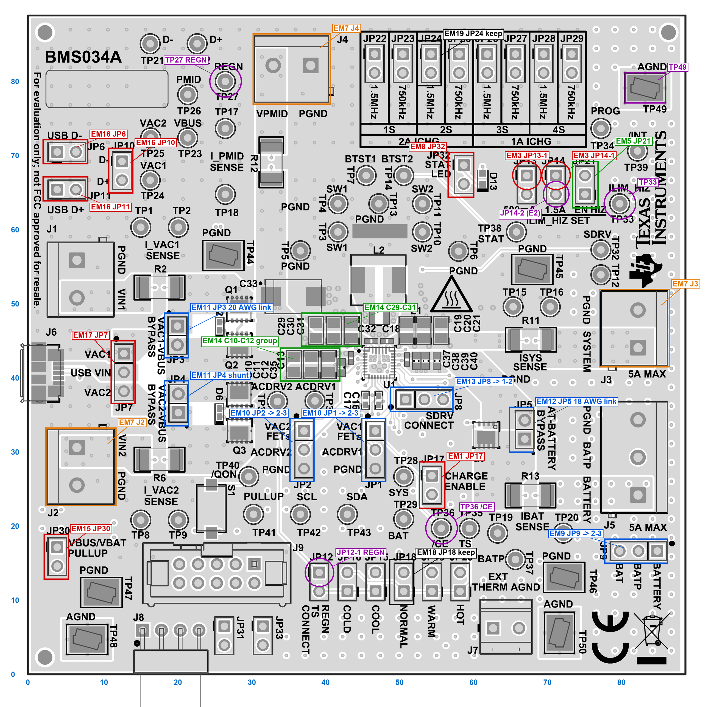

*Figure 2: top layer (SLUUCB5E Figure 4-1) with every top-side rework item. Axis numbers are millimetres in the EVM
frame.*

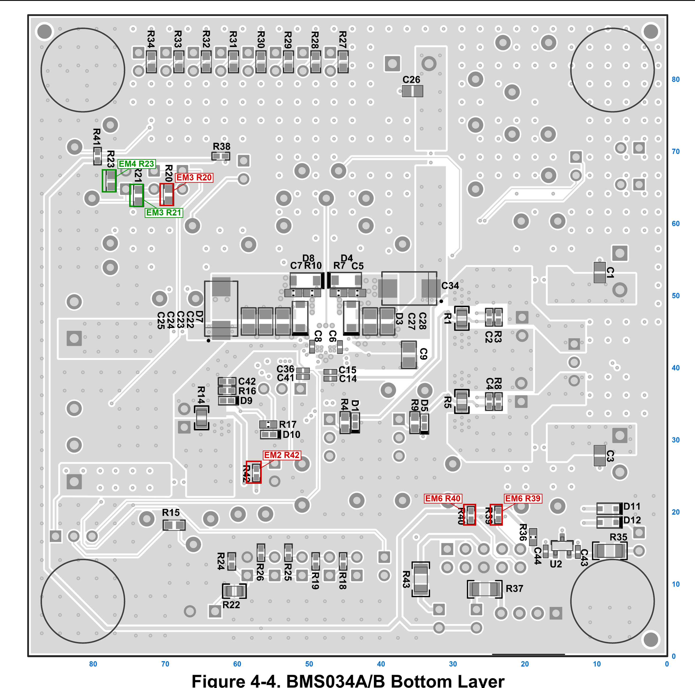

*Figure 3: bottom layer (SLUUCB5E Figure 4-4) as seen from below, with the six underside rework items (R20, R21, R23,
R42, R39, R40). The board is flipped left to right, so x runs from 88.9 mm at the left to 0 at the right; the axis
numbers are top-view x.*

Note that the square pad is pin 1 on every header of this board. Figures 4 and 5 give the schematic pin numbers.

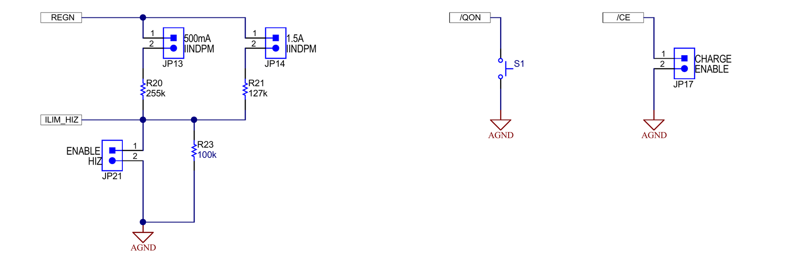

*Figure 4: SLUUCB5E Figure 4-6, ILIM_HIZ set (JP13, JP14, JP21, R20, R21, R23) and /CE (JP17), stock values.*

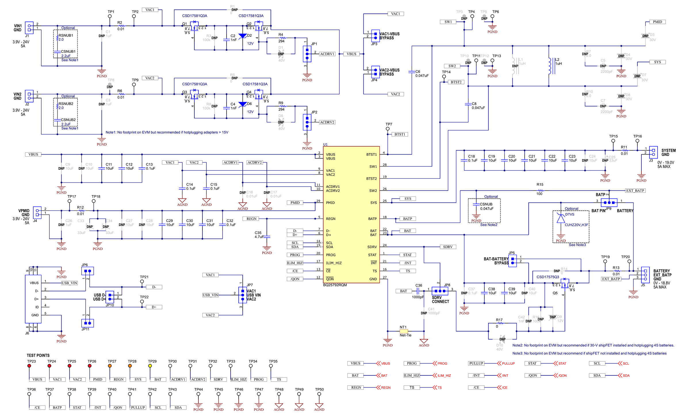

*Figure 5: SLUUCB5E Figure 4-5, power stage with JP1-JP9 and the VBUS and PMID capacitors. JP1 and JP2 pin 1 is the
FET-gate side, pin 2 is ACDRV and pin 3 is PGND. JP9 pin 1 is BATTERY, pin 2 is BATP and pin 3 is BAT.*

## 5. Procedure

**CAUTION:** Do all of the rework before the first power-up. If you power the EVM before the rework, the stock
board starts to charge at power-on (JP17 grounds /CE).

**CAUTION:** Do not move a PROG jumper (JP22 to JP29) with power applied (section C). If you do, the 2S, 1.5 MHz
setting that EM19 requires is not assured.

**CAUTION:** Use an ESD mat and a wrist strap for every step (workshop practice). The rework touches pins that connect
directly to the BQ25798 (TP33 ILIM_HIZ, TP36 /CE, JP12 REGN).

### 5.1 Incoming inspection

1. Photograph both sides of the EVM as received.
2. Record the shunt positions of JP1 to JP33.
3. Make sure that JP24 has a shunt (EM19).
4. Make sure that JP22, JP23 and JP25 to JP29 are open (EM19).
5. Measure R23 in circuit and record the value (stock 100 kOhm).
6. Measure R21 and R20 in circuit and record the values (stock 127 kOhm and 255 kOhm).
7. Measure R29 in circuit and record the value (T-A-02).
8. Measure TP49 (AGND) to J1 pin 1 (PGND) and record the resistance (T-A-02).

Note that a parallel path through the ILIM_HIZ network can make the in-circuit readings low. The records are for
comparison only. R29 is 6.04 kOhm on the schematic and 6.20 kOhm in the BOM; the CELL and PWM_FREQ readback of T-B-01
confirms the setting (EM19).

### 5.2 Shunt removals

Figure 6 shows the left-side jumpers, and Figure 7 shows JP32. Figure 14 in step 5.5 shows JP17.

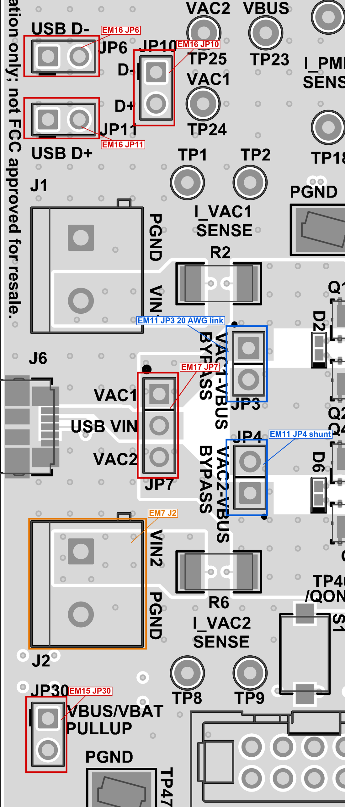

*Figure 6: left side of the top layer: JP6, JP10, JP11 (EM16), JP7 (EM17), JP30 (EM15), JP3 and JP4 (EM11) and J2
(EM7).*

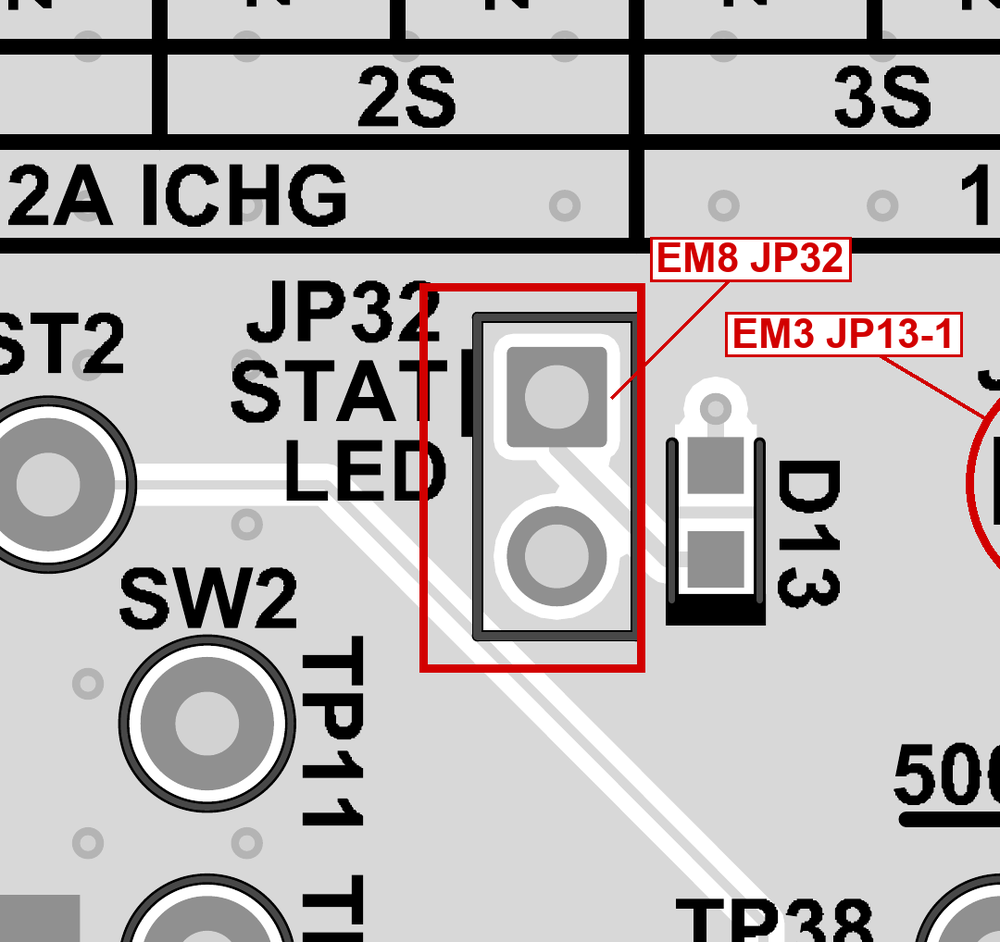

*Figure 7: JP32, the STAT LED shunt (EM8).*

1. Remove the JP17 shunt (EM1).
2. Remove the JP14 shunt (EM3).
3. Remove the JP32 shunt (EM8).
4. Remove the JP30 shunt (EM15).
5. Remove the JP6, JP10 and JP11 shunts (EM16).
6. Remove the JP7 shunt (EM17).
7. Make sure that JP21 has no shunt.
8. Keep the shunt on JP12 ("TS CONNECT") (EM18).
9. Keep the shunt on JP18 ("NORMAL"), unless a pack NTC is fitted (EM18, section 2 item 2).
10. Make sure that JP15, JP16, JP19, JP20, JP31 and JP33 are open (EM18, EM20).
11. Put the removed shunts away from the bench.

Note that JP12 "must remain connected" (SLUUCB5E Table 1-3). A removed shunt that is refitted by mistake can undo
EM1 or EM3.

### 5.3 Shunt position changes

Figure 8 shows JP1, JP2 and JP8, and Figure 9 shows JP9.

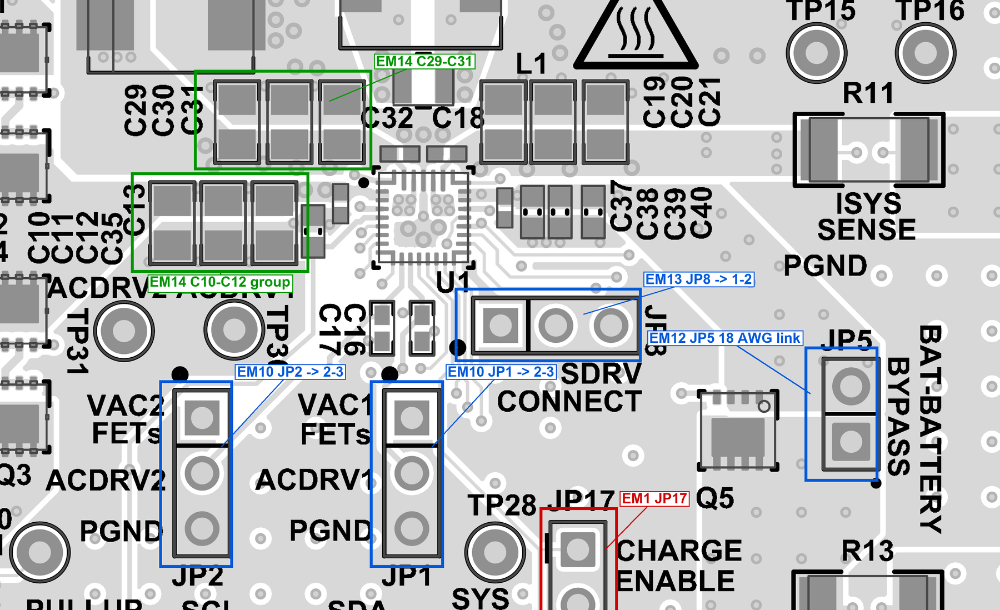

*Figure 8: centre of the top layer: JP1 and JP2 (EM10), JP8 (EM13), JP5 (EM12), the capacitor groups (EM14) and the
upper part of JP17 (EM1).*

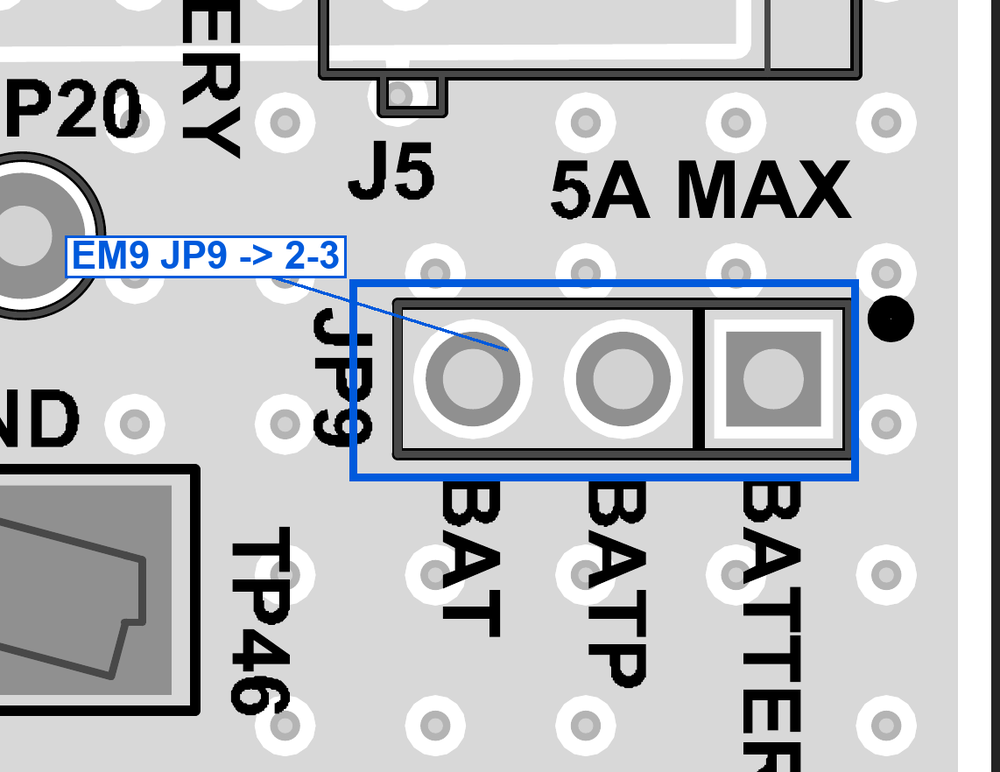

*Figure 9: JP9 (EM9). Pin 1 (square, right) is BATTERY, pin 2 (middle) is BATP and pin 3 (left) is BAT.*

1. Move the JP1 shunt to pins 2-3, the two lower pins (EM10).
2. Move the JP2 shunt to pins 2-3, the two lower pins (EM10).
3. Move the JP8 shunt to pins 1-2, the square pin and the middle pin (EM13).
4. Move the JP9 shunt to pins 2-3, the middle pin and the BAT pin (EM9).

### 5.4 Underside SMT work

Figure 10 shows R20, R21 and R23, Figure 11 shows R42, and Figure 12 shows R39 and R40.

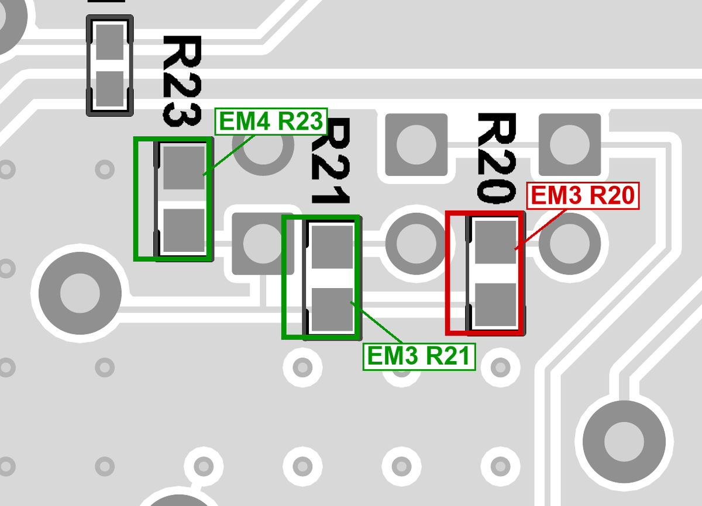

*Figure 10: underside, ILIM_HIZ resistors: R23 (EM4), R21 (EM3) and R20 (EM3).*

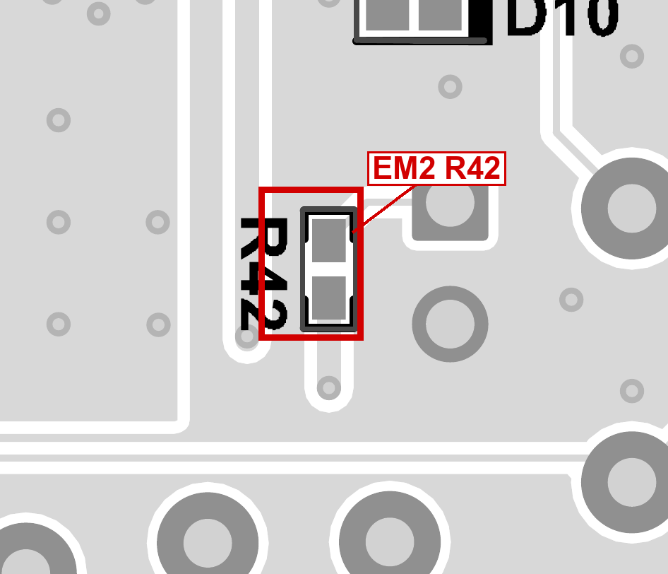

*Figure 11: underside, R42 (EM2).*

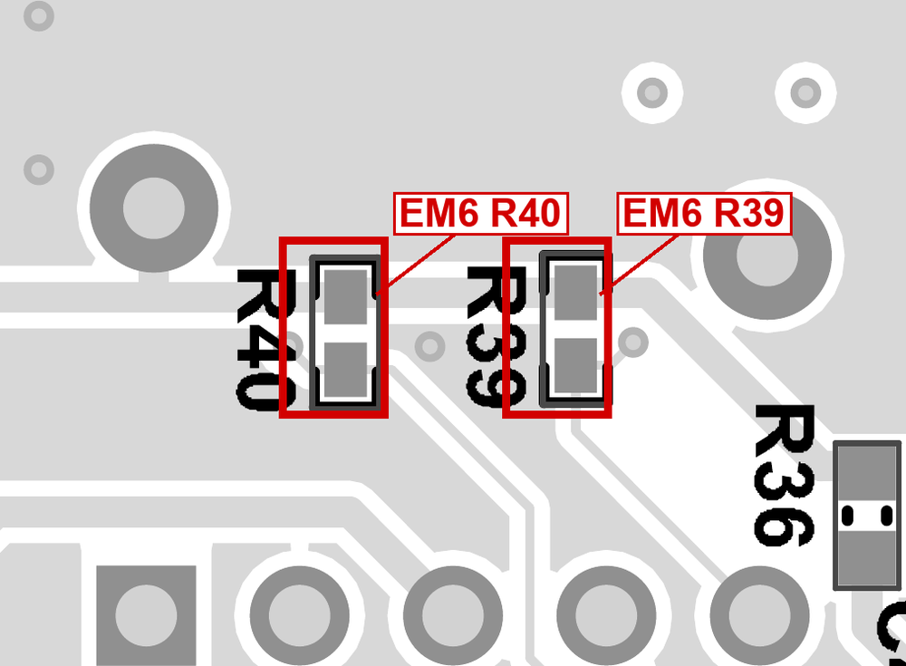

*Figure 12: underside, the I2C pull-ups R39 and R40 (EM6).*

1. Turn the EVM over and support it on its edges. The top-side terminal blocks are 13 mm tall.
2. Remove R20 (255 kOhm) (EM3).
3. Leave the R20 footprint empty.
4. Remove R21 (127 kOhm) (EM3).
5. If a 0 ohm part is available, fit the CRCW06030000Z0EA jumper at R21 (EM3).
6. If no 0 ohm part is available, leave R21 empty (section C fallback).
7. Remove R23 (100 kOhm) (EM4).
8. Measure the removed R23 and record the value (EM4).
9. Measure the new 49.9 kOhm part before you fit it (EM4).
10. Fit the 49.9 kOhm part at R23 (EM4).
11. Remove R39 and R40, the 10.0 kOhm I2C pull-ups (EM6).
12. Leave the R39 and R40 footprints empty.
13. Remove R42, the 10.0 kOhm /CE pull-up (EM2).
14. Clean the flux from the underside.

Note that with the step 6 fallback, the E2 lead lands on the vacated R21 pad on the ILIM_HIZ side and needs strain
relief, and T-A-02 requires a recalculation of R255 and R257 with `r3_calc.py`.

### 5.5 Header pin removals

Figure 13 shows JP13, JP14 and JP21, and Figure 14 shows JP17.

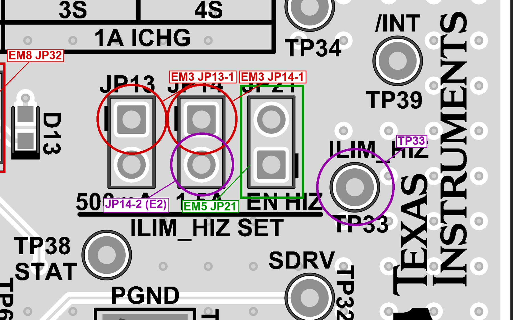

*Figure 13: top layer, ILIM_HIZ set: JP13 pin 1 and JP14 pin 1 (EM3, remove), JP14 pin 2 (the E2 joint), JP21 (EM5)
and TP33.*

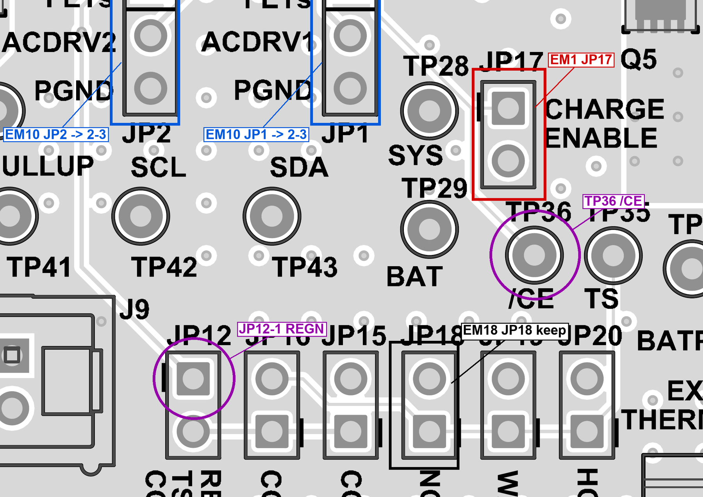

*Figure 14: top layer, /CE area: JP17 (EM1), TP36 (/CE), JP12 pin 1 (REGN), JP1 and JP2 (EM10) and JP18 (EM18, keep).*

**WARNING:** Do not leave JP14 pin 1 or JP17 pin 2 in place. A shunt refitted on JP14 ties REGN to ILIM_HIZ and
bypasses the EIB release. A shunt refitted on JP17 grounds /CE and enables charging permanently.

1. Remove JP14 pin 1, the square REGN pin (EM3). Desolder it, or cut it flush and cover the stub with Kapton.
2. Remove JP13 pin 1, the square REGN pin (EM3). Desolder it, or cut it flush and cover the stub with Kapton.
3. Keep JP14 pin 2. It becomes the E2 joint (EM3).
4. Remove JP17 pin 2, the round AGND pin (EM1). Desolder it, or cut it flush and cover the stub with Kapton.
5. Keep JP17 pin 1 (the /CE side) bare.

### 5.6 Power links

Figure 6 shows JP3 and JP4, and Figure 8 shows JP5.

**CAUTION:** If a JP3 or JP5 hole does not take the wire, do not solder the link onto the header pins. That fallback
needs a per-pin rating of at least 3.5 A from T-A-05 first; without it, the joint can overheat.

1. Desolder the JP3 header (EM11).
2. Clean the two JP3 holes.
3. Make sure that a 20 AWG wire goes fully into each JP3 hole (pin gauge, T-A-02).
4. Solder a 20 AWG tinned link into the two JP3 holes (EM11).
5. Fit the SPC02SYAN shunt on JP4 (EM11).
6. Desolder the JP5 header (EM12).
7. Clean the two JP5 holes.
8. Make sure that an 18 AWG wire goes fully into each JP5 hole (pin gauge, T-A-02).
9. Solder an 18 AWG tinned link into the two JP5 holes (EM12).

Note that the JP3 link carries the charger input current, about 2.77 A at most (TODO(recalc: D-67)). The JP5 link
carries the full charge current, at most 3.21 A.

### 5.7 Input and PMID capacitors

Figure 8 shows the two capacitor groups. Table 2 gives the values that identify the parts.

*Table 2: capacitors in the two groups (SLUUCB5E Figure 4-5 and Table 4-1).*

| Part | Value | Net | Action |
|---|---|---|---|
| C10 | DNP (empty 0805 footprint, leftmost) | VBUS | none |
| C11, C12 | 10 uF 0805 | VBUS | replace (EM14) |
| C35 | 4.7 uF 0603 | REGN | none |
| C13 | 0.1 uF 0402 | VBUS | none |
| C29, C30, C31 | 10 uF 0805 | PMID | replace (EM14) |
| C32, C18 | 0402 | - | none |

**CAUTION:** Preheat the board before you remove an 0805 MLCC with hot air (workshop practice). A local thermal
shock can crack the neighbouring capacitors.

1. Find the group marked "C10 C11 C12 C35 C13" (Figure 8).
2. Identify the empty C10 footprint at the left of that group.
3. Identify C11 and C12 as the two populated 0805 parts to the right of C10.
4. Confirm C11 and C12 by value (Table 2).
5. Replace C11 with a GMC21X5R106K50NT (EM14).
6. Replace C12 with a GMC21X5R106K50NT (EM14).
7. Replace C29, C30 and C31 with GMC21X5R106K50NT parts (EM14).
8. Do not disturb C13, C35, C32 or C18.

Note that the C11 and C12 identification comes from the silkscreen label order of SLUUCB5E Figure 4-1. It is not yet
confirmed on a received board.

### 5.8 R256 and C252 on JP21

Figure 13 shows JP21.

**CAUTION:** Land R256 and C252 on JP21 pin 2 (AGND), not on a PGND point. SLUUCB5E layout note 7 keeps these
analog parts off PGND, and the T-A-02 check of JP21 pin 2 to TP49 then fails.

1. Identify JP21 pin 1: the lower, square post at (75.31, 64.77) mm (ILIM_HIZ).
2. Identify JP21 pin 2: the upper, round post at (75.31, 67.31) mm (AGND).
3. Tack R256 (200 kOhm) between JP21 pin 1 and pin 2 (EM5).
4. Tack C252 (2.2 nF C0G) between JP21 pin 1 and pin 2, beside R256 (EM5).
5. Keep JP21 without a shunt.

Note that the E4 lead is not fitted (r9-2).

### 5.9 Terminal blocks J2, J3 and J4

Figure 15 shows J2, J3 and J4.

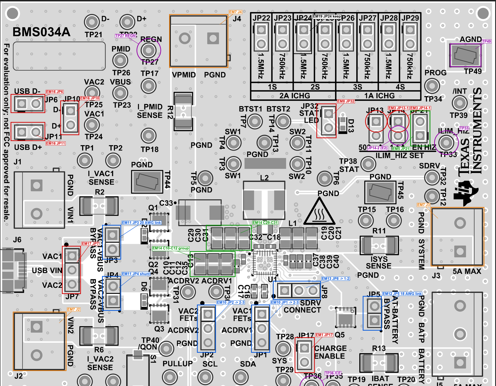

*Figure 15: top layer above y = 20 mm, with J2 (VIN2), J3 (SYSTEM) and J4 (VPMID) (EM7).*

1. Desolder J2, J3 and J4 (EM7). Alternatively, fit an insulating cap or heat-shrink over each terminal block.
2. Do not change J1 (VIN1) or J5 (BATTERY). The W leads use them.

Note that J2 sits at VCHG-IN, J3 at SYS and J4 at PMID in the always-powered design.

### 5.10 /CE pull-ups R272 and R272b

This step uses Option 1 of section 2 item 1. Figure 16 shows the two link distances on the top layer. Figure 17
shows the L1 route on the underside.

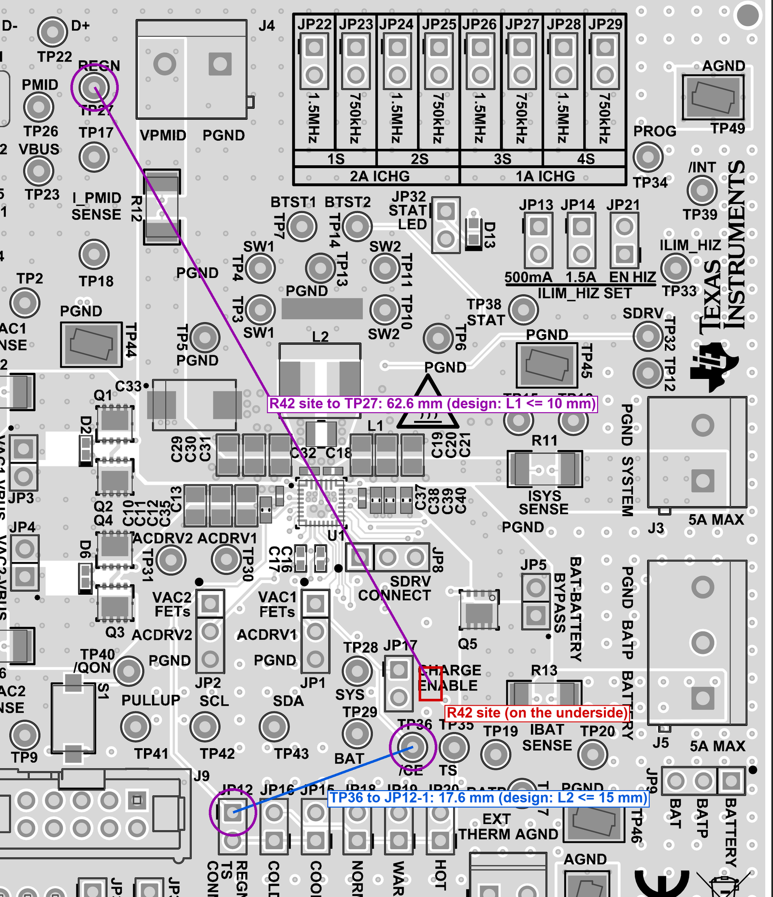

*Figure 16: EM2 link geometry on the top layer. Red box: the R42 site, which is on the underside. Purple line: R42
site to TP27, 62.6 mm against the 10 mm L1 limit. Blue line: TP36 to JP12 pin 1, 17.6 mm centre to centre against the
15 mm L2 limit (about 14.6 mm of link after the pad and post radii and one 0603 body, so marginal). Distances are
straight lines; the R42 centre is read from the bottom-layer render to about 0.5 mm.*

**WARNING:** Do not use one joint or one wire for both pull-ups. If a shared joint opens, both pull-ups open and /CE
floats.

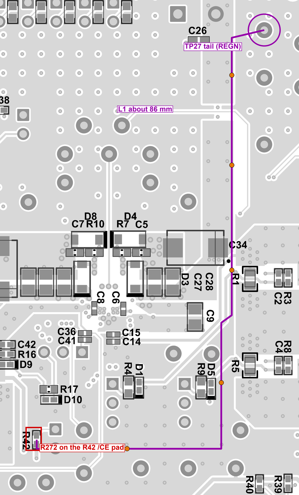

*Figure 17: candidate L1 route on the bottom layer (viewed from below, so x increases to the left). Purple line: L1
from R272 on the R42 /CE pad to the TP27 tail, about 86 mm. Orange dots: tack points. The route keeps about 0.6 mm or
more from the SMT bodies and through-hole pads it passes: D5 and the pad at (30.1, 26.9) mm on the lower riser, C34 and
R1 on the upper riser. The route is read from the SLUUCB5E Figure 4-4 render on a 5 mm grid to about 0.5 mm. It
stays clear of the power-stage capacitor bank and of the R20, R21 and R23 ILIM_HIZ parts.*

**CAUTION:** Do not route L1 near R20, R21, R23 or the JP13 and JP14 posts. REGN near ILIM_HIZ is the condition that
EM3 removes.

1. Identify the /CE pad of the R42 footprint with the DMM (TP36 is /CE).
2. Identify TP27, TP36 and JP12 pin 1 by net with the DMM (A.5).
3. Dry-fit L1 along the Figure 17 route without solder.
4. If the dry fit touches a part body or a pad joint, move the wire to the nearest clear path and record the route.
5. Hold R272b at the TP36 base and dry-fit L2 from its free end to JP12 pin 1.
6. If L2 needs more than 15 mm, record the length and stop. The operator rules on L2.
7. Fit R272 (47.0 kOhm) on the /CE pad of the vacated R42 footprint (EM2).
8. Solder one end of L1 to the free end of R272.
9. Lay L1 along the route and tack it at the five points of Figure 17 (workshop practice: Kapton tape or adhesive).
10. Solder the other end of L1 to the underside tail of TP27. Keep the top-side TP27 loop free for the scope probe.
11. Fit R272b (47.0 kOhm) at the base of TP36 (/CE).
12. Connect the free end of R272b to JP12 pin 1 (REGN) with its own Kynar link L2.
13. Record the measured L1 and L2 lengths for the design document.

Note that Option 1 places about 86 mm of REGN wire on the underside. The REGN-ripple check T-C-16 probes TP27;
section 7 adds a /CE reading at TP36 to the same run.

## 6. Checks after the rework

Do these checks with the power off and with the EIB and the W leads not connected (T-A-02). Table 3 gives the
criteria.

*Table 3: post-rework checks (T-A-02, power off).*

| Check | Measurement | Criterion |
|---|---|---|
| EM1 | Visual: JP17 shunt and pin 2 | both absent, or pin 2 cut flush and insulated |
| EM1 | TP36 (/CE) to TP49 (AGND), before step 5.10 | > 1 MOhm |
| EM3 | Visual: JP14 pin 1, JP13 pin 1, R20 | all absent |
| EM3 | JP14 pin 2 (E2 joint) to TP33; also checks the R21 0 ohm link | < 1 ohm |
| EM3 | JP13 pin 2 to TP33 | > 10 MOhm |
| EM4 | New R23 part before fitting | 49.9 kOhm +- 1 % |
| EM5 | JP21 pin 2 (the R256 / C252 terminal) to TP49 | < 1 ohm (AGND, not PGND) |
| EM2 | R272 and R272b, each with the other link lifted | 47.0 kOhm +- 1 %, from /CE to REGN |
| EM11, EM12 | JP3 and JP5 holes, before the links | 20 AWG and 18 AWG fully inserted |
| EM14 | Visual: C11, C12, C29, C30, C31 | new parts seated, no cracked neighbours |
| EM19 | R29 value, TP49-to-PGND resistance (step 5.1) | recorded |
| all | TP27, TP33, TP36, TP38, TP41, TP49, JP12 pin 1, JP21 pin 1 and JP17 pin 1, each to its IC pin by net (SLUUCB5E Figures 4-5 and 4-6) | as the schematic |

Note that the TP36-to-TP49 check precedes step 5.10. After EM2, TP36 reaches REGN through R272 and R272b, and REGN
reaches AGND through the JP12 TS divider, so the reading falls below 1 MOhm. The J8 pinout check of T-A-02 belongs to
the W7 lead work.

If a check fails, use the action column of T-A-02 in the design document.

## 7. First power-up notes

These notes apply at the first power-up (T-B-01). They are not part of the rework.

- Do not add an input capacitor of any kind to the EVM (EM24).
- Do not press S1 (/QON) (EM22).
- Skip the SLUUCB5E section 2.4.1 step that checks the PULLUP rail for 3.3 V. Instead, confirm that TP41 (PULLUP) to
  TP49 is below 0.1 V with VCHG-IN at 18.5 V (EM25). TP41 is PULLUP on the schematic and the silkscreen.
- Read back CELL = 1h and PWM_FREQ = 0 over I2C (EM19, T-B-01).
- During T-C-16, scope /CE at TP36 as well as REGN at TP27 (EM2, Option 1). Record the /CE ripple for the operator.
- RSNUB1 and CSNUB1 have no footprint and stay unfitted (EM21).

## 8. Item index

Table 4 maps each design item to its step and figures.

*Table 4: EM items, steps and figures.*

| Item | Change | Step | Figures |
|---|---|---|---|
| EM1 | JP17 shunt off; pin 2 removed | 5.2, 5.5 | 4, 14 |
| EM2 | R42 removed; R272 and R272b fitted (Option 1 L1 route) | 5.4, 5.10, 7 | 3, 11, 16, 17 |
| EM3 | R21 0 ohm; R20 removed; JP14 shunt off; JP14 pin 1 and JP13 pin 1 removed | 5.2, 5.4, 5.5 | 3, 4, 10, 13 |
| EM4 | R23 49.9 kOhm | 5.4 | 3, 4, 10 |
| EM5 | R256 and C252 across JP21 | 5.8 | 4, 13 |
| EM6 | R39 and R40 removed | 5.4 | 3, 12 |
| EM7 | J2, J3, J4 desoldered or insulated | 5.9 | 2, 6, 15 |
| EM8 | JP32 shunt off | 5.2 | 7 |
| EM9 | JP9 to 2-3 | 5.3 | 5, 9 |
| EM10 | JP1 and JP2 to 2-3 | 5.3 | 5, 8 |
| EM11 | JP3 20 AWG link; JP4 shunt | 5.6 | 6 |
| EM12 | JP5 18 AWG link | 5.6 | 8 |
| EM13 | JP8 to 1-2 | 5.3 | 8 |
| EM14 | C11, C12, C29-C31 to 50 V | 5.7 | 5, 8 |
| EM15 | JP30 shunt off | 5.2 | 6 |
| EM16 | JP6, JP10, JP11 shunts off | 5.2 | 6 |
| EM17 | JP7 shunt off | 5.2 | 6 |
| EM18 | JP18 kept (no NTC); JP12 kept | 5.2 | 14 |
| EM19 | JP24 kept | 5.1 | 2 |
| EM20 | JP31, JP33 open | 5.2 | - |
| EM21 | RSNUB1 / CSNUB1 not fitted | 7 | - |
| EM22 | S1 not pressed | 7 | - |
| EM23 | EVM mount | out of scope | - |
| EM24 | No input capacitor added | 7 | - |
| EM25 | TP41 bring-up check | 7 | - |
