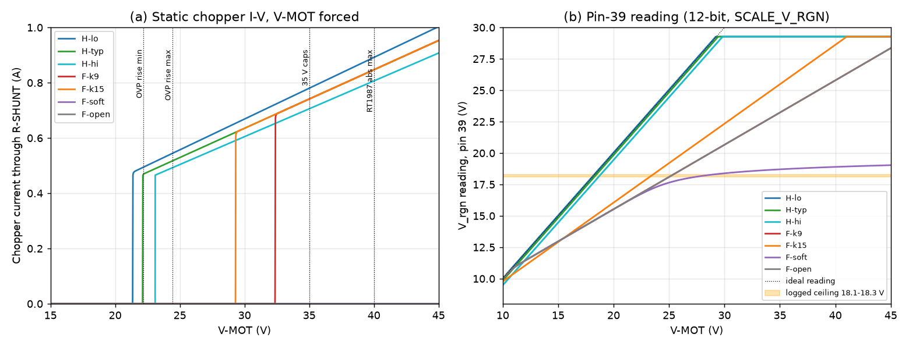
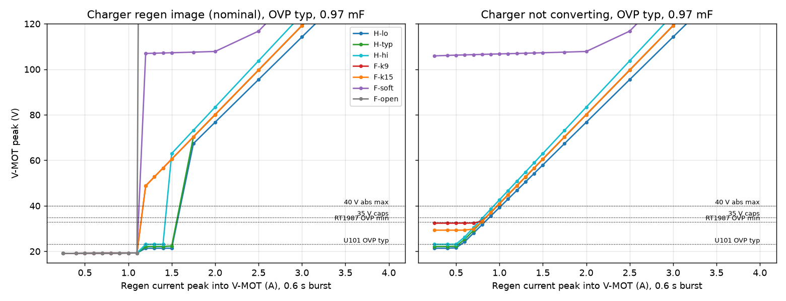
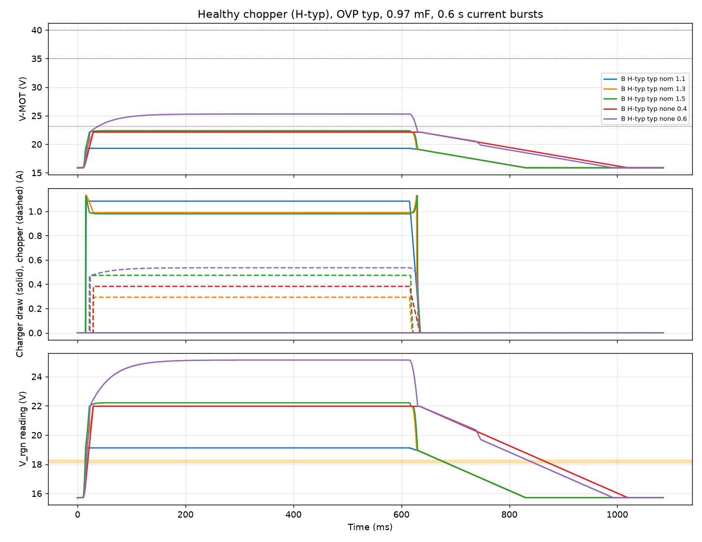
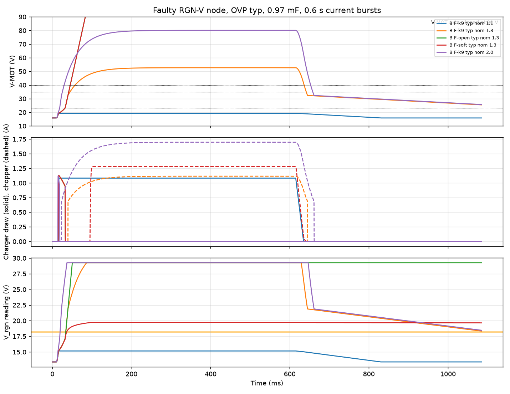
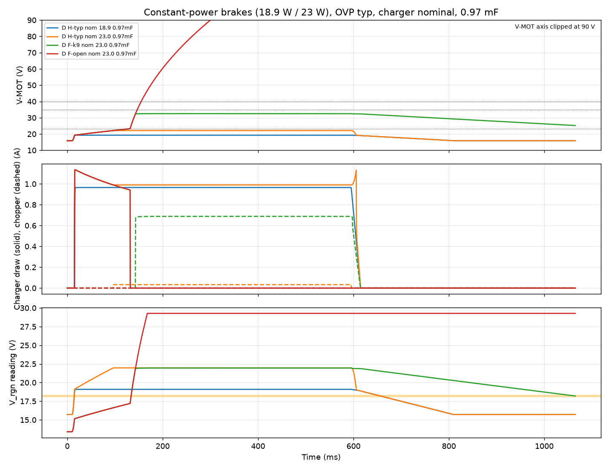
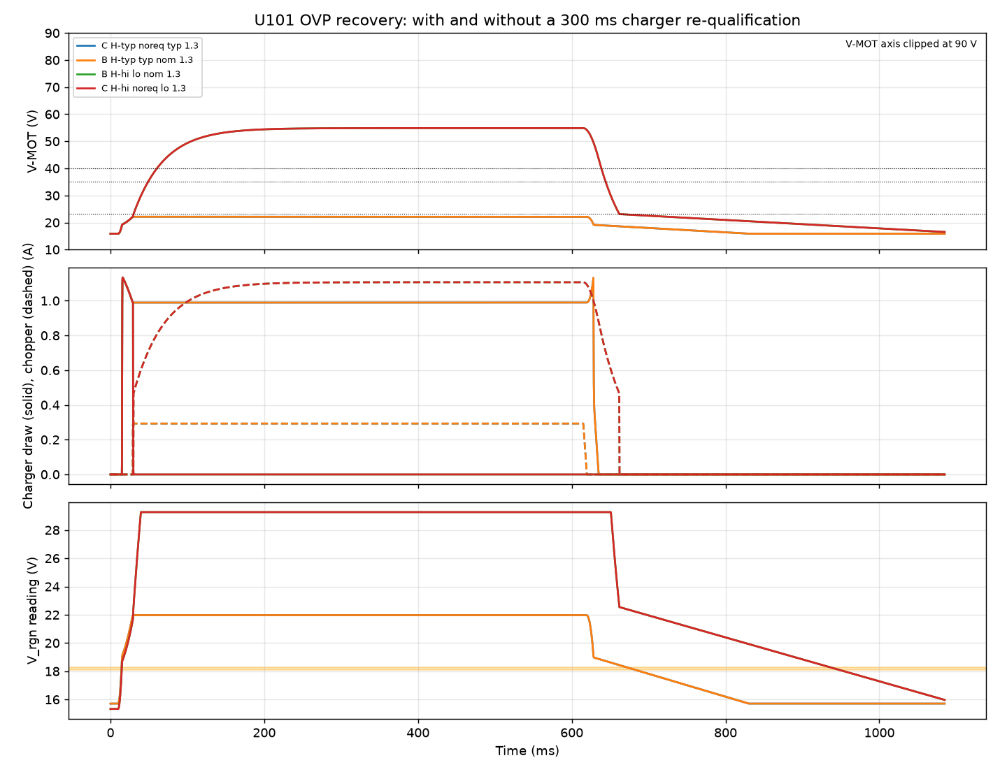
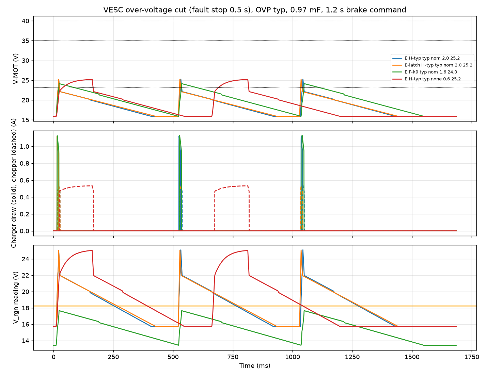
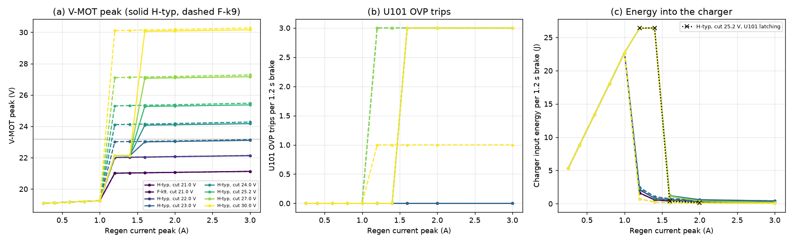
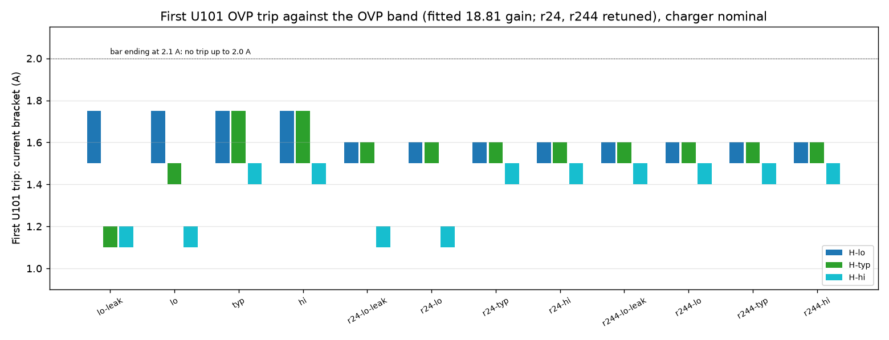

# Sim 2: MB regen chopper and the V-MOT ceiling against the U101 OVP

## 1. Purpose

This simulation informs review items VR-1 and VR-2 of `../../REVIEW_2026-11-14.md` (sections 4.1 and 4.2). It
quantifies five things on the motherboard (MB) V-MOT node with the carrier (CR) fitted:

1. the static clamp voltage of the TL431/BSP170P regen chopper and its tolerance band, healthy and with the measured
   nonlinear sink on RGN-V;
2. the V-MOT peak during a VESC braking event, with the BQ25798 charger drawing through D-BC-RG and U101
   (TCKE1401NM), and whether and how often the U101 overvoltage protection (OVP) trips;
3. the regen current at which V-MOT reaches 35 V (rating of CAL, C-D6 and C-D7) and 40 V (RT1987 absolute maximum);
4. the effect of the VESC over-voltage cut (regen_dynamics.md section 0 item 1) on the V-MOT ceiling, on U101 cycling
   and on the energy that reaches the charger;
5. the pin-39 V_rgn reading in the faulty state, for comparison with the 18.1-18.3 V reading ceiling in the logs.

The design-document criteria at stake are the U101 OVP band of section B.4 (22.19 / 23.19 / 24.41 V rising,
20.50 / 21.63 / 22.32 V falling) against the chopper band, the H.7 absorption capability, and the T-C-04 rule that no
low-VBR clamp sits on VCHG-IN.

## 2. Circuit and models

### 2.1 Topology (from the MB Eagle schematic)

The net list of `references/Scale_Car_Board_20260624.sch` gives the topology:

| Net (sch line) | Members |
|---|---|
| V-MOT (8852) | D-MT-EN.VOUT, C-D6, C-D7, J-M.1 (VESC), D-BC-RG.VIN, R1-SNT.2, R-GS.2, Q-SNT.SOURCE, Z-SNT.K, CAL.1 |
| RGN-V (9096) | R1-SNT.1, R2-SNT.2, U-SNT.REF (Teensy pin 39 by label, line 7698) |
| N$36 (9114) | U-SNT.CATHODE, R-G.2 |
| VG (9121) | R-G.1, R-GS.1, Q-SNT.GATE, Z-SNT.A |
| N$39 (9141) | Q-SNT.DRAIN, R-SHUNT.1 |
| VCHG-IN (9064) | R1-CHG.2, D-BC-RG.VOUT, C-D8, D-BC-FC.VOUT, C-D10, CHG.VIN+ (CR J1 pin 10) |
| GND (8493) | R2-SNT.1, U-SNT.ANODE, R-SHUNT.2, CAL.2, ... |

Part values come from the schematic part lines 5913-5986 and the MB BOM (`Scale Car Design PCB BOM 20260622.csv`):
R1-SNT 78.7 kOhm 0.1 % (line 36), R2-SNT 10 kOhm 0.1 % (37), R-G 220 Ohm 0.1 % 0402 1/16 W (40), R-GS 3.3 kOhm
0.1 % 0603 1/10 W (39), Z-SNT BZT52C12 (38), Q-SNT BSP170P (34), U-SNT TL431BIDBZR (35), R-SHUNT 47 Ohm 5 % 20 W (33),
CAL 470 uF 35 V 80 mOhm (30), C-D6/C-D7 10 uF 35 V X7R 1206 (81). The CR side comes from `gen/netlist.py`:
C102a/b/c (lines 95-98), D107 SMAJ33A (99), U101 TCKE1401NM (105), R102/R103/R104 845k/64.9k/51.1k (111-116),
C101 22 nF (119), C103 1 uF (121).

**Source citations (added 2026-11-15, second review R2-SIM-4).** The `gen/netlist.py` line numbers in this section refer
to the committed state at git tag `charger-r8-pre-review-2026-11-14` (commit 014c745). Later edits (D-82, the r9-25
revision) moved those lines. The values of every simulated CR part (C102a, C102b, C102c, D107, U101 TCKE1401NM, R102
845 kOhm, R103 64.9 kOhm, R104 51.1 kOhm, C101 22 nF, C103 1 uF) are unchanged in the current `gen/netlist.py` and in
`bom_2026-11-14/cr_bom.csv`. Section 5.8 cites the current file by part reference, not by line.

### 2.2 Models

| Element | Model | Source |
|---|---|---|
| U-SNT | TI TL431 PSpice macro-model SLVM071B (`../models/TL431_TI_SLVM071.lib`, unencrypted, runs with `ngbehavior=psa`) inside a corner wrapper that shifts the trip voltage and adds the REF current | TL431_TI.pdf section 6.12 (TL431BI) |
| Q-SNT | Level-1 PMOS, VTO -2.1 / -3 / -4 V, KP 0.6 A/V^2 (RDS(on) 0.24 Ohm at VGS -10 V), Ciss 328 pF. BEHAVIOURAL: no Infineon model was fetched | BSP170P_Infineon.pdf p.2 |
| Z-SNT | Diode, BV 12 V | BZT52C_Diodes.pdf (BZT52C12: 11.4-12.7 V) |
| D-MT-EN, D-BC-RG | Ideal diode: VFWD 35 mV plus R_ON 20 mOhm; D-BC-RG OVP at 33 V after a 512 us blanking, latched off. BEHAVIOURAL | RT1987_DS-00.pdf EC table |
| U101 | Hysteretic OVP on VIN (thresholds from VOVPR/VOVPF x 18.806), OVP_ton 509 us, dV/dT ramp 2185 V/s, R_ON 44.5 mOhm. No reverse blocking in the fitted wiring: VSYS is tied to VIN and Q1 is not fitted (TCKE1401NM DS Rev. 3.0 section 7.6, Figure 7.1 right; `gen/netlist.py` U101 pins 1, 2, 5 = VCHGIN, 3 and 4 open). Sections 3-5.7 model the switch without the body diode; section 5.8.6 adds it and shows no effect. Self-releasing (a model input, supported by DS section 7.3 p.6, section 7.5 p.7 and the Table 10.3 OVP_ton rows p.16; whether the MODE-open latch-off also applies to OVP is TODO(verify: Toshiba)), with a latching variant. BEHAVIOURAL (**Superseded 2026-11-15, review R2-SIM-7:** "R_ON 44.5 mOhm, reverse blocking; self-releasing, with a latching variant") | tcke1401nm.pdf Table 10.1, 10.3, Formula 2, section 7.6 |
| D107 | Diode, BV 36.7 V, RS 2 Ohm | design doc B.4 D107 row (VBR 36.7-40.6 V, Vc 53.3 V) |
| BQ25798 | Sink I = min(I_cap, P_in / V, 10 A/V x (V - VINDPM)), 100 us first-order lag, a 300 ms re-qualification after every U101 OVP release. BEHAVIOURAL | design doc G.1 regen image, H.7 |
| VESC regen | Ideal current or constant-power source; optional over-voltage cut: the source stops when V-MOT exceeds V_cut, stays off for a 0.5 s fault stop, then re-arms with a 2 ms first-order ramp while the brake command lasts. BEHAVIOURAL, UNCONFIRMED mechanism | regen_dynamics.md section 0 item 1 |
| RGN-V sink (faulty) | I = (V - V_on)/R_k (smooth knee), optional two-junction steepening | vrgn doc 7.1 item 3, review 4.1 |

Table 2.3 lists the chopper states. The healthy corners combine the TL431BI 25 C reference tolerance (2483/2507 mV),
the full VI(dev) of 34 mV in one direction, the dVref/dVKA terms, Iref + II(dev) (0 to 6.5 uA), the 0.1 % divider
tolerance, the R-SHUNT 5 % tolerance and the BSP170P VGS(th) range.

| State | Description |
|---|---|
| H-lo | Vref 2.449 V, dVref/dVKA -2.7 / -2.0 mV/V, Iref 0, R1 -0.1 %, R2 +0.1 %, R-SHUNT 44.65 Ohm, VGS(th) -2.1 V |
| H-typ | Vref 2.495 V, -1.4 / -1.0 mV/V, Iref 2 uA, nominal resistors, VGS(th) -3 V |
| H-hi | Vref 2.541 V, dVref/dVKA 0 (no minimum stated; ASSUMPTION), Iref 6.5 uA, R1 +0.1 %, R2 -0.1 %, R-SHUNT 49.35 Ohm, VGS(th) -4 V |
| F-k9 | Knee sink V_on 1.22 V, R_k 9.35 kOhm (the bus-dip fit), TL431 typical and connected |
| F-k15 | Knee sink R_k 15 kOhm, V_on 1.058 V, fitted through the measured 30.9 uA at a node of 1.522 V (small-signal-gain fit) |
| F-soft | F-k9 plus a constructed two-junction path of 36 uA at 2.050 V. HYPOTHESIS, not measured: it represents the "soft clamp near 1.8-2 V" of vrgn doc 7.4 and is calibrated so that an 18.2 V reading corresponds to about 28 V |
| F-open | F-k9 with the TL431 cathode open (open pin-1 joint or open R-G): the chopper can never conduct |

## 3. Assumptions

Each item below is either sourced or marked ASSUMPTION; swept items name their range.

1. VBUS is a stiff 15.9 V source (CLAUDE.md: measured no-load regulation 15.9 V); D-MT-EN blocks reverse current, so
   VBUS is no sink during regen.
2. V-MOT capacitance (CAL + C-D6/C-D7 + VESC bulk) is lumped with 80 mOhm ESR (BOM line 30) plus 8 uF of ceramics;
   swept 0.4 / 0.97 / 4 mF (design T-E-04 values; regen_dynamics.md section 2). Parts E and F use 0.97 mF.
3. VESC housekeeping draws 15 mA (vrgn doc 7.2: 7-20 mA). ASSUMPTION within that range. The logged inter-pulse decay of
   14-20 V/s at 0.97 mF (regen_dynamics.md section 0 item 1) corresponds to 13.6-19.4 mA, which brackets this value.
4. The regen source is an ideal current source with a 5 ms rise (regen_dynamics.md 1.1, onset within 5 ms) and a 20 ms
   fall (ASSUMPTION), swept 0.25-4 A, or a constant-power source (11.1, 18.9, 23, 30 W). The physical brakes are
   11.1 W / 0.30 s and 18.9 W / 0.58 s at the -12 A rail (regen_dynamics.md section 0 item 4) and 23 W (design F.3).
   Parts B, C and D have no VESC cut (flat 0.3 or 0.6 s tops). Part E adds the cut of item 5.
5. **VESC over-voltage cut (Part E).** regen_dynamics.md section 0 item 1 reports, for every logged hard decel, a regen
   pulse that ends at a fixed voltage, a decay at 14-20 V/s with no regen current, and a re-pulse 0.523-0.562 s after
   the first while the command stays railed. The report reads this as the VESC over-voltage fault (`l_max_vin`) with a
   500 ms fault stop; that reading is UNCONFIRMED. The model applies it as follows: the source stops (100 us) when V-MOT
   exceeds V_cut, stays off for 0.5 s (ASSUMPTION, the VESC default as recalled in regen_dynamics.md), then re-arms with
   a 2 ms time constant (ASSUMPTION; onset within 5 ms) for as long as the 1.2 s brake command lasts (ASSUMPTION; holds
   three pulses, as YP0166 shows). V_cut is unknown and is swept over 21.0, 22.0, 23.0, 24.0, 25.2, 27.0 and 30.0 V;
   the set contains the 23.4-25.2 V that section 5.1 infers from the reading ceiling. The VESC is assumed to sample
   V-MOT without delay (ASSUMPTION).
6. Charger regen image (G.1): VINDPM 19.0 V (18.62-19.38 V band), I_cap = min(IINDPM 1.70 A, ILIM clamp 1.328-1.752 A),
   input power P_in. Corners: "lo" 18.8 W, 1.328 A, VINDPM 19.38 V (design doc H.7 row 1: ICHG 2.50 A, pack 7.40 V,
   eta_max 0.93, ICHG -6.5 %; H.4 clamp minimum); "d310" 21.76 W, 1.328 A, VINDPM 19.0 V (H.7: the ICHG 3.10 A design
   image, input-limited at the clamp minimum); "nom" 8.0 V x 2.50 A / 0.92 = 21.7 W, 1.70 A, 19.0 V; "hi" 8.32 V x
   3.10 A / 0.90 = 28.7 W, 1.70 A, 18.62 V. The "nom" and "hi" efficiencies are ASSUMPTIONS. "none" is a charger that
   does not convert (P5 LOW, FC image, EN_CHG 0, CV taper near a full pack) while U101 still conducts; it also
   represents the rig as logged before the CR, where no charger absorbed regen.
7. VINDPM loop: 10 A/V with a 100 us lag (ASSUMPTION; SLUSDV2C does not specify the loop, design F.3 says T-B-12
   measures it). Charger quiescent draw 1 mA (ASSUMPTION).
8. Re-qualification: the charger draws again only 300 ms after the U101 output ramp completes (FR-23 T_REGN_MAX
   provisional 300-400 ms, review 4.2); variants without re-qualification (Parts C-noreq, E-noreq) and with a latching
   U101 OVP (Part E-latch) are also run.
9. Path: D-BC-RG 20 mOhm, MB trace 150 nH + 10 mOhm (H.19 upper value), U101 44.5 mOhm, W1/W2 + EVM 0.15 uH + 50 mOhm;
   total 0.12-0.16 Ohm, inside R_PATH_RG 0.12-0.19 Ohm (F.3). Effective capacitance: C-D8 + C-D10 6 uF, CR input 3.66 uF
   (C102b 2.96 uF at 24.41 V, design B.4), EVM input 25 uF (ASSUMPTION for 50.4 uF nominal under DC bias; BOM-7 notes no
   DC-bias check exists).
10. RT1987 D-BC-RG OVP at its 33 V minimum (no maximum is specified); a variant without it (Part D-noRTovp) shows the case
    in which its trip lies above the D107 breakdown.
11. U101 OVP corners lo / typ / hi; "lo-leak" adds the +-320 nA OVP pin leakage through the 48.4 kOhm divider Thevenin
    resistance, which lowers both thresholds by 0.29 V (21.90 / 20.21 V); this mechanism is the one of review PWR-2.
    **Superseded 2026-11-15 (review R2-SIM-0, section 5.8.1):** the "lo-leak" corner omits the UVLO-pin leak (also
    +-320 nA, TCKE1401NM DS Rev. 3.0 Table 10.1) and the 0.1 % resistor tolerance. The sim 5 model gives OVP rising
    21.588-25.019 V and falling 19.899-22.927 V (`../efuse_decay/RESULTS.md` Table 1). The "lo-leak" runs stay in the
    CSVs as a record; section 5.8 repeats the affected cases at the sim 5 corners.
12. Retuned OVP bands (Part F, a design option, not the fitted parts): "r24" scales the divider gain so that the typical
    rising threshold is 24.0 V (rising 22.97 / 24.00 / 25.27 V, lo-leak 22.67 V); "r244" sets the minimum rising
    threshold to 23.40 V, above the H-hi onset 23.10 V plus the 0.29 V leakage shift (rising 23.40 / 24.45 / 25.74 V,
    lo-leak 23.09 V, falling 21.62 / 22.81 / 23.54 V). The leakage shift is scaled with the gain (ASSUMPTION: unchanged
    divider Thevenin resistance). **Superseded 2026-11-15 (review R2-SIM-0, section 5.8.4):** under the sim 5 leakage
    model the r244 gain gives a leak-corner rising band of about 22.76-26.38 V, so its minimum does not clear the
    23.10 V H-hi onset. Section 5.8.4 replaces r244 by real E-series dividers evaluated with the sim 5 model.

## 4. Cases

Table 4.1 lists the run sets.

| Part | Content | Runs |
|---|---|---|
| A | Static I-V: V-MOT forced 10-45 V, chopper current, total node current and the pin-39 reading (12-bit, `SCALE_V_RGN`, ino:2032) | 7 DC sweeps |
| B | No VESC cut. 7 chopper states x OVP lo/typ/hi x charger nom/none x 18 currents (0.25-4 A), 0.97 mF, 0.6 s; plus charger lo/d310/hi (4 states) and OVP lo-leak (3 healthy states) | 1026 |
| C | No VESC cut. H-typ, F-k9, F-open x 0.4/0.97/4 mF x 0.3/0.6 s x 8 currents; re-qualification variant | 168 |
| D | No VESC cut. Constant-power brakes 11.1/18.9/23/30 W x 7 states x charger nom/none/lo x 3 capacitances; RT1987 OVP absent | 262 |
| E | VESC cut, 1.2 s brake command. 7 states x OVP lo/typ x charger nom/none x 10 currents (0.25-3 A) x 7 cut levels (1960); U101 latching and no-re-qualification variants (4 states x OVP lo/typ x 4 currents x 4 cut levels x 2, 256); constant-power brakes x 7 states x charger nom/none/d310 x 4 powers x 5 cut levels (420) | 2636 |
| F | No VESC cut. Retuned OVP bands r24 / r244 (lo, typ, hi, lo-leak) x 3 healthy states x 8 currents (1.1-2.0 A), charger nom | 192 |

All 4284 transient runs converged (`run_summary.json`; maximum time step 10 us, Gear integration; wall time 2558 s).

## 5. Results

### 5.1 Static chopper clamp and the pin-39 reading

Figure 1 shows the chopper current against a forced V-MOT (a) and the resulting pin-39 reading (b).

*Figure 1: (a) current through R-SHUNT against V-MOT; (b) the V_rgn reading against V-MOT, with the logged
18.1-18.3 V ceiling shaded. DC sweep 10-45 V.*

The healthy chopper turns on abruptly: the R-SHUNT current rises from 1 mA to 0.47 A within 0.04-0.22 V, after which the
FET is fully enhanced and V-MOT follows R-SHUNT x I. Table 5.1 lists the key points (`results_static_iv.csv`). The
voltage columns at 0.47 / 0.74 / 0.85 A refer to the R-SHUNT current only; the total node current also includes the
divider and the R-GS / Z-SNT / R-G / TL431 path, and the VESC housekeeping (15 mA) comes on top.

| State | Onset (1 mA) | 0.47 A at | 0.74 A (R-SHUNT) at | 0.85 A (R-SHUNT) at | Total node current at 35 / 40 V (+15 mA HK) | Reading at 15.93 V | dV_read/dV, 14-17 V | V-MOT at an 18.2 V reading |
|---|---|---|---|---|---|---|---|---|
| H-lo | 21.35 V | 21.39 V | 33.2 V | 38.1 V | 0.887 / 1.020 A | 15.96 V | 1.00 | 18.18 V |
| H-typ | 22.12 V | 22.21 V | 35.0 V | 40.1 V | 0.848 / 0.975 A | 15.78 V | 1.00 | 18.36 V |
| H-hi | 23.10 V | 23.32 V | 36.7 V | 42.2 V | 0.812 / 0.935 A | 15.39 V | 1.00 | 18.75 V |
| F-k9 | 32.36 V | 32.38 V | 35.0 V | 40.1 V | 0.848 / 0.975 A | 13.45 V | 0.51 | 25.21 V |
| F-k15 | 29.30 V | 29.32 V | 35.0 V | 40.1 V | 0.848 / 0.975 A | 13.50 V | 0.63 | 23.42 V |
| F-soft | never | - | - | - | < 0.02 A | 13.45 V | 0.51 | 28.16 V |
| F-open | never | - | - | - | < 0.02 A | 13.45 V | 0.51 | 25.21 V |

The healthy chopper onset band is therefore **21.35-23.10 V** (typical 22.12 V), slightly wider than the review's
21.44-22.94 V because the high corner here takes dVref/dVKA = 0. This band is the onset of chopper conduction, not a
V-MOT ceiling (see the end of this paragraph). The U101 OVP rising band (22.19-24.41 V; 21.588-25.019 V at the sim 5
leakage and resistor corners, section 5.8.1) overlaps it (**Superseded 2026-11-15, reviews R2-SIM-0 and R2-SIM-6:**
"The healthy clamp band is therefore **21.35-23.10 V** ... The U101 OVP rising band (22.19-24.41 V; 21.90 V with pin
leakage) overlaps it"): H-hi (23.10 V) lies above the OVP minimum, and H-lo (21.35 V) lies below every OVP corner. The chopper is not
a hard clamp: above 0.47 A of R-SHUNT current V-MOT rises at the R-SHUNT slope of 47 V/A, and at 35 V the node absorbs
0.81-0.89 A in total including housekeeping.

The faulty models are consistent with the logged pin-39 behaviour. At 15.93 V they read 13.45-13.50 V (ratio
0.844-0.847; logs 0.848, vrgn doc section 2), and their incremental gain is 0.51-0.63 (logs 0.48-0.65, vrgn doc 7.1
item 2), whereas a healthy TL431BI reads 0.966-1.002 x V-MOT with a gain of 1.00. The agreement is largely by
construction, because the F-k9 and F-k15 sinks are fitted to the same bench data (the bus dips and 30.9 uA at
1.522 V). With the faulty node the chopper trips at 32.4 V (F-k9) or 29.3 V (F-k15), or never (F-open, F-soft), in
agreement with the 30-33 V estimate of vrgn doc 7.4.

**Reading ceiling.** With a linear knee (F-k9, F-k15) the reading has no ceiling below the faulty trip: it keeps rising
at 0.51-0.63 V/V and reaches 21.9 V at the trip. An 18.2 V reading corresponds to a true V-MOT of 25.2 V (F-k9) or
23.4 V (F-k15). A plateau at 18.1-18.3 V across independent bursts therefore requires either a V-MOT limit near
23.4-25.2 V outside the chopper (most plausibly the VESC over-voltage cut of assumption 5) or a steepening sink such as
F-soft (by construction 28 V). Under the knee models the logged peaks correspond to a true V-MOT of at least 23.4 V,
which is above the U101 OVP minimum (22.19 V) and at or above its typical value (23.19 V).

### 5.2 V-MOT peak against regen current without a VESC cut (Parts B, C)

Figure 2 shows the V-MOT peak against the peak regen current for the nominal charger (left) and a charger that does not
convert (right), at OVP typ, 0.97 mF and 0.6 s, with no VESC cut. Every statement in this section is conditional on that
omission; section 5.6 adds the cut.

*Figure 2: V-MOT peak against regen current, 0.6 s current bursts without a VESC cut, OVP typical corner, 0.97 mF.
Faulty states with no chopper conduction run off the plotted range (up to 1.25 kV in the ideal-source model).
Simulated window 1.09 s.*

With a converting charger every state holds V-MOT at 19.1-19.3 V (VINDPM plus the path drop) up to 1.0 A, because the
nominal charger absorbs 21.7 W, that is 1.14 A at 19.1 V. Above that current the behaviour splits by chopper state:

- **Healthy:** the chopper takes the surplus at 21.4-23.1 V up to about 0.47 A, so U101 does not trip up to 1.5 A
  (H-lo, H-typ) or 1.4 A (H-hi). The first trip lies between 1.5 and 1.75 A (H-lo at every OVP corner; H-typ at OVP
  typ/hi), between 1.4 and 1.5 A for H-hi at OVP typ/hi and for H-typ at OVP lo, and between 1.1 and 1.2 A for H-hi at
  OVP lo and lo-leak and for H-typ at OVP lo-leak (21.90 V, the superseded OVP-pin-only corner of assumption 11). In the
  last group the OVP trips before the chopper conducts. At the sim 5 corner (21.588 V) the same brackets hold for the
  nominal charger; with no converting charger H-typ then trips at 0.25 A or less (section 5.8.2).
- **Faulty (F-k9, F-k15, F-soft, F-open):** U101 trips as soon as the regen current exceeds the charger capacity
  (between 1.1 and 1.2 A at all OVP corners with the nominal charger).
- **Charger corners (OVP typ):** with the H.7 "lo" capability (18.8 W) the first trip is 1.3-1.4 A (H-typ, H-hi),
  1.4-1.5 A (H-lo) and 0.9-1.0 A (F-open); with the "d310" design image 1.5-1.75 A (H-lo, H-typ), 1.4-1.5 A (H-hi) and
  1.1-1.2 A (F-open); with "hi" 1.75-2.0 A (healthy) and 1.5-1.75 A (F-open).

Once U101 trips, the charger load disappears within the 0.74-3 us OVP_toff and V-MOT rises at
(I_regen - I_chopper) / C. With the healthy chopper V-MOT settles where the node current equals I_regen, which is close
to R-SHUNT x I_regen (70 V at 1.75 A); with F-k9 or F-k15 it first rises to the faulty trip (29.3-32.4 V) and then
follows the same law; with F-open it is bounded by nothing in the circuit. At 2 A and 0.97 mF V-MOT passes 35 V 9.0 ms
(H-typ) or 6.8 ms (F-k9) after the trip and 40 V about 4.5 ms later. Table 5.2 summarises the thresholds
(`results_thresholds.csv`; the bracket gives the last current that did not reach the limit and the first that did).

| Charger | Chopper, OVP corner | First U101 OVP trip | V-MOT >= 35 V | V-MOT >= 40 V |
|---|---|---|---|---|
| nom | H-lo, every corner; H-typ, OVP typ/hi | 1.5-1.75 A | 1.5-1.75 A | 1.5-1.75 A |
| nom | H-hi, OVP typ/hi; H-typ, OVP lo | 1.4-1.5 A | 1.4-1.5 A | 1.4-1.5 A |
| nom | H-hi, OVP lo / lo-leak; H-typ, OVP lo-leak | 1.1-1.2 A | 1.1-1.2 A | 1.1-1.2 A |
| nom | all faulty states, any OVP | 1.1-1.2 A | 1.1-1.2 A | 1.1-1.2 A |
| none | H-lo, OVP lo / typ / hi | 0.5-0.6 / 0.5-0.6 / 0.6-0.7 A | 0.8-0.9 A | 1.0-1.1 A |
| none | H-typ, OVP lo / typ / hi | 0.4-0.5 / 0.5-0.6 / 0.5-0.6 A | 0.8-0.9 A | 0.9-1.0 A |
| none | H-hi, OVP lo / typ / hi | <= 0.25 / 0.5-0.6 / 0.5-0.6 A | 0.8-0.9 A | 0.9-1.0 A |
| none | F-k9 / F-k15, any OVP | <= 0.25 A | 0.8-0.9 A | 0.9-1.0 A |
| none | F-open / F-soft, any OVP | <= 0.25 A | <= 0.25 A | <= 0.25 A |

Without a VESC cut, three properties hold across Parts B, C and D:

1. **U101 OVP trips at most once per burst.** After a trip V-MOT does not fall back below the OVP falling threshold while
   a constant regen source stays on. The OVP stays tripped for the rest of the burst; the result does not change without
   the 300 ms re-qualification (Part C-noreq). Section 5.6 shows that this property does not survive a VESC cut.
2. **Every trip with a converting charger leads to V-MOT >= 35 V**, because such a trip needs at least 1.1 A and the
   chopper node carries only 0.81-0.89 A at 35 V. Section 5.6 shows that a VESC cut below 35 V bounds V-MOT at the cut.
3. **The RT1987 D-BC-RG OVP (33 V minimum) latches** in every run that reaches 35 V.

Capacitance and pulse width change only the timing, not the thresholds (Part C): at 2 A with H-typ the burst start to
35 V time is 20 ms (0.4 mF), 29 ms (0.97 mF) and 78 ms (4 mF), and the 0.3 s and 0.6 s bursts give the same brackets.

### 5.3 Waveforms without a VESC cut

Figure 3 shows the healthy chopper for five bursts.

*Figure 3: H-typ, OVP typ, 0.97 mF, no VESC cut; V-MOT (top), charger draw (solid) and chopper current (dashed)
(middle), pin-39 reading (bottom). 0.6 s bursts from t = 10 ms; the full simulated window of 1.09 s is shown.*

At 1.1 A the charger holds V-MOT at 19.2 V. At 1.3 and 1.5 A the chopper regulates V-MOT at 22.1-22.4 V while the charger
draws 0.98 A (constant power at the higher voltage). Without a charger, 0.4 A is clamped at 22.1 V, and 0.6 A trips U101
and settles at 25.3 V.

Figure 4 shows the faulty states.

*Figure 4: faulty RGN-V states, OVP typ, 0.97 mF, no VESC cut, 0.6 s bursts; V-MOT axis clipped at 90 V. Window 1.09 s.*

F-k9 at 1.1 A behaves like the healthy board, because the charger absorbs the whole burst; its pin-39 reading is
15.1 V for a true 19.3 V. At 1.3 A the OVP trips at 23.2 V, V-MOT passes the faulty trip at 32.4 V and settles near
52.7 V. F-open runs away without bound. In F-soft the TL431 cathode follows V-MOT, so the reading saturates near 19.7 V
while V-MOT exceeds 100 V; above about 100 V the result is a macro-model artefact (section 7).

Figure 5 shows constant-power brakes, which represent the mechanical limit of the vehicle better than a current source.

*Figure 5: constant-power brakes of 18.9 W and 23 W with the nominal charger, OVP typ, 0.97 mF, no VESC cut, 0.58 s
bursts; V-MOT axis clipped at 90 V; full simulated window of 1.06 s.*

With a healthy chopper and a converting charger (nom or the H.7 "lo" 18.8 W corner), no corner trips U101 for any brake
up to 30 W at OVP typ: the charger holds 19.2-19.6 V up to 18.9 W, and at 23 W and 30 W the chopper takes the excess at
21.4-21.6 V (H-lo), 22.1 V (H-typ) or 23.1 V (H-hi) (`results_power_brakes.csv`). With a faulty chopper the 23 W brake
exceeds the charger capacity, trips U101 and ends at 32.5 V (F-k9), 30.9 V (F-k15) or without bound (F-open: 146 V at
0.97 mF, 43 V at 4 mF). Without a converting charger, the healthy chopper settles a constant-power brake where the
node absorbs P, approximately P = V^2 / R-SHUNT + V (V - 14 V) / 220 Ohm + V x 15 mA (R-SHUNT, the R-G gate path and
the housekeeping draw): the simulation gives 28.1 V at 18.9 W, 30.9 V at 23 W and 35.2 V at 30 W for H-typ (27.5 /
30.3 / 34.4 V for H-lo, 28.7 / 31.6 / 35.9 V for H-hi), after a U101 trip at 18.9 W and above. The RT1987 latches at
30 W.

Figure 6 compares the OVP recovery with and without the 300 ms re-qualification.

*Figure 6: U101 OVP recovery at 1.3 A with and without the charger re-qualification, no VESC cut; V-MOT axis clipped at
90 V.*

The two traces coincide for each chopper/OVP pair: without a VESC cut, the recovery behaviour of U101 and of the charger
does not influence the burst once the OVP has tripped.

### 5.4 Component stress in the chopper

Once the FET is fully enhanced, the TL431 saturates and the excess gate-network current I_KA flows through R-G into
Z-SNT. Table 5.3 lists the stress against the ratings (`results_burst_grid.csv`, OVP typ, H-typ, no VESC cut; the first
1 ms of each run, where the UIC start charges the junction capacitances, is excluded).

| Case | V-MOT | I_KA (abs max 150 mA) | R-G power (1/16 W) | Z-SNT power (500 mW) | R-SHUNT power (20 W) | BSP170P peak power (1.8 W) |
|---|---|---|---|---|---|---|
| charger none, 0.4 A (clamping) | 22.13 V | 1.2 mA | 0.3 mW | < 0.1 mW | 6.9 W | 2.6 W |
| charger nom, 1.5 A (no U101 trip) | 22.37 V | 31 mA | 0.21 W | 0.34 W | 10.5 W | 2.6 W |
| charger none, 0.6 A (U101 tripped) | 25.29 V | 49 mA | 0.53 W | 0.57 W | 13.5 W | 2.6 W |
| charger none, 1.0 A | 40.96 V | 117 mA | 3.0 W | 1.50 W | 35 W | 2.6 W |
| charger none, 1.3 A | 52.70 V | 168 mA | 6.2 W | 2.25 W | 59 W | 2.6 W |

R-G exceeds its 1/16 W rating once its current exceeds 16.9 mA, which the static sweep places at a V-MOT of 21.65 V
(H-lo), 22.29 V (H-typ) and 23.14 V (H-hi), that is as soon as the R-SHUNT current passes about 0.47-0.48 A. This lies
inside the repaired-board, no-trip region: at 1.5 A with the nominal charger R-G dissipates 0.21 W (3.4 x rating) for
the whole 0.6 s burst. Z-SNT exceeds 500 mW above a V-MOT of about 25 V, R-SHUNT its 20 W continuous rating above
30.7 V, and the TL431 its 150 mA cathode current above about 48 V. R-GS stays at or below 0.05 W (rating 0.1 W) in every run
with a VESC cut and reaches 0.105 W only in no-cut runs at the highest V-MOT, where the Z-SNT voltage rises with its
current. The BSP170P dissipates up to V^2 / (4 R-SHUNT) = 2.6 W (5.6 W at the F-k9 trip of 32.4 V) whenever the chopper
regulates in its linear region, which is above its 1.8 W rating for a steady state; its thermal transient over 0.6 s is
not modelled. Where the TL431 does not conduct (F-k9 below its trip, F-soft), its cathode sits at V-MOT, so the 37 V VKA
absolute maximum is exceeded whenever V-MOT exceeds 37 V. With a VESC cut (Part E) the overloads become pulses: at a
25.2-30 V cut, R-G reaches 0.53-1.08 W and Z-SNT 0.57-0.84 W for the few milliseconds the chopper needs to pull V-MOT
back to its clamp after each pulse.

### 5.5 D107 when the RT1987 OVP does not act first

With the RT1987 OVP removed (its trip is specified only as >= 33 V), D107 clamps V-MOT through D-BC-RG at 39.0-45.0 V
for 2-4 A and absorbs 24-108 J per 0.6 s burst (`results_power_brakes.csv`, part D-noRTovp, no VESC cut). V-MOT then
exceeds both the 35 V capacitor rating and, above 2 A (H-typ) or 1.5 A (F-open), the 40 V RT1987 absolute maximum. The
burst energy is orders of magnitude above a single-pulse TVS event; the SMAJ33A energy rating is not in the repository
(TODO(verify: SMAJ33A datasheet)). With the RT1987 OVP at 33 V (Part B), D107 conducts at most 64 mA, during the 512 us
blanking only. A VESC cut below 36.7 V removes this case.

### 5.6 With the VESC over-voltage cut (Part E)

Figure 7 shows four 1.2 s brakes with the cut model of assumption 5 at OVP typ and 0.97 mF.

*Figure 7: VESC over-voltage cut with a 0.5 s fault stop, 1.2 s brake command from t = 10 ms, OVP typ, 0.97 mF;
V-MOT (top), charger draw (solid) and chopper current (dashed) (middle), pin-39 reading (bottom). Full simulated window
1.69 s.*

The waveforms reproduce the logged pattern: a short regen pulse up to the cut level, a linear decay with no regen
current, and a re-pulse 0.5 s later. In the 2.0 A H-typ case with a 25.2 V cut, each pulse reaches the cut within
about 10 ms, U101 trips at 23.2 V on the way up, and the chopper pulls V-MOT back to 22.1 V within milliseconds. U101
stays off for about 0.12 s per trip (0.37 s over three trips): D-BC-RG blocks reverse current, so VCHG-IN discharges
only through the MB divider R1-CHG/R2-CHG and the CR divider string before it falls below the OVP falling threshold
(21.63 V typ). Under the self-releasing model input of Table 2.2, U101 therefore releases between pulses and trips
again on every pulse: three trips per 1.2 s brake. The release itself is an input of the model, not a result of this
simulation; the datasheet support and the open latch question are given in Table 2.2. The
F-k9 case (no chopper conduction below 32.4 V) shows the same cycling; there V-MOT itself decays at the 15 V/s
housekeeping rate and U101 stays off for 0.16-0.24 s per trip. The F-k9 pin-39 reading peaks at 17.66 V for a 24.0 V
cut and at 18.27 V for a 25.2 V cut, which lies inside the logged 18.1-18.3 V ceiling.

Figure 8 maps the V-MOT peak, the number of U101 trips and the energy that enters the charger against the regen current
for every cut level (H-typ solid, F-k9 dashed, nominal charger, OVP typ).

*Figure 8: (a) V-MOT peak, (b) U101 OVP trips per 1.2 s brake and (c) charger input energy per brake against the regen
current, for cut levels 21.0-30.0 V; nominal charger, OVP typ, 0.97 mF. The dotted line in (c) is H-typ at a 25.2 V
cut with a latching U101.*

Three results follow from Figure 8 and `results_vesc_cut.csv`:

1. **The cut bounds V-MOT.** In every Part E run V-MOT peaks within 0.0-0.3 V above the cut level, or lower when the
   chopper holds it. No run with a cut at or below 30 V reaches 35 V, and no run latches the RT1987 OVP. The ">= 35 V
   after every trip" property of section 5.2 therefore holds only for a VESC whose cut lies above about 35 V, or for a
   VESC that does not cut.
2. **U101 cycles once per VESC pulse.** Whenever the cut lies above the OVP rising threshold and the regen current
   exceeds what the charger and the chopper absorb, U101 trips on every pulse (three trips per 1.2 s brake in 1010 of the
   2636 Part E runs, at most one trip per regen pulse). VCHG-IN falls below the OVP falling threshold between pulses,
   about 0.12 s after each trip with a healthy chopper and later with the faulty node, where V-MOT itself decays at the
   15 V/s housekeeping rate. The exception is
   a 30 V cut with the faulty node at OVP lo (falling threshold 20.50 V), where V-MOT does not fall far enough within the
   0.5 s fault stop and U101 trips once per brake.
3. **The harvest has a cliff at the VESC cut.** While V-MOT stays below the cut, the brake is never interrupted and the
   charger takes 22.7 J at 1.0 A and 26.4 J at 1.2-1.4 A per 1.2 s brake (H-typ, nominal charger, cut >= 23 V). As soon
   as the regen current exceeds the charger plus chopper capacity (1.4-1.6 A for H-typ at OVP typ; 1.0-1.2 A for any
   chopper whose onset lies above the cut, including every faulty state), the VESC cuts on each pulse and the charger
   takes only 0.1-2.5 J per brake, because the VESC injects energy only during the first 10-40 ms of each 0.5 s pulse
   period. This cliff appears at every cut level, also below the OVP band (21-22 V), where U101 never trips.

Table 5.4 compares the U101 release, latch and no-re-qualification variants (charger input energy per 1.2 s brake,
nominal charger).

| Chopper, OVP | Cut | 1.2 A | 1.4 A | 1.6 A | 2.0 A |
|---|---|---|---|---|---|
| H-typ, typ | 24.0-27.0 V | 26.4 / 26.4 / 26.4 J | 26.4 / 26.4 / 26.4 J | 1.1 / 0.4 / 1.2 J | 0.4 / 0.1 / 0.5 J |
| H-hi, lo | 24.0-25.2 V | 2.0 / 0.6 / 2.0 J | 0.7 / 0.2 / 0.7 J | 0.4 / 0.1 / 0.5 J | 0.3 / 0.1 / 0.3 J |
| F-k9, typ | 24.0 V | 2.3 / 0.7 / 2.4 J | 0.8 / 0.3 / 1.0 J | 0.5 / 0.2 / 0.7 J | 0.3 / 0.1 / 0.5 J |
| F-k9, typ | 25.2-27.0 V | 0.7 / 0.7 / 2.4 J | 0.3 / 0.3 / 1.0 J | 0.2 / 0.2 / 0.7 J | 0.1 / 0.1 / 0.5 J |

*Entries: self-releasing U101 with 300 ms re-qualification / latching U101 / self-releasing without re-qualification.*

With a VESC cut, latch against release and the re-qualification time do change the harvest, because the charger can
return for the next pulse: a self-releasing U101 without re-qualification recovers 0.2-1.7 J more per brake than a
latching one. However, every variant stays below 2.5 J, against 26.4 J when the cut does not fire. The dominant
determinant of the harvest is therefore whether V-MOT reaches the VESC cut at all, not the U101 recovery behaviour.

The constant-power brakes with the cut (part EP) confirm this. With a healthy chopper and the nom or d310 charger the
11.1, 18.9, 23 and 30 W brakes never reach a cut at 23 V or above (H-lo, H-typ) or 25.2 V or above (H-hi), U101 never
trips, and the charger takes 12.9, 22.3, 26.4 and 26.4 J per brake. With a 21 V cut the 23 W and 30 W brakes reach the
cut on every pulse and the charger takes 3.4-3.5 J and 0.5 J. With the faulty node the 23 W brake trips U101 at every
cut of 25.2 V or above (2.5-2.6 J per brake), and at a 23 V cut the VESC cuts before U101 trips (5.0-5.1 J). Without a
converting charger, a healthy chopper holds 11.1 W below every cut of 23 V or above (25.2 V or above for H-hi), but the
18.9-30 W brakes reach every cut from 23 V to 27 V and U101 trips on each pulse whenever the cut exceeds the OVP rising
threshold; with a 30 V cut the 18.9 W brake settles below the cut (27.5-28.7 V) after one U101 trip.

### 5.7 Retuned U101 OVP band (Part F)

Figure 9 compares the first-trip current bracket for the fitted OVP band and the two retuned bands of assumption 12
(nominal charger, no VESC cut).

*Figure 9: first U101 OVP trip current bracket against the OVP band and corner, healthy chopper corners, nominal
charger, no VESC cut, 0.6 s bursts. Part B uses a 1.5 / 1.75 A grid step and Part F a 1.5 / 1.6 A step, so the H-lo /
H-typ brackets 1.5-1.75 A and 1.5-1.6 A express the same limit.*

With the fitted band, H-hi at OVP lo / lo-leak and H-typ at OVP lo-leak trip at 1.1-1.2 A, that is as soon as the
charger capacity is exceeded, because the OVP lies below the chopper voltage. Moving the typical rising threshold to
24.0 V (r24) removes that early trip for H-typ but not for H-hi at r24-lo and r24-lo-leak (22.97 / 22.67 V, still below
the 23.10 V H-hi onset). Setting the minimum rising threshold to 23.40 V (r244) moves the first trip of every healthy
corner to the charger plus chopper capacity: 1.4-1.5 A (H-hi) and 1.5-1.6 A (H-lo, H-typ) at every OVP corner, a gain of
0.3 A for H-hi against the fitted band at OVP lo. Above that capacity the U101 trip cannot be avoided by the OVP band
alone. The r244 band reaches 25.74 V at its high corner, above the 24 V BQ25798 recommended VBUS maximum and inside its
25.2-26.2 V VBUS_OVP range (design doc 0.3, r9-20 row); the option therefore has a cost on the charger side that this
simulation does not evaluate. (**Superseded 2026-11-15, review R2-SIM-0:** the r244 figures omit the UVLO-pin leak and
the resistor tolerance. Section 5.8.4 gives the lever (a) dividers under the sim 5 model; their leak-corner maximum
lies above the BQ25798 VBUS_OVP range.)

### 5.8 Second-review re-run (2026-11-15): sim 5 OVP corners, lever (a) and the U101 reverse path

This section answers review items R2-SIM-0, R2-SIM-6 and R2-SIM-7. `run_r2.py` produces every figure in it
(`r2_run_log.txt`; 1512 transient runs, none failed, wall time 1068 s). The 2026-11-14 outputs of `run.py` are
unchanged; `run.py` gained only an optional body-diode switch that is off in every 2026-11-14 deck.

#### 5.8.1 OVP corners under the sim 5 leakage model

Sections 3 to 5.7 used an OVP-pin-only leakage corner (assumption 11). The sim 5 model adds the UVLO-pin leak, also
+-320 nA (TCKE1401NM DS Rev. 3.0 Table 10.1, p.14), and the 0.1 % resistor tolerance (`../efuse_decay/run.py`,
`part_a`). `run_r2.py` re-implements its closed form and reproduces `../efuse_decay/results/a_bands_corners.csv` to
4.8e-5 V. At the fitted divider (R102 845 kOhm, R103 64.9 kOhm, R104 51.1 kOhm; the R102, R103 and R104 entries of `gen/netlist.py`),
320 nA moves the OVP threshold by 0.291 V through the OVP pin and by a further 0.270 V through the UVLO pin. Table 5.5
compares the two corner models (`r2_bands.csv`).

| OVP threshold at VCHG-IN | Sim 2 corner, OVP pin only (superseded) | Sim 5 model, both pins, 0.1 % resistors |
|---|---|---|
| Rising, minimum | 21.90 V | **21.588 V** |
| Rising, maximum | 24.41 V (no leak) | **25.019 V** |
| Falling, minimum | 20.21 V | **19.899 V** |
| Falling, maximum | 22.32 V (no leak) | **22.927 V** |

*Table 5.5: U101 OVP corners of the fitted divider. Typical values (no leak) are 23.188 V rising and 21.627 V falling.*

The sim 2 minimum lies 0.31 V above the sim 5 minimum. Every figure that cites "21.90 V with pin leakage" is
therefore replaced by 21.588 V (sections 5.1 and 6 item 2).

#### 5.8.2 First U101 trip at the sim 5 corners

Part G repeats the healthy-chopper first-trip runs at the two sim 5 corners "s5-lo" (rising 21.588 V, falling 19.899 V)
and "s5-hi" (25.019 V, 22.927 V), with the same resistor and leak signs for rising and falling. The runs use 0.97 mF,
0.6 s current bursts and no VESC cut. Table 5.6 gives the first-trip brackets (`r2_ovp_corners.csv`).

| Chopper | s5-lo, charger nom | s5-hi, charger nom | s5-lo, charger none | 2026-11-14: lo-leak nom / lo none |
|---|---|---|---|---|
| H-lo | 1.5-1.6 A | 1.5-1.6 A | 0.5-0.6 A | 1.5-1.75 A / 0.5-0.6 A |
| H-typ | 1.1-1.2 A | 1.5-1.6 A | <= 0.25 A | 1.1-1.2 A / 0.4-0.5 A |
| H-hi | 1.1-1.2 A | 1.4-1.5 A | <= 0.25 A | 1.1-1.2 A / <= 0.25 A |

*Table 5.6: first U101 OVP trip, current bracket (last current without a trip, first with a trip). Part G uses a
0.1 A grid between 1.1 and 1.6 A, Part B a 1.5 / 1.75 A step, so 1.5-1.6 A and 1.5-1.75 A express the same limit.*

With the nominal charger the sim 5 corner changes no bracket. Without a converting charger, H-typ now trips at 0.25 A
or less, because 21.588 V lies below its 22.12 V onset; at OVP lo (22.19 V) it tripped at 0.4-0.5 A.

#### 5.8.3 OVP rising minimum needed to clear the H-hi onset

The U101 comparator acts on VCHG-IN, which lies below V-MOT by the D-BC-RG and path drop. Part GS therefore sweeps the
rising threshold at VCHG-IN from 22.7 V to 23.4 V in 0.1 V steps (falling threshold x 1.09/1.18, the lo-corner ratio of
Table 10.1), H-hi, nominal charger, 1.1-1.5 A. Up to 23.0 V, H-hi trips at 1.1-1.2 A, as soon as the charger capacity
is exceeded. From 23.1 V upward, the first trip moves to 1.4-1.5 A, the charger plus chopper capacity. The required
leak-corner rising minimum therefore lies between 23.0 V and 23.1 V. This report uses **23.10 V**, the rounded H-hi
onset of Table 5.1 (23.095 V in `results_static_iv.csv`).

#### 5.8.4 Lever (a): divider values under the sim 5 model

Scaling the fitted band to a leak-corner minimum of 23.10 V gives a no-leak minimum of 23.70 V and a leak-corner
maximum of 26.77 V. This scaling assumes an unchanged divider Thevenin resistance, as Part F did. Under the same
scaling, the 2026-11-14 r244 band becomes about 22.76-26.38 V, so r244 does not clear 23.10 V.

`run_r2.py` evaluates real E96 and E192 values with the full sim 5 corner model instead (`r2_candidates.csv`). R102 stays
845 kOhm. The class "UVLO kept" holds R103 + R104 near 116 kOhm, so the UVLO rising typical value stays within
0.05 V of the fitted 9.859 V. Table 5.7 lists the candidates.

| R103 / R104 (0.1 %) | Series | OVP rising, leak corners | No leak (typ) | OVP falling, leak corners | UVLO rising, leak corners |
|---|---|---|---|---|---|
| 64.9k / 51.1k (fitted) | E96 | 21.588-25.019 V | 22.149-24.457 V (23.188 V) | 19.899-22.927 V | 9.055-10.548 V |
| **68.1k / 47.5k** | E96, E192 | **23.256-26.863 V** | 23.818-26.300 V (24.935 V) | 21.439-24.614 V | 9.092-10.571 V |
| 69.0k / 47.5k | E192 | 23.278-26.888 V | 23.840-26.324 V (24.959 V) | 21.460-24.637 V | 9.028-10.501 V |
| 69.8k / 46.4k | E96 | 23.835-27.504 V | 24.398-26.940 V (25.542 V) | 21.974-25.200 V | 9.052-10.521 V |
| 61.9k / 47.5k (UVLO not kept) | E96 | 23.104-26.691 V | 23.664-26.130 V (24.774 V) | 21.299-24.456 V | 9.558-11.085 V |

*Table 5.7: lever (a) candidates, R102 845 kOhm 0.1 %. E192 has no value between 47.5k and 48.1k, and 48.1k gives a
minimum below 23.10 V with R103 near 68k. Availability of each value at 0.1 % is TODO(verify: distributor stock).*

The recommended candidate is R103 68.1 kOhm, R104 47.5 kOhm. Its leak-corner minimum, 23.256 V, clears 23.10 V by
0.16 V; its UVLO band moves by at most 0.04 V. The OVP pin sees 75 V / 20.22 = 3.71 V at the 75 V VIN operating
maximum (Table 9.1 OVP pin 0-4 V) and 3.96 V at 80 V (Table 8.1 OVP pin 6 V absolute maximum). Part GC simulates
68.1k / 47.5k and 69.8k / 46.4k at both leak corners. Every healthy first trip then lies at the charger plus chopper
capacity: 1.5-1.6 A for H-lo and H-typ, 1.4-1.5 A for H-hi (`r2_ovp_corners.csv`). This equals the 2026-11-14 r244
result.

#### 5.8.5 Relation to the BQ25798 VBUS overvoltage threshold

SLUSDV2C section 6.5 (Electrical Characteristics, p.9) gives the BQ25798 VBUS overvoltage rising threshold as 25.2 V
minimum, 25.7 V typical and 26.2 V maximum, and the falling threshold as 24.0-24.8 V. Section 6.3 (p.7) gives a
24 V recommended VBUS maximum, and section 6.1 (p.7) a 30 V absolute maximum. The fitted divider keeps the U101 OVP
rising maximum (25.019 V) 0.18 V below the 25.2 V minimum.

The lever (a) candidate does not. Its leak-corner maximum, 26.863 V, lies 1.66 V above the VBUS_OVP minimum and
0.66 V above the VBUS_OVP maximum. At such a corner U101 no longer trips before the BQ25798 input OVP, and VBUS can
reach 26.86 V, inside the 30 V absolute maximum. The BQ25798 then stops switching, and its charger-side consequence is
not simulated here.

This conflict is structural. The V_OVPR spread of Table 10.1 is 1.298 / 1.18 = 1.100, so a rising minimum of 23.10 V
forces a rising maximum of at least 25.41 V with no leak and exact resistors (25.51 V with 0.1 % resistors, an upper
bound of the resistor term). No divider can therefore clear the H-hi onset and stay below the 25.2 V VBUS_OVP minimum.

A lower string impedance reduces the leak term only. Table 5.8 gives the lowest E192 leak-corner maximum at four
impedance scales, with the minimum at or above 23.10 V and the UVLO typical within 0.25 V of 9.859 V
(`r2_impedance.csv`).

| String scale | R102 / R103 / R104 | OVP rising, leak corners | UVLO rising, leak corners | String current at 25 V |
|---|---|---|---|---|
| 1.0 | 835k / 64.9k / 47k | 23.173-26.756 V | 9.268-10.756 V | 26.4 uA |
| 0.5 | 432k / 33.2k / 24.6k | 23.163-26.180 V | 9.463-10.588 V | 51.0 uA |
| 0.25 | 205k / 16k / 11.8k | 23.100-25.793 V | 9.453-10.362 V | 107.4 uA |
| 0.1 | 84.5k / 6.42k / 4.87k | 23.110-25.636 V | 9.634-10.442 V | 261.0 uA |

*Table 5.8: lever (a) with a scaled string (E192 values, 0.1 %). The 0.75 scale row is in `r2_impedance.csv`.*

From a 0.5 scale downward the maximum falls below the 26.2 V VBUS_OVP maximum, but no row reaches 25.2 V. However, a
lower string resistance changes R102 and the VCHG-IN decay of sim 5 part (b), which assumes 961 kOhm, and adds standby
draw. Those consequences are not evaluated: TODO(recalc: sim 5 part b) before any scaled string is adopted.

#### 5.8.6 U101 without reverse blocking (R2-SIM-7)

Sections 3-5.7 give U101 no reverse path, but the fitted wiring has none of its blocking (Table 2.2). Part "body"
adds the internal body diode from VOUT (anode) to VIN (cathode), with 0.40 V at 1 mA, the most conductive value of
the sim 5 sweep (`../efuse_decay/RESULTS.md` section 2.2). It repeats 1304 runs of the 2026-11-14 grid:

- Part B: H-lo, H-typ, H-hi, F-k9 and F-open x OVP lo and typ x charger nom and none x 18 currents (360 runs);
- Part E: 7 chopper states x OVP lo and typ x charger nom and none x 10 currents x cuts 23.0, 25.2 and 30.0 V
  (840 runs);
- the latching U101 variant: 4 states x OVP lo and typ x 1.2, 1.6 and 2.0 A x cuts 24.0 and 25.2 V (48 runs);
- Part D at 0.97 mF: 7 states x charger nom and none x 11.1, 18.9, 23 and 30 W (56 runs).

No run changes its number of U101 trips, VESC cuts or RT1987 latches (`r2_body_compare.csv`). The largest changes are
11.9 mV in the V-MOT peak, 85 uJ in the charger energy and 0.79 ms in the U101 off time. VOUT exceeds VIN by at most
16 mV, so the body diode carries at most 62 uA and 17.5 nC per run. VOUT is fed only through U101, and after a trip
the EVM side discharges into its own load while D-BC-RG holds VCHG-IN up. The reverse-blocking simplification
therefore has no effect on any sim 2 result; Table 2.2 now states the fitted wiring.

#### 5.8.7 Chopper onset and OVP release (R2-SIM-6)

The healthy band 21.35-23.10 V of Table 5.1 is the onset of chopper conduction (1 mA through R-SHUNT). It is not a
V-MOT ceiling: above 0.47 A of R-SHUNT current V-MOT rises at 47 V/A (section 5.1), and without a VESC cut it reaches
35 V or more after any U101 trip with a converting charger (section 5.2, up to 52.7 V in Table 5.3). A V-MOT stress
figure for a part on V-MOT or VCHG-IN therefore takes the VESC cut level, or 35 V and more without a cut, not 23.10 V.

Sim 2 does not show that the U101 OVP self-releases. Self-release is a model input (Table 2.2), supported by
TCKE1401NM DS Rev. 3.0 section 7.3 (p.6), section 7.5 (p.7) and the Table 10.3 OVP_ton rows (p.16). The MODE pin
(open on the CR, latch-off) is described for the overcurrent response (DS p.1, Table 7.3); whether it also latches an
OVP event is TODO(verify: Toshiba). Sim 2 section 5.6 gives the consequence of either behaviour (Table 5.4).

## 6. Conclusion against the design criteria

1. **VR-1 (consistent with the fitted knee sink).** The knee sinks (F-k9, F-k15) reproduce the logged ratio
   (0.844-0.847 against 0.848) and small-signal gain (0.51-0.63 against 0.48-0.65), largely by construction, because they
   are fitted to the same bench data; a healthy TL431BI would read 0.97-1.00 x V-MOT with unit gain. Under these sinks
   the logged 18.26 V peak corresponds to a true V-MOT of 23.4-25.2 V, and the chopper trips at 29.3-32.4 V or never. A
   linear knee gives no reading ceiling, so the 18.1-18.3 V plateau comes from a V-MOT limit near 23.4-25.2 V outside the
   chopper or from an unmeasured steepening of the sink. The Part E cut model with a 24-25.2 V cut reproduces the logged
   pulse pattern and a reading near the ceiling. The simulation shows that the knee hypothesis is self-consistent; it
   does not independently confirm the root cause, which remains for the bench gate (vrgn doc 7.6 steps 1-4).
2. **VR-2, chopper repaired.** The healthy chopper onset band (21.35-23.10 V; an onset, not a V-MOT ceiling, since
   V-MOT rises at 47 V/A above 0.47 A of R-SHUNT current) overlaps the U101 OVP band (22.19-24.41 V; 21.588-25.019 V
   at the sim 5 leakage and resistor corners, section 5.8.1) (**Superseded 2026-11-15, reviews R2-SIM-0 and R2-SIM-6:**
   "The healthy chopper band (21.35-23.10 V) overlaps the U101 OVP band (22.19-24.41 V, 21.90 V with pin leakage)").
   With a converting charger the OVP does not trip until the regen current exceeds charger
   capacity plus about 0.47 A (1.4-1.75 A); in the corners H-hi with OVP lo or lo-leak and H-typ with lo-leak it trips as
   soon as the charger capacity is exceeded (1.1-1.2 A). The sim 5 corner (21.588 V) gives the same brackets with the
   nominal charger (section 5.8.2). Power-limited brakes up to 30 W do not trip U101 at OVP typ.
   The physical brakes (11.1-23 W, about 0.5-1.2 A) therefore keep U101 conducting on a repaired board, with a thin
   margin at the 23 W brake in the H-hi / OVP-lo corner.
3. **VR-2, board as built (faulty node).** The chopper gives no protection below 29.3 V. Any brake that exceeds the
   charger capacity (18.8-28.7 W over the charger corners; the 23 W brake exceeds the nominal 21.7 W) trips U101 if the
   VESC cut lies above the OVP rising threshold, and then U101 trips once per VESC pulse. V-MOT reaches 35 V only if the
   VESC cut lies above about 35 V or the VESC does not cut (then within 7-10 ms at 2 A, 0.97 mF); with a cut at
   23.4-25.2 V, as the reading ceiling suggests, V-MOT stops at the cut. Without a converting charger, which is the
   condition of every logged regen event, any regen above 0.25 A takes V-MOT to the faulty trip, or to the VESC cut if
   that is lower. The S1 severity of VR-2 on the board as built is supported for a VESC that does not cut below 35 V; with
   a cut at 23.4-25.2 V the failure is a repeated U101 trip and a lost harvest, not an over-voltage of the 35 V parts.
4. **Levers for the VR-2 operator question.** Two levers keep U101 conducting on a repaired board for regen above the
   charger capacity: (a) a leak-corner OVP rising minimum of at least 23.10 V at VCHG-IN (section 5.8.3), which moves
   every healthy first trip to the charger plus chopper capacity (1.4-1.6 A); (b) a VESC cut below the OVP rising
   minimum. Under the sim 5 leakage model, lever (a) needs a no-leak rising minimum of about 23.7 V. With R102 845 kOhm
   kept, R103 68.1 kOhm and R104 47.5 kOhm 0.1 % give OVP rising 23.256-26.863 V at the leak corners (section 5.8.4).
   That maximum lies 0.66 V above the BQ25798 VBUS_OVP maximum 26.2 V (SLUSDV2C section 6.5, p.9). No divider can
   keep the maximum below the 25.2 V VBUS_OVP minimum, because the V_OVPR spread alone forces at least 25.41 V
   (section 5.8.5). (**Superseded 2026-11-15, review R2-SIM-0:** "(a) an OVP rising minimum above the chopper band
   maximum plus the leakage shift (23.40 V or more, Part F), which moves every healthy first trip to the charger plus
   chopper capacity (1.4-1.6 A) at a charger-side VBUS cost; (b) a VESC cut below the OVP rising minimum.") However, lever (b) alone does not keep the harvest: whenever
   the regen exceeds the charger plus chopper capacity, or exceeds the charger capacity with the chopper onset above the
   cut, the VESC itself cuts on each pulse and the charger receives 0.1-2.5 J per 1.2 s brake instead of 26.4 J. The
   harvest is preserved only if the ordering VINDPM (19.0 V) < chopper band (21.35-23.10 V) < OVP rising minimum <
   VESC cut holds and the brake stays within charger plus chopper capacity. Above that capacity, and on the board as
   built (faulty trip 29-32 V), no circuit lever keeps the harvest; the only remedy is a brake demand within the
   charger capacity. Latch against release changes the harvest by at most 1.7 J per brake (Table 5.4).
5. **Post-trip ceiling and stress.** Without a VESC cut, a healthy chopper limits V-MOT only where the node current
   equals the regen current (35 V at 0.85 A total including housekeeping, 40 V at 0.98 A, H-typ), and a constant-power
   brake settles at 28.1 / 30.9 / 35.2 V for 18.9 / 23 / 30 W. R-G (0402, 1/16 W) is overstressed as soon as the R-SHUNT
   current passes about 0.47 A, which includes the repaired-board no-trip region (0.21 W at 1.5 A); Z-SNT, TL431 and
   R-SHUNT are overstressed at the higher voltages of Table 5.3. The T-C-04 rule (no low-VBR TVS on VCHG-IN) stands;
   D107 conducts only if the RT1987 OVP trips above 36.7 V, and then it absorbs tens of joules per burst.

## 7. Limitations

- The VESC is an ideal current or power source. The cut model (Part E) is a behavioural reading of the logged pulse
  pattern, UNCONFIRMED against the VESC firmware: the cut level, the 0.5 s fault stop, the 2 ms re-arm and the
  zero-delay detection are assumptions, and the VESC current-loop dynamics and back-EMF limit are not modelled. In
  Parts B-D every V-MOT figure above about 35 V is the value the circuit would reach without a cut; the F-open figures
  (up to 1.25 kV) only mean "unbounded".
- The TI TL431 macro-model has no REF input current and a fixed 2.495 V reference; both are added by the wrapper. Its
  internal clamp diodes break down at 100 V, so F-soft results with a cathode near 100 V are artefacts beyond device
  destruction (VKA abs max 37 V).
- The BSP170P, RT1987, TCKE1401NM and BQ25798 are behavioural models built from the cited datasheet tables, not vendor
  models. The BQ25798 VINDPM loop (10 A/V, 100 us) and the "nom"/"hi" efficiencies are assumptions; a slower VINDPM loop
  would let V-MOT overshoot during the first milliseconds of a burst (design F.3, T-B-12), which this model does not
  stress.
- No thermal model: the BSP170P linear-mode dissipation and the R-G, R-SHUNT, Z-SNT and TL431 overloads are reported as
  instantaneous power against continuous ratings.
- The F-k9 / F-k15 sink is extrapolated linearly above the measured 1.29-1.53 V node range; F-soft is a constructed
  hypothesis.
- The faulty states assume the TL431 regulates normally once REF reaches Vref; a damaged part may not.
- The retuned OVP bands of Part F scale the divider gain only; resistor values, tolerances and the charger-side VBUS
  consequences are not evaluated. (2026-11-15: section 5.8.4 evaluates real dividers with tolerances and pin leaks;
  the charger-side consequence of a U101 OVP above the BQ25798 VBUS_OVP threshold is still not simulated.)
- The U101 OVP release (self-release against latch with MODE open) is a model input, TODO(verify: Toshiba).

## 8. Bench tests that would confirm it

1. vrgn doc 7.6 steps 1-4 (DMM on RGN-V and the Teensy pin, the V-MOT sweep 8-18 V): confirms or refutes the knee model
   and fixes the faulty trip voltage (29.3-32.4 V predicted).
2. After the U-SNT repair, vrgn doc 7.6 step 7 (current-limited supply into V-MOT, VESC disconnected): the onset must lie
   at 21.35-23.10 V and the R-SHUNT current must rise to about 0.47 A within 0.25 V. A thermal camera on R-G at
   0.5-0.6 A of supply current checks the R-G overload of section 5.4.
3. Read the VESC `l_max_vin` and the fault-stop time from the VESC Tool configuration, and log `inpVoltage` and the fault
   code during a hard brake: this sets the cut level of Part E and confirms or refutes assumption 5.
4. T-B-12 extended: a current source into V-MOT through 0.19 Ohm with the charger in the regen image, stepped 0.8-1.8 A:
   the charger capacity (1.0-1.4 A predicted) and the first U101 OVP trip (1.4-1.75 A predicted on a repaired board).
5. T-C-04 extension (review 4.2): record FLAG and VCHGOUT across a sequence of VESC pulses to settle latch against
   self-release and the re-qualification time; with the self-releasing model input, the simulation predicts one trip
   per pulse.
6. A scope on C-D6 with VESC `inpVoltage` during a hard brake (review 4.1 recommended fix): the true V-MOT at the logged
   18.1-18.3 V reading (23.4-25.2 V predicted for the knee model).

## 9. Files

| File | Content |
|---|---|
| `run.py` | Entry script; regenerates all outputs (`--quick` for a smoke test) |
| `decks/dc_iv_*.cir`, `decks/tran_*.cir` | Static decks for every state and representative transient decks (two with the VESC cut). They include the TL431 library by the path `../../models/TL431_TI_SLVM071.lib`, relative to `decks/`; run ngspice with `decks/` as the working directory. `run.py` itself passes the absolute path. |
| `results_static_iv.csv` | Part A key points, including the total node current at 35 V and 40 V |
| `results_burst_grid.csv`, `results_cap_pulse.csv`, `results_power_brakes.csv` | Per-run metrics of parts B, C and D |
| `results_vesc_cut.csv` | Per-run metrics of part E (VESC cut, latch and no-re-qualification variants, constant-power brakes) |
| `results_ovp_retune.csv` | Per-run metrics of part F (retuned OVP bands) |
| `results_thresholds.csv` | Current brackets for the first OVP trip, 35 V, 40 V and the RT1987 latch, per part, cut level and U101 variant |
| `fig_*.png` | Figures 1-9 |
| `waveforms.npz` | Decimated waveforms of the plotted runs |
| `run_summary.json`, `run_log.txt` | Run counts per part, failures, wall time, console log |
| `run_r2.py` | Second-review round (2026-11-15): sim 5 OVP corners, lever (a) dividers, U101 body-diode re-run (section 5.8); imports `run.py` |
| `r2_bands.csv`, `r2_candidates.csv`, `r2_impedance.csv` | Section 5.8.1, 5.8.4 and 5.8.5 band calculations |
| `r2_ovp_runs.csv`, `r2_ovp_corners.csv` | Parts G, GS and GC per-run metrics and first-trip brackets (sections 5.8.2-5.8.4) |
| `r2_body_diode.csv`, `r2_body_compare.csv` | Body-diode runs and their comparison with the 2026-11-14 CSVs (section 5.8.6) |
| `r2_summary.json`, `r2_run_log.txt` | Run counts, failures, wall time, console log of `run_r2.py` |
| `../models/TL431_TI_SLVM071.lib`, `../models/TL431_TI_SLOJ174.mod` | TI TL431 models with source headers (SLOJ174 kept for reference, not used) |

## 10. Check and corrections

An independent check re-ran the first version of `run.py` and reproduced every CSV to within 1e-4 relative. It raised
seven issues. Table 10.1 lists each issue and its resolution in this version.

| # | Issue (severity) | Resolution |
|---|---|---|
| 1 | The burst model omitted the VESC over-voltage cut; the ">= 35 V after every trip", "one trip per burst" and "latch vs release does not matter" claims depended on that omission (major) | Fixed. A VESC cut model (assumption 5) and Part E (2636 runs: 7 cut levels 21-30 V, 0.5 s fault stop, 1.2 s brakes, current and constant-power sources, U101 latch and no-re-qualification variants) were added. The cut bounds V-MOT at the cut, U101 trips once per pulse (three per brake) and releases between pulses, and latch against release changes the harvest by up to 1.7 J per brake. Sections 5.2 and 6 now state the no-cut claims as conditional; section 5.6 reports the cut results. The checker's stall did not recur: the cut is modelled with capacitor-state latches like the existing RT1987 latch. |
| 2 | Conclusion 4 named a VESC limit below 21.35 V as the only lever, which the sim's own OVP-corner results contradict (major) | Fixed. Part F (192 runs) quantifies the OVP-band lever: a rising minimum of 23.40 V moves every healthy first trip to 1.4-1.6 A. Conclusion 4 now names both levers and adds the Part E finding that a VESC cut below the OVP band prevents U101 trips but not the harvest loss. |
| 3 | "VR-1 confirmed by simulation" overstated the evidence, since the knee sinks are fitted to the same data (minor) | Fixed. Section 5.1 and conclusion 1 now read "consistent with the fitted knee sink" and leave confirmation to vrgn doc 7.6 steps 1-4. |
| 4 | The sqrt(P x R-SHUNT) formula did not match the quoted numbers; the static 0.74 / 0.85 A figures were R-SHUNT currents, not node currents (minor) | Fixed. Section 5.3 gives the simulated values and the formula P = V^2/R-SHUNT + V(V - 14 V)/220 Ohm + V x 15 mA; Table 5.1 labels the R-SHUNT columns and adds the total node current (0.85 A at 35 V for H-typ with housekeeping). |
| 5 | R-G (0402, 1/16 W) was not in the stress table; the 13 mA I_KA in Table 5.3 row 1 was a t = 0 UIC artefact (minor) | Fixed. `run.py` now reports R-G and R-GS power and excludes the first 1 ms from every stress metric. Table 5.3 is corrected (row 1: 1.2 mA) and adds a no-trip row at 1.5 A in which R-G dissipates 0.21 W (3.4 x rating). |
| 6 | The charger "lo" corner (19.5 W) lay above the H.7 18.8 W capability; the "none" summary omitted the OVP-lo brackets (minor) | Fixed. "lo" is now the H.7 18.8 W capability with the 1.328 A clamp and the 19.38 V VINDPM, and a "d310" corner (H.7, 21.76 W, the ICHG 3.10 A design image) was added. Table 5.2 lists the "none" brackets at every OVP corner (H-hi at OVP lo trips at <= 0.25 A). |
| 7 | The saved decks hard-coded the absolute TL431 library path (minor) | Fixed. The saved decks use a path relative to `decks/`; section 9 states the working-directory convention. A saved deck was run from `decks/` to verify the path. |

The Part B, C and D results that the check reproduced are unchanged except where items 5 and 6 changed the inputs: the
stress metrics and the "lo" charger rows.

### 10.2 Second review (2026-11-15)

A second holistic review of the r8 records raised three items against this simulation. Table 10.2 lists each item
and its resolution.

| ID | Issue (severity) | Resolution |
|---|---|---|
| R2-SIM-0 | The lever (a) value "OVP rising minimum >= 23.40 V" and the "21.90 V with pin leakage" corner omit the UVLO-pin leak and the resistor tolerance; under the sim 5 model the r244 band does not clear the H-hi onset, and its high corner exceeds the BQ25798 VBUS_OVP maximum (S2) | Fixed. Section 5.8 re-runs the OVP corner analysis with the sim 5 model (21.588-25.019 V, reproduced to 4.8e-5 V). The required leak-corner minimum is 23.10 V (Part GS sweep, section 5.8.3). Lever (a) is R103 68.1 kOhm / R104 47.5 kOhm with R102 845 kOhm: OVP rising 23.256-26.863 V, no leak 23.818-26.300 V (section 5.8.4). Its maximum lies 0.66 V above the BQ25798 VBUS_OVP maximum 26.2 V; a maximum below the 25.2 V minimum is impossible for any divider (section 5.8.5). Assumptions 11 and 12, sections 5.1, 5.2, 5.7 and conclusions 2 and 4 now carry the sim 5 figures, with the old text in superseded form. |
| R2-SIM-6 | The healthy chopper band was read as a V-MOT ceiling, and OVP self-release was cited to sim 2, which assumes it (S3) | Fixed. Section 5.1 and conclusion 2 call the band an onset; section 5.8.7 states the post-onset behaviour and the datasheet basis of self-release. Table 2.2 and section 5.6 label self-release as a model input; the MODE-open latch question stays TODO(verify: Toshiba). The design-document and companion-document wording is outside this folder. |
| R2-SIM-7 | Table 2.2 gave U101 reverse blocking, which the fitted wiring does not have (S3) | Fixed. `run.py` gained an optional body diode (off in every 2026-11-14 deck). Section 5.8.6 re-runs 1304 cases with it: no trip, cut or latch count changes, the largest V-MOT peak change is 11.9 mV. Table 2.2 now states the fitted wiring. |

A check pass of the 2026-11-15 figures confirmed the following:

- The `run_r2.py` corner model reproduces every sim 5 band of `a_bands_corners.csv` to 4.8e-5 V.
- A hand calculation of the 68.1k / 47.5k divider reproduces the typical rising threshold 24.935 V (1.233 V x 960.6 /
  47.5) and the two leak shifts: 320 nA x 45.2 kOhm x 20.22 = 0.292 V (OVP pin) and about 0.27 V (UVLO pin).
- Part G at the sim 5 corners reproduces the 2026-11-14 lo-leak brackets for the nominal charger. This is expected:
  21.90 V and 21.588 V both lie below the H-typ and H-hi onsets (22.12 V, 23.10 V) and above the H-lo onset (21.35 V).
- The 2026-11-14 CSVs are byte-identical: `run.py` was not re-run, and `run_r2.py` writes only `r2_*` files.
