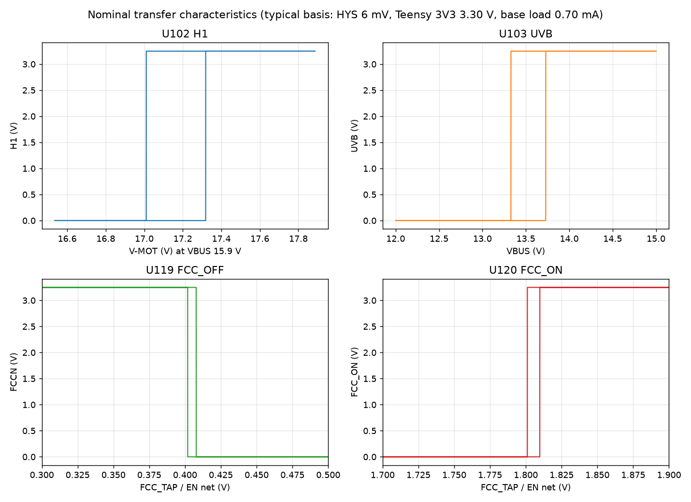
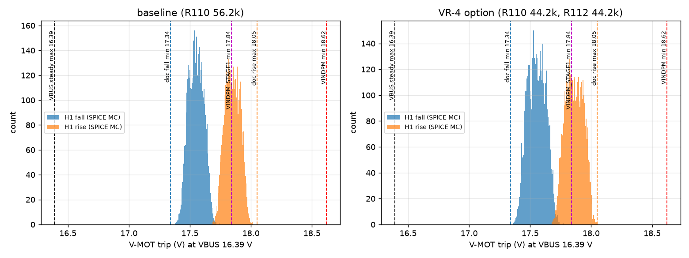
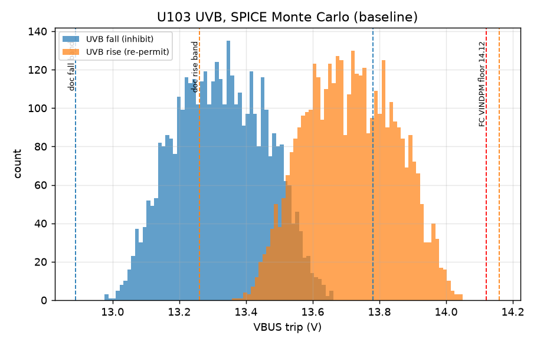
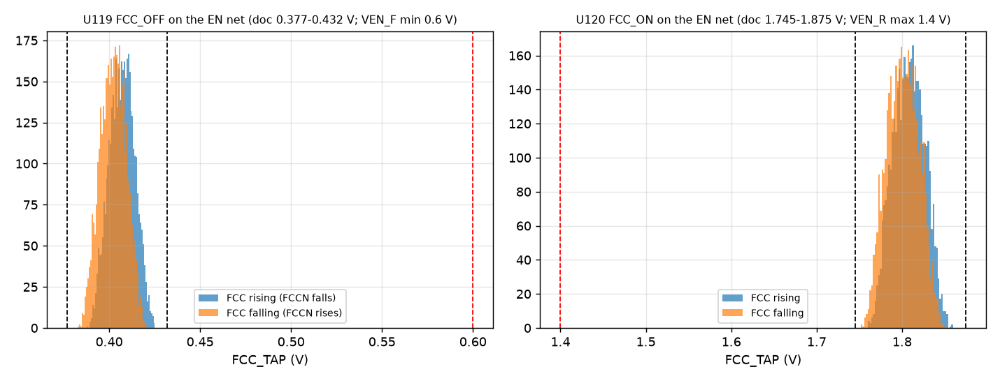
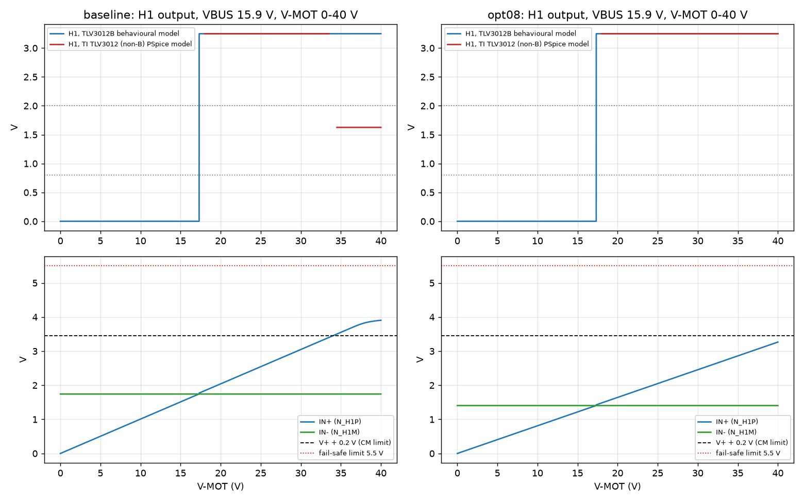
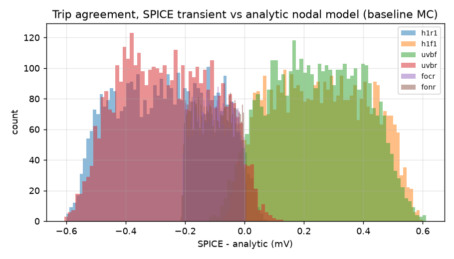

# Sim 3: CR comparators H1, UVB, FCC_OFF and FCC_ON

**Source citations (added 2026-11-15, second review R2-SIM-4).** Every line number in this report for
`gen/netlist.py`, `cr/cr.net` and `docs/charger_bq25798_wiring_design_2026-11-05.md` refers to the committed state at
git tag `charger-r8-pre-review-2026-11-14` (commit 014c745). Later edits (D-82, the r9-25 revision) moved those lines.
The BOM citations refer to `bom_2026-11-13/`. The current set `bom_2026-11-14/` carries the same value, tolerance, TCR
and MPN for every simulated part (U102, U103, U119, U120, R109-R116, R122, R126, R175, R184-R189, C106-C108,
D104-D106 in `cr_bom.csv`, the same lines 22-39; R170/R171 in `system_bom.csv` line 3). The cr.net topology asserts of
`run.py` pass on the current `cr.net` (second review, R2-SIM-4 evidence). No result changes.

## 1. Purpose

This simulation checks the four TLV3012B comparators on the carrier board (CR) against the design-document bands. It
informs the following items of `../../REVIEW_2026-11-14.md`:

- section 4.4 VR-4: the comparator taps are on full-voltage MB nodes, the proposed H1+ ratio of about 0.08, and the
  open TODO(verify) on TLV3012 behaviour above the input common-mode range;
- section 5, the checks "Comparator thresholds recomputed by corner Monte Carlo" and "Recomputed thresholds with
  R170/R171 10k" (an independent re-derivation of the H1, UVB, FCC_OFF and FCC_ON bands);
- LOG-3, which depends on the H1 trip ratio (H1 can assert in Init, Idle and Teensy reset when V-MOT exceeds about
  1.09 x VBUS).

The criteria come from `docs/charger_bq25798_wiring_design_2026-11-05.md`: B.2 (lines 1856-1904), H.1 and H.2
(lines 3343-3352), the FCC_OFF / FCC_ON row of H.22, and the regen threshold stack of line 3400 (VBUS steady max
16.39 V < H1 fall min 17.34 V < H1 rise max 18.05 V < VINDPM min 18.62 V). The H.1 row "H1 fall max vs
VINDPM_STAGE1 min" (17.76 V vs 17.84 V) and the H.1 ripple row are also checked.

## 2. Circuit and models

### 2.1 Circuit

The decks reproduce the comparator section of the CR as captured in `../../cr/cr.net`. Before it writes any deck,
`run.py` parses `cr.net` and asserts every pin-to-net connection of the 25 parts that it simulates; all values are
read from the same file (generator source `../../gen/netlist.py` at tag `charger-r8-pre-review-2026-11-14`, lines
131-165 and 205; the U102 to R189 block and the R175 row in the current file; **Superseded 2026-11-15, R2-SIM-4,
the line numbers moved with D-82:** "lines 131-165 and 205"). The MB-side tap resistors
R170 and R171 (10.0 kOhm, 0.1 %, 25 ppm/K) are not in `cr.net`. Their values come from design document B.2
(line 1860 at the tag) and `../../bom_2026-11-13/README.md` line 116 (now `../../bom_2026-11-14/system_bom.csv` line 3,
ERA-6AEB103V, same value, tolerance and TCR; **Superseded 2026-11-15, R2-SIM-4, bom_2026-11-14 is the current set:**
"`../../bom_2026-11-13/README.md` line 116"); the MB nodes come from
`references/Scale_Car_Board_20260624.sch` line 8852 (C-D6 pin 1 = V-MOT) and line 8784 (C-D2 pin 1 = VBUS).

Table 1 summarises the four comparator networks.

| Comparator | IN+ | IN- | Output | Hysteresis |
|---|---|---|---|---|
| U102 H1 | V-MOT through R170 10.0 k (MB) + R109 487 k, R110 56.2 k to GND | VBUS through R171 10.0 k (MB) to T2C, R111 442 k, R112 56.2 k to GND | H1 (R126 1.00 k to Teensy pin 34) | R113 6.49 M, OUT to IN+ |
| U103 UVB | T2C through R114 1.00 M, R115 104 k to GND | own REF | UVB | R116 10.0 M, OUT to IN+ |
| U119 FCC_OFF | own REF / 3 (R184 20.0 k, R185 10.0 k) | FCC through R186 10.0 k; R187 3.30 M to 3V3 | FCCN | internal only |
| U120 FCC_ON | FCC through R188 453 k, R189 1.00 M to GND | own REF | FCC_ON | internal only |

Table 1 shows that H1 and UVB share the node T2C, so the R116 coupling and the T2C loading are part of every solve.
The CR 3V3 rail is the Teensy 3V3 (tap T6) through R175 68.0 ohm, loaded by a constant current that stands for the
other CR and EIB loads. FCC_TAP (the D-BC-FC EN net, Teensy pin 31) is an ideal source, and FCC sits behind R122
1.00 k. Each BAV199 clamp (D104-D106) is fitted. The input filter capacitors C106, C107 (470 pF), C108 (1.0 nF) and
C130 (100 nF) are omitted from the trip decks, because they do not change a DC trip point; they are fitted in the
ripple decks (section 5.6).

### 2.2 Comparator models

The TI PSpice model of the TLV3012 (SBOC081A, `../models/tlv3012_ti_sboc081a.lib`, fetched from ti.com on
2026-11-14) runs in ngspice-46 in PSpice compatibility mode (`ngbehavior=psa`). However, its header names datasheet
SBOS300B (2004), and it represents the non-B TLV3012: it has no internal hysteresis (`V_VHYST 0`), a fixed 0.5 mV
offset and an ideal 1.242 V reference, and it drives its output to mid-supply when either input leaves the range
(V-) - 0.2 V to (V+) + 0.2 V. The fitted part is the TLV3012B (`cr.net` MPN TLV3012BIDBVR), whose behaviour outside
the common-mode range is specified differently (SBOS300C section 9.4.4). All trip and Monte Carlo results therefore
use a behavioural TLV3012B model (`../models/tlv3012b_behav.lib`). The TI model serves as an independent cross-check
of the network at nominal values and shows the vendor-model prediction above the common-mode range.

The datasheet of the fitted part is TI SBOS300C (February 2004, revised April 2023),
https://www.ti.com/lit/ds/symlink/tlv3012b.pdf, retrieved 2026-11-15 during the check round (section 10) to audit
sections 6.9 and 9.4.4. The PDF is not in `references/Datasheets`; adding it there is recommended so that the 9.4.4
fail-safe table, on which conclusion 4 rests, can be audited from the repository. Table 2 lists the datasheet
parameters that the behavioural model implements, and the Monte Carlo distribution of each. The 6.9 table header is
"VS = 1.8 V and 5.5 V, VCM = VS/2, TA = 25 C, unless otherwise noted"; VOS is specified at VCM = (V-).

| Parameter | SBOS300C value | Model and Monte Carlo distribution |
|---|---|---|
| Input offset VOS | +-6 mV at 25 C; +-9 mV over -40..125 C (6.9) | uniform +-9 mV |
| Internal hysteresis VHYS | 2 / 6 / 8 mV over -40..125 C (6.9) | uniform 2-8 mV |
| CMRR | 54 dB min, VCM -0.2 V to V+ + 0.2 V (6.9) | offset term KCM x VCM, KCM uniform +-2.0 mV/V |
| PSRR | 100 typ / 1000 max uV/V, VS 1.65-5.5 V (6.9) | offset term KPS x (V+ - 3.3 V), KPS uniform +-1 mV/V; the 3.3 V reference is an ASSUMPTION (section 3) |
| Common-mode range | (V-) - 0.2 V to (V+) + 0.2 V (6.6, 6.9) | per-input range flags |
| Fail-safe inputs | both in range: normal; IN- above range with IN+ in range: LOW; IN+ above range with IN- in range: HIGH; both above: indeterminate (9.4.4) | implemented; parameter INDET (0 or 1) selects the indeterminate state |
| POR | push-pull output LOW while V+ is below the 1.65 V minimum (6.6, 9.4.5) | implemented without the 1.9 ms delay |
| Output | push-pull; VOH and VOL 90-200 mV from the rail at 5 mA, VS 5 V (6.9) | rail through ROUT, uniform 18-40 ohm |
| REF | 1.223 / 1.242 / 1.260 V at 25 C; drift 100 ppm/C max; sourcing regulation 1 mV/mA max (6.9) | uniform 1.223-1.260 V times (1 + d x (T - 25 C)), d uniform +-100 ppm/C; RREF uniform 0.36-1.0 ohm; REF current drawn from V+ |
| Supply current | 2.4 typ; 3.1 max at 25 C; 3.6 max over temperature (6.9) | uniform 2.4-3.6 uA |
| Propagation delay | 2-4 us (6.10) | not modelled (quasi-static decks) |

The BAV199 diodes use a plain junction model (`../models/bav199_behav.lib`) with ASSUMED parameters, because the
Nexperia model and data sheet returned HTTP 403 and no BAV199 data sheet is in `references/Datasheets`. The nominal
model has VF of about 0.80 V at 1 mA (IS 4 pA, N 1.6); two variants bracket VF at 0.70 V and 0.90 V. The diodes
matter only in the over-range cases.

## 3. Assumptions

- **Resistors:** tolerance and TCR from the ordering BOM (`../../bom_2026-11-14/cr_bom.csv` lines 22-39, identical
  rows; **Superseded 2026-11-15, R2-SIM-4, bom_2026-11-14 is the current set:** "`../../bom_2026-11-13/cr_bom.csv`
  lines 22-39"): 0.1 % and
  25 ppm/K for R109-R112, R114, R115, R170 and R171; 1 % and 100 ppm/K for R113, R116, R122, R126, R175 and
  R184-R189. Each resistor draws an independent uniform tolerance and an independent uniform TCR; perfect tracking of
  the divider pairs is not assumed.
- **Temperature:** uniform -20 C to +70 C per board, one temperature for all parts. This is 25 C +- 45 C, the same
  excursion as `DT_CR = (0, 45)` with a +- drift sign in `docs/reviews/charger_eval_2026-11-05/round3/calc/r3_calc.py`.
  ASSUMPTION: the CR operates inside this range (T-C-03 tests UVB at 0 C and 60 C ambient).
- **CR 3V3 rail:** Teensy 3V3 uniform 3.135-3.465 V (ASSUMPTION, `round4/calc/r9_calc.py` line 38, +-5 %), R175
  68.0 ohm 1 %, base load uniform 0.35-1.00 mA (design document H.24(a) basis); the comparator, REF-divider and
  pull-up currents are simulated in addition. The resulting rail spans 3.067-3.435 V.
- **Teensy pin 34:** 100 kOhm pull-down on H1_RB (ASSUMPTION, design document H.15, R9.H15).
- **PSRR reference:** the supply term of the offset is KPS x (V+ - 3.3 V) (ASSUMPTION). SBOS300C 6.9 specifies the
  +-9 mV VOS limit under the table condition VS = 1.8 V and 5.5 V, so the limit already holds at both supply extremes;
  with a linear supply dependence the offset then stays inside +-9 mV at every rail in between, and the KPS term
  (at most +-0.24 mV over the 3.06-3.47 V rail) is extra margin. The worst case is repeated with the reference at
  1.8 V and 5.5 V and with the term removed (`csv/psrr_reference_sweep.csv`, section 5.2).
- **Sources:** V-MOT and VBUS are ideal sources at C-D6 and C-D2 (the MB node impedance is far below R170/R171); tap
  wire resistance is neglected against 10 kOhm.
- **Distributions:** the primary Monte Carlo is uniform over the full datasheet and BOM limits, which is conservative
  for a 3-sigma figure. A sensitivity variant uses a truncated normal distribution with sigma = limit / 3.
- **Not modelled:** BAV199 leakage beyond the pA-class junction model (T-A-07 measures it; the B.2 estimate is
  < 1 mV of trip shift), comparator input bias current (+-10 pA), propagation delay, and the 1.9 ms POR delay.

## 4. Cases and method

1. **Nominal trips.** One board at nominal values, on two bases: the design-document basis (VHYS 5 mV, rail 3.30 V,
   no base load, as in `r3_calc.py`) and a typical basis (VHYS 6 mV, Teensy 3.30 V, base load 0.70 mA). V-MOT ramps
   up and down at VBUS 15.2, 15.9, 16.39 and 19.5 V (19.5 V is the top of the H.1 guard row); VBUS ramps 15 -> 12 -> 15 V; FCC_TAP ramps 0 -> 2.1 -> 0 V. Each trip
   is a `.meas FIND ... WHEN` on the comparator output at 1.5 V; the transient has no capacitors, so it is
   quasi-static, and the step limit (5 ns nominal, 20 ns Monte Carlo) bounds the ramp quantisation to < 0.5 mV.
2. **TI-model cross-check.** The same network with the TI model (DC sweeps up and down, `psa` mode) against the
   behavioural model with the TI model's own parameters (offset 0.5 mV on IN+, no hysteresis, ideal REF).
3. **Monte Carlo.** N = 4000 boards per design (seed 20261114), run in SPICE as 400 decks of 10 independent boards
   each; every board carries all four comparators on one shared rail. The same random draws are applied to both
   designs.
4. **Independent analytic check.** A nodal solution in numpy (`analytic()` in `run.py`) recomputes every trip of
   every Monte Carlo board from the same parameters. It also gives a deterministic worst case, with and without the
   resistor TCR: linear sensitivities over every bounded parameter (51 parameters) select the bound of each, then the
   12 parameters with the largest sensitivity are enumerated exhaustively over both bounds (4096 vertices per edge)
   with the others held at the selected bound, and the extreme over that set is reported
   (`csv/worst_case_vertices.csv`). It also gives a 200 000-sample run of the uniform and normal variants.
5. **VR-4 option.** R110 = 44.2 kOhm. R112 is solved so that the ratio of the H1- and H1+ divider ratios stays at its
   present value (the "1.079 trip ratio" of VR-4), and the nearest E192 value is used.
6. **Over-range.** V-MOT 0 -> 40 V at VBUS 15.9 V and 19.5 V; rail low (Teensy 3.135 V, 1.00 mA), nominal and high
   (3.465 V, 0.35 mA), and a sagged rail of 1.83 V (the EIB-2 short case of the review); both BAV199 variants;
   behavioural model with INDET 0 and 1, and the TI model on U102 (a grid of `.op` points from 18 V to 40 V in
   0.5 V steps, because a DC sweep or an alter/op loop of the TI model did not finish within 10 min).
7. **Ripple (additional case).** With C106 and C107 fitted, V-MOT = hysteresis centre + sine at 8, 20 and 30 kHz;
   the smallest peak-to-peak amplitude that toggles H1 is found by bisection (11 steps), for the typical part and for
   the minimum-hysteresis vertex of the exhaustive worst case at VBUS 15.9 V (Teensy 3V3 3.135 V, base load 1.00 mA,
   CR rail 3.062 V, U102 VHYS 2 mV, R113 at +1 % tolerance and +0.45 % TCR, with the remaining parameters at that
   vertex).

## 5. Results

### 5.1 Nominal trips and the TI-model cross-check

Figure 1 shows the nominal transfer characteristics of the four comparators on the typical basis.

Figure 1 shows a 0.31 V wide H1 loop at VBUS 15.9 V, a 0.40 V wide UVB loop, and 6-9 mV wide FCC_OFF and FCC_ON loops,
which come from the internal hysteresis alone. Table 3 compares the nominal trips on the design-document basis with
B.2.

| Quantity | This simulation (doc basis) | Design document | Difference |
|---|---|---|---|
| H1 rise at VBUS 15.9 V | 17.314 V | 17.314 V (r3_calc_out.txt) | 0.0 mV |
| H1 fall at VBUS 15.9 V | 17.012 V | 17.012 V | 0.0 mV |
| UVB rise | 13.724 V | 13.72 V | +4 mV |
| UVB fall | 13.329 V | 13.33 V | -1 mV |
| FCC_OFF on the EN net (FCC rising / falling) | 0.407 / 0.402 V | 0.39-0.44 V band (B.1) | inside |
| FCC_ON on the EN net (rising / falling) | 1.809 / 1.802 V | 1.80 V nominal (review section 5) | +9 / +2 mV |

Table 3 shows agreement with the design document to within 4 mV at nominal values. The TI PSpice model and the
behavioural model, run with the same offset, no hysteresis and an ideal reference, agree to within 0.43 mV on every
trip (`csv/ti_model_crosscheck.csv`), which confirms the network and the offset sign convention independently of the
behavioural comparator.

### 5.2 Monte Carlo: H1

Table 4 gives the H1 trip distributions (SPICE, N = 4000 per design) with the deterministic worst case (WC) from the
analytic model, with and without the resistor TCR.

| H1 trip (V-MOT) | MC min | MC max | mean - 3 sigma | mean + 3 sigma | WC with TCR | WC without TCR | Design document |
|---|---|---|---|---|---|---|---|
| fall at VBUS 15.20 V | 16.092 | 16.447 | 16.075 | 16.437 | 15.978-16.537 | 16.045-16.469 | 16.053-16.463 |
| rise at VBUS 15.90 V | 17.155 | 17.478 | 17.135 | 17.496 | 17.041-17.589 | 17.110-17.518 | 17.097-17.516 |
| fall at VBUS 15.90 V | 16.850 | 17.212 | 16.834 | 17.200 | 16.732-17.305 | 16.802-17.234 | 16.810-17.229 |
| rise at VBUS 16.39 V | 17.685 | 18.013 | 17.666 | 18.030 | 17.568-18.127 | 17.640-18.054 | 17.627-18.052 |
| fall at VBUS 16.39 V | 17.381 | 17.747 | 17.366 | 17.734 | 17.260-17.843 | 17.329-17.770 | 17.340-17.764 |
| rise at VBUS 19.50 V | 21.052 | 21.411 | 21.039 | 21.420 | 20.917-21.542 | 21.003-21.455 | not stated |
| fall at VBUS 19.50 V | 20.747 | 21.146 | 20.739 | 21.125 | 20.610-21.257 | 20.692-21.170 | 20.70 (guard 1.20 V, H.1) |

Table 4 shows that the worst case without the resistor TCR reproduces the design-document bands to within 13 mV; the
two calculations therefore agree on the same basis. At VBUS 19.5 V the worst-case fall minimum without TCR is
20.692 V, a guard of 1.192 V against the 1.20 V upper end of the H.1 guard band. The TCR term (25 ppm/K over +-45 K, 0.11 % per resistor) widens
every H1 band by about 70 mV on each side, which is as large as the 0.1 % tolerance itself; `r3_calc.py` does not
include it. The VOS term dominates the worst case (0.179 V of V-MOT across the +-9 mV range), followed by the CMRR
term (0.07 V) and each of R110 and R112 (0.07 V). The H1 hysteresis on V-MOT spans 0.252-0.343 V in the Monte Carlo (mean 0.298 V) and 0.250-0.347 V at the
worst case; the design document states 0.30 V nominal and uses 0.25 V as the minimum. The SPICE and analytic trips agree to within
0.63 mV on every board, which is the ramp quantisation of the transient.

Figure 2 shows the H1 Monte Carlo distributions at VBUS 16.39 V against the regen threshold stack, for the present
design and for the VR-4 option.

Figure 2 shows that every Monte Carlo board keeps the order of the stack: the fall trip is above 16.39 V and the rise
trip is below 18.62 V. Table 5 states each stack criterion against the simulated values.

| Criterion (design document) | Doc value | MC (N = 4000) | WC with TCR | Result |
|---|---|---|---|---|
| VBUS steady max 16.39 V < H1 fall min | 17.34 V | 17.381 V | 17.260 V | pass; WC margin 0.87 V |
| H1 rise max < VINDPM min 18.62 V | 18.05 V (margin 0.57 V) | 18.013 V | 18.127 V | pass; WC margin 0.49 V |
| H1 fall max < VINDPM_STAGE1 min 17.84 V (H.1) | 17.76 V (margin 0.08 V) | 17.747 V (margin 93 mV) | 17.843 V | MC pass; WC fails by 3 mV |
| H1 guard at VBUS 15.9 V (fall min - VBUS) | >= 0.91 V | 0.950 V | 0.832 V | pass (>0); 0.08 V below the doc figure |
| H1 guard at VBUS 15.2 V | >= 0.85 V | 0.892 V | 0.778 V | pass (>0); 0.07 V below the doc figure |
| H1 guard at VBUS 19.5 V (top of the H.1 range) | 1.20 V | 1.247 V | 1.110 V | pass (>0); 0.09 V below the doc figure |

Table 5 shows that the regen threshold stack holds with margins of 0.49 V and more at the worst case, and that
the guard stays positive over the whole H.1 range, 15.2-19.5 V. However, the H.1
row "the staged raise never drops H1" (H1 fall max below the 17.84 V minimum of VINDPM_STAGE1) holds only
statistically: the uniform Monte Carlo maximum is 17.747 V (93 mV margin) and the 3-sigma bound is 17.734 V, but the
deterministic worst case that includes the resistor TCR reaches 17.843 V, 3 mV above the criterion. The exhaustive
vertex search confirms this value; the earlier sensitivity-only vertex gave the same 17.843 V. Table 5a shows how
the worst case depends on the PSRR reference assumption.

| PSRR treatment | H1 fall max at 16.39 V | H1 rise max at 16.39 V | UVB fall max |
|---|---|---|---|
| reference 3.3 V (used) | 17.843 V | 18.127 V | 13.818 V |
| reference 1.8 V | 17.853 V | 18.142 V | 13.829 V |
| reference 5.5 V | 17.865 V | 18.147 V | 13.842 V |
| KPS = 0 (VOS limit alone) | 17.841 V | 18.126 V | 13.815 V |

Table 5a shows that the VINDPM_STAGE1 overlap exists under every PSRR treatment, from 0.5 mV (KPS = 0) to 25 mV
(reference 5.5 V). The 1.8 V and 5.5 V references are pessimistic, because they let the offset at the CR rail exceed
the +-9 mV limit that SBOS300C specifies at both supply extremes. No other criterion changes its result. The 200 000-sample
uniform run of the analytic model reaches 17.745 V, and the normal variant (sigma = limit/3) reaches 17.689 V
(`csv/analytic_200k_gauss_vs_uniform.csv`), so the violation requires every parameter at its adverse limit at once.

### 5.3 Monte Carlo: UVB

Figure 3 shows the UVB distributions against the design-document bands and the FC VINDPM floor.

Figure 3 shows both UVB distributions inside the design-document bands. Table 6 gives the figures.

| UVB trip (VBUS) | MC min | MC max | mean +- 3 sigma | WC with TCR | WC without TCR | Design document |
|---|---|---|---|---|---|---|
| fall (inhibit) | 12.976 | 13.662 | 12.923-13.727 | 12.846-13.818 | 12.874-13.788 | 12.89-13.78 |
| rise (re-permit) | 13.358 | 14.049 | 13.314-14.115 | 13.255-14.188 | 13.283-14.158 | 13.26-14.16 |

Table 6 shows that the worst case without TCR again reproduces the design-document bands: to within 13 mV on the fall
band and the rise maximum, and 23 mV inside the design-document rise minimum (13.283 V against 13.26 V). The UVB band is dominated by the REF tolerance and drift (0.53 V of VBUS across
the band) and by VOS (0.20 V); the 0.1 % divider contributes 0.05 V. With TCR, the fall maximum is 13.818 V, so the
margin to the FC VINDPM floor of 14.12 V is 0.30 V (doc 0.34 V); the rise maximum of 14.188 V stays 1.01 V below the
assumed loaded FC-only bus of 15.2 V (doc 1.04 V). The UVB hysteresis is 0.339-0.440 V. Both H.2 criteria pass.

### 5.4 Monte Carlo: FCC_OFF (U119) and FCC_ON (U120)

Figure 4 shows the distributions of the two FCC comparators on the EN net.

Figure 4 shows both comparators far from the RT1987 enable thresholds. Table 7 gives the figures.

| Trip | MC range | WC with TCR | WC without TCR | Design document (H.22) | Criterion |
|---|---|---|---|---|---|
| FCC_OFF, EN net, FCC rising | 0.388-0.425 V | 0.379-0.436 V | 0.382-0.433 V | 0.377-0.432 V | < VEN_F min 0.6 V: margin 0.164 V |
| FCC_OFF, EN net, FCC falling | 0.383-0.422 V | 0.374-0.431 V | 0.376-0.428 V | | |
| FCC_OFF, IN- (N_FOM) | 0.397-0.435 V | 0.389-0.444 V | 0.391-0.442 V | 0.387-0.441 V | |
| FCC_ON, EN net, rising | 1.760-1.860 V | 1.739-1.880 V | 1.744-1.875 V | 1.745-1.875 V | > VEN_R max 1.4 V: margin 0.33 V |
| FCC_ON, EN net, falling | 1.752-1.853 V | 1.732-1.873 V | 1.736-1.867 V | | |

Table 7 shows agreement with H.22 to within 1 mV on the same basis, and both criteria pass with margins of 0.16 V
and 0.33 V at the worst case. The R187 pull-up offsets IN- from the EN net by 9.2 mV, as H.22 states.

### 5.5 VR-4 option (R110 44.2 kOhm)

The solve for R112 gives the following values:

- present ratios: H1+ = R110/(R170 + R109 + R110) = 0.10159; H1- = 0.10961 including the T2C loading; ratio of
  ratios 1.07897 (the "1.079" of VR-4);
- R110 = 44.2 kOhm gives an H1+ ratio of **0.08167**, not 0.0802 as VR-4 states;
- R112 for an unchanged ratio of ratios is 44.105 kOhm exactly; the nearest E192 value is **44.2 kOhm** (0.1 %),
  which gives 1.08109 (+0.20 %), and moves the nominal H1 rise at VBUS 15.9 V by +15 mV (17.334 V against
  17.319 V, typical basis).

Table 8 compares the VR-4 option with the present design at VBUS 16.39 V.

| Quantity | Present design | VR-4 option |
|---|---|---|
| H1 rise at 16.39 V, MC range / WC with TCR | 17.685-18.013 / 17.568-18.127 V | 17.678-18.048 / 17.554-18.170 V |
| H1 fall at 16.39 V, MC range / WC with TCR | 17.381-17.747 / 17.260-17.843 V | 17.359-17.775 / 17.234-17.875 V |
| H1 standard deviation (analytic, 200 000 uniform) | 0.060 V | 0.072 V (+19 %) |
| VOS sensitivity on V-MOT (per 18 mV span) | 0.179 V | 0.222 V (x 1.24) |
| H1 hysteresis on V-MOT, MC / WC minimum | 0.252-0.343 V / 0.250 V | 0.257-0.362 V / 0.255 V |
| H1 fall at 19.50 V, MC minimum / WC minimum (guard) | 20.747 / 20.610 V (1.110 V) | 20.727 / 20.584 V (1.084 V) |
| UVB fall nominal (typical basis) | 13.329 V | 13.335 V (+6.4 mV through the T2C loading) |
| V-MOT at which IN+ leaves the CM range, rail 3.063 / 3.249 / 3.438 V | 32.1 / 34.0 / 35.8 V | 39.98 V / > 40 V / > 40 V |
| Smallest V-MOT ripple that toggles H1, 8 / 20 / 30 kHz (minimum-hysteresis vertex) | 0.359 / 0.784 / 1.141 V p-p | 0.334 / 0.661 / 0.949 V p-p |

Table 8 shows that the option keeps the H1+ input inside the common-mode range up to 40 V except at the lowest rail
corner (39.98 V). The cost is a 1.24-fold larger offset term on V-MOT (VR-4 states 1.27, which corresponds to 0.0802),
a 19 % wider H1 distribution, a WC fall maximum of 17.875 V (35 mV above VINDPM_STAGE1 min), and 7-17 % less ripple
immunity, because the lower R110 lowers the IN+ Thevenin resistance from 50.1 kOhm to 40.3 kOhm and so the C106 filter
corner rises. VR-4 keeps the UVB divider (R114/R115) unchanged, as it requires. However, the UVB trip still moves by +6.4 mV,
because the lower R112 loads T2C more and lowers the T2C gain by 0.047 %. The shift is negligible against the 0.30 V
UVB margin.

### 5.6 Over-range (V-MOT to 40 V) and phase reversal

Figure 5 shows H1 and its two inputs for V-MOT from 0 V to 40 V at VBUS 15.9 V and the nominal rail, for the present
design and the VR-4 option, with both comparator models.

Figure 5 shows that the TLV3012B behavioural model keeps H1 HIGH from the rise trip to 40 V, while the TI model of the
non-B part drops H1 to mid-supply once IN+ passes V+ + 0.2 V. Table 9 summarises the over-range cases
(`csv/overrange.csv`, BAV199 high-VF variant).

| Case | IN+ leaves CM range at V-MOT | IN+ max at 40 V | H1 above the rise trip, TLV3012B model | H1 above the rise trip, TI (non-B) model |
|---|---|---|---|---|
| Present, rail 3.063 V | 32.1 V | 3.75 V | HIGH (3.063 V) | mid-supply 1.53 V above 32.5 V (LVC undefined band) |
| Present, rail 3.249 V | 34.0 V | 3.91 V | HIGH | mid-supply 1.63 V; no DC solution at 34.0 V |
| Present, rail 3.438 V | 35.8 V | 4.03 V | HIGH | mid-supply 1.72 V above 36.0 V |
| VR-4 option, rails 3.063-3.438 V | 39.98 V / none / none | 3.27 V | HIGH | HIGH (no DC solution at the 40.0 V point, rail 3.063 V) |
| Present, rail sagged to 1.83 V, VBUS 15.9 V | 20.0 V | 2.58 V | HIGH (1.83 V) | mid-supply 0.92 V |
| Present, rail 1.83 V, VBUS 19.5 V | 20.1 V | 2.58 V | never HIGH (INDET 0) or HIGH from 20.1 V (INDET 1) | never HIGH (mid-supply) |

Table 9 shows the following:

- For the fitted TLV3012B, H1 stays HIGH (the state that VR-4 calls the safe direction) to 40 V at every rail corner
  and both VBUS values, because IN- stays inside the range (1.74 V at 15.9 V, 2.14 V at 19.5 V) and SBOS300C 9.4.4
  item 3 then defines the output as HIGH. No phase reversal occurs. The BAV199 clamp holds IN+ at 3.75-4.03 V, below
  the 5.5 V fail-safe limit and the 7 V absolute maximum, with at most 6.1 uA into the rail at the normal rails.
- The INDET setting changes no result at the normal rails, because the indeterminate region (both inputs above range)
  is never reached.
- The TI PSpice model does not represent the TLV3012B here: it reports a mid-supply output (1.53-1.72 V, inside the
  SN74LVC 0.8-2.0 V undefined band at U118) and has no DC solution at the boundary, where the mid-supply output
  lowers IN+ through R113 and returns it into range. This is a property of the non-B model. If a non-B TLV3012 were
  ever substituted, its 6.1 absolute maximum (V+ + 0.5 V = 3.56-3.94 V) would also be exceeded by the 3.75-4.03 V
  clamp level. The B suffix in the BOM is therefore load-bearing.
- With the rail sagged to 1.83 V (the EIB-2 short), the common-mode limit falls to 2.03 V. At VBUS 15.9 V, H1 still
  trips normally and stays HIGH. At VBUS 19.5 V, IN- (2.14 V) is above the range, so H1 is LOW (item 2) until IN+ also
  leaves the range at 20.1 V, after which the state is indeterminate (item 4). This needs both the rail fault and a
  bus at its OVP level.

### 5.7 Ripple that toggles H1 (additional simulation)

Table 10 gives the smallest V-MOT ripple at the hysteresis centre that toggles H1, with C106 and C107 fitted
(`csv/ripple_chatter.csv`).

| Frequency | Present, typical part (hysteresis 0.308 V) | Present, minimum-hysteresis vertex (0.250 V) | Design document H.1 (0.25 V hysteresis) | VR-4 option, typical part | VR-4 option, minimum-hysteresis vertex (0.255 V) |
|---|---|---|---|---|---|
| 8 kHz | 0.441 V p-p | 0.359 V p-p | 0.39 V p-p | 0.428 V p-p | 0.334 V p-p |
| 20 kHz | 0.964 V p-p | 0.784 V p-p | 0.78 V p-p | 0.835 V p-p | 0.661 V p-p |
| 30 kHz | 1.403 V p-p | 1.141 V p-p | 1.14 V p-p | 1.198 V p-p | 0.949 V p-p |

Table 10 shows that, at the minimum-hysteresis vertex, the H.1 ripple limits at 20 kHz and 30 kHz are reproduced to
within 0.5 % (0.784 V against 0.78 V, 1.141 V against 1.14 V), but the 8 kHz limit is 8 % optimistic: H1 toggles at
0.359 V p-p, against the 0.39 V of H.1. The T-E-07 pass limit should therefore be 0.36 V p-p at 8 kHz for the present
design. The VR-4 option lowers every threshold by 7-17 %.

### 5.8 Model agreement

Figure 6 shows the difference between the SPICE trips and the analytic trips over the baseline Monte Carlo.

Figure 6 shows differences below 0.63 mV on H1 and UVB and below 0.22 mV on the FCC comparators, which is the ramp
quantisation of the transient. The two independent solutions agree, so the worst-case and 200 000-sample figures that
use the analytic model rest on the same circuit as the SPICE decks.

## 6. Conclusion against the design-document criteria

1. The design-document bands for H1 (B.2, H.1), UVB (H.2), FCC_OFF and FCC_ON (H.22) are reproduced independently, to
   within 13 mV on every band edge except the UVB rise minimum (23 mV inside the document band), when the same basis
   is used (no resistor TCR). This confirms the review's section 5 recalculations
   in substance; the review's own H1 figures at 15.9 V (rise 17.29 V, fall 17.04 V) differ from the nominal
   17.314 / 17.012 V by about 25 mV.
2. Every criterion of the regen threshold stack and of H.2 and H.22 passes at the worst case including the resistor
   TCR over -20..+70 C. The margins shrink by 0.04-0.09 V against the document: H1 rise max 18.127 V against
   VINDPM min 18.62 V (0.49 V), H1 fall min 17.260 V against VBUS 16.39 V (0.87 V), UVB fall max 13.818 V against
   14.12 V (0.30 V). The H1 guard stays positive up to VBUS 19.5 V (1.110 V minimum there).
3. The H.1 criterion "H1 fall max < VINDPM_STAGE1 min 17.84 V" is met by every Monte Carlo board (maximum 17.747 V)
   but not at the deterministic worst case with TCR (17.843 V, 3 mV over; confirmed by an exhaustive vertex search,
   and present under every PSRR treatment, 0.5-25 mV). The design document omits resistor TCR
   in `r3_calc.py`; adding it is recommended, and either the staged VINDPM raise moves one 100 mV code higher or the
   criterion is accepted on a statistical basis. The VR-4 option worsens this to 35 mV over.
4. The TLV3012B shows no phase reversal: with V-MOT up to 40 V, IN- stays in range and SBOS300C 9.4.4 item 3 holds H1
   HIGH. The VR-4 premise is confirmed for the fitted part, and the present ratios can stay. The TI PSpice model
   cannot answer this question, because it models the non-B part.
5. The VR-4 0.08 ratio is not required for the TLV3012B. It costs a 19 % wider H1 distribution, 7-17 % less ripple
   immunity, and a larger VINDPM_STAGE1 overlap. Its stated values need correction: R110 44.2 kOhm gives 0.0817 and
   the offset grows 1.24-fold. With the UVB divider unchanged, as VR-4 requires, the UVB trip still moves by +6.4 mV
   through the T2C loading.
6. The T-E-07 ripple limit at 8 kHz is 0.36 V p-p at the minimum-hysteresis vertex, 8 % below the 0.39 V of H.1.

## 7. Limitations

- The behavioural TLV3012B model implements the datasheet tables and the 9.4.4 rules; it is not a transistor-level
  model. The "indeterminate" region is bracketed by INDET 0 and 1, not predicted.
- The Monte Carlo distributions are uniform over the limits; real parts are usually narrower, so the 3-sigma figures
  are conservative. VOS is drawn over its full-temperature limit at every temperature.
- The rail model uses an ASSUMED Teensy 3V3 tolerance (+-5 %) and base load (0.35-1.00 mA); neither is measured.
- BAV199 parameters are ASSUMED (no data sheet in the repository); only the over-range clamp level depends on them,
  and it stays below 5.5 V for both variants.
- The decks are quasi-static. Propagation delay, POR timing and the dynamic behaviour at the common-mode boundary are
  not simulated; the ripple decks include only C106/C107 and the behavioural comparator.
- The analytic worst case enumerates the 12 most sensitive parameters exhaustively and holds the other 39 at the
  bound that their linear sensitivity selects. The exhaustive step moved no H1 fall edge and moved the H1 rise
  maxima by +2.75 mV and the UVB minima by -3.0 to -3.6 mV; the residual from the 39 fixed parameters is therefore
  expected to be well below 1 mV, but it is not proven.
- The ripple threshold uses the minimum-hysteresis vertex; the filter attenuation varies by less than 1 % over the
  tolerances, so the minimum-hysteresis vertex is taken as the minimum-threshold vertex without a separate search.

## 8. Bench tests that confirm the results

- **T-C-02** (H1 trips through R170/R171 at VBUS 15.2, 15.9, 16.4 and 19.5 V): the measured trips must lie inside
  Table 4 (WC with TCR); repeat at 0 C and 60 C to see the TCR term.
- **T-C-03** (UVB at 0 C and 60 C): measured trips inside Table 6.
- **T-C-12 / T-D-01** (FCC levels): FCC_OFF and FCC_ON trips inside Table 7.
- **T-E-07** (V-MOT ripple at the H1 tap): pass below 0.36 V p-p at 8 kHz (Table 10).
- **Over-range (no current test; proposed):** with the CR on the bench, drive T1 through R170 from a PSU to 40 V with
  T2 at 15.9 V and 19.5 V, and log H1_RB (pin 34) and N_H1P. Pass: H1 stays HIGH and N_H1P stays below 4.1 V.
- **T-A-07** (BAV199 leakage) bounds the only unmodelled DC error source of the dividers.

## 9. Files

| File | Content |
|---|---|
| `run.py` | Entry script; regenerates every deck, CSV and PNG (557 s on 8 workers, ngspice-46, final run of 2026-11-15; **Superseded 2026-11-15, R2-SIM-8, final run time:** "543 s on 8 workers") |
| `run_log.txt` | Console output of the final run (557 s), the run that wrote the present `csv/` and `summary.json` (runtime_s 557.35). `run.py` does not write this file; the console was redirected to it. (**Superseded 2026-11-15, R2-SIM-8, the earlier file came from the run before the final one:** "Console output of the last run") |
| `run_log_pre_dedup_2026-11-15.txt` | Console output of the run before the final one (543 s, run.py with the foreign duplicate block of section 10.1); kept as evidence for section 10.1 |
| `summary.json` | All results and settings of the last run |
| `decks/` | Nominal, TI cross-check, first Monte Carlo batch per design, over-range and ripple decks |
| `csv/nominal_trips.csv`, `csv/ti_model_crosscheck.csv` | Section 5.1 |
| `csv/mc_baseline.csv`, `csv/mc_opt08.csv` | Per-board parameters, SPICE trips and analytic trips |
| `csv/mc_statistics.csv`, `csv/mc_derived.csv` | Tables 4-8 (statistics, worst cases, sensitivities, hysteresis, guard) |
| `csv/analytic_200k_gauss_vs_uniform.csv` | 200 000-sample uniform and normal variants |
| `csv/worst_case_vertices.csv` | Worst case per edge: exhaustive result, sensitivity-vertex result, the 12 enumerated parameters |
| `csv/psrr_reference_sweep.csv` | Table 5a |
| `csv/overrange.csv`, `csv/ripple_chatter.csv` | Tables 9 and 10 |
| `png/fig1_nominal_loops.png` ... `png/fig6_spice_vs_analytic.png` | Figures 1-6 |
| `../models/tlv3012b_behav.lib`, `../models/bav199_behav.lib` | Behavioural models (this simulation) |
| `../models/tlv3012_ti_sboc081a.lib` | TI TLV3012 PSpice model (data, unmodified below its source header) |

## 10. Check and corrections

An independent check reproduced the run (every CSV identical byte for byte, topology confirmed against `cr.net` and
`gen/netlist.py` lines 131-205) and returned six issues. Table 11 lists each issue and its resolution; `run.py` was
changed accordingly and re-run in full (800 of 800 Monte Carlo decks ok, no missing measurement). The Monte Carlo
draws are unchanged, so every existing Monte Carlo figure is unchanged.

| # | Severity | Issue | Resolution |
|---|---|---|---|
| 1 | major | The ripple case labelled "smallest hysteresis" kept the Teensy 3V3 at 3.30 V (V-MOT hysteresis 0.266 V, against the Monte Carlo minimum of 0.252 V); at the low-rail corner the thresholds fall to 0.360 / 0.784 / 1.143 V p-p, so the 0.38 V T-E-07 limit was about 6 % non-conservative | Fixed. The minimum-hysteresis case is now the exhaustive worst-case vertex of the H1 hysteresis at VBUS 15.9 V (Teensy 3.135 V, base load 1.00 mA, rail 3.062 V, VHYS 2 mV, R113 x 1.01455 = tolerance + TCR; hysteresis 0.250 V). The thresholds are 0.359 / 0.784 / 1.141 V p-p, which agree with the check to within 2 mV. The T-E-07 limit is now 0.36 V p-p, the H.1 comparison is restated (8 kHz 8 % optimistic; 20 and 30 kHz within 0.5 %), and the VR-4 column is recomputed at its own vertex (0.334 / 0.661 / 0.949 V p-p) |
| 2 | minor | The worst case picked its vertex from linear sensitivities only; an exhaustive 4096-vertex search gave rise max 18.128 V against 18.125 V | Fixed. `worst_case()` now enumerates the 12 most sensitive parameters exhaustively (4096 vertices per edge). Results: H1 fall max at 16.39 V 17.843 V (unchanged), H1 rise max 18.127 V (+2.75 mV), VR-4 fall max 17.875 V (unchanged); UVB minima move by -3.0 to -3.6 mV. No conclusion changes. `csv/worst_case_vertices.csv` gives both values for every edge |
| 3 | minor | SBOS300C was cited without a URL or retrieval date and is not in the repository | Fixed in section 2.2 and in the header of `../models/tlv3012b_behav.lib`: https://www.ti.com/lit/ds/symlink/tlv3012b.pdf, retrieved 2026-11-15; the section 9.4.4 text (items 1-4) and the 6.9 conditions were re-read from that copy. Adding the PDF to `references/Datasheets` is recommended; this simulation does not modify `references/` |
| 4 | minor | The PSRR term is referenced to 3.3 V without being stated as an assumption | Fixed. SBOS300C 6.9 specifies VOS under "VS = 1.8 V and 5.5 V", so the +-9 mV limit holds at both extremes and the KPS term is extra margin. The 3.3 V reference is now an ASSUMPTION (section 3) and is swept (Table 5a): the H1 fall maximum is 17.841-17.865 V over the treatments, so the VINDPM_STAGE1 overlap is 0.5-25 mV and its sign does not depend on the assumption |
| 5 | minor | "Not zero, as VR-4 assumes" misread VR-4, which requires the UVB divider to stay as it is | Fixed. Section 5.5 and conclusion 5 now state that VR-4 keeps the UVB divider unchanged, yet the trip still moves by +6.4 mV through the T2C loading |
| 6 | minor | The H.1 guard row covers VBUS 15.2-19.5 V, but the Monte Carlo stopped at 16.39 V | Fixed. VBUS 19.5 V is added to the Monte Carlo and the worst case (Table 4, Table 5): guard minimum 1.247 V (Monte Carlo), 1.110 V (worst case with TCR) and 1.192 V (without TCR, against 1.20 V in H.1) |

In addition, the re-run exposed two transcription errors in the first version of Table 7, which are corrected: the
Monte Carlo minimum of FCC_OFF on IN- at FCC rising is 0.397 V (0.392 V was the falling-edge value), and the
worst case without TCR of FCC_OFF at FCC falling is 0.376 V (0.3764 V, earlier rounded to 0.377 V). Neither changes
a margin.

The `gen/netlist.py` lines 131-205 named in the first paragraph of this section are lines at tag
`charger-r8-pre-review-2026-11-14` (see the note at the top of this report).

### 10.1 Foreign code block in run.py and the final re-run (2026-11-15)

During the 2026-11-15 simulation round, a script of another agent inserted a duplicate, older copy of the functions
`dc_deck()` and `dc_trip()` into `run.py`. The orchestrator of the round removed the block and re-ran `run.py` in full
(557 s). The removed block was not preserved; this record rests on the orchestrator's report and on the evidence
below.

The orchestrator kept the outputs of the run before the removal in
`C:\Users\ricky\AppData\Local\Temp\claude\sim_2026-11-14\comp_pre_dedup\` (the `csv/` folder and `summary.json`), with
the console of the final run as `rerun_log.txt`. The second review (finding R2-SIM-8) found that `run_log.txt` in this
folder was still the console of the earlier run. On 2026-11-15 the following comparisons were made:

1. All 11 CSV files of `csv/` are byte-identical to the 11 files of the backup.
2. `summary.json` equals the backup in every field except `runtime_s` (542.90 s before, 557.35 s after). The fields
   that hold NaN in both files are equal as NaN.
3. The console of the earlier run (now `run_log_pre_dedup_2026-11-15.txt`) and the console of the final run (now
   `run_log.txt`) agree line for line on all 921 lines once the per-deck run times and the total run time are masked.
4. The present `run.py` holds one definition each of `dc_deck()` (line 555) and `dc_trip()` (line 570), 34 top-level
   functions with no duplicated name, and the module-level `cr.net` topology asserts pass on the current `cr.net`.

The final run therefore reproduces every result of the earlier run, and no figure in this report changes.
