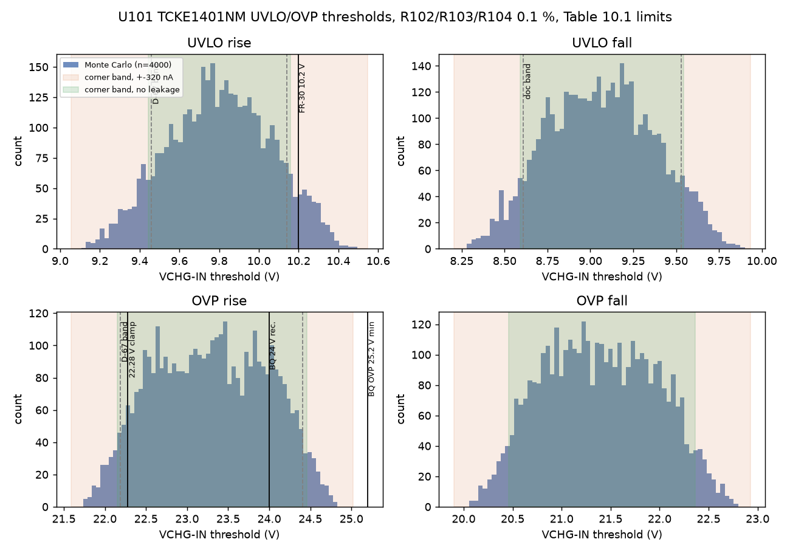
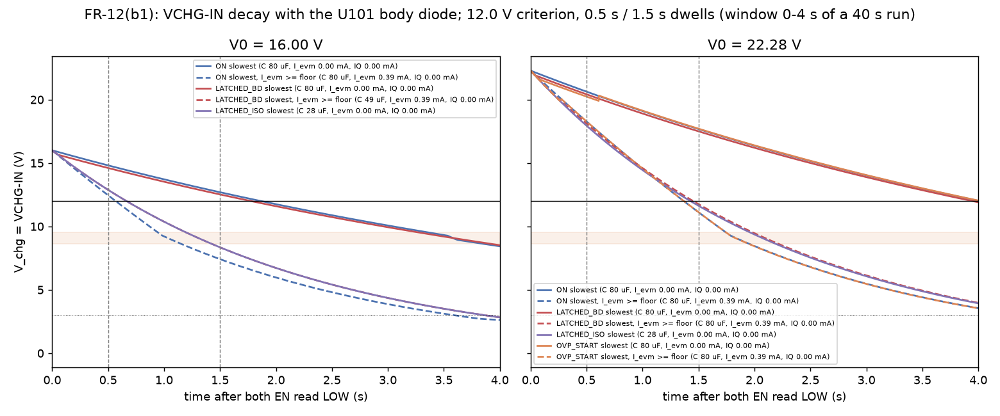
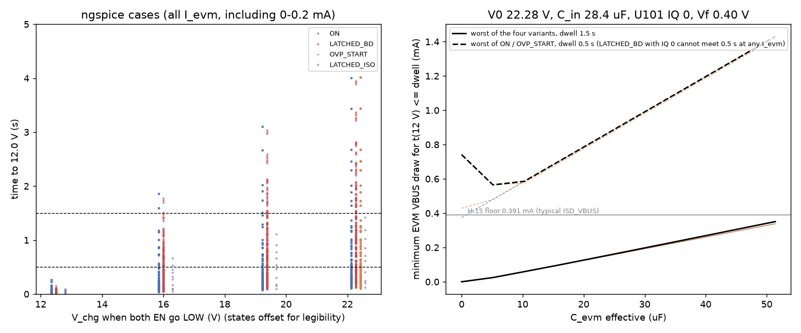
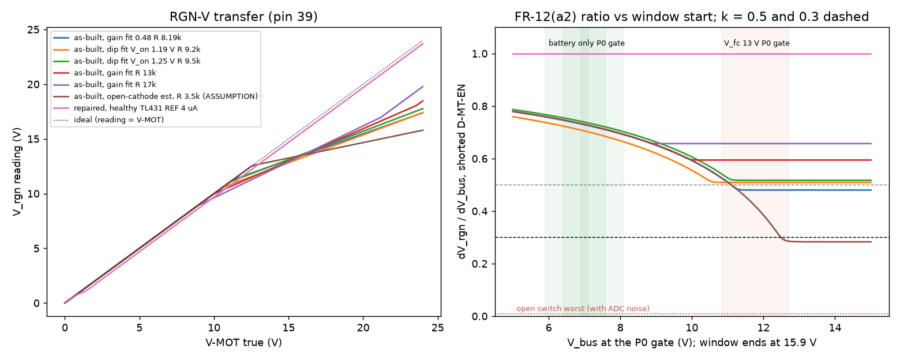

# Sim 5 (efuse_decay): U101 UVLO/OVP band with pin leakage, FR-12(b1) V_chg decay and the FR-12(a2) ratio

Date: 2026-11-14 (revised the same day after an independent check; section 8). Simulator: ngspice-46 (KiCad 9.0
`ngspice.dll`) through `../common/ngspice_run.py`. Reproduce with `C:\Users\ricky\miniforge3\python.exe run.py`
(about 2.5 min). The script writes the decks to `decks/`, and the CSV files, the PNG figures, `headline.txt` and
`console_log.txt` (a copy of the console output) to `results/`.

**Source citations (added 2026-11-15, second review R2-SIM-4).** Every line number in this report for
`gen/netlist.py`, `cr/cr.net` and `docs/charger_bq25798_wiring_design_2026-11-05.md` refers to the committed state at
git tag `charger-r8-pre-review-2026-11-14` (commit 014c745). Later edits (D-82, the r9-25 revision) moved those lines.
The values of every simulated part (R102 845 kOhm, R103 64.9 kOhm, R104 51.1 kOhm, all 0.1 %; C102a 1 uF, C102b
4.7 uF, C102c 0.1 uF; U101 TCKE1401NM) are unchanged in the current `gen/netlist.py` and in `bom_2026-11-14/cr_bom.csv`.
Since D-82, the R102 MPN is ERA-6AEB8453V (was TNPW0805845KBEEA), C102a is CL31B105KCHSFNE and C102b is
CNC6P1X7R2A475K250AE; the value, tolerance and DC-bias basis used here do not change. No result changes.

## 1. Purpose

This simulation checks three firmware-handoff numbers that `../REVIEW_2026-11-14.md` flags as unverified after the
change of U101 to the Toshiba TCKE1401NM (D-67):

| Part | Question | Review items | Design-document criterion |
|---|---|---|---|
| (a) | UVLO and OVP trip bands of R102/R103/R104 with the UVLO/OVP pin leakage | PWR-2, DOC-0 | B.4 R102 row (line 1954): UVLO rising 9.46-10.14 V, "0.06 V below the FR-30 10.2 V threshold"; OVP rising 22.19-24.41 V |
| (b) | Time for V_chg (pin 38) to fall from 12.5-22.28 V to 12.0 V after both charger-path EN outputs go LOW | PWR-1, DOC-0, FW-9 | FR-12(b1) (line 3258): V_chg < 12.0 V after a 0.5 s dwell; 1.5 s fallback |
| (c) | dV_rgn/dV_bus for a shorted D-MT-EN over the real P0-gate to P2-end window | VR-3 (section 4.3) | FR-12(a2) (line 3258): fail if dV_rgn > k x dV_bus, k about 0.5 |

## 2. Circuit and models

### 2.1 Part (a): UVLO/OVP string

The string is R102 845 kOhm (VCHGIN to N_UV), R103 64.9 kOhm (N_UV to N_OV) and R104 51.1 kOhm (N_OV to GND), all
0.1 % (`gen/netlist.py` R102, R103 and R104 rows; lines 111, 115, 116 at the tag). U101 pin 6 (UVLO) sits on N_UV
and pin 7 (OVP) on N_OV (`gen/netlist.py` U101 row; line 106 at the tag). (**Superseded 2026-11-15, R2-SIM-4, the
line numbers moved with D-82:** "(`gen/netlist.py` lines 111, 115, 116)" and "(`gen/netlist.py` line 106)".) Each pin is modelled as a constant current source between its node and GND. The thresholds and leak
currents come from TCKE1401NM DS Rev. 3.0 Table 10.1 (`references/Datasheets/tcke1401nm.pdf`, p.14, Ta = -40 to
125 C):

| Parameter | Min | Typ (25 C) | Max |
|---|---|---|---|
| V_UVLOR (UVLO rising) | 1.142 V | 1.19 V | 1.224 V |
| V_UVLOF (UVLO falling) | 1.039 V | 1.12 V | 1.15 V |
| V_OVPR (OVP rising) | 1.18 V | 1.233 V | 1.298 V |
| V_OVPF (OVP falling) | 1.09 V | 1.15 V | 1.187 V |
| I_UVLO (UVLO leak, 0-75 V) | -320 nA | 8 nA | +320 nA |
| I_OVP (OVP leak, 0-4 V) | -320 nA | 0 nA | +320 nA |

The deck (`decks/a_uvlo_ovp_string.cir`) holds 4074 copies of the string on one VIN source: the nominal string, the
nominal string with the typical leak, 72 corners (each resistor at +-0.1 %, each leak at -320, 0 and +320 nA) and
4000 Monte Carlo draws. The network is linear, so a `.dc` at 10 V and 20 V gives the slope and offset of each pin
voltage, and each threshold follows by inversion. The ngspice thresholds agree with the closed-form Thevenin solution
to 1.1e-7 V.

In the Monte Carlo, each reference is drawn uniformly within its Table 10.1 limits, with one physical constraint: a
falling reference that exceeds its rising reference is redrawn uniformly between the falling minimum and the rising
draw. Table 10.1 gives no hysteresis limits; section 7.4 states 70 mV typical for UVLO only. The rows VSEL_UVLO
(153.2-272.8 mV) and VSEL_OVP (167-265 mV) are the internal-threshold select levels, not hysteresis.

### 2.2 Part (b): VCHG-IN decay

The node is VCHG-IN, which pin 38 reads through the R1-CHG 78.7 kOhm / R2-CHG 10 kOhm divider
(`references/Scale_Car_Board_20260624.sch` lines 5976-5977). Each copy in `decks/b_vchg_decay_01.cir` to
`b_vchg_decay_07.cir` contains the IN side and, except in the reference state LATCHED_ISO, the EVM side:

- **C_in**, the IN-side capacitance: C-D8 and C-D10 (10 uF 0805 each, MB schematic lines 5924 and 5935), C102a 1 uF,
  C102b 4.7 uF and C102c 0.1 uF (`gen/netlist.py` C102a, C102b and C102c rows; lines 95, 96, 98 at the tag;
  **Superseded 2026-11-15, R2-SIM-4:** "(`gen/netlist.py` lines 95, 96, 98)"), 25.8 uF nominal. The effective range
  17.0-28.4 uF is the H.23(q) basis (0.66x to 1.10x, `round4/calc/r7_calc.py` lines 5828-5830), reused unchanged.
- **R_div38** 88.7 kOhm and **R_str** 961.0 kOhm (R102 + R103 + R104) to GND; in parallel, 81.2 kOhm.
- **The U101 IN-side current IQ**, constant above the 4.7 V operating minimum (Table 9.1) and tapered to zero below.
- **The EVM side** (U101 VOUT and the EVM VBUS): **C_evm** and a constant **I_evm** standby draw that tapers below
  3.5 V. The node starts at V0, which is the slow bound: an EVM side that had already decayed before EN went LOW
  holds less charge.
- **The U101 internal FET body diode** from VOUT (anode) to VIN (cathode), present in every state. TCKE1401NM DS
  section 7.6 and Figure 7.1 (right) state that with VSYS tied to VIN and BGATE/DRV open, which is the CR wiring
  (`gen/netlist.py` U101 row; `cr.net` net /VCHGIN), the device has no reverse-current blocking. The datasheet gives
  no body-diode data, so the diode is an ideality-1 junction whose forward voltage at 1 mA is swept (0.40, 0.55,
  0.70 V; ASSUMPTION).
- **The FET** as an `sw` switch (R_ON 44.5 mOhm, Table 10.1), controlled per state as below.

The four states follow from the board. EN (pin 12) is open and internally pulled up and MODE (pin 11) is open
(latch-off, Table 7.3) (`gen/netlist.py` U101 row; lines 105-108 at the tag; **Superseded 2026-11-15, R2-SIM-4:**
"(`gen/netlist.py` lines 105-108)"), so the EN-LOW OFF state of Table 10.1 does not occur.

| State | FET | IN-side current IQ | EVM side |
|---|---|---|---|
| ON (normal Idle) | closed above UVLO rising 9.86 V, open below UVLO falling 9.28 V (typical) | 0, 0.5 (typ), 1.2 (max) mA; Table 10.1 gives no minimum | connected; body diode active below UVLO |
| LATCHED_BD (after a current-limit latch-off) | open | 0, 41 uA, 79 uA (IQ(OFF) typ/max, a candidate for the unspecified latched current), 0.5 mA, 1.2 mA | coupled through the body diode only |
| OVP_START (V0 = 22.28 V only) | open until VCHG-IN falls below the OVP falling threshold (19.899 V corner minimum or 21.627 V typical, part (a)), then as ON | as ON | body diode, then connected |
| LATCHED_ISO (reference; the model before the check round) | open | as LATCHED_BD | disconnected (equivalent to an EVM side already below VIN) |

The EVM-side values come from the design document. C_evm is 51.4 uF nominal: EVM C11, C12, C29, C30 and C31
(5 x 10 uF), four 0.1 uF parts and C103 1 uF (B.4 C101 row, SLUUCB5E Fig 4-5 / Table 4-1), swept at 0.40 and 1.00
of nominal. I_evm itemises H.15 (line 3390) and extends below it:

- **Zero, 0.1 mA and 0.2 mA:** no datasheet minimum exists, so the draw is swept down to zero (ASSUMPTION).
- **Floor, 0.391 mA:** BQ25798 ISD_VBUS 386 uA (SLUSDV2C 6.5: HIZ, ADC off, ACDRV off, no battery; a typical value
  with no minimum) plus D103 leakage 5 uA.
- **Typ, 1.08 mA:** ILIM_HIZ held with REGN on: BQ25798 0.39 mA, EVM TS bias 0.39 mA and the REGN pull-ups 0.30 mA.
- **Max, 2.31 mA:** BQ25798 1.0 mA, ADC 0.52 mA, TS 0.39 mA, pull-ups 0.30 mA and D103 0.10 mA.

The sweep holds 2776 cases. Each copy starts at V0 (`uic`) and runs for 40 s. `.meas` records the times at which
V(in) falls through 12.0 V and 3.0 V, and V(in) at 0.2 s and 0.4 s for the slope test. An independent ODE model in
`run.py` (scipy Radau, the same exponential diode and tapers, charge sharing at the OVP release) reproduces the
ngspice times to 12 V as follows: ON 3.1e-5 relative, LATCHED_ISO 5.3e-6, LATCHED_BD 2.0e-3 and OVP_START 8.2e-3
(times of at least 50 ms; at most 0.23 ms absolute below 50 ms). The two larger figures come from the 2 ms output
step around the diode turn-on and the switch charge-sharing event; the largest absolute difference is 1.3 ms.

The ODE model also evaluates two items that are not in the decks:

- **The joint C_evm x I_evm boundary** for each dwell (V0 22.28 V, C_in 28.4 uF, U101 IQ 0, Vf 0.40 V, worst of ON,
  LATCHED_BD and the two OVP_START thresholds).
- **RT1987 forward leakage into VCHG-IN.** Below about 15.9 V, VCHG-IN is lower than VIN of both D-BC-FC (VBUS) and
  D-BC-RG (V-MOT, at the bus in Idle), and both RT1987 VOUTs sit on VCHG-IN (MB schematic net VCHG-IN). RT1987_DS-00
  specifies IOUT_LK (45 typ, 60 max uA) only at VOUT 32 V, VIN 0 V, EN 0, which is a current into VOUT. The off-state
  current from VIN to VOUT is unspecified, so a total sourced current of 0-120 uA, active below 15.9 V, is swept
  (ASSUMPTION).

### 2.3 Part (c): RGN-V node and the FR-12(a2) ratio

The RGN-V tap is R1-SNT 78.7 kOhm from V-MOT and R2-SNT 10 kOhm to GND (MB schematic lines 5979-5980). Pin 39 reads it
with `SCALE_V_RGN` = 3.3 x 88.7/10/4095 (`teensy_controller.ino:2032`), 7.15 mV per count. The as-built sink is the
knee measured in `docs/vrgn_measurement_error_2026-11-05.md` section 7.1 item 3: I = (V_node - V_on)/R above V_on
(a softplus of 4 mV width in `decks/c_rgnv_transfer.cir`). Seven node sets are swept from 0 to 24 V:

| Node set | V_on | R | Static ratio at 15.93 V | Small-signal gain at 15.93 V | Source |
|---|---|---|---|---|---|
| As-built, gain fit 0.48 | 1.271 V | 8.19 kOhm | 0.848 | 0.480 | lowest measured gain (7.1 item 2, REVIEW VR-3); R solved for 0.48, V_on for 0.848 |
| As-built, dip fit A | 1.19 V | 9.2 kOhm | 0.834 | 0.509 | V_rgn doc 7.1 item 3 |
| As-built, dip fit B | 1.25 V | 9.5 kOhm | 0.853 | 0.517 | V_rgn doc 7.1 item 3 |
| As-built, gain fit 13k | 1.123 V | 13 kOhm | 0.848 | 0.594 | slope inside the 0.48-0.65 gain range (7.1 item 2); V_on solved for 0.848 |
| As-built, gain fit 17k | 1.000 V | 17 kOhm | 0.848 | 0.657 | as above |
| As-built, open-cathode estimate | 1.415 V | 3.5 kOhm | 0.848 | 0.283 | ASSUMPTION: physics reviewer's 3.5-4 kOhm slope (7.3); V_on solved |
| Repaired (healthy TL431) | - | 4 uA constant | 0.980 | 1.000 | TL431 REF 4 uA max (V_rgn doc 7.2 table) |

The first five sets reproduce the measured static ratio (0.834-0.853) and span the measured small-signal gain
(0.48-0.66), which validates the knee model over the window that FR-12(a2) uses.

The window follows `busBringupTick()` (`teensy_controller.ino` 12837-13010, read only). FR-12(a2) records V_rgn and
V_bus when the P0 gate passes and again at the end of the P2 dwell. The P0 gate requires
V_bus >= max(V_fc, V_batt) - `PRECHARGE_DROP_MAX` (1.5 V) and V_bus >= `V_PRECHARGE_MIN` (5.0 V)
(`.ino:2326-2328`). The P2 dwell ends with the bus regulated at 15.8-16.0 V. **The V_fc reading clips at 12.34 V**
(`SCALE_V_FC`, 27.4 kOhm / 10 kOhm, `.ino:2024`). With the H-20 at 13 V the gate therefore passes at a V_bus of
10.84 V, not 11.5 V. Each reading is quantised to its ADC count: V_bus uses 4.55 mV per count (`.ino:2028`).

## 3. Assumptions

| Item | Value | Source or status |
|---|---|---|
| Leak sign | Both signs evaluated (corners and Monte Carlo) | Table 10.1 does not define a direction |
| Monte Carlo distributions | Uniform within each tolerance or limit; independent, except that a falling reference stays below its rising reference | ASSUMPTION. The limits span -40 to 125 C, so the probabilities are illustrative; the corners are the criterion |
| C_in effective range | 17.0-28.4 uF | H.23(q) ASSUMPTION, reused; the slow corner (28.4 uF) cannot exceed nominal + 10 % |
| C_evm effective fraction | 0.40-1.00 of 51.4 uF | ASSUMPTION (MLCC DC bias at 12-22 V), swept |
| I_evm | 0, 0.1, 0.2, 0.391, 1.08, 2.31 mA, constant with voltage | H.15 itemisation from 0.391 mA up; below it ASSUMPTION. The 0.391 mA figure is a TYPICAL datasheet value, not a minimum |
| EVM side at EN LOW | At V0 | Slow bound; an EVM side that decayed earlier holds less charge |
| U101 body diode | Vf 0.40, 0.55, 0.70 V at 1 mA, ideality 1, 27 C | ASSUMPTION; existence from TCKE1401NM DS 7.6 / Fig 7.1 (right); no datasheet data |
| OVP_START switch | Closes below OVPF; reopens only 1.5 V higher | ASSUMPTION for numerical stability; the decay is monotonic apart from the charge-sharing step, so the reopen level is never reached |
| RT1987 VIN-to-VOUT off-state leakage into VCHG-IN (two devices) | 0-120 uA total below 15.9 V, ODE sensitivity only | Unspecified (RT1987_DS-00 gives IOUT_LK only for VIN 0 V); open item for T-C-04 |
| RT1987 IOUT_LK into VOUT above VIN | Not modelled (0) | Would add sink current above the bus voltage and shorten the decay there |
| U101 current in UVLO | Equal to the case's IQ above 4.7 V | ASSUMPTION; affects only the time to 3 V |
| Pre-charge settled level | Source - 0.3 V (boost body diode and RT1987 at light load) | ASSUMPTION; the gate level sweeps from the gate threshold up to this value in 9 steps |
| V-MOT with a shorted D-MT-EN | Equal to V_bus | RT1987 R_ON 20 mOhm at the idle VESC draw |
| Open D-MT-EN | V-MOT isolated (back-to-back FETs, RT1987_DS-00 section 17); residual V-MOT 0, 5, 10 or 15.9 V decays with tau 105-122 s | V_rgn doc 7.3; window 0.09-1.6 s from `.ino:2318-2334` |
| ADC reading noise | +-2 counts per reading | ASSUMPTION (averaged reading), used as a bound on the ratio and on the slope |

## 4. Results

### 4.1 Part (a): UVLO/OVP bands

Figure 1 shows the Monte Carlo histograms of the four thresholds, with the corner bands with and without the pin
leakage and the design-document limits.

Figure 1 shows that the leakage widens every band by about 0.4 V (UVLO) and 0.6 V (OVP) on each side. Table 1
gives the corner values (`results/a_bands_corners.csv`).

**Table 1: VCHG-IN thresholds (V), corners of Table 10.1 and 0.1 % resistors**

| Threshold | Typ, no leak | Typ, 25 C leak | Corners, no leak | Corners, +-320 nA | Design doc |
|---|---|---|---|---|---|
| UVLO rising | 9.859 | 9.865 | 9.444-10.158 | **9.055-10.548** | 9.46-10.14 |
| UVLO falling | 9.279 | 9.285 | 8.593-9.544 | **8.203-9.934** | 8.61-9.53 |
| OVP rising | 23.188 | 23.195 | 22.149-24.457 | **21.588-25.019** | 22.19-24.41 |
| OVP falling | 21.627 | 21.634 | 20.460-22.365 | **19.899-22.927** | not stated |

The leakage corners reproduce the PWR-2 verifier figures to the millivolt. In addition, the 0.1 % resistor tolerance,
which D-67 omits, moves the no-leak bands outward by 16-48 mV. Against each criterion:

- **FR-30 (10.2 V):** the UVLO rising maximum is 10.548 V, 0.348 V **above** 10.2 V. Even without leakage, the
  maximum is 10.158 V, 0.042 V below 10.2 V, not the stated 0.06 V.
- **Design clamp (22.28 V):** the OVP rising minimum is 21.588 V, 0.69 V below the clamp, so a nuisance OVP trip at
  the clamp is possible at the corners.
- **BQ25798 (24 V recommended VBUS maximum, 25.2 V VBUS_OVP minimum):** the OVP rising maximum is 25.019 V. That is
  1.02 V above 24 V and 0.18 V below 25.2 V, so U101 still trips before the BQ25798 input OVP at every corner.
- **OVP recovery:** the OVP falling band, 19.90-22.93 V, sits above the 15.9 V bus, so U101 recovers from an OVP trip
  once V-MOT returns to the bus.
- **UVLO falling:** the band maximum is 9.93 V, above the 9.9 V proof (b) level of F.5 T10, so a reading below 9.9 V
  does not prove UVLO (DOC-0 item 2). The band minimum is 8.20 V, so a proof threshold needs to sit below 8.20 V less
  the pin-38 gain error, for example 8.0 V at a 2 % gain error.

Under the illustrative uniform Monte Carlo, 7.0 % of draws put UVLO rising above 10.2 V, 7.0 % put OVP rising below
22.28 V, 18.4 % put OVP rising above 24.0 V, and none exceeds 25.2 V (`results/a_mc_probabilities.csv`). At 25 C
with the typical leak, the trips move by 7 mV only, so a single fitted unit measured at room temperature in T-C-04
sits close to its no-leak value.

### 4.2 Part (b): FR-12(b1) decay to 12.0 V

Figure 2 shows, for start voltages of 16.0 V (the Idle bus) and 22.28 V (the design clamp), the slowest decay of each
state over the full sweep and the slowest decay with the EVM draw at or above the H.15 floor.

In Figure 2, the body diode couples the EVM-side capacitance to VCHG-IN in the latched state, so the LATCHED_BD
traces follow the ON traces and are slower than the LATCHED_ISO trace of the previous model. With a zero EVM draw,
every coupled state is 2.7-2.9 times slower than with the floor draw. The upward step of the OVP_START trace at
0.6 s is the charge sharing when the FET closes below the OVP falling threshold. Table 2 summarises the cases
(`results/b_decay_summary.csv`; every case is in `results/b_decay_cases.csv`).

**Table 2: worst time from both EN LOW to V_chg = 12.0 V (s)**

| State | V0 | I_evm >= 0.391 mA (floor) | All I_evm (0-2.31 mA) | Cases > 1.5 s, all I_evm |
|---|---|---|---|---|
| ON | 12.50 V | 0.074 | 0.265 | 0/216 |
| ON | 16.00 V | 0.567 | 1.864 | 6/216 |
| ON | 19.38 V | 1.010 | 3.106 | 18/216 |
| ON | 22.28 V | 1.368 | 4.010 | 27/216 |
| LATCHED_BD | 12.50 V | 0.094 | 0.150 | 0/360 |
| LATCHED_BD | 16.00 V | 0.663 | 1.775 | 4/360 |
| LATCHED_BD | 19.38 V | 1.105 | 3.033 | 36/360 |
| LATCHED_BD | 22.28 V | **1.452** | 3.947 | 69/360 |
| OVP_START | 22.28 V | 1.368 | 4.021 | 54/432 |
| LATCHED_ISO (reference) | 22.28 V | 1.427 | 1.427 | 0/10 |

The largest time in Table 2 is 4.021 s (OVP_START, 22.28 V, all I_evm); the ON-state maximum is 4.010 s. (Note added
2026-11-15, second review R2-SIM-5: a quotation of the zero-draw worst case must use 4.02 s.)
With the draw at or above the floor, no case exceeds 1.5 s; every case above 1.5 s has I_evm of 0.2 mA or less. All
worst cases have C_in 28.4 uF, C_evm 51.4 uF (except LATCHED_BD at 16.0 V with the floor draw, 20.6 uF), U101 IQ 0 and
Vf 0.40 V where the diode governs.

Figure 3 shows, on the left, every ngspice case against its start voltage, and on the right, the minimum EVM draw that
meets each dwell as a function of the effective EVM capacitance (`results/b_joint_cevm_ievm_boundary.csv`).

Figure 3 (right) shows that the minimum draw for the 1.5 s dwell rises almost linearly with C_evm, at about 6.8 uA per
uF, from 0 at C_evm = 0 to 0.351 mA at the full 51.4 uF. LATCHED_BD governs the boundary. The 1.5 s dwell therefore
holds only if the EVM VBUS draw is at least 0.351 mA at 51.4 uF effective, or 0.130 mA at 20.6 uF. With a zero draw,
C_evm must be 1.4 uF or less, which no fitted EVM meets. The H.15 floor (0.391 mA) clears the boundary by 0.040 mA
(10 % of a typical value). For the 0.5 s dwell, ON and OVP_START need 1.43 mA at 51.4 uF, and LATCHED_BD with IQ 0
cannot meet 0.5 s at any EVM draw, because the IN node alone takes 1.427 s and the diode only adds charge to it.
Table 3 gives the one-node break-even currents (`results/b_breakeven_current.csv`).

**Table 3: minimum total constant current for the dwell (mA), one node, FET closed or EVM side absent**

| Dwell | V0 | LATCHED_ISO, 28.4 uF | ON, 28.4 + 51.4 uF | ON, 28.4 + 20.6 uF |
|---|---|---|---|---|
| 0.5 s | 16.00 V | 0.056 | 0.466 | 0.220 |
| 0.5 s | 19.38 V | 0.228 | 0.985 | 0.530 |
| 0.5 s | 22.28 V | 0.375 | 1.430 | 0.797 |
| 1.5 s | 22.28 V | 0 | 0.338 | 0.128 |

Table 4 gives the sensitivity of the slowest floor-draw cases to an RT1987 off-state current sourced into VCHG-IN
below 15.9 V (`results/b_rt1987_leak_sensitivity.csv`; V0 22.28 V, C_in 28.4 uF, C_evm 51.4 uF, IQ 0, Vf 0.40 V).

**Table 4: t(12 V) (s) against the total RT1987 forward leakage**

| State, I_evm 0.391 mA | 0 uA | 10 uA | 20 uA | 45 uA | 90 uA | 120 uA |
|---|---|---|---|---|---|---|
| ON | 1.368 | 1.378 | 1.388 | 1.416 | 1.473 | 1.518 |
| LATCHED_BD | 1.452 | 1.493 | **1.539** | 1.687 | 2.198 | 3.117 |
| OVP_START (OVPF 19.899 V) | 1.368 | 1.378 | 1.389 | 1.416 | 1.474 | 1.518 |

Table 4 shows that about 12 uA of sourced leakage consumes the 0.048 s latched margin. The leakage figure is
unspecified, so the margin of the 1.5 s dwell in the latched state is not established by the datasheets.

The slope alternative was re-derived over the same sweep (`results/b_slope_test.csv`). For every healthy case still
above 12 V at 0.4 s (1230 cases), the mean slope over 0.2-0.4 s is -2.29 V/s or steeper, and the slowest case has a
zero EVM draw (LATCHED_BD, 16.0 V, 79.8 uF, Vf 0.70 V). The closed-form bound at 12 V with only the dividers as sinks
and 79.8 uF is -1.85 V/s; a sourced leakage of I uA reduces it by I/79.8 V/s. A stuck path holds V_chg at V_bus, so
its slope is zero within +-0.143 V/s (+-2 counts at each end over 0.2 s). The earlier statement that healthy nodes
fall at 5.2 V/s or more holds only with the draw at or above the floor (-6.09 V/s worst in that subset).

For FR-12(b2) (`results/b_t3_summary.csv`), the slowest time to 3 V is 4.65 s with the draw at or above the floor,
inside the 5 s timeout. With a zero EVM draw, the body diode keeps the EVM capacitance on the node down to 3 V and the
time reaches 12.96 s. Up to 134 of 1440 latched cases then exceed 5 s, so the (b2) timeout expires and the (b3) Idle
probe is skipped. Under r8-11, (b2) carries no pass/fail on time, so this outcome is a skipped probe, not a false
fault.

The results against the FR-12(b1) criterion are as follows:

- **The 0.5 s dwell is not established in any state.** In the latched state it needs at least 0.375 mA of U101
  IN-side current from 22.28 V, which no datasheet figure supplies, and the EVM draw cannot substitute for it. In the
  ON and OVP_START states it needs 1.43 mA of total draw at 51.4 uF. At the typical values (IQ 0.5 mA, EVM 1.08 mA)
  every ON case passes 0.5 s, with the slowest at 0.458 s from 22.28 V.
- **The 1.5 s dwell is conditional, not unconditional.** It passes every case with an EVM draw of 0.391 mA or more and
  no RT1987 forward leakage; the worst case is 1.452 s (LATCHED_BD), a margin of 0.048 s. It fails with a draw of
  0.2 mA or less at full C_evm, and with about 12 uA of RT1987 forward leakage at the floor draw.

### 4.3 Part (c): FR-12(a2) ratio

Figure 4 shows, on the left, the pin-39 reading against the true V-MOT for each node set. On the right, it shows the
ratio for a shorted D-MT-EN as a function of the V_bus level at which the P0 gate passes, with the window ending at
15.9 V.

In Figure 4, every as-built set reads 1.0x below the knee (about 10-12.5 V true V-MOT) and has a slope of 0.28-0.66
above it. The ratio therefore depends on where the window starts relative to the knee. Table 5 gives the ranges
over the gate-level grid and over V_bus at the P2 end from 15.8 to 16.0 V (`results/c_ratio_summary.csv`).

**Table 5: dV_rgn / dV_bus, shorted D-MT-EN**

| Scenario (P0 gate V_bus range) | Dip fits | Gain fit 0.48 | Gain fits 13k / 17k | Open-cathode estimate (ASSUMPTION) | Repaired |
|---|---|---|---|---|---|
| V_fc 0, V_batt 7.4 V (5.9-7.1 V) | 0.700-0.770 | 0.724-0.763 | 0.725-0.761 | 0.723-0.765 | 1.000 |
| V_fc 0, V_batt 8.4 V (6.9-8.1 V) | 0.661-0.745 | 0.690-0.736 | 0.690-0.734 | 0.688-0.739 | 1.000 |
| V_fc 13 V, reads 12.34 V (10.84-12.70 V) | 0.508-0.541 | **0.479-0.525** | 0.593-0.658 | 0.286-0.530 | 0.998-1.001 |
| Open switch (any node, any scenario) | -0.003 to +0.009, including the +-2 count noise bound | | | | |

The results against FR-12(a2) are as follows:

- **k = 0.5 fails on measured data with the fuel cell live.** At the lowest measured small-signal gain (0.48), a
  shorted switch reads 0.479 when the window starts near 12.7 V, below 0.5, so the shorted switch passes the check.
  The dip-fit sets read 0.508-0.541, only 0.008 above 0.5. This confirms VR-3.
- **k = 0.3 separates the measured node sets.** The worst measured case is 0.479, against an open switch at no more
  than 0.009 including the noise bound. However, under the open-cathode slope estimate (3.5 kOhm, not measured) a
  window that starts at 12.5-12.7 V reads 0.286, below 0.3.
- **The window is long enough:** dV_bus is at least 3.1 V in every modelled case. The ADC noise bound on the shorted
  ratio at the shortest window is 0.015.

## 5. Conclusion

- **(a)** With the TCKE1401NM leakage, the UVLO rising band is 9.055-10.548 V and the OVP rising band is
  21.588-25.019 V. The B.4 statement that the UVLO maximum stays 0.06 V below the FR-30 10.2 V threshold is false:
  the maximum is 0.348 V above it, and 0.042 V below it without leakage. The OVP band stays below the BQ25798
  VBUS_OVP minimum (0.18 V margin) and extends 0.69 V below the 22.28 V clamp. These figures should replace the D-67
  bands in B.4, F.5 T10 (proof (b) below 8.2 V less the gain error) and T-C-04.
- **(b)** The FR-12(b1) 0.5 s dwell is not supported by the datasheets in any eFuse state. The 1.5 s dwell holds only
  under two conditions that T-C-04 must establish: an EVM Idle VBUS draw of at least 0.351 mA at 51.4 uF effective
  (about 6.8 uA per uF of effective EVM capacitance), and an RT1987 forward leakage into VCHG-IN well below 12 uA. Its
  worst modelled margin is 0.048 s (latched, body diode, floor draw). The recommended firmware rule is therefore a
  slope test with a timed fallback: (b1) passes if V_chg < 12.0 V at 0.5 s, or if the mean slope over 0.2-0.4 s is
  -1.0 V/s or steeper; otherwise it fails. The -1.0 V/s threshold sits 0.85 V/s inside the slowest healthy bound
  (-1.85 V/s with no EVM draw and 79.8 uF) and 0.86 V/s outside the stuck-path noise (+-0.143 V/s). It holds without
  any assumption on the EVM draw, provided the total effective capacitance stays at or below 79.8 uF and the sourced
  RT1987 leakage stays below about 68 uA. A pure 1.5 s dwell is admissible as the default only once T-C-04 measures
  the EVM Idle draw, the effective C_evm and the IN-side current on the fitted unit and confirms the 0.351 mA
  boundary with margin.
- **(c)** The recommended FR-12(a2) threshold is **k = 0.2** with **dV_bus >= 2 V**. A window shorter than 2 V,
  for example after a warm reset that leaves the bus charged, is reported as inconclusive and is repeated at the next
  bring-up; it does not count as a pass. The value k = 0.2 keeps 0.086 of margin to the most pessimistic as-built
  node (0.286), 0.279 to the lowest measured node (0.479) and 0.19 to the open switch (0.009). k = 0.3, the review's
  proposal, is adequate only for the measured knee slopes (8.2-17 kOhm). k = 0.5 fails on the measured data. Once
  U-SNT is repaired, the shorted ratio is 1.0 and k may rise to 0.5.

## 6. Limitations

- The TCKE1401NM is represented by its datasheet limits, not by a vendor model. No Toshiba SPICE model was used. The
  body diode is an assumed junction; its forward voltage at sub-milliampere currents is not in the datasheet.
- The Monte Carlo probabilities rest on uniform distributions over limits that span -40 to 125 C. They are not yield
  predictions.
- The latched-state IN-side current, the BQ25798 Idle VBUS draw and the RT1987 forward off-state leakage are
  unspecified. Part (b) brackets the first two down to zero and sweeps the third; the 1.5 s verdict depends on their
  true values (section 4.2).
- The capacitance ranges (C_in 17.0-28.4 uF, C_evm 0.40-1.00 x 51.4 uF) are assumptions. The slope threshold holds
  only while the total effective capacitance stays at or below 79.8 uF.
- The EVM side is assumed to start at V0. An EVM side that decayed before EN went LOW gives a faster decay.
- The knee model is fitted to node voltages of 1.29-1.53 V. The window evaluated here reaches 1.52 V, so no
  extrapolation is needed. Above about 1.8 V at the node the Darlington soft clamp (V_rgn doc 7.4) is not modelled,
  which is irrelevant for FR-12(a2).
- The open-cathode 3.5 kOhm slope is a reviewer estimate, not a measurement.

## 7. Bench tests that confirm the results

- **T-C-04 (UVLO/OVP):** ramp VCHG-IN slowly up and down on the fitted U101 and record the four trip voltages at the
  FLAG pin. At room temperature they should lie within about 10 mV of the typical-reference values of Table 1
  (9.86 / 9.28 / 23.19 / 21.63 V) scaled by the unit's actual references. Repeat at the highest enclosure temperature
  to bound the leakage term.
- **T-C-04 (FR-12(b1) step, design doc line 3534):** with both EN outputs LOW, from 12.5, 16.0, 19.38 and 22.28 V, in
  the ON state with the EVM fitted and in the latched state, log pin 38 at 1 kHz. Record the time to 12.0 V and the
  mean slope over 0.2-0.4 s. In the same setup, measure with an electrometer-range meter:
  - the IN-side current of U101 (ON and latched);
  - the EVM Idle VBUS draw and the effective EVM capacitance at 12-22 V (from the EVM-side slope with a known load);
  - the current sourced into VCHG-IN by D-BC-FC and D-BC-RG with both EN LOW, the bus at 15.9 V and VCHG-IN held at
    12 V.
  These measurements gate the 1.5 s default: it is admissible only if the measured draw exceeds the Figure 3
  boundary for the measured C_evm with margin and the sourced leakage is below a few microamperes.
- **T-E-05 (FR-12(a2) calibration):** run the bring-up with the H-20 live (V_fc 12.5-13 V) and battery only, on a
  board with D-MT-EN bridged (a jumper across the RT1987 VIN-VOUT, under bench supervision). Log V_rgn and V_bus at
  the P0 gate and at the P2 end. The ratio should fall within Table 5, and an unbridged board should read below 0.01.

## 8. Check and corrections

An independent check returned SOUND_WITH_ISSUES with seven issues. Each was resolved as follows.

| # | Issue | Resolution |
|---|---|---|
| 1 (major) | The latched model omitted the U101 body diode; with it, t(12 V) is 1.445-1.461 s, not 1.427 s | Accepted. TCKE1401NM DS 7.6 and Fig 7.1 (right) were confirmed: no reverse-current blocking with VSYS = VIN and BGATE/DRV open. A body diode (Vf 0.40-0.70 V at 1 mA) now sits across the FET in every state, with the EVM side on every latched copy (state LATCHED_BD). The worst floor-draw latched time is 1.452 s (margin 0.048 s), inside the checker's 1.445-1.461 s. The old model is kept as LATCHED_ISO for reference |
| 2 (major) | The 1.5 s pass relied on an unswept EVM draw of at least about 0.34 mA; the slope claim also failed at zero draw | Accepted. I_evm now includes 0, 0.1 and 0.2 mA. The joint boundary (Figure 3) gives 0.351 mA at 51.4 uF and about 6.8 uA per uF; at zero draw C_evm must be 1.4 uF or less (the checker's "about 25 uF" figure applies only at a draw of about 0.17 mA). The conclusion is reworded as conditional, the T-C-04 measurements gate the 1.5 s default, and the slope test is re-derived (-2.29 V/s slowest healthy, -1.85 V/s bound, threshold -1.0 V/s). The 5.2 V/s statement is withdrawn |
| 3 (minor) | No node set at the lowest measured gain 0.48; k = 0.5 stated as having 0.008 margin | Accepted. A gain-0.48 set (R 8.19 kOhm, V_on 1.271 V) reads 0.479-0.525; k = 0.5 now stated as failing on measured data. The gain range in the text is corrected to 0.48-0.66. k = 0.2 is unaffected |
| 4 (minor) | RT1987 leakage overstated as only shortening the decay | Accepted. The off-state VIN-to-VOUT leakage of the two RT1987s is unspecified and would source current below about 15.9 V. A 0-120 uA sensitivity (Table 4) shows that about 12 uA consumes the latched margin; the measurement is added to T-C-04 |
| 5 (minor) | The ON state at 22.28 V ignored a unit in OVP | Accepted. State OVP_START (FET open, body diode active, until the OVP falling threshold of 19.899 V or 21.627 V, then closed) is added. Its worst floor-draw time is 1.368 s, equal to the ON state to 1 ms |
| 6 (minor) | Garbled UVLO-falling sentence; independent falling draws can exceed rising | Accepted in part. The sentence is reworded (maximum 9.93 V above 9.9 V; minimum 8.20 V binds). The Monte Carlo now keeps each falling reference below its rising reference. The suggested hysteresis limits (153-273 mV, 167-265 mV) were not used: in Table 10.1 these are VSEL_UVLO and VSEL_OVP, the internal-threshold select levels, not hysteresis. The rising statistics and the corner bands are unchanged |
| 7 (minor) | `console_log.txt` was not written by `run.py` | Accepted. `run.py` now copies its console output to `results/console_log.txt`. V_fc above 13 V was not swept: above the knee the ratio is the constant slope, so the conclusion does not change |
