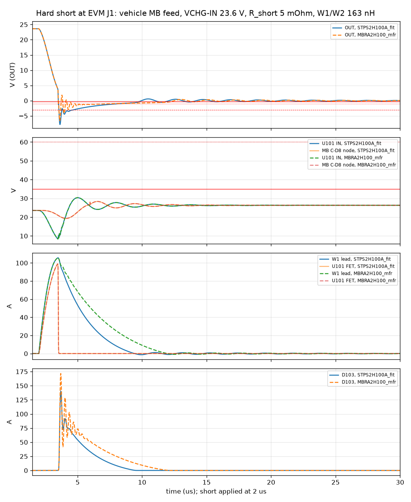
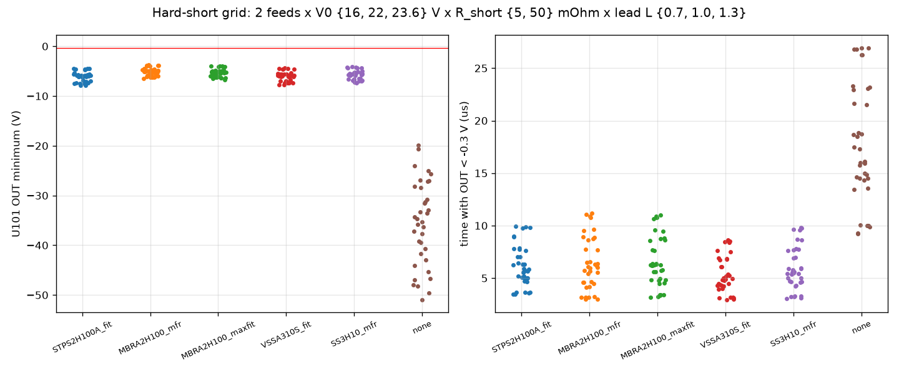
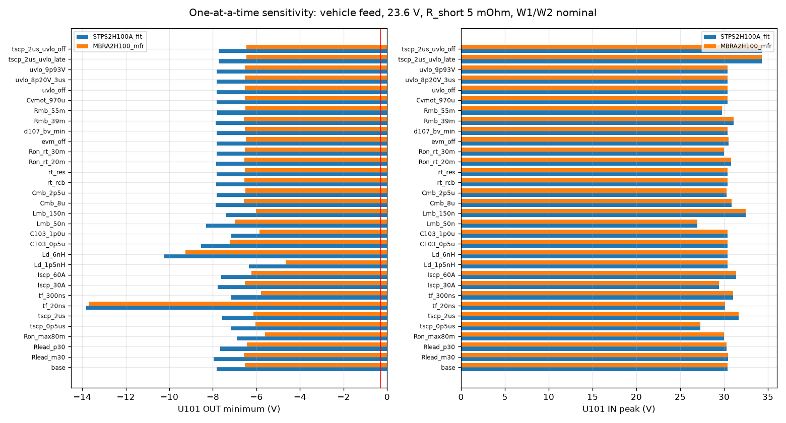
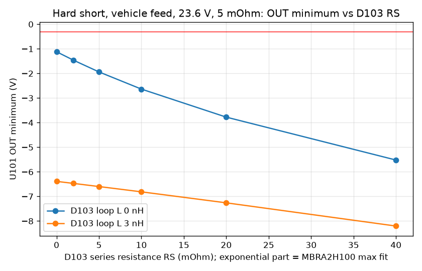
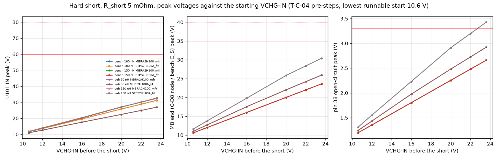
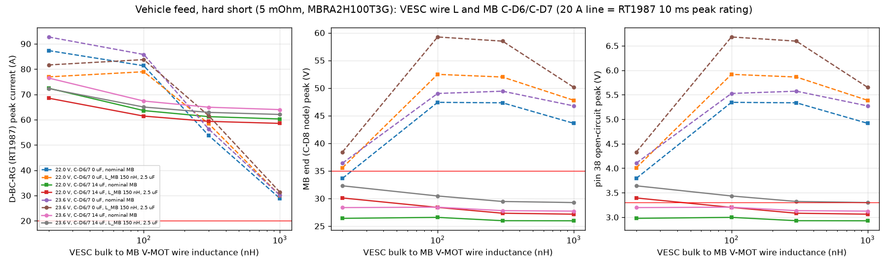
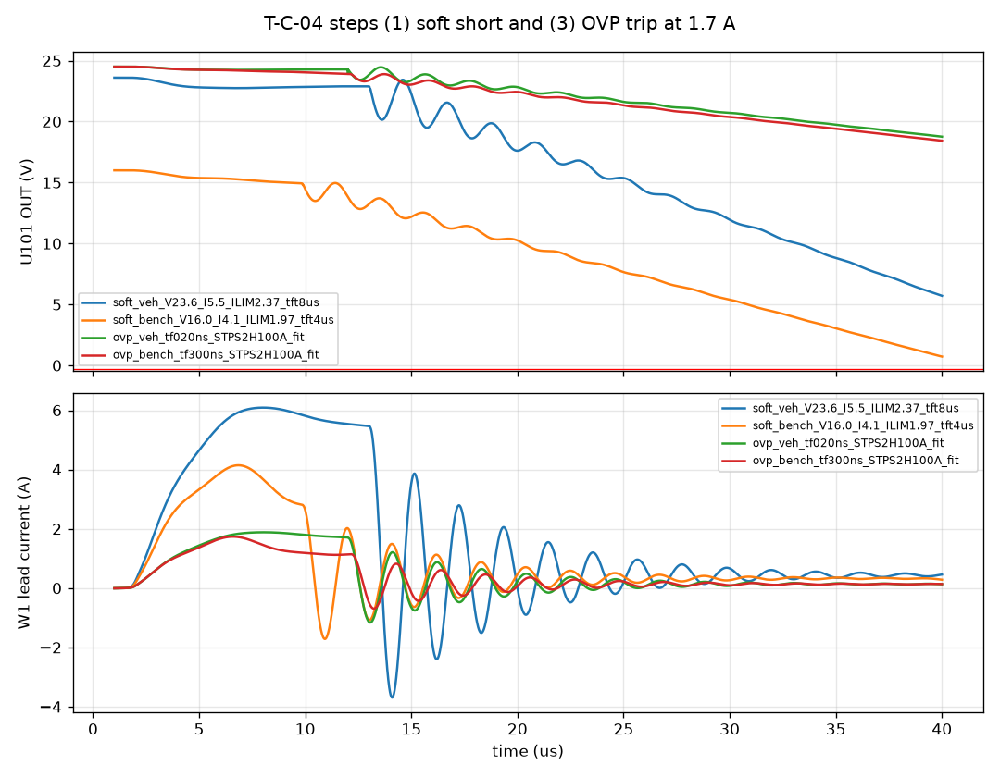

# Sim 1 (hardshort): hard short, soft short and OVP trip at the EVM J1 end of W1/W2

Revision 2 (2026-11-15). This revision corrects the duration metric, adds the U101 UVLO turn-off path, the MB C-D6/C-D7
capacitance and the VESC supply-wire inductance, and splits the OUT excursion into a spike and a plateau. Section 10
lists each correction from the independent check and its resolution. Every figure in this report comes from the
revision-2 run of `run.py`.

Revision 3 (2026-11-15, second review). Three findings of the second review are resolved. R2-SIM-9: the fast-trip
delay of the base model is the midpoint of the datasheet row, so `run.py --tft-check` re-runs the short-resistance set
and the headline hard-short cases at the datasheet values (section 5.6; the revision-2 outputs are unchanged).
R2-PWR-0: section 5.7 adds the current-limit dwell that follows every trip and that this model does not contain.
R2-SIM-4: the source citations are restated below. Superseded text is kept in the form
(**Superseded 2026-11-15, <reason>:** "old text").

**Source citations (R2-SIM-4).** Every line number in this report for `gen/netlist.py`, `cr/cr.net` and
`docs/charger_bq25798_wiring_design_2026-11-05.md` refers to the committed state at git tag
`charger-r8-pre-review-2026-11-14` (commit 014c745). Later edits (D-82, the r9-25 revision) moved those lines. The BOM
citations refer to `bom_2026-11-13/`; the current set `bom_2026-11-14/cr_bom.csv` carries the same rows, values and
MPNs for every simulated part (C102a/b/c, D107, U101, R101-R104, C103, D103), except a changed thickness text in the
C102b specification ("2.50 mm, Digi-Key description" in place of "2.80 mm max thickness"). No result changes.

## 1. Purpose

This simulation informs review finding PWR-0 (`../../REVIEW_2026-11-14.md`, section 3.2) and test T-C-04 of the
wiring design document (`docs/charger_bq25798_wiring_design_2026-11-05.md`, section I, line 3534; H.5 lines
3359-3361; B.4 D103 row, line 1961). PWR-0 states that the D103 candidate STPS2H100A does not support the recorded
-0.5 to -1 V OUT excursion of a hard short and that the acceptance rests on TI guidance for the replaced TPS26630.
The simulation answers five questions:

1. the U101 VOUT minimum and the time below the TCKE1401NM absolute minimum of -0.3 V (TCKE1401NM DS Rev. 3.0
   Table 8.1) in T-C-04 step (2), for each D103 candidate;
2. the D103 peak current against its IFSM;
3. the U101 VIN peak against the 60 V T-C-04 limit and the 80 V absolute maximum;
4. the MB-end (C-D8 node) peak against 35 V and the pin-38 peak against 3.3 V;
5. the OUT excursion in step (1) (soft short) and step (3) (OVP trip at 1.7 A).

Section 8 states whether step (2) risks the only U101 and which D103 and test order the review should recommend.

## 2. Circuit and models

### 2.1 Circuit

The topology is the following chain, generated per case by `run.py` (`deck()`):

`source -> feed path -> header pin J1.10 -> U101 VIN (C102a/b/c, D107) -> U101 switch -> VOUT (C103, D103) ->
W1/W2 lead -> EVM J1 (VIN1 capacitance, EVM VBUS capacitors) -> short MOSFET or electronic load`

Table 1 lists every circuit element, its value and its source. Part numbers come from the ordering BOM
`bom_2026-11-13/cr_bom.csv`; net connections come from `cr/cr.net` and `gen/netlist.py`. The simulation uses the
`cr_bom.csv` parts. Since D-82 (`../../LAYOUT_DECISIONS.md`), `gen/netlist.py` carries the ordered MPNs:
CL31B105KCHSFNE (C102a), CNC6P1X7R2A475K250AE (C102b), CL21B105KBFNNNF (C103) and STPS2H100A (D103, "Schottky 100V
2A SMA"). The netlist-versus-BOM MPN mismatch is therefore resolved. (**Superseded 2026-11-15, R2-SIM-4, resolved by
D-82:** "Note that `gen/netlist.py` still carries pre-order MPNs for C102a (GRM31CR72A105KA01L, line 95), C102b
(C3225X7S2A475K, line 96), C103 (GRM21BR71H105KA12L, line 121) and D103 ("Schottky 40V SMA", B340A-13-F bench
fallback, lines 122-123), whereas `cr_bom.csv` orders CL31B105KCHSFNE, CNC6P1X7R2A475K250AE, CL21B105KBFNNNF and
STPS2H100A. The simulation uses the `cr_bom.csv` parts. This MPN mismatch is a pre-existing repository inconsistency
for the review to record.")

**Table 1.** Circuit elements.

| Element | Value in the model | Source |
|---|---|---|
| U101 VIN, VSYS on VCHGIN; VOUT on VCHGOUT | single VCHGIN entry through J1 pin 10 | `cr/cr.net` lines 1776-1791; `gen/netlist.py` lines 105-110 |
| C102a | CL31B105KCHSFNE, 1 uF 100 V X7R 1206; 0.75 uF at 16 V, 0.65 uF at 23.6 V (ASSUMPTION, curve not read) | `cr_bom.csv` C102a row (line 3); design doc H.5 (0.7 uF effective) |
| C102b | CNC6P1X7R2A475K250AE: 3.84 uF at 16 V, 2.90 uF at 25 V, linear between (3.04 uF at 23.6 V) | `cr_bom.csv` C102b row (line 4); design doc B.4 C102b row (TDK DC-bias data, r9-22) |
| C102c | GRM188R72A104KA35D, 100 nF 100 V, 0.09 uF effective (ASSUMPTION) | `cr_bom.csv` line 5; `gen/netlist.py` line 98 |
| C102 parasitics | ESR 5 mOhm, ESL 1 nH (0.5 nH for C102c) (ASSUMPTION) | - |
| D107 | SMAJ33A: VBR 40.6 V (maximum; 36.7 V in sensitivity), series resistance 1.69 Ohm from Vc 53.3 V at 7.5 A | `cr_bom.csv` D107 row (line 13); `gen/netlist.py` lines 99-100 |
| U101 switch | R_ON 44.5 mOhm typical (80 mOhm maximum in sensitivity) | TCKE1401NM DS Rev. 3.0 Table 10.1 |
| U101 short-circuit trip | turn-off starts tSCP = 1.0 us after I_FET > I_SCP = 45 A (typical; 0.5/2.0 us and 30/60 A in sensitivity) | DS sec. 7.9, Table 10.3 |
| U101 fast trip | turn-off starts tFASTTRIP = 6 us after I_FET > 2 x I_LIM (4/8 us in step (1); 3/4/6/8 us in the `--tft-check` set, section 5.6); I_LIM 2.37 A typical (R101 8.45 kOhm). 6 us is the midpoint of the DS Table 10.3 row for 6 kOhm < RILIM <= 30 kOhm (4 us typical, 8 us maximum, no minimum); DS sec. 7.9 gives 3 us (Typ.) for IFASTTRIP < IOUT < ISCP. (**Superseded 2026-11-15, R2-SIM-9, 6 us is not a datasheet value:** "turn-off starts tFASTTRIP = 6 us (4/8 us in step (1)) after I_FET > 2 x I_LIM") | DS Table 10.3 (p.16), sec. 7.9 (p.9); `gen/netlist.py` lines 117-118 at the tag; design doc B.4 R101 row |
| U101 UVLO | turn-off starts UVLO_toff = 0.33 us (typical; 3 us maximum) after VIN < VIN_UVLOF = 9.28 V (typical; 8.20 and 9.93 V in the `uvlo` set) | DS sec. 7.4, Table 10.1 (VUVLOF 1.039/1.12/1.15 V) and the UVLO_toff row; divider R102/R103/R104 = 845k/64.9k/51.1k (`gen/netlist.py` lines 111-116, `cr.net` lines 493-528): VIN_UVLOF 8.61/9.28/9.53 V, 8.20-9.93 V with the +-320 nA pin leakage (review PWR-2) |
| U101 OVP (static) | VIN_OVPR 22.19/23.19/24.41 V (21.59-25.02 V with pin leakage); a start above VIN_OVPR leaves U101 off | DS Table 10.1 (VOVPR 1.18/1.233/1.298 V); same divider |
| U101 turn-off slew | conductance falls along a tanh profile with parameter t_f = 100 ns (20/300 ns in sensitivity); this gives an FET current 90-10 % fall of 30.7 ns (5.2 ns at t_f 20 ns, 105 ns at t_f 300 ns). ASSUMPTION: the datasheet gives no VOUT fall time | - |
| C103 | CL21B105KBFNNNF, 1 uF 50 V X7R 0805; 0.70 uF effective (the 23.6 V DC-bias value; conservative, see section 3), 0.5/1.0 uF in sensitivity; ESR 5 mOhm, ESL 1 nH | `cr_bom.csv` C103 row (line 6) |
| D103 | six candidates (Table 2), in series with a loop inductance L_d = 3 nH (ASSUMPTION; 1.5/6 nH in sensitivity) for the D103-C103-pin 17/18 loop | `cr.net` (D103 pin 1 VCHGOUT, pin 2 GND); `cr_bom.csv` line 11 |
| W1/W2 | 0.30 m twisted pair, 20 AWG: L' = (mu0/pi) acosh(s/2a) = 0.5405 uH/m with s = 1.675 mm and a = 0.406 mm, so L = 162.2 nH; R = 2 x 0.30 m x 33.31 mOhm/m + 2 mOhm terminal contact (ASSUMPTION) = 22.0 mOhm; swept +-30 % | `gen/netlist.py` lines 228-229; design doc A.3 and H.23(p) |
| EVM J1 | VIN1 node 48 nF (ASSUMPTION); R2 sense 10 mOhm + ACFET1/RBFET1 (20 mOhm, ASSUMPTION) + 10 nH; VBUS C11 + C12 (2 x 10 uF 25 V X5R 0805) at 8 uF effective (ASSUMPTION) | SLUUCB5E sec. 2 and Table 4-1 |
| Short | low-Rds MOSFET: R_short 5 or 50 mOhm, 5 ns edge, applied at t = 2 us; in the `rsh` set 5 mOhm to 2 Ohm, with a series L_short of 0 or 100 nH (ASSUMPTION) for R_short >= 0.5 Ohm | T-C-04 step (2) |
| Electronic load (steps (1), (3)) | constant current I_set x tanh(V/0.5 V), 0.2 us edge (ASSUMPTION) | T-C-04 steps (1), (3) |
| Bench feed | C_S 20 uF, ESR 10 mOhm (ASSUMPTION), 150 nH (100 nH in the ladder), 25 mOhm (ASSUMPTION) | T-C-04 r3 text ("~100-150 nH and ~20 uF") |
| Vehicle feed: VESC bulk | stiff source, 5 mOhm, 20 nH, C_VMOT 400 uF (970 uF in sensitivity), ESR 10 mOhm | design doc H.6 (C_VMOT 0.4-0.97 mF) |
| Vehicle feed: VESC-to-MB wire | 5 mOhm, L_wire 20 nH (ASSUMPTION; 20/100/300/1000 nH in the `vmot` set) | - |
| Vehicle feed: MB V-MOT node | C-D6 + C-D7 (2 x 10 uF 1206) at 14 uF effective (ASSUMPTION, DC-bias curve not read; 0 uF as a bracket in the `vmot` set), ESR 5 mOhm, ESL 1 nH; 1 nF pad capacitance (ASSUMPTION) | MB `Scale_Car_Board_20260624.sch` lines 5913, 5923 (parts), 8852-8874 (V-MOT net: C-D6, C-D7, D-BC-RG VIN) |
| Vehicle feed: D-BC-RG (RT1987) | R_ON 25 mOhm (20/30 mOhm in sensitivity); fast reverse-current comparator: off when VOUT - VIN > 50 mV for tFRC = 0.5 us ("frc", default). Brackets: "res" (no reverse blocking) and "rcb" (instantaneous blocking). No body diode is modelled | design doc H.19; RT1987 DS-00 EC table (VFRC, tFRC) and sec. 17.6; MB `.sch` line 5922 |
| Vehicle feed: C-D8 + C-D10 | 4 uF total effective (2.5/8 uF in sensitivity), ESR 5 mOhm, ESL 1 nH | MB `.sch` lines 5924, 5935 and VCHG-IN net (line 9064); design doc H.5 MB-end row |
| MB VCHG-IN copper to the header | 47 mOhm (39/55 mOhm), 100 nH (50/150 nH) | design doc H.19 |
| Header pin and CR copper | 5 mOhm, 5 nH (ASSUMPTION) | design doc H.19 (3-8 mOhm) |
| Pin 38 | R1-CHG 78.7 kOhm / R2-CHG 10 kOhm from VCHG-IN (ratio 0.1127); open-circuit divider voltage, no Teensy clamp | MB `.sch` lines 5976-5977, CHG-V net (line 9086) |
| D-BC-FC | off; its blocking path is not modelled; C-D10 is included in C-D8 + C-D10 | MB `.sch` line 5933 |

The deck has no TL431/BSP170P chopper: its 47 Ohm path (R-SHUNT) sinks about 0.46 A (design doc B.4 D107 row) and
is negligible on the 1-10 us scale of the event.

### 2.2 D103 candidates

Table 2 lists the six D103 cases. st.com did not answer on 2026-11-14, so no ST model or ST Fig. 14 curve was
available; the STPS2H100A case is a behavioural fit. The diode fits are written by `run.py` to
`../models/hardshort_<name>.lib`, and each file names its source table. Two manufacturer model files were fetched and
stored with a source header: `../models/onsemi_MBRA2H100T3G.lib` and `../models/vishay_SS3H10.lib`.

**Table 2.** D103 candidates.

| Case | Part, package | Model | IS / N / RS | IFSM | IR criterion (1), <= 0.1 mA at 23.6 V and 60 C |
|---|---|---|---|---|---|
| STPS2H100A_fit | ST STPS2H100A, SMA (ordered) | behavioural, fitted with N = 1 to DocID6115 Table 4 maximum: 0.79 V at 2 A, 0.88 V at 4 A. Above 4 A this is a linear extension with RS = 36.1 mOhm (4.63 V at 105 A): a pessimistic bound | 1.47e-12 A / 1.000 / 36.1 mOhm | 75 A (10 ms) | not tabulated; 1 uA at 25 C, 1 mA at 125 C (100 V) |
| MBRA2H100_mfr | onsemi MBRA2H100T3G, SMA | onsemi MODPEX model, unmodified (Dmbrs2h100t3g); 1.85 V at 105 A | 2.13e-5 A / 2.0 / 10 mOhm | 130 A (60 Hz half wave) | met by estimate: MBRS2H100/D Rev. 16 Fig. 4, about 0.01 mA at 60 C |
| MBRA2H100_maxfit | same part | behavioural fit to the MBRS2H100/D Fig. 2 maximum 25 C curve: 0.79 V at 2 A, 0.98 V at 10 A, 1.55 V at 60 A | 6.44e-5 A / 2.907 / 8.7 mOhm | 130 A | as above |
| VSSA310S_fit | Vishay VSSA310S-M3 (3 A TMBS), SMA | behavioural fit to doc 89405 Fig. 3 typical 25 C curve, raised 0.09 V to the Table maximum 0.80 V at 3 A (ASSUMPTION: uniform shift) | 3.50e-4 A / 3.021 / 32.4 mOhm | 60 A: fails criterion (2) | borderline: 15 mA maximum at 100 V and 125 C |
| SS3H10_mfr | Vishay SS3H10 (3 A), SMC: does not fit the SMA OUT strip | Vishay model, unmodified | 1.96e-8 A / 1.17 / 30 mOhm | not read (TODO(verify: Vishay doc 88752)) | not read |
| none | D103 not fitted | reference only | - | - | - |

The onsemi MBRA2H100T3G has the same voltage and current rating as the STPS2H100A and the same 0.79 V maximum at 2 A,
but its datasheet publishes a maximum VF curve to 60 A and an IFSM of 130 A. No SMA candidate with a lower
high-current VF than the MBRA2H100T3G was found whose datasheet and model were reachable on 2026-11-14 (diodes.com
returned 403, so the Diodes Inc. B340A bench fallback was not modelled; it also fails criterion (1)).

### 2.3 Measurements

`run.py` measures each case from 1.0 us onward (the `uic` start has a sub-nanosecond settling transient; the CSV
column `pre_dev_V` records the largest deviation of U101 VIN from V0 before the stimulus and is below 2 mV in every
case). The reported quantities are:

- the OUT minimum and the times with OUT below -0.3, 0, -1, -2 and -3 V;
- the **spike width**, defined as the time with OUT below half of the OUT minimum, and the **plateau level**,
  defined as the time-weighted mean of OUT over the 2 us that start 0.2 us after the spike ends;
- the D103 peak current and i2t, the W1/W2 lead peak current;
- the U101 turn-off instant (conductance at 50 %), the FET current at that instant, the FET current 90-10 % fall
  time and the **trip path** (the turn-off term that opened the FET: SCP, FASTTRIP, UVLO or OVP);
- the U101 VIN minimum while the FET conducts and the U101 VIN peak;
- the MB-end (C-D8 node) peak, the pin-38 open-circuit peak and its time above 3.3 V, the MB-end voltage at the end
  of the run, and the D-BC-RG peak current;
- an analytic cross-check OUT_min,est = -(VF(I0) + I0 Zc), with I0 the lead current when OUT first crosses 0 V,
  Zc = sqrt((L_d + ESL_C103) / C103), and the effective ring factor k defined by OUT_min = -(VF(I0) + k I0 Zc).

`time_below()` is checked at the start of every run against a 10 us, 50 % square wave (expected 5.000 us below 0;
the run prints 5.0000 us).

### 2.4 Validation

The deck was reduced to the topology of `in_spike()` (`docs/reviews/charger_eval_2026-11-05/round4/calc/r7_calc.py`
lines 4328-4351: ideal parts, no D103 or D107, 0 Ohm short, instantaneous turn-off 1 us after 45 A) at the H.23(p)
worst case (V0 22 V, C_S 20 uF, L_IN 150 nH, W1/W2 115.7 nH). Table 3 compares the ngspice result with the Python
reference (ported unchanged into `run.py`).

**Table 3.** Validation against `r7_calc.py` `in_spike()` (`results/validation_in_spike.csv`).

| Quantity | Python reference | ngspice deck | Difference |
|---|---|---|---|
| U101 IN peak after turn-off | 33.787 V | 33.764 V | -0.07 % |
| Input current at turn-off | 68.08 A | 67.90 A | -0.26 % |
| W1/W2 lead peak current | 130.04 A | 130.05 A | +0.00 % |

The deck reproduces the design-document figures (H.5 and H.23(p): 33.79 V, 68 A, 130 A) to 0.3 %. This validation
covers the IN side and the lead current only. The OUT-minimum mechanism is checked separately by the analytic
cross-check of section 5.2.

## 3. Assumptions

Every ASSUMPTION is listed in Table 1 and is swept in `results/tables.md` where the result depends on it. The
following assumptions have no sweep:

1. The U101 FET is a linear resistor until the trip; gate-drive saturation is not modelled. The linear model is
   therefore conservative for the IN spike, the lead current and the OUT excursion.
2. After a trip (SCP, FASTTRIP or UVLO) the U101 FET stays off for the rest of the run. TCKE1401NM DS sec. 7.9
   states a slow re-turn-on into current limiting at I_LIM (at most about 2.8 A); it is not modelled. Section 5.7
   bounds the dissipation and the energy of that current-limit dwell (R2-PWR-0).
3. The UVLO timer integrates the time with VIN below VIN_UVLOF and does not reset when VIN recovers. This gives the
   earliest UVLO opening.
4. All semiconductors are at 25 C. The junction heating of D103 in a 10 us pulse is not modelled.
5. The U101 trip timing uses typical values (I_SCP 45 A and tSCP 1 us have no minimum or maximum in the datasheet);
   the sensitivity runs cover 30-60 A and 0.5-2.0 us.
6. The D103 behavioural fits extend a 2-60 A curve to 175 A; the extension is linear in RS.
7. The C103 nominal of 0.70 uF is the DC-bias value at 23.6 V. At turn-off C103 sits at about 3 V and then swings
   between about -7 and +3 V, where its effective value is nearer 1.0 uF. The nominal is therefore conservative:
   1.0 uF gives -5.85 V instead of -6.54 V (MBRA2H100T3G, Table B).

## 4. Cases

Table 4 lists the case sets. All sets run from `run.py`; the CSV of each set is in `results/<set>.csv`, the decks in
`decks/`, and the aggregated tables that this report quotes in `results/tables.md`.

**Table 4.** Case sets (646 transient runs plus the validation deck, about 160 s). The separate `--tft-check` mode
(section 5.6) adds 528 runs, 92-156 s, and writes only `results/tft_check.csv`, `results/tft_check.md` and
`decks/tft*.cir`.

| Set | Content | Runs |
|---|---|---|
| grid | step (2): feed {bench, vehicle} x V0 {16, 22, 23.6 V} x R_short {5, 50 mOhm} x W1/W2 L {0.7, 1.0, 1.3} x nominal x six D103 cases | 216 |
| sens | one-at-a-time sensitivity around vehicle feed, 23.6 V, 5 mOhm, nominal lead, for STPS2H100A_fit and MBRA2H100_mfr (32 variants each, among them UVLO off/late/early and tSCP 2 us with UVLO late or off) | 64 |
| ladder | step (2) at V0 10.6, 12, 16, 20, 22, 23.6 V on both feeds, two feed inductances, two D103 cases | 48 |
| soft | step (1): I_set 4.1 A (I_LIM 1.97 A) and 5.5 A (I_LIM 2.37, 2.70 A), tFASTTRIP 4 and 8 us, both feeds, 16 and 23.6 V | 24 |
| ovp | step (3): 1.7 A load, V0 24.5 V (above the 24.41 V OVP maximum), FET opens at 12 us, t_f 20/100/300 ns | 12 |
| rs | extra: D103 RS 0-40 mOhm with the MBRA2H100 max-fit exponential, L_d 0 and 3 nH | 12 |
| rsh | extra: R_short 5 mOhm to 2 Ohm (0.9 and 1.5 Ohm added), L_short 0/100 nH for R_short >= 0.5 Ohm, both feeds, 16 and 23.6 V, two D103 cases | 120 |
| mbend | extra: MB end against the RT1987 model (res, frc, rcb), L_MB 50/150 nH, C-D8 + C-D10 2.5/4/8 uF, V0 16/22/23.6 V, 200 us | 54 |
| uvlo | extra: UVLO off / typical (9.28 V, 0.33 us) / late (8.20 V, 3 us) / early (9.93 V, 0.33 us), both feeds, V0 10.6/12/16/22 V, two D103 cases | 64 |
| vmot | extra: vehicle feed with L_wire 20/100/300/1000 nH, C-D6 + C-D7 0/14 uF, nominal MB or the MB worst corner (L_MB 150 nH, 2.5 uF), V0 22/23.6 V, 200 us | 32 |

The 23.6 V start of the grid is above the typical U101 OVP rising threshold of 23.19 V: a typical U101 is off at
23.6 V, and only a part with VOVPR at or above 1.255 V (upper tolerance, maximum 1.298 V) conducts there. The 22 V
start is below the 22.19 V OVP minimum and is reached by every part at typical pin leakage (with the +-320 nA leakage
limit the OVP minimum is 21.59 V). This report therefore quotes the 22 V row as the all-parts worst case and the 23.6 V
row as the upper-tolerance bound.

## 5. Results

### 5.1 Hard short (step (2))

Figure 1 shows the waveforms of the vehicle-feed case at 23.6 V, R_short 5 mOhm and nominal lead for the STPS2H100A
fit and the MBRA2H100T3G model.

**Figure 1.** Hard short at EVM J1, vehicle MB feed, VCHG-IN 23.6 V, R_short 5 mOhm, W1/W2 162 nH. Displayed window
1.5-30 us of the 60 us run; the short is applied at 2 us. Red lines: -0.3 V (solid), -1 V (dotted), -3 V (dashed).

The lead and FET currents rise together at about 75 A/us. The FET current passes I_SCP 45 A about 0.5 us after the
short, and the FET opens 1.49 us after the short with 81 A in it and 106 A in the lead (the SCP path). The C103
charge then supplies the lead current for about 25 ns, OUT passes 0 V, and D103 takes the lead current through its
loop inductance. The excursion has two parts. The first part is a **spike** set by the C103-L_d ring: OUT reaches
-7.83 V (STPS2H100A fit) or -6.54 V (MBRA2H100T3G), with a width of 0.33 us and 0.22 us below half of that minimum.
The second part is a **plateau** at -VF of D103 while the lead current decays with the lead time constant (L/R about
7 us): its mean over the 2 us after the spike is -2.52 V (STPS2H100A fit) and -1.41 V (MBRA2H100T3G). OUT stays below
-0.3 V for 7.8 us (STPS2H100A fit) and 8.9 us (MBRA2H100T3G), below -1 V for 4.6 and 3.6 us, and below -3 V for
1.06 and 0.24 us. U101 VIN falls to 8.4 V while the FET conducts and then rises to 30.4 V after the turn-off.

Table 5 summarises the grid (full table: `results/tables.md` Table A).

**Table 5.** Hard-short grid, worst case per feed, start voltage and D103 over R_short {5, 50} mOhm and W1/W2 L x
{0.7, 1.0, 1.3}. The 23.6 V rows apply to an upper-tolerance OVP part only (section 4).

| Feed, V0 | D103 | OUT min (V) | t(OUT < -0.3 V) (us) | t(< -1 V) (us) | t(< -3 V) (us) | plateau (V) | D103 peak (A) | D103 i2t (A2 s) |
|---|---|---|---|---|---|---|---|---|
| bench 16 V | STPS2H100A_fit | -6.02 | 3.44-8.90 | 1.28-4.73 | 0.14-0.33 | -2.04 to -0.57 | 104.7 | 0.0058 |
| bench 16 V | MBRA2H100_mfr | -4.96 | 2.98-9.52 | 0.59-2.70 | 0.08-0.17 | -1.20 to -0.67 | 127.4 | 0.0090 |
| vehicle 22 V | STPS2H100A_fit | -7.44 | 3.64-9.80 | 1.49-5.63 | 0.17-1.01 | -2.58 to -1.18 | 135.4 | 0.0115 |
| vehicle 22 V | MBRA2H100_mfr | -6.20 | 3.19-10.91 | 0.72-4.22 | 0.14-0.23 | -1.40 to -0.78 | 163.4 | 0.0182 |
| vehicle 22 V | MBRA2H100_maxfit | -6.42 | 3.40-10.78 | 0.95-6.19 | 0.18-0.28 | -1.57 to -0.91 | 165.0 | 0.0172 |
| vehicle 22 V | VSSA310S_fit | -7.34 | 3.14-8.45 | 1.50-5.66 | 0.17-0.79 | -2.54 to -1.17 | 137.9 | 0.0118 |
| vehicle 22 V | SS3H10_mfr (SMC) | -6.98 | 3.27-9.64 | 1.23-5.33 | 0.15-0.36 | -2.25 to -1.07 | 140.8 | 0.0130 |
| vehicle 23.6 V | STPS2H100A_fit | -7.83 | 3.66-9.96 | 1.53-5.79 | 0.18-1.16 | -2.69 to -1.22 | 143.3 | 0.0130 |
| vehicle 23.6 V | MBRA2H100_mfr | -6.54 | 3.22-11.16 | 0.75-4.49 | 0.16-0.25 | -1.44 to -0.79 | 172.9 | 0.0205 |
| vehicle 23.6 V | none | -50.97 | 10.08-26.94 | 7.21-22.41 | 4.57-15.20 | - | - | - |

Figure 2 shows the OUT minimum and the time below -0.3 V of every grid case, grouped by D103 candidate.

**Figure 2.** OUT minimum (left) and time with OUT below -0.3 V (right) over the 216 grid cases.

Every grid case with a D103 fitted takes OUT to between -3.76 V and -7.83 V and keeps it below -0.3 V for
2.93-11.16 us. At 22 V, which every part reaches, the worst minimum is -7.44 V (STPS2H100A fit) and -6.20 V
(MBRA2H100T3G). The D103 candidates differ by at most 1.3 V in the minimum. The MBRA2H100T3G gives the shallowest spike
and the shallowest plateau (-0.67 to -1.44 V against -0.57 to -2.69 V for the STPS2H100A fit), but the longest time
below -0.3 V, because its lower VF lets the lead current decay more slowly. The time below -3 V is at most 0.25 us for
the MBRA2H100T3G and 1.16 us for the STPS2H100A fit. Without D103, OUT reaches -20 V to -51 V, so D103 is essential
but not sufficient.

The D103 peak current is 105-175 A; it exceeds the lead current because the C103-D103 loop rings after the
commutation. The D103 i2t is at most 0.021 A2 s, against 28 A2 s for a 75 A, 10 ms half sine (STPS2H100A IFSM) and
70 A2 s for a 130 A, 8.3 ms half sine (MBRA2H100T3G IFSM). The peak currents exceed both IFSM values, but the IFSM
ratings are 10 ms ratings; no datasheet read here gives a peak rating for a pulse of about 10 us (criterion (4) of the
B.4 D103 row stays open).

The U101 VIN peak is at most 33.6 V in the grid. The U101 VIN collapses while the FET conducts, to 5.5-8.2 V at the
16 V starts and to 4.9-12.0 V at the 22-23.6 V starts. Every start therefore takes VIN below the VIN_UVLOF band of
8.61-9.53 V (8.20-9.93 V with pin leakage) in at least part of the grid. At 16 V the UVLO path opens the FET first
(1.26-2.11 us after the short); at 22 V and 23.6 V the SCP path opens it first (1.36-2.07 us after the short), because
VIN crosses VIN_UVLOF less than UVLO_toff before tSCP expires.

### 5.2 Sensitivity and the analytic cross-check

Figure 3 shows the one-at-a-time sensitivity of the OUT minimum and the U101 VIN peak.

**Figure 3.** One-at-a-time sensitivity (vehicle feed, 23.6 V, R_short 5 mOhm, nominal lead).

The spike depth depends mainly on two quantities that the datasheet and the design do not fix: the D103 loop
inductance and the U101 turn-off speed. Table 6 gives both, with the turn-off speed stated as the effective FET
current 90-10 % fall time.

**Table 6.** OUT minimum (V) against L_d and the U101 turn-off speed (vehicle feed, 23.6 V, 5 mOhm).

| Variant | Effective FET current fall 90-10 % | MBRA2H100_mfr | STPS2H100A_fit |
|---|---|---|---|
| L_d 1.5 nH | 30.7 ns | -4.65 | -6.34 |
| L_d 3 nH (nominal) | 30.7 ns | -6.54 | -7.83 |
| L_d 6 nH | 30.6 ns | -9.25 | -10.26 |
| t_f 20 ns | 5.2 ns | -13.71 | -13.81 |
| t_f 300 ns | 105 ns | -5.80 | -7.18 |
| C103 0.5 uF | 31.0 ns | -7.23 | -8.54 |
| C103 1.0 uF | 30.3 ns | -5.85 | -7.15 |

Each nanohenry of L_d costs 0.8-1.3 V of OUT minimum. A current fall of 5 ns instead of 31 ns doubles the depth;
a fall of 105 ns makes it 0.7 V shallower. The W1/W2 resistance (+-30 %), the U101 R_ON, I_SCP, tSCP, the MB copper,
the EVM capacitors, the RT1987 model and the UVLO parameters move the minimum by less than 1 V. The worst minimum
across the model is -8.32 V (STPS2H100A fit, L_MB 50 nH, Table B and ladder).

The analytic form OUT_min = -(VF(I0) + k I0 Zc) describes the spike with an effective ring factor k of 0.31-0.61 over
the grid (median 0.44) and 0.27-0.70 over the sensitivity runs with t_f >= 100 ns. The undamped LC bound (k = 1)
therefore overestimates the depth by a factor of 1.43-1.80; the D103 RS, the C103 ESR and the finite commutation
time damp the ring. At t_f 20 ns, k is 1.15-1.49: a fast turn-off adds a commutation overshoot that the LC term alone
does not contain. The cross-check confirms the mechanism (the depth scales with I0 sqrt(L_d / C103), as Table 6
shows) but is not a bound.

tSCP and the UVLO path set the U101 VIN peak: 27.3 / 30.4 / 31.7 V at tSCP 0.5 / 1.0 / 2.0 us with the typical
UVLO. With tSCP 2.0 us the typical UVLO opens the FET first; with the UVLO late (8.20 V, 3 us) or absent, the SCP
path opens it at 2 us and the VIN peak is 34.3 V, with 125.6 A in D-BC-RG. D107 never conducts more than 0.86 A
(t_f 20 ns; at most 0.05 A in the grid).

Figure 4 shows the OUT minimum against the D103 series resistance with the exponential part of the MBRA2H100T3G
maximum curve.

**Figure 4.** OUT minimum against D103 RS (0-40 mOhm), with L_d 0 and 3 nH.

The case "MBRA max-fit exponential, RS = 0, L_d = 0" leaves OUT at -1.12 V and below -0.3 V for 10.0 us, because the
exponential part of the forward voltage alone exceeds 0.3 V at 100-180 A. With the 3 nH loop the minimum is -6.39 V
at RS 0. No SMA Schottky can hold OUT above -0.3 V in this event; this confirms the verifier note of PWR-0.

### 5.3 Short resistance, UVLO and voltage ladder

Table 7 shows the OUT minimum against the short resistance (`results/tables.md` Table C).

**Table 7.** OUT minimum (V) against R_short; worst of STPS2H100A_fit and MBRA2H100_mfr and of L_short 0/100 nH.

| R_short | bench 16 V | bench 23.6 V | vehicle 16 V | vehicle 23.6 V | U101 trip path |
|---|---|---|---|---|---|
| 5 mOhm | -5.72 | -7.45 | -5.83 | -7.83 | UVLO (16 V), SCP (23.6 V) |
| 0.1 Ohm | -3.63 | -4.79 | -3.39 | -5.03 | UVLO (16 V), SCP (23.6 V) |
| 0.3 Ohm | -1.42 | -2.96 | -2.33 | -3.00 | fast trip (16 V), SCP (23.6 V) |
| 0.5 Ohm | -0.20 | -0.28 | -0.80 | -1.01 | fast trip (FET current 14-31 A) |
| 0.9 Ohm | +0.021 | +0.030 | +0.022 | +0.031 | fast trip (8-20 A) |
| 1.0 Ohm | +0.041 | +0.058 | +0.043 | +0.062 | fast trip (7.5-18 A) |
| 1.5 Ohm | +0.30 | +0.43 | +0.32 | +0.45 | fast trip (4.9-12.5 A) |
| 2.0 Ohm | +0.82 | +1.18 | +0.87 | +1.23 | fast trip (3.7-9.6 A) |

A short of 0.9 Ohm or more trips U101 through the fast-trip path and keeps OUT above 0 V in all four corners. The
margin is small at 0.9-1.0 Ohm (+0.02 to +0.06 V) and grows to +0.30 to +0.45 V at 1.5 Ohm and +0.82 to +1.23 V at
2 Ohm. A 100 nH series inductance lowers the minimum by at most 7 mV at 0.9 Ohm and above. A short of 0.3 Ohm or
less drives OUT to -1.4 to -7.8 V.

The UVLO set (`results/tables.md` Table I) gives the effect of the UVLO turn-off path. At the 10.6-16 V starts the
typical UVLO opens the FET 0.26-1.38 us earlier than the SCP path would, at 29-58 A instead of 39-61 A. The OUT
minimum moves by -0.40 to +0.37 V (for example, from -4.42 to -4.82 V on the bench feed at 16 V with the
MBRA2H100T3G, and from -4.03 to -3.65 V on the vehicle feed at 10.6 V with the STPS2H100A fit). The late UVLO (8.20 V,
3 us) gives the same result as no UVLO at every start. At 22 V and above the UVLO path does not act with the typical
tSCP.

Figure 5 shows the peaks against the starting VCHG-IN, which is the T-C-04 pre-step ladder.

**Figure 5.** U101 VIN peak, MB-end peak and pin-38 peak against the starting VCHG-IN (R_short 5 mOhm).

The 8 V pre-step of the design document cannot run on the fitted board: VIN_UVLOR is 9.46-10.14 V (9.06-10.55 V with
pin leakage), so U101 stays off at 8 V. The lowest runnable start is above 10.55 V; the ladder uses 10.6 V. The
10.6 V and 12 V starts already take OUT to -2.8 to -4.5 V (ladder and UVLO sets), through the UVLO path with the
typical threshold. The peaks rise linearly with V0 from 10.6 V upward.

### 5.4 MB end, pin 38 and D-BC-RG

With the RT1987 fast reverse-current comparator ("frc"), C-D6 + C-D7 at 14 uF and L_wire 20 nH, the MB end (C-D8
node) reaches 18.7 V (16 V start), 26.8 V (22 V) and 28.8 V (23.6 V) over the vehicle grid, and pin 38 reaches 2.11,
3.02 and 3.25 V. Across the `mbend` set (`results/tables.md` Table H) the worst corner is L_MB 150 nH and C-D8 + C-D10
2.5 uF. At 22 V it gives an MB end of 30.1 V ("frc") or 30.5 V ("rcb") and pin 38 at 3.39-3.44 V, above 3.3 V for
0.67-0.91 us. At 23.6 V it gives 32.3-32.8 V and pin 38 at 3.64-3.70 V, above 3.3 V for 3.0 us ("frc") or for the
remaining 186 us of the run ("rcb"). After the event the RT1987 blocks the return path, so VCHG-IN stays at
26.4-29.4 V at the end of the 200 us run (22-23.6 V starts), and pin 38 stays near 3.0-3.3 V until the R1-CHG divider
and the U101 bias current discharge the node.

Figure 7 shows the D-BC-RG current, the MB-end peak and the pin-38 peak against the VESC-to-MB wire inductance, with
and without C-D6 + C-D7.

**Figure 7.** Vehicle feed, hard short (5 mOhm, MBRA2H100T3G), 22 and 23.6 V starts, nominal MB and the MB worst
corner. Solid lines: C-D6 + C-D7 14 uF; dashed lines: 0 uF bracket. 200 us run.

With C-D6 + C-D7 present (the fitted board), L_wire from 20 nH to 1000 nH moves the D-BC-RG peak over 58.5-76.5 A,
the MB end over 26.0-32.3 V, pin 38 over 2.93-3.64 V and the OUT minimum over -5.70 to -6.54 V. The local capacitance
supplies the fast current, so the wire inductance has a small effect. Without C-D6 + C-D7 (bracket only), the wire
current charges C-D8 through D-BC-RG: the MB end reaches 33.6-59.2 V and pin 38 reaches 3.8-6.7 V. The bracket shows
that the MB-end result depends on C-D6 + C-D7 being effective at the D-BC-RG VIN; the model has no RT1987 body diode,
so the bracket values are indicative only.

The D-BC-RG current reaches 45.9-83.7 A over the vehicle grid (49 A at 16 V, 64-79 A at 22 V, 67-84 A at 23.6 V),
41-126 A over the sensitivity runs, 58.5-76.5 A over the `vmot` set with C-D6 + C-D7, and 13-83 A on the vehicle
ladder. The RT1987 DS-00 rates the peak current at 20 A for 10 ms at 2 % duty cycle (absolute maximum ratings,
"Peak IVIN, IVOUT for 10ms at 2% Duty Cycle"). That is a 10 ms rating; no rating for a pulse of 1-2 us was found, so
the comparison states a pulse of 2-6 times the 10 ms peak current for about 1.5 us, not a proven overstress.

### 5.5 Soft short (step (1)) and OVP trip (step (3))

Figure 6 shows two soft-short cases and two OVP-trip cases.

**Figure 6.** T-C-04 step (1) (electronic load 4.1 or 5.5 A) and step (3) (1.7 A load, OVP turn-off at 12 us).
Displayed window 1-40 us, the full run.

In step (1) the fast trip opens the FET 7.0-12.2 us after the load step (tFASTTRIP 4-8 us after the FET current
passes 2 x I_LIM) with 2.2-4.9 A in the FET. OUT dips in a ring of about 0.8 MHz of the lead with C103 and the EVM
capacitors and never goes below 0 V during the ring; the lowest values in Table E (-0.02 V) are the electronic load
discharging the node to its dropout at the end of the 40 us run. D103 does not conduct. This pass covers only loads
above 2 x I_LIM, which force the fast trip. The design document's soft short of 4.1-4.74 A at the typical I_LIM of
2.37 A is mostly a current-limit event: the FET regulates at I_LIM for tCL_PLIM (130-190 ms) and dissipates about
23.6 V x 2.37 A = 56 W. The model has no current-limit regulation and no thermal model, so step (1) inside the
4.1-4.74 A band is not modelled. In step (3) OUT stays at or above 18.41 V for every t_f; D103 does not conduct.
Section 5.7 bounds the current-limit dwell over the whole I_LIM band.

### 5.6 Fast-trip delay at the datasheet values (revision 3, R2-SIM-9)

TCKE1401NM DS Rev. 3.0 Table 10.3 (p.16) gives tFASTTRIP 4 us typical and 8 us maximum for 6 kOhm < RILIM <= 30 kOhm,
with no minimum. R101 is 8.45 kOhm, so this row applies. DS section 7.9 (p.9) gives a fast-trip response of 3 us
(Typ.) for IFASTTRIP < IOUT < ISCP. The base value of 6 us in every revision-2 set is therefore the midpoint of the
Table 10.3 row, not a datasheet value.

`run.py --tft-check` re-runs the `rsh` set (120 cases) and 12 headline hard-short cases at 3, 4, 6 and 8 us. The
headline cases are both feeds at 16, 22 and 23.6 V, R_short 5 mOhm, the nominal lead, the STPS2H100A fit and the
MBRA2H100T3G model. The 6 us runs reproduce `results/rsh.csv` and `results/grid.csv` exactly in 132 of 132 cases
(OUT minimum, trip path, FET current at the turn-off, time below -0.3 V and U101 VIN peak). Table 7a gives the result
for the shorts that reach the fast-trip path (`results/tft_check.md`, `results/tft_check.csv`).

**Table 7a.** OUT minimum (V) against R_short and tFASTTRIP. Each entry is the range over the four corners (bench and
vehicle feed, 16 and 23.6 V) of the per-corner worst over the two D103 cases and L_short 0/100 nH.

| R_short | 3 us (DS sec. 7.9 typ.) | 4 us (Table 10.3 typ.) | 6 us (revision-2 base) | 8 us (Table 10.3 max.) |
|---|---|---|---|---|
| 0.3 Ohm | -2.55 to -1.84 | -3.00 to -2.14 | -3.00 to -1.42 | -3.00 to -0.48 |
| 0.5 Ohm | -0.77 to -0.52 | -1.01 to -0.77 | -1.01 to -0.20 | -0.89 to -0.10 |
| 0.9 Ohm | +0.015 to +0.022 | +0.016 to +0.024 | +0.021 to +0.031 | +0.024 to +0.041 |
| 1.0 Ohm | +0.030 to +0.044 | +0.033 to +0.048 | +0.041 to +0.062 | +0.047 to +0.078 |
| 1.5 Ohm | +0.25 to +0.36 | +0.27 to +0.39 | +0.30 to +0.45 | +0.33 to +0.53 |
| 2.0 Ohm | +0.72 to +1.02 | +0.76 to +1.09 | +0.82 to +1.23 | +0.89 to +1.39 |

Table 7a shows that a short of 0.9 Ohm or more keeps OUT above 0 V for every delay from 3 to 8 us. For these shorts a
shorter delay gives a lower OUT minimum, because the FET opens on an earlier, higher part of the lead-current ring. At
2 Ohm and 16 V the FET current at the turn-off is 5.0-6.6 A at 4 us and 3.6-6.6 A over 3-8 us (revision 2: 3.7-6.3 A
at 6 us); the FET opens 4.3-10.0 us after the short. The 6 us base therefore overstated the 2 Ohm margin by 0.07 V
against the 4 us typical and by 0.11 V against the 3 us value (bench 16 V corner: +0.824 V against +0.758 V and
+0.718 V). At 0.5 Ohm OUT goes below 0 V for every delay; at the
4 us typical the bench 16 V corner falls to -0.77 V, against -0.20 V at 6 us.

The 12 headline hard-short cases give identical results at all four delays. The SCP or the UVLO path opens the FET
1.26-2.11 us after the short (section 5.1), before any fast-trip delay ends. Tables 5, 6 and 8 and the hard-short
conclusions of section 6 are therefore unchanged. The `soft` set of step (1) already uses 4 and 8 us; 3 us was not
run for step (1).

### 5.7 Current-limit dwell after a trip (revision 3, R2-PWR-0; not modelled)

Every turn-off in this report is final: the FET stays off for the rest of the run (section 3, item 2). The
TCKE1401NM does not behave in this way. DS section 7.9 (p.9) states that the fast-trip circuit holds the FET off for
only a few microseconds. The device then turns back on slowly and transitions to OCP operation under ILIM limiting.
DS section 7.8 (p.9) states that the device then regulates its current at I_LIM and dissipates (VIN - VOUT) x I_LIM.
The regulation lasts up to tCL_PLIM, 130/160/190 ms minimum/typical/maximum (Table 10.3, "ILIM < IOUT < IFASTTRIP to
VOUT = 0 V"), unless thermal shutdown (TSD, 165 C typical, Table 10.2) ends it first. FLAG asserts after
tCL_PLIM_FLAG, 1.0/1.9/3.5 ms at 12-75 V (Table 10.3). With MODE open, as on the CR, the device then latches off
(Table 7.3, p.11; Table 7.1 "after tCL_PLIM: Shutdown"). Sim 1 therefore covers only the first turn-off of each
T-C-04 event.

Section 7.9 describes the re-turn-on for the fast-trip circuit, and the same section describes the SCP turn-off. This
report assumes that an SCP turn-off, and a UVLO turn-off once VIN recovers above VIN_UVLOR, also end in the same
dwell (ASSUMPTION; TODO(verify: Toshiba)).

The I_LIM band is 1.97/2.37/2.77 A. The typical value is DS Formula 9 (p.9): 18.9 / 8.45 + 0.13 = 2.367 A. Table 10.1
(p.14) gives limits only for RILIM 9 kOhm (1.84/2.21/2.59 A at VIN - VOUT = 1 V); the band is that row scaled by
2.367 / 2.21 (design doc B.4 R101 row; UNVERIFIED extrapolation, TODO(verify: Toshiba)). Table 7b bounds the dwell for
the T-C-04 cases at the 16 V and 23.6 V starts of this report. The energy column assumes that the dwell lasts the full
tCL_PLIM maximum of 190 ms.

**Table 7b.** U101 dissipation and energy in the current-limit dwell (I_LIM 1.97-2.77 A).

| T-C-04 case | VOUT in the dwell | P at 16 V (W) | P at 23.6 V (W) | E at 23.6 V, 190 ms (J) |
|---|---|---|---|---|
| Step (2) hard short, 5-50 mOhm | <= 0.3 V (I_LIM x (R_short + 22 mOhm W1/W2 + 30 mOhm EVM path)); bound P <= VIN x I_LIM | 31.5-44.3 | 46.5-65.4 | 8.8-12.4 |
| Step (1) electronic load, 4.1-4.8 A (every unit regulates: at once when the load current is below 2 x I_LIM, after the fast trip when it is above) | the load's CC dropout, about 0-1 V (ASSUMPTION); bound P <= VIN x I_LIM | 31.5-44.3 | 46.5-65.4 | 8.8-12.4 |
| Fast-trip short 2 Ohm (section 6, recommendation 2) | 2 x I_LIM = 3.94-5.54 V | 23.8-29.0 | 38.7-50.0 | 7.4-9.5 |
| Fast-trip short 1.5 Ohm | 1.5 x I_LIM = 2.96-4.16 V | 25.7-32.8 | 40.7-53.9 | 7.7-10.2 |
| Step (3) OVP trip, 1.7 A load | no dwell: 1.7 A is below the 1.97 A I_LIM minimum | - | - | - |

At 16 V the 190 ms energy is at most 8.4 J (hard short, step (1)), 5.5 J (2 Ohm) and 6.2 J (1.5 Ohm). The datasheet
gives no safe operating area, no transient thermal impedance and no repetitive current-limit or TSD rating. It gives
only PD 2.2 W absolute maximum on a 4-layer FR4 board (Table 8.1, Note 9) and the Note 8 reliability caution. Whether
tCL_PLIM or TSD ends each dwell cannot be predicted from the datasheet (TODO(verify: Toshiba)). The T-C-04 row at the
tag asks for 100 repetitions of steps (1)/(3) and 10 of step (2); each repetition of step (1) or (2), and each
fast-trip short, adds one such dwell on the only U101. The fast-trip-short substitute of section 6 therefore removes
the negative OUT excursion, but not the dwell.

The dwell also ends in a second turn-off, which this model does not contain. With a low-resistance short (step (2)),
up to I_LIM (2.77 A) then flows in W1/W2 at that turn-off and commutates into D103. An analytic estimate, which
neglects the lead resistance and the turn-off speed, gives OUT near -VF(2.77 A) for about L_lead x I_LIM / VF. With
the D103 models of Table 2 this is -0.83 V for 0.54 us (STPS2H100A fit) and -0.63 V for 0.71 us (MBRA2H100T3G). This
estimate is not simulated (TODO(calibrate) against the T-C-04 scope capture). With the electronic load of step (1) or
a short of 0.9 Ohm or more, the turn-off at the higher currents of sections 5.3 and 5.5 kept OUT above 0 V. The same
result is expected at I_LIM but is not simulated.

## 6. Conclusion against the design-document criteria

Table 8 compares the results with the T-C-04 criteria (design doc line 3534) and the limits named in the task.

**Table 8.** Results against the criteria.

| Criterion | Result | Verdict |
|---|---|---|
| Step (1) (loads above 2 x I_LIM), step (3): OUT >= -0.3 V | OUT ring minimum > 0 V; D103 idle | pass; step (1) inside 4.1-4.74 A not modelled |
| Step (2): OUT minimum and duration recorded; TCKE1401NM VOUT >= -0.3 V (Table 8.1) | -3.8 to -7.4 V at 16-22 V (all parts), -7.8 V at 23.6 V (upper-tolerance OVP); spike 0.2-0.4 us wide, below -3 V for at most 1.2 us; plateau -0.6 to -2.7 V; below -0.3 V for 2.9-11.2 us | absolute minimum exceeded by a factor of 12-26 in depth, for 2.9-11.2 us |
| H.5 / J.1 item 5 assumption "OUT about -0.5 to -1 V" | not reproduced; the MBRA2H100T3G plateau is -0.7 to -1.4 V, close to the assumption, but the spike adds 4-5 V for 0.2 us; -1.1 V only with zero loop inductance | the assumption is not supported, mainly because of the spike |
| D103 IFSM >= 75 A (criterion (2)) and 130 A for <= 1 us (criterion (4)) | 105-175 A for about 10 us; i2t <= 0.021 A2 s | criterion (4) open (no pulse rating read); i2t below the 10 ms ratings by a factor above 1300 |
| U101 IN peak < 60 V, < 80 V absolute maximum | <= 33.6 V (grid), <= 34.3 V (tSCP 2 us, UVLO late or absent) | pass |
| MB end (C-D8) < 35 V; VCHG-IN < 40 V | 18.7-28.8 V (grid); 30.1-30.5 V (22 V) and 32.3-32.8 V (23.6 V) at L_MB 150 nH, 2.5 uF; 26.0-32.3 V over L_wire 20-1000 nH with C-D6 + C-D7 | pass, with a margin of 2.2 V in the worst corner; depends on C-D6 + C-D7 (33.6-59.2 V without them) |
| Pin 38 against 3.3 V | 3.25 V (grid, 23.6 V); 3.39-3.44 V (22 V worst corner) and 3.64-3.70 V (23.6 V worst corner), above 3.3 V for 0.7-3.0 us, or held there after the event in the "rcb" bracket | exceeds 3.3 V in the MB worst corner; record against the i.MX RT1062 injection limit (TODO(verify: i.MX RT1062 DS)) |
| U101 current-limit dwell after each trip (revision 3, section 5.7) | not modelled; bound (VIN - VOUT) x I_LIM: 23.8-44.3 W at 16 V, 38.7-65.4 W at 23.6 V, for up to tCL_PLIM 190 ms (at most 12.4 J per event); no SOA or repetitive rating in the datasheet | open: every repetition of steps (1) and (2) and every fast-trip short adds one dwell on the only U101 (TODO(verify: Toshiba)) |

The hard-short step (2) puts the only U101 at risk. Every D103 candidate leaves OUT more than 1 V below the -0.3 V
absolute minimum for microseconds, and the spike depth is set mainly by the D103 loop inductance and the U101 turn-off
speed, neither of which the TCKE1401NM datasheet bounds. The simulation does not show that U101 is destroyed: the
datasheet gives no rating for a negative VOUT pulse, and section 12.1 recommends the Schottky without a limit. The
acceptance basis of J.1 item 5 (SLVSE94G, TI E2E) does not apply to the Toshiba part; only a Toshiba statement or the
bench survival result can supply one. A Toshiba query should state both parts of the pulse: a spike of 4-8 V for
0.2-0.4 us and a plateau of -0.7 to -2.7 V for 3-11 us.

The review should therefore recommend the following:

1. **Test order.** Run T-C-04 step (2) last, after every other U101 test (steps (1) and (3), UVLO, OVP, IMON gain,
   FLAG), so that a lost U101 costs the least data. The 8 V pre-step of the design document cannot run, because U101
   is held off by UVLO below 9.06-10.55 V; the lowest runnable pre-step is about 10.6 V. The 10.6 V and 12 V pre-steps
   are not low-risk: they already take OUT to -2.8 to -4.5 V, through the UVLO path.
2. **A lower-risk substitute.** A "fast-trip short" through 2 Ohm (+0.72 to +1.39 V OUT minimum over tFASTTRIP
   3-8 us; +0.76 to +1.09 V at the 4 us typical) or 1.5 Ohm (+0.25 to +0.53 V; +0.27 to +0.39 V at 4 us) at the EVM
   J1 end exercises the U101 fast-trip path, the W1/W2 lead and the FLAG/latch behaviour with OUT above 0 V in all
   simulated corners (Table 7a). A 1 Ohm short leaves only +0.030 to +0.078 V and 0.9 Ohm only +0.015 to +0.041 V;
   use 1 Ohm only with a low-inductance resistor of 1 % tolerance or better. At 2 Ohm and a 16 V start the current
   (8 A) stays above 2 x I_LIM maximum (5.54 A). The substitute does not exercise the I_SCP path; the I_SCP step can
   stay last or be deleted by an operator ruling. The substitute keeps the current-limit dwell of section 5.7
   (23.8-29.0 W at 16 V for up to 190 ms), so it is not free of risk to the only U101. (**Superseded 2026-11-15,
   R2-SIM-9, the margins were taken at the 6 us midpoint only:** "A "fast-trip short" through 2 Ohm (+0.82 to +1.23 V
   OUT minimum) or 1.5 Ohm (+0.30 to +0.45 V) at the EVM J1 end exercises the U101 fast-trip path, the W1/W2 lead and
   the FLAG/latch behaviour with OUT above 0 V in all simulated corners. A 1 Ohm short leaves only +0.04 to +0.06 V
   and 0.9 Ohm only +0.02 V")
3. **D103.** Prefer the onsemi MBRA2H100T3G (SMA, 100 V, 2 A) to the STPS2H100A. It has the same rating and the same
   0.79 V maximum at 2 A, an IFSM of 130 A instead of 75 A, a published maximum VF curve to 60 A, and it meets the IR
   criterion (1) by estimate from its Fig. 4. It gives a 1.2-1.3 V shallower OUT minimum, a plateau no deeper than -1.44 V (STPS2H100A fit: -2.69 V)
   and at most 0.25 us below -3 V instead of 1.16 us. The STPS2H100A result rests on a linear extension of
   two table points and is a pessimistic bound until its Fig. 14 is read.
4. **Layout.** Keep the D103 cathode-C103-U101 pin 17/18 loop and the D103 anode-to-pad ground as short as possible:
   each nanohenry of loop inductance costs 0.8-1.3 V of OUT minimum (Table 6).
5. **New observations for the review.** In the vehicle feed, the hard short drives D-BC-RG (RT1987) to 46-84 A over
   the grid (up to 126 A in the sensitivity runs) for about 1.5 us, against a 20 A peak rating for 10 ms; and pin 38
   to 3.25-3.70 V. The bench feed avoids both. The MB-end margin to 35 V is 2.2 V in the worst corner and rests on
   C-D6 + C-D7 being effective at the D-BC-RG VIN. U101 VIN collapses below the UVLO-falling band at every start; at
   16 V the UVLO path, not the SCP path, opens the FET.

## 7. Limitations

1. The U101 model is a behavioural switch with typical trip values; the internal gate drive, the comparator delay
   spread, the slow turn-on after the fast trip, current-limit regulation (tCL_PLIM) and the behaviour with VIN below
   4.7 V are not modelled. The turn-off speed is an ASSUMPTION and is the second-largest driver of the spike depth.
   Section 5.6 brackets the fast-trip delay (3-8 us) and section 5.7 bounds the current-limit dwell analytically.
2. The UVLO comparator accumulates time below VIN_UVLOF without reset, and a UVLO opening is permanent for the run.
3. The STPS2H100A, VSSA310S and MBRA2H100 max-fit models are behavioural; no ST model or ST high-current curve was
   available. The manufacturer models were fitted by their makers over an unstated current range.
4. The D103 loop inductance, the C103, C-D6/C-D7 and C-D8/C-D10 effective capacitances, the VESC wire inductance, the
   EVM input impedance, the bench feed ESR and the header-pin inductance are ASSUMPTIONs; the sweeps bound their
   effect on the reported quantities.
5. The RT1987 model covers the fast reverse-current comparator only; its forward ideal-diode servo, its body diode,
   its OVP and its behaviour at 40-126 A are not modelled.
6. Temperature, skin effect in W1/W2 (the 22 mOhm DC resistance is swept +-30 %) and the twist-pitch dependence of L'
   are not modelled separately.
7. The pin-38 voltage is the open-circuit divider voltage; the Teensy input protection and any filter are not
   modelled.

## 8. Confirming bench test

T-C-04 confirms these results with the following measurements, scoped on one time base (>= 100 MHz, ground springs):
U101 VOUT at pins 17/18 and at the D103 pins, the W1 current (current probe), U101 VIN at pins 1/2 and, on the
vehicle feed, the C-D8 pad and pin 38. The measurements that would confirm or refute the model are:

1. step (1) at 16 V with 5.5 A: the FET opens 4-8 us after the FET current passes 2 x I_LIM, and OUT does not go below
   0 V;
2. the 2 Ohm fast-trip short at 16 V: OUT stays above +0.7 V, the FET opens 4.3-10.0 us after the short, and the
   FET current at the trip is 3.6-6.6 A (tFASTTRIP 3-8 us, Table 7a) (**Superseded 2026-11-15, R2-SIM-9:** "OUT
   stays above +0.8 V, and the FET current at the trip is 3.7-6.3 A");
3. if step (2) is run: the OUT spike minimum and width, the plateau level and the time below -0.3 V against Table 5
   (2.9-11.2 us), the W1 peak against 75-116 A (16-23.6 V), the FET turn-off instant against 1.26-2.11 us after the
   short and the trip path (FLAG timing), and the U101 VIN minimum against 4.9-12.0 V; the spike depth then gives the
   effective L_d and turn-off speed, and the plateau gives the D103 VF at 100 A;
4. on the vehicle feed: the D-BC-RG current (current probe on the RT1987 VIN trace, or the V-MOT-to-C-D8 drop), the
   C-D8 peak against 27-33 V, and the pin-38 time above 3.3 V;
5. after every short and every step (1) load (revision 3, section 5.7): VOUT, the W1 current and FLAG on a slow time
   base for at least 200 ms, to record the re-turn-on, the regulated current against I_LIM 1.97-2.77 A, the FLAG
   delay against 1.0-3.5 ms, and whether tCL_PLIM (130-190 ms) or TSD ends the dwell; and, on a low-resistance short,
   the OUT excursion at the final turn-off against the estimate of -0.63 to -0.83 V for 0.5-0.7 us;
6. I_LIM itself at the Table 10.1 test condition VIN - VOUT = 1 V, with a CV or CR load, before any short.

## 9. Files

| Path | Content |
|---|---|
| `run.py` | entry script; regenerates every deck, CSV, PNG and `results/tables.md` (about 160 s; `--quick` runs one case per set; `--tft-check` runs only the section 5.6 set, 92-156 s, and leaves `../models/` unchanged) |
| `results/tft_check.csv`, `results/tft_check.md`, `decks/tft*.cir` | section 5.6, Table 7a (revision 3) |
| `decks/*.cir` | the generated decks (646 cases plus `validation_in_spike.cir`) |
| `results/<set>.csv` | per-case parameters and measurements for grid, sens, ladder, soft, ovp, rs, rsh, mbend, uvlo, vmot |
| `results/tables.md` | aggregated tables A-J quoted in this report |
| `results/validation_in_spike.csv` | Table 3 |
| `results/wave_*.csv` | decimated waveforms of the two Figure 1 cases |
| `results/summary.txt` | console summary |
| `plots/fig1_hardshort_waveforms.png` ... `fig7_vmot_wire.png` | Figures 1-7 of this report; the file numbers now match the figure numbers |
| `../models/hardshort_*.lib` | behavioural D103 fits (generated) |
| `../models/onsemi_MBRA2H100T3G.lib`, `../models/vishay_SS3H10.lib` | manufacturer models with source headers |

## 10. Check and corrections

An independent check (verdict SOUND_WITH_ISSUES) reproduced the revision-1 outputs byte for byte and raised the ten
issues below. Table 9 lists each issue and its resolution.

**Table 9.** Check issues and resolutions.

| # | Severity | Issue | Resolution |
|---|---|---|---|
| 1 | major | `time_below()` added two bool arrays (a logical OR), so every duration was halved | Fixed: the masks are cast to float before the sum; a square-wave unit check runs at the start of every run. Every duration in this report is from the fixed function. The grid time below -0.3 V with D103 fitted is 2.93-11.16 us (revision 1: 1.46-5.59 us); the "RS = 0" case gives 10.0 us (revision 1: 5.0 us); pin 38 stays above 3.3 V for 3.0 us ("frc") or 186 us ("rcb") in the 23.6 V worst corner. The conclusion keeps its direction, because the corrected durations are longer |
| 2 | major | The 8 V ladder step cannot occur (VIN_UVLOR 9.46-10.14 V); the model had no UVLO turn-off path | Fixed: a UVLO comparator (VIN_UVLOF 9.28 V typical, UVLO_toff 0.33 us) is a third turn-off term in every case; the `uvlo` set sweeps off / 8.20 V and 3 us / 9.93 V. The 8 V ladder rows are replaced by 10.6 V (above the 10.55 V UVLO-rising maximum with leakage). Section 5.3 reports the UVLO effect (-0.40 to +0.37 V on the OUT minimum at 10.6-16 V; no effect at 22 V and above) and compares the VIN collapse with the UVLO-falling band. Recommendation 1 is restated |
| 3 | minor | The 23.6 V start is above the typical OVP threshold; the headline needs an upper-tolerance part | Fixed: Table A states OVP reachability per start; section 4 and Tables 5 and 8 quote the 22 V row as the all-parts worst case (-7.44 V STPS2H100A fit, -6.20 V MBRA2H100T3G; MB end 30.1-30.5 V in the worst corner) and the 23.6 V row as the upper-tolerance bound |
| 4 | minor | The excursion is a spike plus a plateau; a single minimum hides the difference | Fixed: the time below -1, -2 and -3 V, the spike width and the plateau level are measured and reported (Table 5, section 5.1). The section states that the spike depth rests on the unmeasured L_d and turn-off speed |
| 5 | minor | t_f is a tanh profile parameter, not a current fall time | Fixed: the effective FET current 90-10 % fall time is measured in every case (30.7 ns at t_f 100 ns, 5.2 ns at 20 ns, 105 ns at 300 ns) and Table 6 states the sensitivity against it |
| 6 | minor | RT1987: 10 ms rating; V-MOT stiffness unswept; C-D6/C-D7 omitted; grid range misquoted | Fixed: C-D6 + C-D7 (14 uF effective) sit at the D-BC-RG VIN in every vehicle case; the VESC bulk sits behind a wire inductance swept 20-1000 nH in the `vmot` set, with a 0 uF bracket. The 20 A comparison is stated as a 10 ms rating. The grid range is restated from the CSV (45.9-83.7 A with the revision-2 circuit; the revision-1 circuit gave 60.8-94.3 A, not the 69-94 A that revision 1 quoted) |
| 7 | minor | Step (1) coverage is the fast-trip branch only | Fixed in the text: section 5.5 and Table 8 restrict the pass to loads above 2 x I_LIM and state that the 4.1-4.74 A current-limit band (tCL_PLIM, 56 W) is not modelled |
| 8 | minor | The 1 Ohm recommendation sits at the boundary; resistor inductance and tolerance unmodelled | Fixed: 0.9 Ohm (1 Ohm at -10 %) and 1.5 Ohm were added, with 0 and 100 nH series inductance. Recommendation 2 now names 2 Ohm (+0.82 to +1.23 V) or 1.5 Ohm (+0.30 to +0.45 V), and allows 1 Ohm only with a low-inductance 1 % resistor |
| 9 | minor | D107 RS 0.02 Ohm vs the stated 1.69 Ohm; "ideal Schottky" misnamed; C103 nominal choice; validation does not cover the OUT mechanism | Fixed: the D107 model now uses RS = 1.69 Ohm; the case is named "MBRA max-fit exponential, RS = 0"; section 3 item 7 states that the 0.70 uF C103 nominal is conservative (1.0 uF gives -5.85 V instead of -6.54 V); the analytic cross-check -(VF(I0) + k I0 Zc) is computed per case (section 5.2: k 0.31-0.61 over the grid, so the undamped bound overestimates by 1.43-1.80; k 1.15-1.49 at t_f 20 ns) |
| 10 | minor | Table 1 cited `gen/netlist.py` MPNs that differ from the ordering BOM | Fixed: Table 1 cites `cr_bom.csv` as the MPN source, and section 2.1 records the netlist.py versus BOM MPN mismatch for the review. Revision 3: D-82 has since put the ordered MPNs into `gen/netlist.py`, so the mismatch is resolved (section 2.1) |

Two changes in revision 2 come from the corrections and move the numbers of revision 1. The C-D6 + C-D7 capacitance
lowers the vehicle-feed U101 VIN peak (30.4 V instead of 32.2 V in the base case), the MB-end peak (grid 28.8 V instead
of 30.3 V) and the D-BC-RG current. The UVLO path changes the 16 V results and caps the tSCP 2 us VIN peak at 31.7 V
(34.3 V without the UVLO, instead of the 37.1 V of revision 1, which also lacked C-D6 + C-D7). The `rcb` bracket
needed a numerically safe softplus form and the 1 nF pad capacitance to start once C-D6 + C-D7 sat behind the wire
inductance.

### 10.1 Second review (revision 3, 2026-11-15)

The second holistic review raised three findings on this simulation. Table 9a lists each finding and its resolution.

**Table 9a.** Second-review findings and resolutions.

| Finding | Issue | Resolution |
|---|---|---|
| R2-SIM-9 | tFASTTRIP = 6 us is neither the typical (4 us) nor the maximum (8 us) of Table 10.3 for R101 8.45 kOhm | Fixed: Table 1 states that 6 us is the midpoint. `run.py --tft-check` re-runs the `rsh` set and 12 headline hard-short cases at 3, 4, 6 and 8 us (section 5.6, Table 7a). The hard-short results do not change. The OUT minimum of the 0.9-2 Ohm shorts lies between +0.015 V and +1.39 V over 3-8 us (6 us: +0.021 to +1.23 V), so these shorts stay above 0 V; at 0.5 Ohm the bench 16 V corner moves from -0.20 V (6 us) to -0.77 V (4 us). Recommendation 2 and bench item 2 are restated |
| R2-PWR-0 | After a fast trip or SCP turn-off, the TCKE1401NM turns back on into I_LIM regulation for up to tCL_PLIM; this model omits it | Recorded: section 5.7 bounds the dwell (Table 7b: up to 65.4 W and 12.4 J per event at 23.6 V); Table 8 has a new row; bench items 5 and 6 are added. The dwell is not simulated |
| R2-SIM-4 | Line citations to `gen/netlist.py` and `bom_2026-11-13` are stale after D-82/D-83; the section 2.1 MPN mismatch is resolved | Fixed: the citation note at the top of this report; section 2.1 and Table 9 item 10 mark the mismatch as resolved by D-82 |
