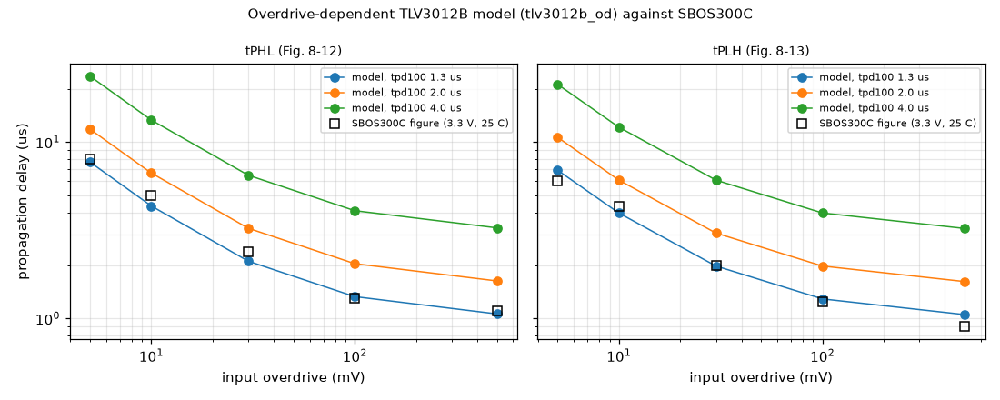
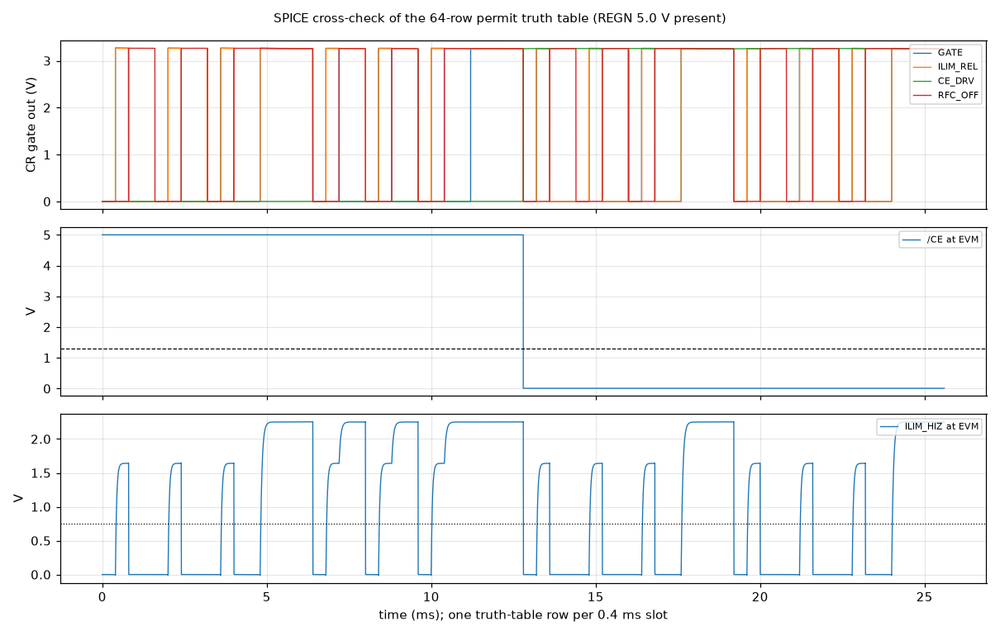
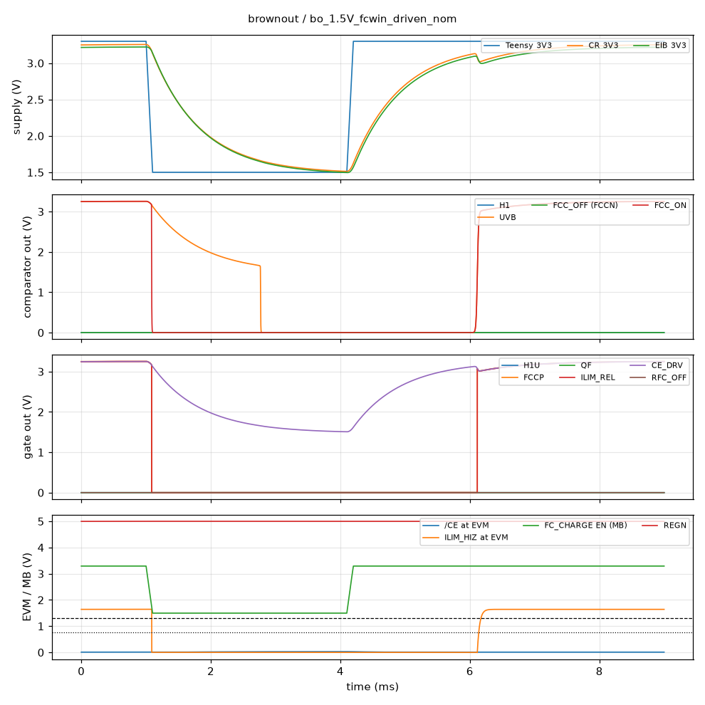
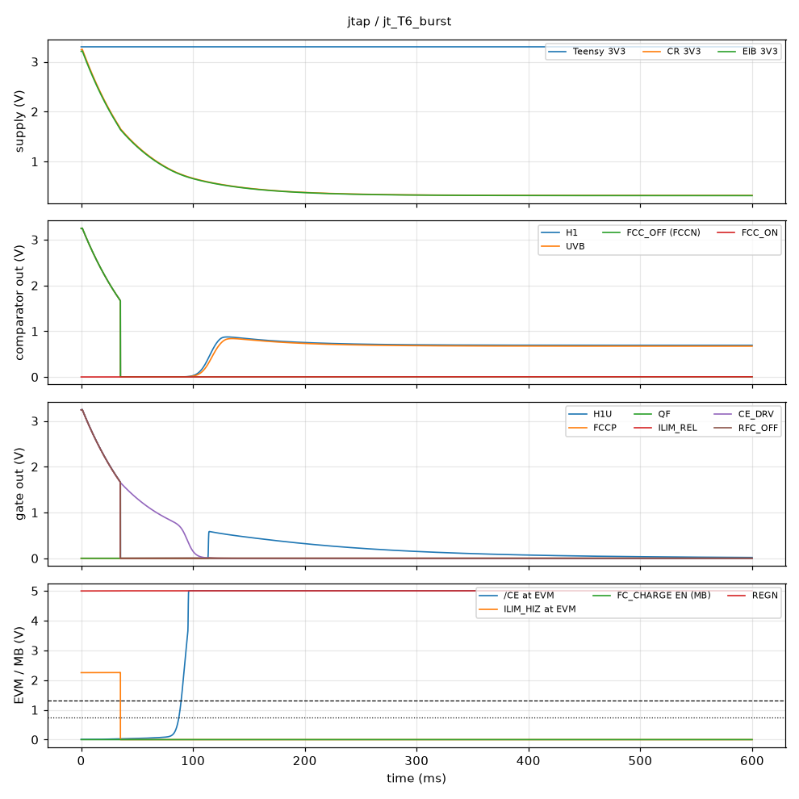
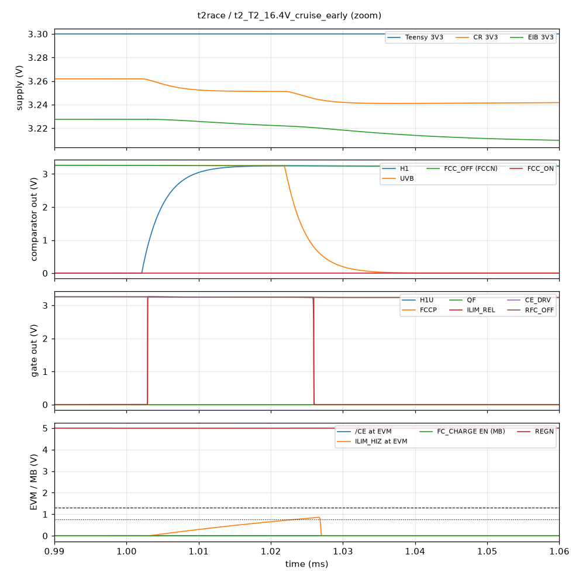
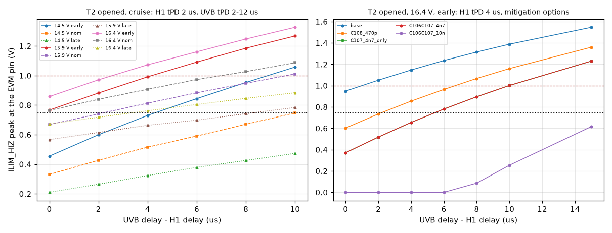
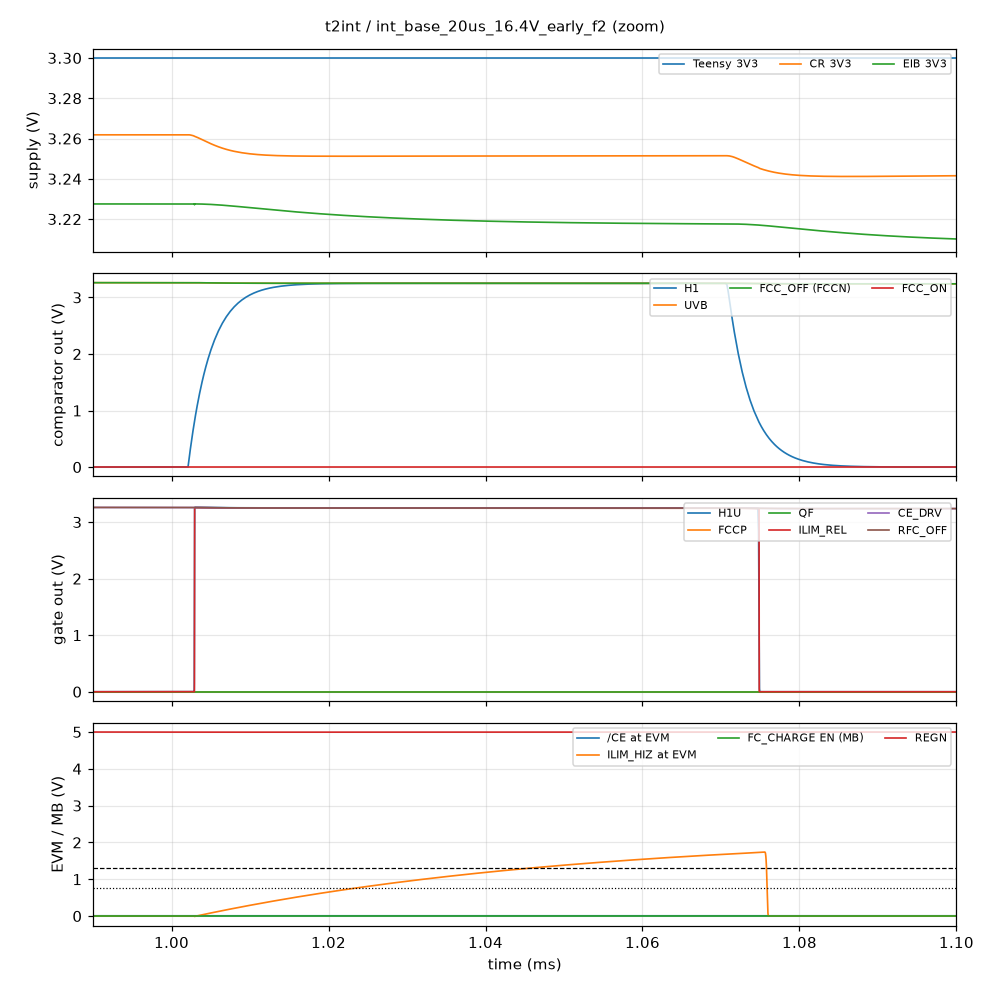
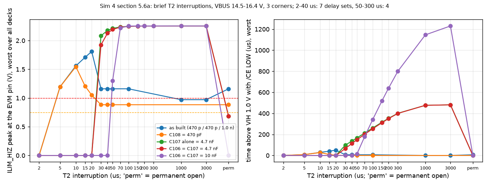
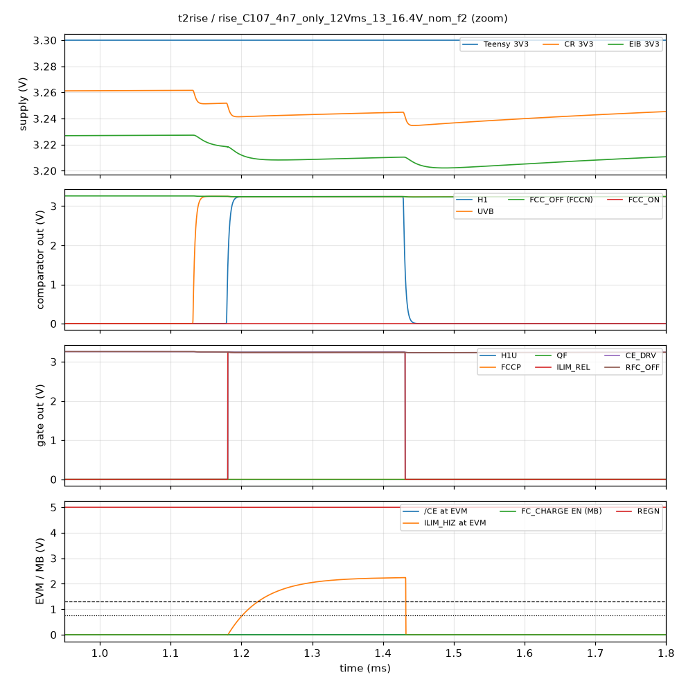
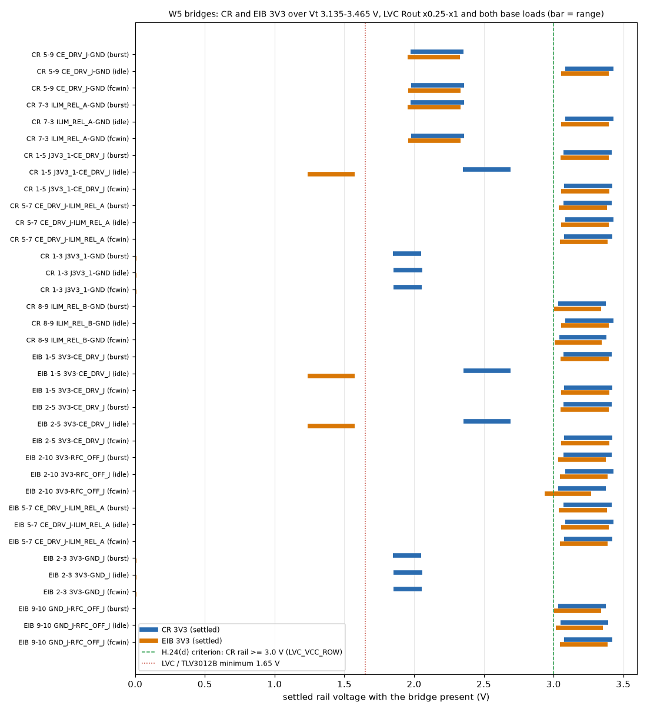

# Sim 4: CR permit logic at power-up, brown-out, MCU reset, J-TAP unplug and W5 bridges

Entry script: `python run.py` (this folder). It regenerates the 847 decks (`decks/`), every CSV (`results/`) and every
PNG (`figures/`) through `../common/ngspice_run.py` (ngspice-46, KiCad 9.0 `ngspice.dll`, six worker threads). The run
of 2026-11-15 that produced every figure of Sections 2-5.6 and 5.7-5.9 took 1330 s (`results/summary.json`,
`wall_s`). The aggregate tables (`results/agg_*.csv`) are written by `summarise.py`, which `run.py` calls at its end.
A second entry script, `python t2brief.py`, regenerates the 4116 decks of Section 5.6a with their CSVs and figures
(about 80 min with twelve workers). `run.py` deletes every deck, CSV and PNG in these folders at its start, so
`t2brief.py` and then `t2brief_check.py` must run after it. Section 10 lists the corrections made after an independent
check of the first run (2026-11-14) and after the second review (2026-11-15).

## 1. Purpose

This simulation checks that every permit output of the carrier board (CR) and the EVM interface board (EIB) stays in
its safe state, or reaches it quickly, when the supplies and the Teensy misbehave. It informs the following items:

- review finding LOG-3 (F.2 against B.1 for GATE in Init, Idle and Teensy reset);
- review findings INT-0, EIB-0 and EIB-1 (W5 wire-pad bridges 5-9, 7-3 and 1-5) and EIB-2 (the two 3V3 conductors
  joined at the EIB);
- review finding LOG-1 (R187 short during an MCU reset);
- design sections B.1 (permit equations), B.3 (edge-rate exception), B.6 (EIB fault table), B.7 (power-up and reset
  states, keeper condition), F.2 (mode table) and H.24(d) (wire-short criterion: CR rail at least 3.0 V, the
  `LVC_VCC_ROW` of `round4/calc/r9_calc.py`; the calculation's own worst-case result is 3.024 V);
- tests T-C-01 (truth table and power-up states), T-C-05 (EIB single faults), T-D-01 (Teensy reset), T-D-04
  (comparator faults incl. T2 open) and the post-solder isolation check proposed for T-A-06.

The safe states are those of B.7: /CE HIGH at the BQ25798, ILIM_HIZ held below 0.75 V, no ILIM release, the
FC_CHARGE EN net below VEN_F min 0.6 V, and RFC_OFF LOW whenever the FC path may conduct.

## 2. Circuit and models

### 2.1 Circuit taken from the netlists

`deck.py` reads every CR and EIB part of the permit path, with its value and pin-to-net map, from `../../cr/cr.net`
and `../../eib/eib.net` through `netparse.py`. No connection is typed by hand. The included parts are the comparators
U102, U103, U119 and U120 with their dividers, filters, hysteresis resistors and BAV199 clamps (gen/netlist.py:132-166),
the gates U105, U106, U107, U110 and U118 (gen/netlist.py:177-190), the pull-downs R108 and R123, the tap resistors
R122, R126 and R147, the drivers R130, R131A, R131B and R132 (gen/netlist.py:196-203), the 3V3 feed R175, R176, R177
and C125 (gen/netlist.py:205-208), R107, the nine decouplers, and the whole fitted EIB: U201, U202, Q201-Q203 and
their resistors (gen/netlist.py:267-318). The U101 power section (U101, R101-R106s, C101-C103, D103, D107, R129,
C129) is not part of the permit path and is not modelled. The EIB DNP set (U203, U204, C203, C204, R258-R265) is
excluded.

The off-board elements are listed in `deck.EXTERNAL` with their sources. Table 2.1 summarises them.

Table 2.1: Off-board elements of the deck.

| Element | Value | Source |
|---|---|---|
| R170, R171 (V-MOT and VBUS tap joints) | 10.0 kOhm | design doc r1-17 (line 219), B.2 |
| FC_CHARGE EN bodge to GND | 10.0 kOhm | CLAUDE.md section 2 (10 kOhm EN bodge) |
| RT1987 EN pull-down | 730 kOhm (475-985 kOhm) | RT1987_DS-00 p.7, as quoted in REVIEW LOG-1 |
| EVM /CE pull-ups R272, R272b to REGN | 47.0 kOhm each | design doc B.6 |
| EVM ILIM_HIZ network: R21 link, R23, R256, C252 | 0 ohm, 49.9 kOhm, 200 kOhm, 2.2 nF | design doc B.6 (EVM side list) |
| REGN | 5.0 V through 2 ohm, or 0 V (absent) | SLUSDV2C REGN typical; output resistance ASSUMPTION |
| Teensy pads (pins 5, 31, 33, 34) | 25 ohm driver, 7 pF, optional keeper | ASSUMPTION |
| W5 wires | 0.064 ohm + 0.3 uH (100 ohm damping) | ASSUMPTION: 0.3 m 28 AWG |
| MB trace and conductor capacitance | 20 pF per Teensy net; EN net 100 pF | ASSUMPTION |
| Part supply currents (`deck.BASE_LOAD`, "parts", every deck) | CR rail 55.6 uA, EIB rail 20 uA, scaled by min(1, V/1.65 V) | r9_calc.py rail_load() rows (r9_calc.py:241-257): 5 LVC x ICC 10 uA, 4 TLV3012B x IQ 5 uA (3.6 uA already in the comparator model), 2 EIB LVC x 10 uA; the scaling below 1.65 V is an ASSUMPTION |
| State-dependent base load ("max", bridge family) | STAT held LOW through a 50 ohm open drain at E7; Teensy pin 34 INPUT_PULLDOWN 100 kOhm | r9_calc.py R9.H15 rows "R107 STAT pull-up while STAT LOW" and "H1 HIGH into pin 34 INPUT_PULLDOWN" (100 kOhm ASSUMPTION there and here) |

The resistive rows of the R9.H15 load list (the REF divider R184/R185, the R274 bleed, the four ribbon input paths
and R113/R116/R187) are netlist parts and are drawn by the deck without any addition. With the "max" load and no
bridge, the CR rail settles at 3.081-3.406 V over a Teensy 3V3 of 3.135-3.465 V (`results/agg_bridge.csv`, row "none"),
which brackets the 3.227 V that R9.H15 gives at 3.30 V.

The CHG_ARM input arrives through the Samtec J1 pin 11, which stays mated in every case. The six J-TAP conductors that
reach the permit path (T1, T2, T5, T6, T10, T13) and the nine W5 wires are voltage-controlled switches, so that each
can be opened at a set time.

### 2.2 Models

No manufacturer SPICE model is used for the permit path. Every active part is a behavioural model in
`../models/permit_behavioural.lib`, built from the datasheet tables named in its header:

- **SN74LVC gates** (TI SCES201N, sections 6.3, 6.5, 6.6): VIL and VIH as functions of VCC (0.35/0.65 x VCC at
  1.65-1.95 V, 0.7/1.7 V at 2.3-2.7 V, 0.8/2.0 V at 3.0-3.6 V); output resistance from the VOH and VOL rows (112 ohm
  at 1.65 V, 50 ohm at 2.3 V, 37.5 ohm at 3.0 V); a 3 ns output lag; no input clamp to VCC (Ioff). The output stage
  conducts only while VCC exceeds an "alive" voltage `va`, which reproduces Ioff at VCC = 0. The same rows are assumed
  for SN74LVC3G04, 2G08, 1G11, 3G06 and 1G06 (ASSUMPTION; those sheets were not re-read). The open-drain parts (U201,
  U202) have no PMOS.
- **TLV3012B, fixed delay** (`tlv3012b`; TI SBOS300C, rev. April 2023): B-version supply 1.65-5.5 V (Table 6.6);
  VOS +-9 mV, VHYS 2-8 mV, REF 1.223-1.260 V (Table 6.9); tPD 2 us typical and 4 us maximum at VOD 100 mV
  (Table 6.10); fail-safe inputs with the common-mode override rules of section 9.4.4; push-pull output held LOW while
  V+ is below the minimum and for up to 1.9 ms after V+ crosses it (section 9.4.5, tON). The POR threshold is a
  parameter between 1.5 V (Fig. 9-1) and 1.65 V. The delay is a parameter `tpd`, independent of the input overdrive.
- **TLV3012B, overdrive-dependent delay** (`tlv3012b_od`, added for the check round): the same model with the
  decision made by a charge-integrating state, so that a step overdrive VOD takes k / VOD and a ramp of slew S takes
  sqrt(2 k / S), followed by a fixed lag t0. The constants come from SBOS300C Figures 8-12 (tPHL) and 8-13 (tPLH) at
  VS 3.3 V, read from the plotted curves: tPHL 8 / 5 / 2.4 / 1.3 / 1.1 us and tPLH 6 / 4.3 / 2.0 / 1.25 / 0.9 us at
  VOD 5 / 10 / 30 / 100 / 500 mV. The parameter `tpd100` scales the whole curve to a chosen delay at VOD 100 mV:
  1.3 us reproduces the figures, 2 us the Table 6.10 typical value and 4 us the Table 6.10 maximum. That the maximum
  scales the whole curve uniformly is an ASSUMPTION, because SBOS300C gives a maximum only at VOD 100 mV.
- **2N7002K / BSS84**: level-1 MOSFETs with VGS(th) 1.6 V and -1.4 V; the EIB results do not depend on them because
  every gate is driven to 0 V or to REGN.
- **BAV199**: generic low-leakage diode (ASSUMPTION: IS 1 nA, N 1.9).

Figure 2.1 compares the step delay of `tlv3012b_od` with the values read from the two SBOS300C figures.

Figure 2.1: Propagation delay of the overdrive-dependent model against input overdrive, for tpd100 = 1.3, 2 and 4 us,
with the SBOS300C Figure 8-12 / 8-13 values at VS 3.3 V (`results/od_characterisation.csv`).

At tpd100 = 1.3 us the model lies within 13 % of the figure values between 5 and 100 mV (tPHL 7.7 / 4.4 / 2.1 / 1.3 us
against 8 / 5 / 2.4 / 1.3 us). For a ramp at 13 mV/us, the slew of the UVB input at its crossing in the T2 race, the
model gives a tPHL of 3.3 us at tpd100 = 1.3 us and 7.0 us at tpd100 = 4 us. The fixed 2 us delay of the first run
therefore understates the UVB delay by 1.3-5.0 us.

The TI TLV3012 PSpice model in `../models/tlv3012_ti_sboc081a.lib` was not used for this purpose: it models the
non-B TLV3012 with a fixed 6.5 us transmission-line delay and has no overdrive dependence.

### 2.3 Corners

Table 2.2 defines the corner sets that each transient family uses.

Table 2.2: Corner sets.

| Corner | LVC input threshold | Comparator VOS / VHYS | POR threshold / hold | REF start-up |
|---|---|---|---|---|
| nom | mid-band | 0 / 6 mV | 1.65 V / 1.9 ms | 1 us |
| early | at VIL (reads HIGH first) | +9 mV / 2 mV (toward HIGH) | 1.5 V / 10 us | 1 us |
| late | at VIH | -9 mV / 8 mV | 1.65 V / 1.9 ms | 1 us |
| skewref | at VIL | +9 mV / 2 mV; U119 -9 mV, 1.9 ms | 1.5 V / 10 us (U119 1.9 ms) | 100 us |

The 10 us POR hold of the early corner is an ASSUMPTION: the datasheet gives "up to 1.9 ms" and no minimum. The
skewref corner looks for an FCCP or H1U glitch while a comparator leaves POR before its REF has settled. The T2-race
families add comparator delay corners on top of these sets (Section 4).

## 3. Assumptions

1. Every ASSUMPTION of Table 2.1 holds within an order of magnitude; the results that depend on one are named where
   they appear.
2. A warm case starts with a 20 us 3V3 ramp and a 5 ms preroll before its first event. Without the preroll, ngspice
   finds a metastable DC point in which the comparators sit at the POR threshold with their output stages half on;
   the preroll removes it, and the preroll is cropped from every result.
3. A solder bridge is a 0.01 ohm resistor present from power-up (an assembly defect).
4. The keeper of an i.MX RT1062 pad in reset is a constant current toward the last driven level. This is the worst
   case of a weak latch (IMXRT1060RM not available locally; TODO(verify: IMXRT1060RM)).
5. REGN is present (5.0 V) in the Run-state cases and in the "REGN present" power-up cases. The latter is the EIB-4
   condition (REGN from the pack with ADC_EN = 1), not a normal cold start.
6. The comparator delay of SBOS300C Table 6.10 (2 us typical, 4 us maximum) applies at VOD 100 mV; at lower overdrive
   the delay follows Figures 8-12 and 8-13. The fixed-delay families therefore sweep the UVB delay above the H1 delay
   (skew 0-15 us), and the `tlv3012b_od` family derives the delay from the actual overdrive.

## 4. Cases

Table 4.1 lists the case families. The "decks" column counts the decks of the full run.

Table 4.1: Case families.

| Family | Content | Decks |
|---|---|---|
| Boolean (Python) | all 64 combinations of P5, QUAL, H1, UVB, FCC_OFF, FCC_ON, evaluated from the cr.net/eib.net gate graph; mode rows of F.2 and B.7 | - |
| xcheck | the same 64 rows in SPICE (comparators replaced by sources, REGN present), 0.4 ms per row | 1 |
| od characterisation | one `tlv3012b_od` at VS 3.3 V: steps of VOD 5-500 mV and a 13 mV/us ramp, both directions, tpd100 1.3 / 2 / 4 us | 36 (small decks, not counted) |
| powerup (case 1) | 3V3 ramp 0 -> 3.3 V in 0.1, 1 and 10 ms; Teensy pins high-Z; bus cold (0 V), healthy (VBUS = V-MOT = 15.9 V) or regen (V-MOT 18.0 V); REGN absent or present; 4 corners | 72 |
| reset (case 1) | warm MCU reset at 1 ms from Run cruise, regen burst, FC window and qualification; 4 corners; pad keeper 17-100 uA; faults: EN bodge open, R187 short (LOG-1), both, REN_PD 475 kOhm | 36 |
| brownout (case 2) | Teensy 3V3 sags to 2.5, 2.0, 1.8, 1.6, 1.5 or 1.2 V for 3 ms (0.1 ms edges); pins keep driving or go high-Z (MCU BOR); cruise, burst, FC window; nom, early, skewref | 108 |
| jtap (case 3) | all J-TAP conductors open at 1 ms (re-plugged at 200 ms), REGN present or absent; single conductors T6, T5, T2, T1, T10, T13; T6 open for 0.6 s with va 0.6 / 0.8 / 1.0 V and without the part supply currents | 21 |
| t2race (extra) | T2 alone, T2 with T1, and a 50 us T2 intermittency, at VBUS 14.5, 15.9 and 16.4 V; cruise and Idle; 4 corners; fixed tPD 2 us | 72 |
| t2fix (extra) | mitigation options for the T2 race, each with the worst T2 case and a V-MOT step that measures the H1 latency; fixed tPD 2 us | 36 |
| t2skew (check round) | T2 opened in cruise, VBUS 14.5 / 15.9 / 16.4 V, early / nom / late; (H1, UVB) tPD = (2, 2), (4, 4), (2, 4), (2, 6), (2, 8), (2, 10), (2, 12), (4, 14) us | 72 |
| t2od (check round) | T2 opened in cruise with `tlv3012b_od`: tpd100 1.3, 2 and 4 us on all comparators, and H1 at 1.3 us beside UVB at 4 us; 3 VBUS x 3 corners; the five mitigation options at 16.4 V; the H1 latency of each option at tpd100 4 us | 76 |
| t2fixskew (check round) | the five mitigation options at 16.4 V, early, H1 tPD 4 us, UVB tPD 4-19 us (skew 0-15 us) | 35 |
| t2int / t2intx / t2intl (second check, `t2brief.py`) | T2 interrupted for 2-40 us (7 delay sets), 50-300 us (4) and 1-3 ms (2), or opened for good; 3 VBUS x 3 corners; five C106/C107/C108 options | 2520 / 792 / 144 |
| t2lat / t2thr (second check) | H1 inhibit latency: V-MOT falling at 3.125 and 4.5 V/ms from 18.6 V to VBUS - 35 mV, four VBUS, 3 corners, 3 delay sets, five options; static H1 fall threshold | 360 / 12 |
| t2rise (second check) | VBUS = V-MOT rising at 12 V/ms (and 24 V/ms for C107 alone) to 15.9 / 16.4 V from 0, 13.0, 14.5 and 15.2 V; five options | 288 |
| eib (case 4) | EIB 3V3 lost (W5 1 and 2 open); REGN arriving 1 ms after the CR; CR unpowered with REGN present; single W5 conductor open (5, 7, 8, 10, 3+9, 4) | 20 |
| bridge (case 5) | 12 W5 pad pairs (Table 5.5) in burst, Idle and FC window; Teensy 3V3 3.135 or 3.465 V; LVC Rout x0.25 or x1; base load "parts" or "max"; an alive-voltage sweep for the 1-5 bridges; the healthy board as reference | 298 |

## 5. Results

### 5.1 Boolean check, SPICE cross-check and LOG-3

The gate graph read from cr.net reproduces the B.1 equations in all 64 rows (`results/truth_table.csv`, 0
mismatches). The CR-to-EIB chain of every signal (R130/W5 5/R250/R267, R131A/W5 7/R251/R268, R131B/W5 8/R266/R270,
R132/W5 10/R253/R269) is asserted against both netlists (`results/chain_check.csv`). The SPICE run of the same 64 rows
agrees with the Boolean evaluation in all 64 rows (`results/truth_table_spice.csv`). Its analog end states are /CE
4.999-5.000 V (inhibit) or 0.008 V, ILIM_HIZ 0.000 V held, 1.641 V released with the FC clamp and 2.250 V released with
the regen clamp. The last two lie inside the H.4 nominal pin ranges (1.577-1.708 V and 2.163-2.343 V).

Figure 5.1 shows the SPICE cross-check: one truth-table row per 0.4 ms slot, with the CR gate outputs and the two EVM
pins.

Figure 5.1: SPICE cross-check of the 64-row truth table, REGN 5.0 V present (full 25.6 ms run shown).

The figure shows only three ILIM_HIZ levels and two /CE levels, so no row produces an intermediate pin voltage.

**LOG-3 is settled in favour of B.7.** In the captured netlist GATE = H1U OR FCCP has no P5, REGEN or mode term. In
every mode with FCC_OFF HIGH and P5 LOW, H1 = UVB = 1 gives GATE = 1. The F.2 GATE column ("0") disagrees with the
netlist in 7 mode rows, each with H1 = UVB = 1 (`results/mode_table.csv`). The 7 rows fall into two groups:

- In Init, Idle, Finish, State 99, the T10 charger trip and Teensy reset, the disagreement changes the EVM pin
  outcome: ILIM_REL = 1 and ILIM_HIZ is released at the regen clamp (2.25 V) instead of held, while /CE stays HIGH
  because P5 = 0.
- In Run entry (qualification), QF already releases ILIM through the regen clamp (RFC_OFF = 1). Only the GATE column
  differs; the EVM pin outcome is the same.

B.7 ("H1U only") agrees with the netlist. The transient power-up confirms it: with V-MOT 18.0 V and VBUS 15.9 V, the
release asserts 0.52-7.7 ms after the 3V3 ramp starts, once the comparator POR ends
(`figures/powerup__pu_1ms_regen_regn5_nom.png`). Table 5.0 proposes per-row replacement text for the F.2 GATE column.

Table 5.0: Proposed F.2 GATE entries (netlist behaviour).

| F.2 row | Proposed GATE entry |
|---|---|
| Init (State 0), Idle (State 1), Finish (State 3), State 99 | "H1U: with H1 = UVB = 1 (V-MOT above 1.089 x VBUS) ILIM_REL = 1 and ILIM_HIZ is released at the regen clamp; /CE HIGH (P5 = 0)" |
| Charger trip inside an FC window (T10) | "H1U, as Idle; FC_CHARGE and REGEN are already open and /CE is HIGH" |
| Teensy reset | "H1U only (FCC = 0, so FCCP = 0), as B.7; /CE HIGH through the pull-downs" |
| Run entry (qualification) | "H1U; ILIM is released by QF in any case (pin outcome unchanged)" |

The text "charger unpowered" is not proposed for any row, because REGN can be present from the pack (the EIB-4
condition) while the charger input paths are open.

### 5.2 Power-up with the Teensy pins high-Z (case 1)

All 72 power-up decks are safe (`results/powerup.csv`). No output leaves its safe state in the cold and healthy-bus
cases at any ramp time or corner: /CE stays at 5.0 V when REGN is present, ILIM_HIZ stays below 8 uV, and the
FC_CHARGE EN net stays at or below 9.6 mV. In the regen-bus cases the only change is the legitimate H1U release above.
The skewref corner produces no FCCP or H1U glitch. The comparator POR holds every comparator output LOW until the REF
of each comparator is far above the 7-16 mV input differences at power-up.

### 5.3 Warm MCU reset (case 1)

Table 5.1 gives the transition times from the instant the pins go high-Z (worst over the four corners).

Table 5.1: Warm reset, healthy board, pins high-Z at t = 1 ms.

| State before the reset | /CE back HIGH | Release dropped | FC_CHARGE EN below 0.6 V | Final state |
|---|---|---|---|---|
| Run cruise, regen armed | 1.0-2.6 us | (not released) | (LOW) | safe |
| Regen burst (H1U = 1) | 1.0-2.6 us | stays released (H1U) | (LOW) | /CE HIGH, release by H1U only |
| FC window | 1.0-2.6 us | 2.9-3.9 us | 2.2-2.3 us | safe |
| Qualification (QUAL HIGH) | (HIGH) | 0.75-2.1 us | (LOW) | safe |

Every transition is monotonic: no output returns to the enabled state after it has left it. This meets the T-D-01
criterion (no LOW-to-HIGH glitch on ILIM_REL and no new /CE LOW edge). The CHG_ARM fall through R108 with the assumed
37 pF takes about 1.7 us, so the B.3 slow-edge exception spends 1-3 us in the undefined band. The model has no input
noise, so it cannot show the chatter that B.3 allows for; T-D-01 remains the check for it.

Table 5.2 gives the keeper and fault cases (`results/reset.csv`).

Table 5.2: Warm reset with a pad keeper or a CR/MB fault.

| Case | Result at the end of the 3 ms window |
|---|---|
| keeper 17 uA (pins 5, 31, 33) | safe in all three states |
| keeper 42.6 uA, P5 HIGH before reset | CHG_ARM held at about 2.0 V: /CE stays LOW (0.008 V) |
| keeper 42.6 uA, QUAL HIGH before reset | QF stays HIGH: ILIM released (2.251 V) with /CE HIGH |
| keeper 64 / 100 uA, FC window | FC_CHARGE EN stays at 0.635 / 0.987 V, above VEN_F min 0.6 V |
| EN bodge open, FC window | EN falls below 0.6 V in 153 us and settles at 0.418 V; release drops in 43 us |
| EN bodge open with REN_PD 475 kOhm | EN falls below 0.6 V in 100 us and settles at 0.319 V |
| R187 short (LOG-1) | EN net 1.536 V, above VEN_R max 1.4 V; FCC_OFF LOW, FCC_ON LOW, no release |
| R187 short and EN bodge open | EN net 3.192 V; FCC_ON HIGH, FCCP HIGH: ILIM released with the FC clamp (1.641 V), /CE HIGH |

The checker of `analyse.py` flags each row from "keeper 42.6 uA" downward as UNSAFE, either because the output never
reaches its safe state ("stuck") or because the FC_CHARGE EN net crosses VEN_F. The two bodge-open rows are flagged
only because the EN fall (100-153 us) exceeds the 100 us transition allowance of the checker; their settled levels are
safe. The REN_PD 475 kOhm row sits at 100.2 us, on the allowance, and its flag is a threshold artefact.

The keeper rows show that the B.7 condition is not conservative. CHG_ARM is a guaranteed LOW only while the keeper
sources less than 0.8 V / 47.0 kOhm = 17.0 uA; 42.6 uA is the current that guarantees a HIGH (r9_calc.py R9.H24(b)).
Between 17.0 and 42.6 uA the input sits in the undefined band, and the model's mid-band threshold already reads HIGH at
29.8 uA. The same holds for QUAL through R147/R123. The B.7 Teensy-reset row and J.2 item 69 should therefore state
"keeper < 17 uA" for a guaranteed LOW. The R187 short reproduces LOG-1 (review: 1.50-1.52 V; simulation: 1.536 V).

### 5.4 Brown-out (case 2)

All 108 brown-out decks are safe (`results/brownout.csv`). With the MCU in BOR reset, /CE returns HIGH within 52 us of
the sag start (50 us of which is the assumed BOR delay), and no release, FC_CHARGE EN or regen-clamp excursion
appears at any depth. With the pins still driving, the cruise state never shows a release, and the FC EN and regen-clamp
checks stay clean. Below 1.65 V (sags to 1.6, 1.5 and 1.2 V, 0.65-2.3 ms below the minimum) the comparators enter POR,
so a legitimate release (burst or FC window) drops and returns only after the rail has recovered above the POR
threshold and the POR hold has elapsed (10 us in the early corner, 1.9 ms in the nominal corner). Every change during
the sag is toward the safe state. The R175/C125 filter (tau 0.7 ms) delays the CR rail behind the Teensy rail.
Figure 5.2 shows the 1.5 V sag in an FC window with the pins driving.

Figure 5.2: Brown-out to 1.5 V for 3 ms in an FC window with the pins driving (window 0-9 ms of 9 ms).

The figure shows the FC_CHARGE EN net following the sagging Teensy pin while FCCP and the release drop with the
comparator POR; the release returns only after the POR hold.

### 5.5 J-TAP unplugged (case 3)

Pulling the whole J-TAP drops every release in 6.1-20.6 us, with REGN present or absent, and no output is left enabled
(`results/jtap.csv`). /CE keeps following P5 for about 127 ms, because CHG_ARM still arrives through J1 pin 11 and the
CR logic runs from C125 until the rail decays (by design: /CE = NOT P5). The single-conductor cases behave as
designed except T2 (Section 5.6) and T6 (below): T5 open drops FCCP in 6 us (B.2: the open tap sits at 0.97 V); T1 open
drops H1 in 4 us; T10 open drops QF in 0.2 us; T13 open has no effect.

T6 open alone removes the CR feed while the Teensy keeps driving P5 through J1. The checker flags every T6 case as
UNSAFE ("stuck") on CE_logic, REL_logic and ILIM_REL_cr, because these outputs need tens of milliseconds, not 100 us,
to reach their safe states. Table 5.3 gives the timeline of the 0.6 s runs (`results/agg_t6.csv`), and Figure 5.3
shows the regen-burst case.

Table 5.3: T6 opened at t = 0 (times in ms from the event).

| State | va (V) | Supply currents | CR below 1.65 V | Release dropped (REL logic, ILIM_REL) | /CE pin HIGH | CR logic drives below 1.65 V for | CR below 0.45 V | Rail at 0.6 s |
|---|---|---|---|---|---|---|---|---|
| burst | 0.6 / 0.8 / 1.0 | parts | 34.4 | 34.1 | 112.1 / 88.4 / 71.9 | 92.4 / 62.4 / 43.5 | 142.6 / 154.9 / 160.6 | 0.320 V |
| FC window | 0.6 / 0.8 / 1.0 | parts | 37.9 | 37.5 | 114.1 / 91.3 / 75.1 | 90.1 / 61.5 / 43.1 | 142.4 / 153.5 / 158.9 | 0.304-0.305 V |
| burst | 0.8 | none | 40.6 | 40.2 | 115.8 | 88.7 | 289.0 | 0.420 V |
| FC window | 0.8 | none | 45.6 | 45.0 | 119.4 | 86.7 | 259.6 | 0.400 V |

Figure 5.3: T6 opened at 0 ms in a regen burst, va 0.8 V, part supply currents included (full 0.6 s run shown).

The figure and the table show three phases. First, the CR logic runs on C125 for 34-46 ms and holds the last state.
Second, the comparators enter POR as the rail crosses 1.65 V, which drops the release at once (34-45 ms). Third, the
CR LVC parts keep CE_DRV HIGH below their 1.65 V minimum until their output stages stop conducting, so /CE returns HIGH
only after 72-119 ms. The duration of this sub-minimum interval (43-92 ms) depends on the assumed alive voltage va,
and it is an extrapolation beyond the datasheet. During it /CE is LOW only because the Teensy still drives P5 HIGH;
the release is already held, so the converter cannot switch. The rail then settles at 0.30-0.32 V with the part supply
currents and at 0.40-0.42 V without them, both inside the B.7 range of 0.3-0.45 V. The settled value depends on the
assumed low-voltage behaviour of those currents. Below about 0.6 V the comparator outputs float to 0.7-0.85 V through
R113/R116 from the clamped inputs; no LVC part is alive at that rail, so the floating levels have no effect on the EVM
pins.

### 5.6 New finding: a lost T2 tap gives a release pulse before UVB drops it

B.1 relies on UVB to drop the release when the T2 (VBUS) tap is lost, because the lost tap forces H1 HIGH. The two
comparators, however, see different inputs. H1's IN- (R112 56.2 kOhm, C107 470 pF) collapses in a few microseconds
and needs to fall only about 8 % (the ratio of the two dividers) to trip H1; H1 therefore sees a large, fast
overdrive. UVB's IN+ (C108 1.0 nF, tau about 94 us) must fall about 17 % below its operating point and crosses REF at
about 13 mV/us; UVB therefore sees a low overdrive and a longer delay. H1U = H1 AND UVB pulses HIGH in between.
Table 5.4 summarises the decks (`results/agg_t2.csv`).

Table 5.4: T2 opened with V-MOT = VBUS (cruise or Idle), REGN present.

| Comparator delay model | VBUS | Release pulse (EIB inputs) | ILIM_HIZ peak at the EVM pin | Decks above VIH 1.0 V |
|---|---|---|---|---|
| fixed 2 us (t2race, 4 corners, cruise and Idle) | 14.5 V | 4.3-10.5 us | 0.21-0.46 V | 0 of 8 |
| fixed 2 us | 15.9 V | 13.7-20.0 us | 0.56-0.77 V | 0 of 8 |
| fixed 2 us | 16.4 V | 16.9-23.1 us | 0.67-0.86 V | 0 of 8 |
| fixed 4 us on both (t2skew, 3 corners) | 14.5-16.4 V | 2.9-26.3 us | 0.15-0.95 V | 0 of 9 |
| fixed H1 2 us, UVB 6 us (skew 4 us) | 14.5-16.4 V | 7.1-31.3 us | 0.32-1.07 V | 1 of 9 |
| fixed H1 2 us, UVB 8 us (skew 6 us) | 14.5-16.4 V | 8.6-35.0 us | 0.38-1.16 V | 2 of 9 |
| fixed H1 2 us, UVB 12 us (skew 10 us) | 14.5-16.4 V | 11.1-43.1 us | 0.47-1.33 V | 5 of 9 |
| fixed H1 4 us, UVB 14 us (skew 10 us) | 14.5-16.4 V | 9.8-46.5 us | 0.43-1.39 V | 5 of 9 |
| overdrive model, tpd100 1.3 us (figure typical) | 16.4 V | 18.9-22.8 us | 0.73-0.85 V | 0 of 3 |
| overdrive model, tpd100 4 us (table maximum) on all | 16.4 V | 18.5-27.2 us | 0.72-0.97 V | 0 of 3 |
| overdrive model, H1 1.3 us beside UVB 4 us | 16.4 V | 22.1-28.8 us | 0.83-1.01 V | 1 of 3 |
| T2 and T1 together (whole J-TAP), fixed 2 us | all | none | 0 V | 0 |

A T2 interruption of 50 us or more gives the same pulse as a permanent T2 opening with the as-built capacitors. A
shorter interruption gives a larger pulse, and larger C106/C107 values move the hazard to longer interruptions;
Section 5.6a quantifies both. (**Superseded 2026-11-15, Section 5.6a:** "The T2 intermittency of 50 us gives the same
pulse as a permanent T2 opening.") Figure 5.4 shows the worst case of the first run, and Figure 5.5 shows the peak
against the delay skew.

Figure 5.4: T2 opened at 1.000 ms, VBUS 16.4 V, cruise, early corner, fixed tPD 2 us (zoom 0.99-1.06 ms of a 3 ms
run).

The figure shows H1 rising about 2 us after the tap opens and UVB falling about 20 us later; ILIM_REL is HIGH between
them, and C252 with the feed network integrates the ILIM_HIZ pin up to 0.86 V.

Figure 5.5: ILIM_HIZ peak against the UVB-minus-H1 delay skew. Left: fixed-delay model, H1 2 us, each VBUS and corner.
Right: VBUS 16.4 V, early corner, H1 4 us, as built and with each mitigation option (`results/t2skew.csv`,
`results/t2fixskew.csv`).

The figure shows the peak rising by about 0.04-0.05 V per microsecond of skew. At the worst corner (16.4 V, early) the
peak crosses VIH_ILIM_HIZ 1.0 V at a skew of about 2.5 us with H1 at 2 us, and at about 1 us with H1 at 4 us; at 15.9 V the crossing is at about 4 us. The
overdrive model at the table maximum on both comparators gives 0.97 V, and a fast H1 part (figure typical) beside a
maximum-delay UVB part gives 1.01 V. Therefore the T2-race pulse **can exceed VIH 1.0 V at the maximum tPD plus a modest
UVB delay skew**; the first-run statement that it stays below 1.0 V holds only at the 2 us typical delay.

The consequence is bounded as follows. In the decks above 1.0 V the pin stays above 1.0 V for 0.6-28.3 us and above
0.75 V for 9.2-37.4 us (skew up to 15 us), and /CE is LOW at the same time (cruise, P5 HIGH; minimum 0.008 V).
SLUSDV2C section 7.3.4.3 states that the charger resumes switching above 1.0 V and stops below 0.75 V, but it gives
neither a deglitch nor a restart time for this pin, and it describes a soft start only for OTG (TODO(verify: SLUSDV2C
ILIM_HIZ deglitch and restart time)). At worst, therefore, the converter may start switching for up to about 37 us
with its input current limited by the clamp that the ADC read at POR (section 7.3.4.3). The pulse is a single-fault
event (T2 crimp, cavity contact or R171 open).

Table 5.5 gives the mitigation check (`results/t2fix.csv`, `results/t2od.csv`, `results/t2fixskew.csv`, VBUS 16.4 V,
the worst T2 case).

Table 5.5: Mitigation options for the T2 race.

| Option | Peak, fixed 2 us (early / nom / late pulse) | Peak, overdrive model (tpd100 4 us; H1 1.3 / UVB 4 us) | Fixed H1 4 us: largest skew with peak < 0.75 V / < 1.0 V | H1 latency after a 1 us V-MOT step 15.9 -> 18.0 V (fixed 2 us; overdrive 4 us) |
|---|---|---|---|---|
| as built (C106 = C107 = 470 pF, C108 1.0 nF) | 0.86 V (23.1 / 19.8 / 16.9 us) | 0.97 V; 1.01 V | none / 0 us | 24.5-33.7 us; 32.7-44.3 us |
| C108 470 pF | 0.49 V | 0.60 V; 0.65 V | 2 us / 6 us | unchanged |
| C107 4.7 nF only | 0.24 V | 0.27 V; 0.39 V | 4 us / 8 us | unchanged |
| C106 = C107 = 4.7 nF | 0.24 V | 0.27 V; 0.39 V | 4 us / 8 us | 231-304 us; 256-335 us |
| C106 = C107 = 10 nF | 0 V | 0 V; 0 V | 15 us (0.62 V) / > 15 us | 490-643 us; 526-688 us |

For a permanent T2 open, C106 = C107 = 10 nF is the only option that removes the pulse at every corner under both
delay models. It keeps zero pulse up to a skew of 6 us at H1 4 us (a pulse of 1.3 us and 0.09 V appears at 8 us; 0.62 V
at 15 us; below VIL 0.75 V throughout). Its cost is an H1 release latency of 0.49-0.69 ms for an ideal step, against a
V-MOT rise that takes milliseconds in a real brake. Raising C107 alone delays IN- against IN+, so a fast VBUS rise can
then trip H1 falsely. This is a design option for the operator, not a change made here. Section 5.6a revises this
paragraph: Table 5.5 covers the permanent open only, and its latency column is the H1 release (rise) latency. (**Superseded
2026-11-15, Section 5.6a:** "C106 = C107 = 10 nF is the only option that removes the pulse at every corner under both
delay models" and "Raising C107 alone is not recommended without a further check: it delays IN- against IN+, so a fast
VBUS rise could then trip H1 falsely.")

### 5.6a Brief T2 interruptions, H1 inhibit latency and the C107-alone false trip (second check, 2026-11-15)

This subsection replaces the unreviewed scratch re-run (`recon.csv`, `recon2.csv` under the system temporary folder,
2026-11-14) that the design document and D-81 quoted. The entry script is `t2brief.py`; Section 9 lists its outputs.
The script reuses the deck builder, corner sets and checker of `run.py` without change. It adds five families:

- **t2int:** T2 opened at 1 ms in Run cruise (P5 HIGH, so /CE is LOW; V-MOT = VBUS; REGN 5.0 V) and re-connected
  after 2, 5, 10, 15, 20, 30 or 40 us, or never ("perm"). The grid is VBUS 14.5 / 15.9 / 16.4 V, corners early / nom /
  late, and seven comparator-delay sets: fixed (H1, UVB) tPD (2, 2), (4, 4), (4, 2), (2, 4) and (2, 8) us, the
  overdrive model at tpd100 4 us, and H1 1.3 us beside UVB 4 us (the sets of Sections 4 and 5.6). There are 2520 decks.
- **t2intx and t2intl (check pass):** the same case at 50-300 us (four delay sets) and at 1 and 3 ms (two delay sets).
  These families find the end of each option's hazardous band. There are 792 and 144 decks.
- **t2lat:** H1 inhibit latency. V-MOT starts at 18.6 V (H1U released) and falls at I / C_VMOT_MIN with I = 1.25 A and
  1.80 A and C_VMOT_MIN = 0.4 mF. The slopes are 3.125 and 4.5 V/ms (`round3/calc/r3_calc.py` H.13). V-MOT stops at
  VBUS - 35 mV, where D-MT-EN conducts (same source). VBUS is 14.5, 15.5, 15.9 or 16.4 V. There are 360 decks.
- **t2thr:** the static H1 fall threshold of each VBUS and corner, from a 0.2 V/ms ramp (12 decks). The 15.9 V nominal
  value is 17.017 V, against 17.012 V in sim 3 (`sim/comparators/RESULTS.md` line 154).
- **t2rise:** VBUS = V-MOT rises at the H.6 slew of 12 V/ms (design document H.6, line 3402) from 0, 13.0, 14.5 or
  15.2 V to 15.9 or 16.4 V, with P5 HIGH. C107 alone is also run at 24 V/ms. There are 288 decks.

The metric "time above 1.0 V" is the total time in which the ILIM_HIZ pin exceeds VIH 1.0 V while /CE is below VIL
0.4 V (SLUSDV2C, as quoted in `analyse.py`). The /CE pin stays at or below 0.008 V in every t2int, t2intx and t2intl
deck. Every deck converged, and every deck ends with ILIM_HIZ held below 0.75 V. The t2int decks at VBUS 16.4 V
reproduce all 123 matching rows of the scratch `recon.csv` / `recon2.csv` to within 3e-15 V.

**Mechanism of the brief-interruption pulse.** On the opening, H1's IN- (R112 node, tau 23.5 us with C107 470 pF)
collapses and H1 trips. UVB's IN+ (C108 1.0 nF, tau 93 us) must fall about 17 % to trip UVB. On the re-connection,
IN- needs about 2.7 tau to recover past the H1 fall point, so H1 stays HIGH for 50-70 us. If UVB has not tripped, the
release lasts from the opening until H1 falls. Figure 5.5a shows the 20 us case.

Figure 5.5a: T2 interrupted for 20 us at 1.000 ms, as built, VBUS 16.4 V, early corner, fixed tPD 2 us (zoom
0.99-1.10 ms of a 2 ms run).

The figure shows H1 HIGH for about 72 us and UVB HIGH throughout; ILIM_HIZ climbs to 1.74 V with /CE at 0.008 V.

With 4.7 nF or 10 nF on C107, the order reverses. IN- falls slowly, so a short interruption does not trip H1. A longer
interruption trips both comparators. On the re-connection, UVB (tau 93 us) recovers first and H1 (tau 235 or 501 us)
stays HIGH, so H1U releases after the re-connection. A first-order estimate of that release is 2.7 tau(IN-) minus
1.8 tau(UVB IN+): 477 us at 4.7 nF and 1203 us at 10 nF. The simulation gives 481 us and 1230 us at 3 ms (Table 5.4a).

Table 5.4a gives the worst case of each option over every VBUS, corner and delay set (`results/agg_t2int.csv`).

Table 5.4a: ILIM_HIZ peak and time above VIH 1.0 V with /CE LOW against the T2 interruption (Run cruise).

| Interruption | As built (470 p / 470 p / 1.0 n) | C108 = 470 pF | C107 alone = 4.7 nF | C106 = C107 = 4.7 nF | C106 = C107 = 10 nF |
|---|---|---|---|---|---|
| 2 us | 0 V | 0 V | 0 V | 0 V | 0 V |
| 5 us | 1.195 V, 7.9 us | 1.194 V, 8.2 us | 0 V | 0 V | 0 V |
| 10 us | 1.560 V, 29.1 us | 1.545 V, 27.9 us | 0 V | 0 V | 0 V |
| 15 us | 1.709 V, 40.9 us | 1.206 V, 8.8 us | 0 V | 0 V | 0 V |
| 20 us | 1.810 V, 50.7 us | 1.051 V, 2.0 us | 0 V | 0 V | 0 V |
| 30 us | 1.160 V, 6.5 us | 0.883 V, 0 us | 2.083 V, 97.9 us | 1.924 V, 65.7 us | 0 V |
| 40 us | 1.160 V, 6.5 us | 0.883 V, 0 us | 2.176 V, 136.2 us | 2.129 V, 113.1 us | 0 V |
| 50 us | 1.160 V, 6.5 us | 0.883 V, 0 us | 2.212 V, 166.6 us | 2.193 V, 148.6 us | 1.300 V, 13.2 us |
| 70 us | - | - | 2.237 V, 212.6 us | 2.233 V, 200.7 us | 2.220 V, 177.8 us |
| 100 us | 1.160 V, 6.5 us | 0.883 V, 0 us | 2.248 V, 261.4 us | 2.247 V, 253.8 us | 2.253 V, 342.2 us |
| 300 us | - | - | 2.253 V, 400.8 us | 2.253 V, 399.2 us | 2.254 V, 799.8 us |
| 1 ms | 0.971 V, 0 us | - | 2.254 V, 476.6 us | 2.254 V, 476.4 us | 2.254 V, 1145.9 us |
| 3 ms | 0.971 V, 0 us | - | 2.254 V, 481.3 us | 2.254 V, 481.2 us | 2.254 V, 1230.4 us |
| permanent | 1.160 V, 6.5 us | 0.883 V, 0 us | 0.684 V, 0 us | 0.683 V, 0 us | 0 V |

The 50-300 us rows use four delay sets and the 1-3 ms rows two (Section 5.6a list); "-" marks a duration not run for
that option. The as-built 50 us to permanent rows (1.160 V, 6.5 us) come from the fixed (2, 8) us skew set; at the
typical delay the peak is 0.858 V. Every peak of about 2.25 V is the regen-clamp level of Section 5.1 (2.250 V), so the
release there is complete, not a pulse. C108 = 470 pF exceeds the as-built result in 49 of 576 matched decks, by at
most 5.0 mV in peak and 0.34 us above 1.0 V, all at 5 or 10 us; it is otherwise lower or equal. Figure 5.5b plots the
table.

Figure 5.5b: Worst ILIM_HIZ peak (left) and worst time above VIH 1.0 V with /CE LOW (right) against the T2
interruption, for the five options (logarithmic duration axis; "perm" plotted at the right edge).

The figure shows that no option removes the hazard. The as-built board is exposed at 5-30 us, and beyond that only with
a UVB delay skew (as the permanent open). C108 = 470 pF is exposed at 5-20 us. The 4.7 nF options are exposed at every
interruption of 30 us or more, and the 10 nF option at every interruption of 50 us or more, with a full release for up
to 0.48 ms and 1.23 ms. In the 470 pF options,
time above 1.0 V stays at or below 50.7 us.

**H1 inhibit latency.** H.13 (design document line 3424) budgets the time from the H1 fall threshold to D-MT-EN
conduction. It deducts 24 us (divider RC), 15 us (comparator) and 7 us (Q201 gate), and T-B-06 must fit the ILIM path
(ILIM_HIZ LOW to IBUS < 10 %) into the rest, at most 150 us (line 3545). The simulation measures the circuit latency L.
L is the time from the V-MOT crossing of the static fall threshold (t2thr) to ILIM_HIZ below VIL 0.75 V. L includes the
divider filter, the comparator, the gates, the EIB switches and the C252 discharge. The window is
(V_fall,min - (VBUS - 0.035 V)) / slope, with V_fall,min from two sources. The r3 basis is `r3_calc_out.txt` lines
148-156 (16.379 / 16.810 / 17.340 V at 15.5 / 15.9 / 16.39 V). The sim 3 basis is the worst case with resistor TCR
(`sim/comparators/RESULTS.md` Table 4: 16.732 / 17.260 V at 15.9 / 16.39 V). The budget for T-B-06 is the window minus
the largest L. The 16.4 V decks stand in for 16.39 V, which shortens the window by about 2 us (conservative). Table 5.4b
gives the result (`results/agg_t2lat.csv`).

Table 5.4b: H1 inhibit latency L and the T-B-06 budget (worst VBUS; fixed = tPD 2 and 4 us; all = also the overdrive
model at tpd100 4 us).

| Option | L, fixed / all (us) | Budget at 1.25 A, r3 / sim 3 basis, all (us) | Budget at 1.80 A, r3 / sim 3 basis, fixed (us) | Budget at 1.80 A, r3 / sim 3 basis, all (us) |
|---|---|---|---|---|
| As built, C108 = 470 pF, C107 alone | 27.0-34.3 / 27.0-58.4 | 234.1 / 219.1 | 169.1 / 158.7 | 149.6 / 139.1 |
| C106 = C107 = 4.7 nF | 197.2-245.2 / 197.2-269.2 | 27.1 / 16.1 | -30.1 / -33.5 | -50.4 / -54.0 |
| C106 = C107 = 10 nF | 340.3-565.8 / 340.3-597.7 | -213.4 / -199.2 | -282.0 / -250.3 | -312.4 / -280.2 |

C108 and C107 do not act on the falling V-MOT path, so the first three options share one row; their L agrees to 0.1 us.
The matched 4.7 nF and 10 nF options leave less than 150 us at both currents, and no time at all at 1.80 A. With the
fixed delays the as-built board keeps 158.7 us at 1.80 A on the sim 3 basis. The overdrive model, applied to the
0.32-0.46 mV/us ramp at IN+ (3.125-4.5 V/ms x 56.2 / 553.2), adds 20-25 us to L. Under that model the as-built board keeps 139.1 us at 1.80 A on the sim 3
basis and 149.6 us on the r3 basis, both below 150 us. That model is an extrapolation of the SBOS300C figures to a ramp
(Section 7 item 2). The H.13 deductions (46 us) therefore cover the fixed-delay L (34.3 us) but not the overdrive-model
L (58.4 us), TODO(verify: SBOS300C tPD at a ramped input of about 0.5 mV/us).

**Reconciliation of the latency figures (R2-SIM-2).** Table 5.5 gives the H1 release latency after a 1 us V-MOT step
(231-304 us at 4.7 nF and 490-643 us at 10 nF, fixed tPD). Table 5.4b gives the inhibit latency on the H.13 ramps
(197-269 us and 340-598 us). Both follow the IN+ time constant: (487 kOhm + 10 kOhm) || 56.2 kOhm || 6.49 MOhm =
50.1 kOhm, or 236 us at 4.7 nF and 501 us at 10 nF. The lower 10 nF figures are shorter than tau, because the ramp
reaches the threshold only 0.22-0.69 ms after it starts, so the filter lag has not settled. The figures "134 us or 232 us (first-order estimate)" in design
document J.2 item 77 have no source in this simulation and are about half of both simulated quantities. The quantity that
H.13 and T-B-06 need is L of Table 5.4b.

**False H1 trip on a fast VBUS rise (C107 alone).** Table 5.4c gives the t2rise results (`results/agg_t2rise.csv`).

Table 5.4c: VBUS = V-MOT rising to 15.9 or 16.4 V, P5 HIGH, 3 corners, delay sets (2, 2) us and H1 1.3 / UVB 4 us.

| Option | Slew | From 0 V | From 13.0 V | From 14.5 V | From 15.2 V |
|---|---|---|---|---|---|
| As built, C108 = 470 pF, C106 = C107 = 4.7 nF or 10 nF | 12 V/ms | no release | no release | no release | no release |
| C107 alone = 4.7 nF | 12 V/ms | release 385 us, ILIM_HIZ 2.25 V | release 288 us, 2.25 V | no release | no release |
| C107 alone = 4.7 nF | 24 V/ms | release 420 us, 2.25 V | release 285 us, 2.25 V | release 99 us, 1.96 V (2 of 12 decks) | no release |

C107 alone trips H1 falsely on every rise of about 2.9 V or more at the H.6 slew of 12 V/ms (all 12 decks of each such
row). The release is complete: ILIM_HIZ reaches the regen clamp and stays above 1.0 V for up to 357 us at 12 V/ms. The
matched options do not trip, because IN+ and IN- lag together. Figure 5.5c shows a 13.0 -> 16.4 V rise.

Figure 5.5c: C107 alone = 4.7 nF, VBUS = V-MOT rising from 13.0 to 16.4 V at 12 V/ms from 1.000 ms, nominal corner,
fixed tPD 2 us (zoom 0.95-1.8 ms of a 4.3 ms run).

The figure shows UVB rising at 1.13 ms and H1 rising at 1.18 ms, while IN- still lags. H1 falls at 1.43 ms, and
ILIM_HIZ reaches 2.25 V in between with /CE LOW. A rise from 0 V occurs at bus start-up, when P5 should be LOW and /CE
HIGH. A rise of 3 V or more from 13 V is the BT_BUS close onto a sagged bus of H.6 (close delta 1.4-3.1 V in the bags,
line 3404). In that state P5 can be HIGH.

**Trade-off for the operator.** Table 5.4d summarises the five options. It does not choose one; the choice is J.2 item
77.

Table 5.4d: Trade-off of the C106/C107/C108 options (worst case of Tables 5.4a-5.4c; "above 1.0 V" = with /CE LOW).

| Option | Hazardous interruptions | Worst peak, time above 1.0 V | Permanent T2 open | T-B-06 budget at 1.25 / 1.80 A (sim 3 basis, all delays) | False H1 trip on a VBUS rise (12 V/ms) |
|---|---|---|---|---|---|
| As built: C106 = C107 = 470 pF, C108 = 1.0 nF | 5-30 us; 40 us and longer only with a UVB delay skew, as the permanent open | 1.810 V, 50.7 us (20 us) | 1.160 V, 6.5 us (skew 6 us); 0.858 V typical | 219.1 / 139.1 us (fixed delay: 243.1 / 158.7 us) | none |
| C108 = 470 pF | 5-20 us | 1.545 V, 27.9 us (10 us) | 0.883 V, 0 us | 219.1 / 139.1 us | none |
| C107 alone = 4.7 nF | 30 us and longer | 2.254 V, 481 us (full release) | 0.684 V, 0 us | 219.1 / 139.1 us | yes: rises of about 2.9 V or more, release up to 385 us |
| C106 = C107 = 4.7 nF | 30 us and longer | 2.254 V, 481 us (full release) | 0.683 V, 0 us | 16.1 / -54.0 us (fails) | none |
| C106 = C107 = 10 nF | 50 us and longer | 2.254 V, 1230 us (full release) | 0 V | -199.2 / -280.2 us (fails) | none |

The interruption-duration spectrum of a real T2 fault (crimp fretting, cavity contact) is not known, so the table
cannot rank the bands; TODO(verify: T-D-04 bench capture of a T2 intermittency). SLUSDV2C section 7.3.4.3 gives no
ILIM_HIZ deglitch or restart time, so it is not known whether a 2-50 us excursion above 1.0 V restarts the converter;
TODO(verify: SLUSDV2C ILIM_HIZ deglitch and restart time).

### 5.7 EIB unpowered, REGN late, CR unpowered (case 4)

All 20 decks are safe (`results/eib.csv`). With both W5 3V3 wires open, U201 and U202 stop sinking as their rail
drains through R274: /CE returns HIGH after 2.67-2.68 ms and the hold is re-applied after 2.74 ms. Both times depend
on the assumed 0.8 V alive voltage. When REGN arrives after the CR is up, the EIB follows the CR command from the first
instant, with no transient release. With the CR unpowered (T6 open) and REGN present, /CE stays at or above 4.0 V
during the REGN ramp and 5.0 V afterwards, ILIM_HIZ stays at 0 V, and the BAV199 back-feed holds both rails at
0.30-0.32 V (B.7: 0.3-0.45 V; 0.39-0.42 V in the first run, which omitted the part supply currents). Every single W5
conductor open moves its channel to the safe side: wire 5 gives /CE HIGH, wire 7 removes the feed in 46-104 us, wire 8
re-applies the hold in 1.2-1.3 us, wire 10 changes the regen clamp to the FC clamp, and wires 3+9 or 4 change nothing
(the EIB ground returns through R273 and E8).

### 5.8 W5 solder bridges (case 5)

Table 5.6 gives the settled rails and permit states for each bridge, over Vt 3.135-3.465 V, LVC output resistance
x0.25-x1 and both base loads (`results/bridge.csv`, `results/agg_bridge.csv`). The criterion of H.24(d) is a CR rail
of at least 3.0 V.

Table 5.6: W5 bridges present from power-up.

| Bridge | Finding | Worst state | CR 3V3 | EIB 3V3 | Effect on the permit outputs |
|---|---|---|---|---|---|
| CR 5-9 CE_DRV_J-GND | INT-0, EIB-1 | P5 HIGH | 1.97-2.36 V | 1.95-2.33 V | /CE forced HIGH; U106A sources 13.4-18.7 mA; other outputs unchanged |
| CR 7-3 ILIM_REL_A-GND | INT-0, EIB-1 | release HIGH | 1.98-2.36 V | 1.95-2.33 V | feed removed, ILIM held; U110B sources 13.4-18.7 mA; other outputs unchanged |
| CR 1-5 / EIB 1-5 / EIB 2-5 (3V3-CE_DRV_J) | EIB-0 | P5 LOW | 2.35-2.69 V | 1.24-1.57 V | **/CE LOW (0.01-0.03 V) with P5 LOW**; U106A sinks 9.8-12.3 mA |
| EIB 2-10 3V3-RFC_OFF_J | EIB-0 | FC window | 3.03-3.43 V | 2.94-3.39 V | **regen clamp in the FC window** (ILIM_HIZ 2.25 V instead of 1.64 V) |
| CR 1-3 / EIB 2-3 (3V3-GND) | B.6, H.20, EIB-2 | any | 1.85-2.06 V | 0 V | EIB unpowered: /CE HIGH, ILIM held (safe) |
| CR 5-7 / EIB 5-7 (CE_DRV_J-ILIM_REL_A) | EIB-0 list | P5 HIGH | 3.07-3.43 V | 3.04-3.40 V | no change when both are HIGH or both LOW |
| CR 8-9, EIB 9-10 (4.99 kOhm reference) | r9-12 | driver HIGH | 3.03-3.43 V (3.034 V minimum with the "max" load) | 3.00-3.40 V | hold or FC clamp (safe) |

Figure 5.6 shows the settled rails of every bridge case against the H.24(d) criterion and the 1.65 V device minimum.

Figure 5.6: Settled CR and EIB 3V3 with each W5 bridge (range over the supply, driver and base-load corners).

The figure shows three groups. The 5-9 and 7-3 bridges violate the 3.0 V criterion by 0.64-1.03 V, which confirms
INT-0 and EIB-1 (review: 1.83-2.30 V). The 3V3-GND bridges give 1.85-2.06 V, below the H.20 figure of 2.30-2.55 V,
because R176 and R177 feed the short in parallel through the EIB 3V3 node; this confirms EIB-2. The 3V3-CE_DRV_J
bridges pull the EIB rail to 1.24-1.57 V, below the 1.65 V LVC minimum, which confirms the EIB-0 verifier range
(1.14-1.55 V).

The 4.99 kOhm reference bridges (CR 8-9, EIB 9-10) meet the 3.0 V criterion with the "max" base load: the CR rail
minimum is 3.034 V at Teensy 3V3 3.135 V and Rout x1, 10 mV above the 3.024 V that r9_calc.py R9.H24(d) computes with
Rout 0 ohm and R175 +1 %. The margin to the criterion is 34 mV in the simulation and 24 mV in the calculation; the
two agree within the difference of their driver and tolerance assumptions.

In every bridge case the CR rail stays at or above 1.85 V, so no comparator enters POR and no relaxation oscillation
(rail sag, POR, release drop, recovery) occurs. The LVC driver currents of 13.4-18.7 mA (source) and 9.8-12.3 mA
(sink) exceed the recommended IOH of 8 mA at VCC 2.3 V (SCES201N section 6.3) but stay below the 50 mA absolute maximum
stated in H.24(a). The 3V3-CE_DRV_J bridge defeats the hardware /CE inhibit in every alive-voltage case (0.6, 1.0 and
1.3 V; /CE 0.01-0.11 V), so the EIB-0 conclusion does not rest on the U201 output working inside its specified supply
range.

### 5.9 Floating inputs

The static scan (`floating.py`, `results/floating_inputs.csv`) finds no floating CMOS input of a powered device in the
normal, Teensy-reset, J-TAP-unplugged, W5-open, E5-off, E2/E3-off and J1-unplugged scenarios. Two items remain:

- U101 EN (pin 12) and MODE (pin 11) are no-connects by design (internal pull-up, TCKE1401NM DS Table 6.1). The
  guaranteed pull-up level equals the ON threshold (REVIEW PWR-4); the simulation does not model U101.
- With the E1 lead off, the Q201, Q202 and Q203 gates float together with the EIB REGN node. B.6 records this case
  ("the Q201/Q202 gates then float, but no feed current exists").

U101 EN, MODE and PGOOD are not driven by any permit output (EN and MODE no-connect, PGOOD to GND, FLAG to J-TAP T16
through R106s; gen/netlist.py:105-110). The eFuse is therefore always enabled above its UVLO, and the permit relies on
/CE and the ILIM_HIZ hold, as B.4 states.

## 6. Conclusion against the design criteria

1. **B.1 / T-C-01:** the captured gate network implements the B.1 equations in all 64 input combinations, and the
   end-to-end EVM pin levels match the intended truth table.
2. **LOG-3:** B.7 is correct and the F.2 GATE column is wrong in 7 mode rows. In 6 of them (Init, Idle, Finish,
   State 99, T10 trip, reset) the EVM pin outcome changes (regen clamp released with /CE HIGH); in the qualification
   row only the column differs. Table 5.0 gives per-row wording.
3. **B.7 power-up and reset:** every enable output stays safe through a 0.1-10 ms 3V3 ramp, through a warm reset from
   any Run state, and through brown-outs to 1.2 V; reset transitions take 0.75-3.9 us and are monotonic. The B.7
   keeper condition "< 42.6 uA" must read "< 17 uA" for a guaranteed LOW on P5 and QUAL. With T6 open alone, the
   release drops in 34-45 ms and /CE returns HIGH in 72-119 ms; the second figure depends on sub-minimum LVC behaviour.
4. **B.1 lost-T2 coverage:** the UVB coverage holds in steady state but not dynamically. A permanent T2 open gives a
   3-47 us release with an ILIM_HIZ peak of 0.86 V at the typical delay. At the maximum tPD with a UVB delay skew of
   1-2.5 us (16.4 V) to 4 us (15.9 V) or more, the peak exceeds VIH 1.0 V (up to 1.39 V at a 10 us skew). A brief T2
   interruption is worse (Section 5.6a, Table 5.4a): as built, 5-30 us interruptions give up to 1.810 V and 50.7 us
   above 1.0 V with /CE LOW, at the typical delay and without skew. No C106/C107/C108 option removes the hazard.
   C108 = 470 pF narrows it to 5-20 us (1.545 V, 27.9 us). The 4.7 nF and 10 nF options remove it below 30 us and
   50 us, but give a full release of up to 0.48 ms and 1.23 ms for every longer interruption. Matched 4.7 nF or 10 nF
   leaves less than the 150 us T-B-06 budget of H.13 at 1.25 A and 1.80 A (Table 5.4b). C107 alone keeps the H.13 budget
   but trips H1 falsely on a VBUS rise of about 2.9 V or more at 12 V/ms (Table 5.4c). The as-built H.13 budget at
   1.80 A is 158.7 us with the fixed delays and 139.1 us under the overdrive model, on the sim 3 TCR basis. Table 5.4d
   gives the trade-off; the choice is open (design document J.2 item 77). (**Superseded 2026-11-15, Section 5.6a:**
   "A lost T2 gives a 3-47 us release with an ILIM_HIZ peak of 0.86 V at the typical delay; ... so the converter may
   resume for up to about 37 us. Matched 10 nF on C106 and C107 removes the pulse under both delay models and keeps it
   below VIL up to a 15 us skew; its cost is 0.49-0.69 ms of H1 release latency.")
5. **H.24(d) and B.6:** the D-66 grids reopen the rail collapse (INT-0, EIB-1: 1.97-2.36 V against 3.0 V) and give two
   unsafe-direction single bridges (EIB-0: /CE LOW with P5 LOW; regen clamp in an FC window). The 4.99 kOhm reference
   bridges meet 3.0 V with the worst base load (3.034 V). The comparators stay powered in every bridge case. The
   post-solder isolation check of the review is the remedy that this simulation supports; the critical pairs are CR
   5-9, 7-3, 1-5, 1-3 and EIB 1-5, 2-5, 2-10, 2-3.
6. **LOG-1:** reproduced (1.536 V on the FC_CHARGE EN net during a reset); with the EN bodge also open, the reset
   releases ILIM with the FC clamp and /CE HIGH.

## 7. Limitations

1. The gate and comparator models are behavioural. Behaviour below 1.65 V (output stage alive voltage, thresholds,
   supply currents) is an extrapolation; the EIB-0, EIB-3V3-lost and T6-open timings depend on it.
2. The overdrive-dependent comparator model is fitted to typical curves read from figures; its maximum-delay scaling
   is an assumption, and the integrator form is not characterised by the datasheet for ramped inputs. The other
   families (power-up, reset, brown-out, J-TAP, EIB, bridges) use the fixed 2 us delay; their conclusions concern
   monotonic transitions toward the safe state, not races between comparators.
3. The model has no noise. It shows no chatter in the undefined input band, which B.3 accepts and T-D-01 tests.
4. The i.MX RT1062 keeper is a constant current, not the real weak latch.
5. The BQ25798 is represented by its /CE and ILIM_HIZ pins only; its response to a short ILIM_HIZ excursion above
   1.0 V (deglitch, restart time) is not specified in SLUSDV2C as read and is not modelled.
6. The part supply currents are constant above 1.65 V and scale linearly below it (ASSUMPTION); the settled
   T6-open rail moves between 0.30 and 0.42 V with this choice.
7. The temperature dependence of REF, VOS, the delay and the resistors is covered only through the VOS/VHYS and delay
   corners.

## 8. Bench tests that would confirm the results

1. **T-C-01:** drive P5, QUAL and the T5 node and read GATE/ILIM_REL with H1 = UVB = 1 in Idle; expect ILIM_REL HIGH
   and the regen-clamp level at TP33 (LOG-3).
2. **T-D-04 extension:** with V-MOT = VBUS = 16 V and REGN present, open T2 at the J-TAP and capture ILIM_REL (CR),
   H1, UVB and TP33 (EVM) on a 1 us/div scope; expect a 13-47 us pulse and a TP33 peak of 0.5-1.4 V, and measure the
   actual H1-to-UVB delay skew of the fitted parts. Repeat with C106 = C107 = 10 nF. Then apply T2 interruptions of
   5, 10, 20, 30, 50 and 100 us (a relay or MOSFET in the T2 conductor) and expect the Table 5.4a peaks; record whether
   the BQ25798 switches during an excursion above 1.0 V (IBUS on the current probe), which answers the open SLUSDV2C
   deglitch question. If C107 = 4.7 nF is fitted for a trial, step VBUS = V-MOT by 3 V at 12 V/ms and expect the Table
   5.4c release.
3. **T-D-01 extension:** measure the pin-5 and pin-33 levels in reset with a 1 MOhm probe and the keeper current with a
   series microammeter; a level above 0.8 V indicates a keeper above 17 uA.
4. **Post-solder isolation (T-A-06 / T-C-05):** meter CR J101 pairs 5-9, 7-3, 1-5, 1-3 and EIB J201 pairs 1-5, 2-5,
   2-10, 2-3 at > 1 MOhm with power off.
5. **Brown-out:** sag the bench Teensy 3V3 to 1.5 V for 3 ms with a programmable supply and confirm that /CE goes HIGH
   and that the release returns only after about 2 ms.
6. **T6 open:** open T6 alone with P5 HIGH and record the CR rail, ILIM_REL and /CE for 0.5 s; expect the release to
   drop at 34-45 ms and /CE to return HIGH within about 120 ms.

## 9. Files

| Path | Content |
|---|---|
| `run.py` | entry script (all families, CSVs, figures, summary) |
| `deck.py`, `netparse.py` | deck builder from cr.net/eib.net (incl. `BASE_LOAD`); KiCad netlist parser |
| `boolean_check.py`, `floating.py`, `analyse.py` | truth table and mode rows; floating-input scan; safe-state metrics |
| `od_check.py` | characterisation of the overdrive-dependent comparator model |
| `t2brief_check.py` | check pass of Section 5.6a: eight worst decks at half the time step; `results/t2brief_check.csv`, `decks/t2check/` |
| `t2brief.py` | Section 5.6a: families t2int, t2intx, t2intl, t2lat, t2thr, t2rise; `results/<family>.csv`, `results/agg_t2int.csv`, `agg_t2lat.csv`, `agg_t2rise.csv`, `decks/<family>/`, `figures/t2int_peak_vs_duration.png` and four waveform figures |
| `summarise.py` | aggregate tables `results/agg_t2.csv`, `agg_latency.csv`, `agg_bridge.csv`, `agg_t6.csv` |
| `../models/permit_behavioural.lib` | behavioural SN74LVC, TLV3012B (`tlv3012b`, `tlv3012b_od`), MOSFET, BAV199 and Teensy-pad models |
| `decks/<family>/*.cir` | the 847 generated decks |
| `results/*.csv`, `results/summary.json` | per-family metrics, truth tables, floating-input list, aggregates, summary |
| `figures/*.png` | waveform figures of selected cases, the bridge chart, the skew chart, the model check and the truth-table cross-check |

## 10. Check and corrections (2026-11-15)

### 10.1 First check (run of 2026-11-14)

An independent check re-ran the first run (2026-11-14) in a scratch copy, reproduced every CSV and raised five issues.
Each was resolved as follows, and `run.py` was re-run in full.

1. **Major: the "never exceeds 1.0 V" claim of the T2 race did not hold up when the comparator delay varied.** Every
   corner used the 2 us typical tPD with no overdrive dependence. Resolution: two delay treatments were added. The
   t2skew and t2fixskew families sweep the 4 us maximum and a UVB-minus-H1 skew of 0-15 us; the new `tlv3012b_od`
   model derives the delay from the input overdrive (SBOS300C Figures 8-12 and 8-13) at the typical and maximum
   scaling. The peak exceeds 1.0 V at the maximum tPD with a skew of 1-4 us or more (depending on VBUS and corner), and reaches 1.39 V at 10 us
   (1.16 V at H1 2 us / UVB 8 us, as the checker found). Section 5.6 and conclusion 4 were restated, the resume
   interval was bounded (above 1.0 V for at most 28 us, above 0.75 V for at most 37 us, /CE LOW) against SLUSDV2C,
   which specifies no deglitch or restart time. The 10 nF option keeps zero pulse up to a 6 us skew and stays below
   VIL to 15 us; the checker's "about 8 us" margin corresponds to the first 0.09 V pulse at 8 us.
2. **Minor: the T6-only cases were flagged UNSAFE but described as settled.** Resolution: the runs were extended to
   0.6 s, swept over va 0.6 / 0.8 / 1.0 V and run with and without the part supply currents, and a timeline metric
   was added (`run.timeline()`, `results/agg_t6.csv`). Section 5.5 now reports the flags, explains them, and quotes the
   settled rail (0.30-0.32 V with the supply currents, 0.40-0.42 V without, matching the checker's 0.40-0.42 V) and the
   va-dependent sub-minimum interval (43-92 ms).
3. **Minor: 3.024 V was called the H.24(d) criterion, and the omitted base loads made the rail figures high.**
   Resolution: the R9.H15 supply currents were added to every deck, and the bridge family was run with both R9.H24(a)
   base loads ("parts" and "max", the latter adding STAT LOW and the pin-34 pull-down). The criterion is now cited as
   3.0 V (`LVC_VCC_ROW`) and 3.024 V as the calculation's result. With the "max" load the CR 8-9 / EIB 9-10 rail
   minimum is 3.034 V, which meets 3.0 V; the healthy rail brackets the R9.H15 3.227 V.
4. **Minor: current and run-time figures did not match the CSV.** Resolution: the driver currents are now quoted as
   the corner ranges of `bridge.csv` (13.4-18.7 mA source, 9.8-12.3 mA sink), and the run time is reported once, from
   `summary.json`.
5. **Minor: LOG-3 wording.** Resolution: the 7 rows are separated into the 6 where the EVM pin outcome changes and the
   qualification row where only the GATE column differs, and Table 5.0 gives per-row F.2 wording instead of the single
   phrase "H1U (charger unpowered)".

The re-run also changed two figures of the first run by small amounts, because of the added supply currents: the CR
unpowered rail with REGN present moved from 0.39-0.42 V to 0.30-0.32 V, and the EIB 3V3-lost times moved from
2.96 / 3.03 ms to 2.67-2.68 / 2.74 ms. The reset row "REN_PD 475 kOhm, EN bodge open" is now flagged by the checker
because its 100.2 us EN fall exceeds the 100 us allowance by 0.2 us. No conclusion of the first run other than those
in items 1-5 changed.

### 10.2 Second review and check pass (2026-11-15)

A second holistic review of the update round raised three findings on this simulation. Each was resolved as follows.

1. **R2-LOG-0 (S2) and R2-SIM-1 (S3): the brief-T2-interruption hazard rested on unreviewed scratch files sampled at
   10, 20 and 30 us only.** Resolution: Section 5.6a reports a formal sweep from `t2brief.py`, with its decks and CSVs
   in this folder. It covers 2-40 us in the requested steps, extended to 3 ms, at three VBUS values, three corners and
   up to seven delay sets, for the five options. The as-built peak is a bound over this grid, 1.810 V at 20 us, not a
   sample. The 30 us case also exceeds 1.0 V (1.160 V; 1.031 V at the typical delay), so the hazard band is 5-30 us,
   not 10-20 us. The sweep also showed that the 4.7 nF and 10 nF options move the hazard to interruptions of 30 us
   and 50 us or more. There it is a full release of up to 0.48 ms and 1.23 ms, which the scratch run (0.6 ms windows,
   at most 20 us for those options) could not show. Section 5.6 and conclusion 4 were amended in the superseded form.
2. **R2-SIM-2 (S3): the H1 latency figures 134 / 232 us of design document J.2 item 77 contradicted Table 5.5.**
   Resolution: Table 5.4b measures the H1 inhibit latency on the H.13 ramps and states the T-B-06 budget for each
   option. Both simulated latencies follow the IN+ time constant (236 / 501 us); the 134 / 232 us figures have no
   source and are about half of them. The review's proposed replacement (231-304 / 490-643 us) is the release latency
   after a step, which is the right order of magnitude but not the H.13 quantity. The H.13 quantity is 197-269 us
   (4.7 nF) and 340-598 us (10 nF).
3. **New in this round (not a review finding): the as-built H.13 budget at 1.80 A.** With the sim 3 TCR fall minimum,
   the as-built budget is 158.7 us with the fixed delays and 139.1 us with the overdrive model. The latter is below the
   150 us of T-B-06. The figure depends on the overdrive model's ramp extrapolation (Section 7 item 2) and is recorded
   for the H.13 / T-B-06 owner; this simulation makes no change.

The check pass of Section 5.6a comprised the following steps:

- **Reproduction:** the 123 t2int decks that match a scratch `recon.csv` / `recon2.csv` row agree with it to within
  3e-15 V in peak.
- **Time step:** `t2brief_check.py` re-ran the eight worst decks at 0.25 us instead of 0.5 us
  (`results/t2brief_check.csv`). The peaks moved by at most 0.5 mV, the times above 1.0 V by at most 0.5 us and the
  latency t_hold by at most 0.05 us.
- **Metric:** the total time above 1.0 V with /CE LOW agrees with the checker's single-episode width to within the
  0.5 us sample extension; every worst case has one episode.
- **First-order checks:** the static fall threshold at 15.9 V (17.017 V) agrees with sim 3 (17.012 V); L of the
  4.7 nF option (197-269 us) brackets tau(IN+) = 236 us; the long-interruption release (481 / 1230 us) agrees with
  2.7 tau(IN-) - 1.8 tau(UVB IN+) = 477 / 1203 us within 3 %.
- **Coverage:** every deck converged; /CE stays at or below 0.008 V in every interruption deck; every deck ends with
  ILIM_HIZ below 0.75 V.

Two limits of the sweep remain. The resistor tolerance is not a corner of this simulation, so the H.13 budget combines
the simulated L with the calculated fall minimum. The duration spectrum of a real T2 fault and the BQ25798 response to a
short ILIM_HIZ excursion are unknown (TODO(verify: T-D-04 bench capture); TODO(verify: SLUSDV2C ILIM_HIZ deglitch and
restart time)).
