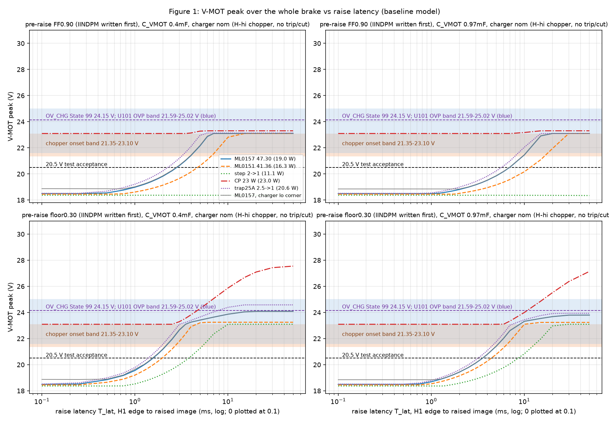
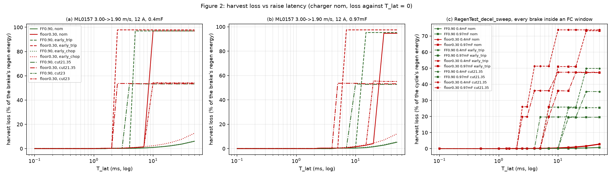
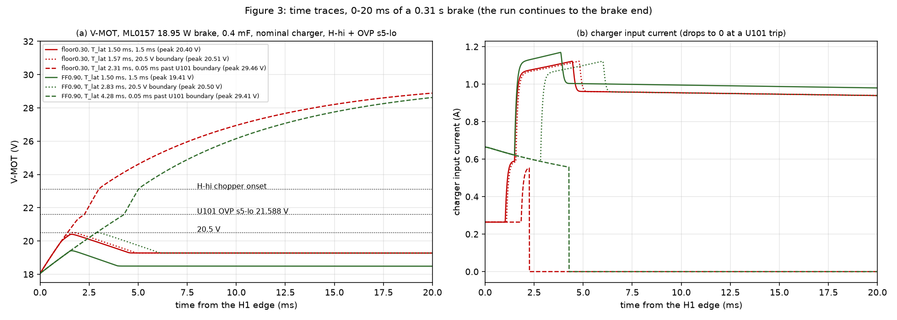
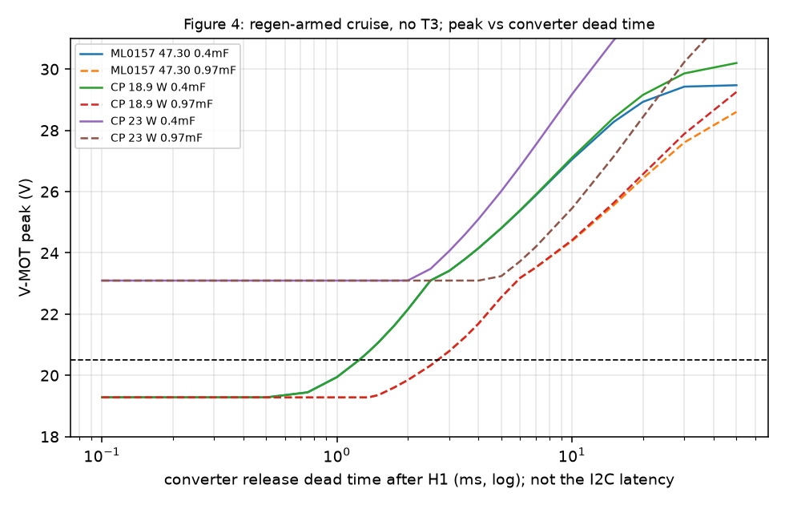
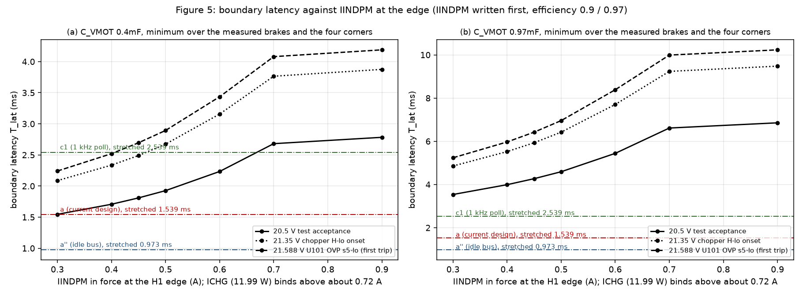

# Sim 7: T3 raise-latency budget (FR-07)

**Date:** 2026-11-16. **Entry script:** `run.py` (miniforge Python, 1384 s). **Outputs:** `results_*.csv`, `fig1`-`fig5`
PNG, `summary.json`, `run_log.txt`, and `tables.md` (the digest of every table that this document quotes).
**Bus inputs:** `i2c_facts_100k.py` and `i2c_facts_100k_out.txt` (Section 6). **Informs:** design document
`docs/charger_bq25798_wiring_design_2026-11-05.md` (below, "the design"), rows FR-07, FR-22(xxxiii), FR-39, FR-41(iii),
FR-41(vii), FR-46, FR-50, FR-51, F.2, F.3, F.4, G.1, T3, H.7, H.16, H.19, H.20, H.21, H.23(o), PM9, EM6, J.2, T-B-12,
T-C-06, T-D-12 and T-G-02.

Supplementary values that `run.py` does not print were computed by importing `run.py` without calling `main()`, or by
reading its CSV files. Each such value is marked "supplementary" in the text and names its inputs.

The following terms are used throughout. **FF** is the FR-41 brake feed-forward. **CP** denotes a constant-power brake.
The four **charger corners** are lo, nom, d310 and hi (Table 3). The **IINDPM-first interval** is the 0.475 ms between
the REG06:07 write and the REG03-05 write.

## 1. Summary

### 1.1 Question and answer

This study derives the largest acceptable T3 raise latency T_lat from the physics of the V-MOT node. T_lat runs from
the H1 rise (pin-34 rising edge, V-MOT = 18.05 V) to the raised charger image being in force. No bus timing enters the
derivation. The 100 kHz bus figures appear only in Section 6, where each firmware architecture is placed on the
latency axis.

The budget is set by the V-MOT rise during the latency. Until T3 lands, the charger absorbs only its pre-raise
capacity, and the brake power in excess of that capacity charges C_VMOT. The pre-raise capacity is
min(IINDPM x 0.88 x V, 11.99 W), where 11.99 W is the ICHG limit of the FC image. The time to a threshold is therefore
approximately the node energy between 18.05 V and the threshold, divided by the excess power (Equation 2, Section 5.1).

Two thresholds bind. The 20.5 V test acceptance of T-B-12, T-G-02 and T-D-12 binds first. Its stated basis is a
0.85 V margin below a 21.35 V VESC cut (`docs/reviews/charger_eval_2026-11-05/round3/calc/r3_calc.py:442`). The design
marks that cut level as superseded (J.2 item 81, VR-1). The first physical threshold is the U101 OVP rising
minimum with leak, 21.588 V (s5-lo). A trip there costs 86-98 % of the brake harvest. With the H-hi chopper, 176 of
216 simulated s5-lo trips also end the Run through FR-50 OV_CHG (211 of 251 over all no-cut trip scenarios).

The 1.5 ms of FR-07 is not derived from the node physics. H.16 and H.23(o) present it as a deadline that the 1.359 ms
100 kHz write schedule meets with 0.141 ms margin. It also lies 0.02 ms above the zero-absorption time to 21.588 V for
an 18.96 W brake at 0.4 mF (1.48 ms, Equation 2). That agreement is a coincidence, because the charger absorbs
4.8-12.0 W during the latency.

Section 11 records the budget ruled on 2026-11-16 (3.5 ms at IINDPM 0.40 A, C_VMOT 1.0 mF and 21.588 V, with the
regen image kept at VINDPM 19.0 V) and its margins.

### 1.2 Limits at 100 kHz

At 100 kHz, the governing variable is the IINDPM value in force at the H1 edge. The FR-41(iii) ramp steps once per
2 ticks at 100 kHz, and IINDPM at the earliest H1 rise is 0.300-0.890 A (design F.3 item 2, R9.H21(r)). The governor
floor 0.30 A is therefore the worst pre-raise state that the 100 kHz design permits. With the design write order
(REG06:07 IINDPM first, then REG03-05), this **floor case** gives the following limits:

- 0.4 mF: 20.5 V is crossed at **1.54 ms**, and the first U101 trip (s5-lo) occurs at **2.24 ms**;
- 0.97 mF: 20.5 V is crossed at **3.54 ms**, and the first U101 trip occurs at **5.24 ms**.

Between the floor and the ICHG limit, every limit rises with IINDPM at the edge (Table 2, Figure 5). For example,
a guaranteed 0.45 A gives 1.81 / 2.69 ms at 0.4 mF, and a guaranteed 0.60 A gives 2.23 / 3.44 ms.

The **FF-landed case** applies when the FR-41 feed-forward has raised IINDPM to about 0.75 A or more before the H1
edge. The ICHG limit of 11.99 W then binds. The limits are 2.78 ms (20.5 V) and 4.19 ms (first U101 trip) at 0.4 mF,
and 6.86 / 10.23 ms at 0.97 mF. The design guarantees this case only at 400 kHz (F.3 item 2).

### 1.3 Boundary tables

Table 1 gives the boundary latencies. The **measured set** consists of the eight measured hard brakes, the 2 -> 1 and
3 -> 1 m/s steps and the 18.9 W constant-power brake. Each value is the minimum over the measured set and the four
charger corners. Each value comes from a bisection with the H-hi chopper (`results_boundaries.csv`, `tables.md`
TABLE 1). The bisection ends on an interval of 0.0073 ms (60 ms / 2^13) and reports its upper end, so each boundary is
resolved to 0.0073 ms.

*Table 1: boundary latency T_lat (ms), minimum over the measured set and the four corners; IINDPM written first.*

| First crossing of | Class | FF landed, 0.4 mF | FF landed, 0.97 mF | Floor 0.30 A, 0.4 mF | Floor 0.30 A, 0.97 mF | Worst-case variant, FF, 0.4 mF | Worst-case variant, floor, 0.4 mF |
|---|---|---|---|---|---|---|---|
| 20.5 V test acceptance | test | **2.78** | 6.86 | **1.54** | 3.54 | 0.00 | 0.00 |
| 21.35 V, chopper H-lo onset | harvest (heat) | 3.88 | 9.48 | 2.09 | 4.86 | 0.00 | 0.00 |
| 21.588 V, U101 OVP rising minimum with leak (s5-lo) | harvest step; Run end in 176 of 216 s5-lo trips | **4.19** | 10.23 | **2.24** | 5.24 | 0.00 | 0.00 |
| 22.149 V, U101 OVP rising minimum without leak | as s5-lo | 4.94 | 12.04 | 2.62 | 6.17 | 0.00 * | 0.00 * |
| 23.188 V, U101 OVP typical | as s5-lo | never (<= 60) | never (<= 60) | 3.78 | 8.55 | 4.97 * | 2.42 * |
| 24.15 V, FR-50 OV_CHG without a prior U101 trip | Run end | never (<= 60) | never (<= 60) | 13.99 | 33.24 | never (<= 60) * | 4.88 * |

The baseline columns use the motor efficiency 0.9 / 0.97 and a 0.1 ms charger lag. The minimum comes from the ML0157
brake or the CP 18.9 W brake at the lo corner in every cell. The corner spread for one brake is at most
0.066 ms. The 23 W brake and the 25 A brakes are not in the measured set; Section 5.9 reports them. The cells marked
"*" are supplementary. `run.py` bisects the worst-case variant only for the first three thresholds. The marked cells
repeat that bisection for the higher three thresholds at 0.4 mF.

The **worst-case variant** combines motor efficiency 1.0 / 1.0 with a 1 ms charger lag. Its minimum is 0.00 ms up to
22.149 V, and that value is a capacity limit, not a latency limit. At efficiency 1.0 the 3.0 m/s, 12 A brakes (ML0157,
ML0165 22.64, YP0166 and the 3 -> 1 m/s step) deliver 22.26 W at the edge. That exceeds the 18.8 W capacity of the lo
corner, and the excess persists through the 0.31 s brake. V-MOT therefore crosses 20.5 V even with an instant raise and
the baseline 0.1 ms lag. A supplementary run of ML0157 at the lo corner peaks at 23.10 V with either lag. Edge power
above the capacity is necessary for a capacity limit but not sufficient. The 25 A brake from 2.5 m/s delivers 20.58 W at
the edge, above 18.8 W, yet stays latency-limited at the lo corner (Table 9). The test is therefore a crossing at T_lat
= 0 (Section 5.9). At the d310 corner, which represents the design raised image (Table 3), the worst-case variant
remains latency-limited (Table 5, Section 5.3). At d310 and 0.4 mF, 20.5 V is crossed at 1.07 ms (FF) and 0.22 ms
(floor).

Table 2 gives the boundaries as a function of IINDPM at the edge (`tables.md` TABLE IEDGE). Figure 5 plots the same
data.

*Table 2: boundary latency T_lat (ms) against IINDPM at the H1 edge; 20.5 V / 21.35 V / 21.588 V; minimum over
the measured set and corners.*

| IINDPM at the edge (A) | 0.4 mF | 0.97 mF |
|---|---|---|
| 0.30 (floor) | 1.54 / 2.09 / 2.24 | 3.54 / 4.86 / 5.24 |
| 0.40 | 1.71 / 2.34 / 2.52 | 3.99 / 5.52 / 5.97 |
| 0.45 | 1.81 / 2.49 / 2.69 | 4.27 / 5.93 / 6.42 |
| 0.50 | 1.93 / 2.67 / 2.89 | 4.59 / 6.42 / 6.96 |
| 0.60 | 2.23 / 3.16 / 3.44 | 5.44 / 7.71 / 8.39 |
| 0.70 | 2.68 / 3.77 / 4.08 | 6.61 / 9.24 / 9.99 |
| 0.90 (FF landed) | 2.78 / 3.88 / 4.19 | 6.86 / 9.48 / 10.23 |

Every limit rises by a factor of 1.7-1.9 between 0.30 A and 0.70 A, and it changes by less than 4 % above 0.70 A.
The ICHG limit binds at IINDPM = 11.99 W / (0.88 x V), which is 0.755 A at 18.05 V and 0.665 A at 20.5 V. The FF-landed
limits therefore require about 0.75 A at the edge, not the full 0.90 A.

### 1.4 Further findings

The following findings qualify the limits above:

1. Harvest loss below the first trip or cut is small. Up to 5 ms, the worst single-brake loss is 0.58 % (FF) and
   1.55 % (floor). At 20 ms it is 3.84 % and 7.88 % (Section 5.4). Latency costs harvest mainly through the step at
   the first U101 trip or the first VESC cut.
2. Some cases are capacity-limited. The CP 23 W brake and the 25 A brake from 3.0 m/s cross 20.5 V at T_lat = 0
   at the d310 corner, the design raised image. They also do so at the two ICHG 2.50 A corners. A hard brake inside
   a CV-phase window crosses 20.5 V at any latency (Section 5.9). No latency budget covers these cases.
3. Motor efficiency is the largest model uncertainty. At 1.0 / 1.0 the ML0157 boundaries at the nom corner fall by
   20.7-36.8 % (Section 5.8).
4. The firmware budget is smaller than T_lat. It equals T_lat minus the pin-34 ISR latency (TODO(calibrate: T-C-06))
   and minus any pure register-to-loop dead time of the BQ25798 (TODO(verify: TI); not in SLUSDV2C).
5. At 100 kHz the current design has no resolvable margin against the floor case. With the LPI2C rise-time stretch
   of x1.133, architecture (a) completes the writes in 1.539 ms. The floor limit is 1.545 ms, so the difference of
   0.006 ms is below the 0.0073 ms bisection resolution (Section 6).

## 2. Model

### 2.1 Structure

The model integrates one V-MOT node with the sim 6 mechanical brake. It adds a charger image that changes at T_lat,
the MB chopper, the VESC housekeeping draw, the U101 OVP trip and an optional VESC over-voltage cut. Equation 1 is the
node equation:

C_VMOT dV/dt = P_e / V - I_chg - I_chop(V) - I_HK     (1)

P_e is the sim 6 brake power (Equation 1 of `../regen_nocut/RESULTS.md`). The VESC battery-side regen cap of 1.5 A
limits P_e at the live node voltage. The chopper current I_chop(V) is solved implicitly on every step, because its I-V
curve rises 0.47 A within 0.04-0.22 V of onset. V-MOT is clamped at VBUS 16.39 V from below, and the bus energy drawn
in the clamp is subtracted from the harvest.

The charger current follows its target through a first-order lag TAU_CHG of 0.1 ms. The charger targets are the
following:

- **Before T3 (FC image):** min(IINDPM_pre x 0.88, 11.99 W / V, 10 A/V x (V - 14.5 V)).
- **IINDPM-first interval:** REG06:07 (IINDPM 1.70 A) lands 0.475 ms before REG03-05. In that interval the target is
  min(I_clamp x 0.88, 11.99 W / V), where I_clamp is the corner clamp of Table 3. ICHG is still the FC value, so the
  11.99 W term binds at every corner. For T_lat below 0.859 ms, the interval is scaled by 0.475 / 0.859 so that it
  never precedes the edge.
- **After T3 (raised image):** min(I_clamp x 0.88, P_corner / V, 10 A/V x (V - I_chg x 0.19 ohm - VINDPM)). VINDPM is
  the stage-1 value 18.2 V +- 2 %. When V-MOT exceeds 19.57 V, VINDPM ratchets to the corner value of
  19.0 V +- 2 % after 1.5 ms (T3 step 4).
- **After a U101 trip:** zero for the rest of the brake.
- **VESC cut at V_cut:** the regen source and the brake force are zero for 0.5 s. The vehicle coasts on drag, and the
  brake resumes if the end speed has not been reached.

Harvest is the charger input energy drawn from the motor side, less the bus energy drawn through the clamp. It also
includes the node energy above VBUS at the end of the run, less that at the start. After a U101 trip the left-over
node energy is not credited. Harvest loss is the harvest at T_lat = 0 minus the harvest at T_lat, for the same case.

### 2.2 Constants and sources

Table 3 lists every constant of the model and its source.

*Table 3: model constants.*

| Quantity | Value | Source |
|---|---|---|
| Brake mechanics, P_e, VESC regen cap, 12 A / 25 A, measured events | as sim 6 | imported from `../regen_nocut/run.py` (Table 1 there) |
| H1 rise maximum, start of every staged run | 18.05 V at VBUS 16.39 V | sim 6 V_H1_RISE; design H.20 |
| FC-image VINDPM | 14.5 V | design F.1 |
| IINDPM accuracy | absorbed = 0.88 x setting | design H.4 r9-25 (SLUSDV2C 6.5, 1 A point only) |
| FC-image ICHG-limited input power | 1.60 A x 0.935 x (7.40 V + 1.60 A x 32.6 mOhm) / 0.93 = **11.99 W** | design H.7 (ICHG -6.5 %, R_BATLEAD 12.6 mOhm, RT1987 20 mOhm, eta_max 0.93); see the note below |
| Post-raise charger corners (P_in, clamp) | lo 18.8 W / 1.328 A: regen image, ICHG 2.50 A (H.7 row 1); nom 21.739 W / 1.70 A: 8.0 V x 2.50 A / 0.92, ICHG 2.50 A; **d310** 21.76 W / 1.328 A: raised image, ICHG 3.10 A, input-limited at the 1.328 A clamp minimum (H.7); hi 28.658 W / 1.70 A: 8.32 V x 3.10 A / 0.90 | `../chopper/run.py` CHARGERS via sim 6; see the note below |
| Stage-1 VINDPM per corner | lo 18.564 V, nom 18.2 V, d310 18.2 V, hi 17.836 V | design F.1, T3 (18.2 V +- 2 %) |
| Ratchet VINDPM per corner | lo 19.38 V, nom 19.0 V, d310 19.0 V, hi 18.62 V | sim 2 corners |
| Ratchet trigger and delay | 19.57 V; 1.5 ms | T3 step 4; delay TODO(verify: firmware round) |
| IINDPM-first interval | 0.475 ms (W(REG03-05) + t_BUF at 100 kHz) | design T3 write order: G.1 T3 exception and FR-46 ("REG06:07 and then REG03-05"); also F.4 step B; `i2c_facts_100k_out.txt` |
| VINDPM loop gain | 10 A/V | sim 2 assumption |
| R_PATH_RG | 0.19 ohm (maximum) | design H.19; TODO(recalc: D-67): with the TCKE1401NM eFuse, H.19 gives about 0.143-0.220 ohm |
| Charger response lag | 0.1 ms (1 ms in the worst-case variant) | sim 2 (1 ohm x 100 uF); TODO(verify: TI) |
| VESC housekeeping | 15 mA | sim 2 IHK (logged 14-20 mA) |
| Chopper I-V, H-lo / H-typ / H-hi | onset 21.35 / 22.12 / 23.095 V; 0.47 A at 21.39 / 22.21 / 23.32 V; 0.74 A at 33.2 / 35.0 / 36.7 V | `../chopper/results_static_iv.csv` |
| U101 OVP rising | 21.588 (s5-lo), 22.149 (no-leak min), 23.188 (typ), 25.019 V (s5-hi) | sim 5 Table 1; sim 6 Table 1 |
| VESC cut | unknown; swept 21.35, 22, 23, 24 V and none; 0.5 s stop | sim 2 assumption 5 (UNCONFIRMED); TODO(calibrate: VESC `l_max_vin`) |
| FR-50 OV_CHG | V-MOT 24.15 V (24.0 V / 0.994) | design FR-50 |
| C_VMOT | 0.4 mF and 0.97 mF | sim 2 section 3 item 2; TODO(calibrate: T-E-04) |
| CV-phase capacity | taper current x (8.32 V + taper current x 32.6 mOhm) / 0.93; taper 1.2 / 0.8 / 0.4 A | VREG 8.32 V (design r4-11); taper currents swept, not sourced |
| Time step | 2 us until T_lat + 5 ms, then 10 us | this study |

The FC-image figure needs a note. H.7 lists an FC-image input limit of 11.2 W and an ICHG limit of 12.0 W. The design
logic sets RFC_OFF = FCC_OFF + H1.UVB (design B.1 permit logic). When UVB is HIGH, the H1 rise therefore lifts the FC
pin clamp. Until T3 lands, the binding pre-raise limits are then IINDPM and ICHG (design F.3, r4 correction). This study
uses the ICHG limit, 11.99 W. When UVB is LOW, the 11.2 W pin clamp stays in force; the `fc_input_11p2W` variant
covers that case (Section 5.8). TODO(verify: H.7 FC-image 11.2 W against the RFC_OFF release).

The post-raise corners also need a note. The design raised image is ICHG 3.10 A (F.1), which the d310 and hi corners
represent. The lo and nom corners are ICHG 2.50 A figures, carried over from sim 6, where they model the regen image.
This study keeps them as conservative lower stand-ins for the raised image. TODO(verify: whether a raised image below
ICHG 3.10 A can be in force at T3). H.7 also lists a raised stage-1 figure of 20.84 W. That figure equals
1.328 A x 0.88 x 17.836 V, the clamp at the low stage-1 VINDPM corner. The d310 corner applies the same clamp at the
live V-MOT, so it absorbs 21.1-21.76 W between 18.05 V and 20.5 V.

### 2.3 Pre-raise cases

The design allows the following charger states at the H1 edge inside an FC window:

- **FF landed:** FR-41 has written IINDPM 0.90 A, which asks for 0.79 A x V. The ICHG limit of 11.99 W binds instead.
  Any IINDPM above about 0.75 A gives the same result.
- **Floor 0.30 A:** the governor floor with no feed-forward, or a ramp frozen at 0.30 A. It is the lower end of the
  100 kHz range 0.300-0.890 A (R9.H21(r)).
- **Intermediate IINDPM:** 0.40, 0.45, 0.50, 0.60 and 0.70 A at the edge (Table 2).
- **CV phase:** FR-39 and F.4 keep a window open in CV. The pre-raise and post-raise capacities then both equal the
  taper-current input power (Section 5.9).
- **Regen-armed cruise:** the charger already holds the regen image (design F.2 row "Run cruise, regen armed"). T3 is
  posted only with the FC image active, so T_lat does not apply (Section 5.6).

The r8 queue-priority rule of FR-07 pre-empts every FR-41 ramp step that has not started when T3 posts. A frozen
IINDPM over the whole latency is therefore the baseline. The IINDPM-first interval is part of every case, because the
design T3 order writes REG06:07 first.

### 2.4 Cross-check against sim 6

The model was first run in the sim 6 configuration. That configuration has no chopper, no housekeeping, accuracy 1.0,
the regen-image capacity before T3, no lag, no R_PATH and no IINDPM-first interval. Over the 48 Part E cases of
`../regen_nocut/results_staged.csv`, the largest difference in peak V-MOT is 2.06 mV (`results_crosscheck_sim6.csv`).

## 3. Thresholds

The thresholds fall into three classes:

- **Test acceptance:** 20.5 V (T-B-12, T-G-02, T-D-12). Its basis is "0.85 V below the 21.35 V VESC cut"
  (`docs/reviews/charger_eval_2026-11-05/round3/calc/r3_calc.py:442`). The design marks the 21.35 V cut level as
  superseded (design F.3, J.2 item 81, VR-1). The 20.5 V value is therefore a design target, not a physical limit.
- **Harvest loss:** four thresholds cost harvest. The chopper onset sheds energy as heat. A U101 OVP trip turns the
  charger off for the rest of the brake, followed by 0.30 s of re-qualification. A VESC cut removes regen and braking
  force for 0.5 s. The BQ25798 VBUS_OVP acts at 25.2 V.
- **Run end and physical stress:** FR-50 OV_CHG at a V-MOT of 24.15 V ends the Run through State 99. The chopper R-G is
  overstressed above 0.47 A of R-SHUNT current (sim 2 conclusion 5). The damage thresholds are the BQ25798 30 V absolute
  maximum, the RT1987 OVP at 33 V and the C-D8/C-D10 35 V rating. U101 shields the BQ25798 once it has tripped.

## 4. Brakes and cycles

The brake set consists of the following:

- the eight measured hard brakes and the 2 -> 1 and 3 -> 1 m/s steps (12 A; 10.9-18.96 W at the edge);
- the 18.9 W and 23 W constant-power brakes of 0.58 s;
- the State-98 'T' 25 A brake from 2.5 and 3.0 m/s to 1.0 m/s;
- a 12 A start-speed sweep, 1.0-4.5 m/s in 0.25 m/s steps, to 1.0 m/s, run to 1.3 s (`results_speed_sweep.csv`).

The measured set of Table 1 is the first item plus the 18.9 W brake. Four of its members start at 3.0 m/s with 12 A:
ML0157, ML0165 22.64, YP0166 and the 3 -> 1 m/s step. Each delivers 18.96 W at the edge.

The drive cycles are the sim 6 Part C cycles under ideal tracking. Each cycle is split into brake segments, and every
segment starts at VBUS inside an FC window:

- RegenTest_decel_sweep: 35.11 J of regen in 5 brakes, peak 17.70 W;
- RegenTest_v2_lowspeed: 13.69 J in 6 brakes, peak 11.03 W;
- UDDS_trimmed_3.5mps and UDDS_trimmed_to_idle: no regen, because drag covers every deceleration.

## 5. Results

### 5.1 Physical mechanism

The boundary latency follows from an energy balance on C_VMOT during the latency. Equation 2 gives the approximation
for a constant brake power P_e and a constant pre-raise absorption P_abs:

T_th ~ C_VMOT (V_th^2 - 18.05^2) / (2 (P_e - P_abs))     (2)

For the 18.96 W brake at 0.4 mF, the node energy from 18.05 V is 18.89 mJ to 20.5 V and 28.05 mJ to 21.588 V. With
P_abs = 11.99 W (FF landed), Equation 2 gives 2.71 ms and 4.03 ms. The simulation of ML0157 at the lo corner gives
2.78 ms and 4.20 ms. Most of the difference is the 15 mA housekeeping draw: with it added to P_abs, Equation 2 gives
2.83 ms and 4.20 ms. With no absorption, Equation 2 gives 1.00 ms and 1.48 ms. These closed-form values are
supplementary and use the constants of Table 3.

At 0.97 mF the node energy is 45.81 mJ to 20.5 V and 68.02 mJ to 21.588 V. Equation 2 then gives 6.57 ms and 9.76 ms
with the ICHG limit. With the housekeeping draw added it gives 6.86 ms and 10.19 ms, and with no absorption 2.42 ms and
3.59 ms. The simulated minima are 6.86 ms and 10.23 ms (CP 18.9 W at the lo corner).

The floor case lies between these bounds. Its absorption is 0.30 A x 0.88 x V, about 4.8-5.4 W, until the IINDPM-first
interval raises it to the ICHG limit 0.475 ms before T3. For ML0157 at the nom corner, the floor 20.5 V boundary falls
from 1.57 ms to 1.34 ms without the interval (variant `iindpm_with_reg03`, Table 8). The interval therefore adds
0.23 ms in the floor case. It adds nothing in the FF-landed case, where ICHG already binds.

### 5.2 V-MOT peak against latency

Figure 1 shows the V-MOT peak over the whole brake against T_lat for the nom corner, without trips or cuts and with the
H-hi chopper. The peak rises from about 18.5 V, the post-raise level. In the FF-landed case it flattens on the chopper
onset at 23.1-23.3 V. In the floor case, latencies of 20-50 ms drive the 3.0 m/s brakes to 23.7-24.1 V and the CP 18.9 W
brake to 24.5 V. Their excess power then exceeds the 0.47 A chopper knee. The weaker brakes stay at 22.8-23.3 V;
the 11 W brakes, for example, have an excess of about 5.6 W, which remains below the knee. In the FF-landed case, the
2 -> 1 m/s step never crosses 20.5 V up to 60 ms. Its 11.1 W is below the 11.99 W ICHG limit.

*Figure 1: V-MOT peak over the whole brake against T_lat on a log axis (T_lat = 0 plotted at 0.1 ms). Each run
continues to the brake end, 0.17-0.58 s. Panels: the two pre-raise cases at 0.4 mF and 0.97 mF at the nom corner, plus
ML0157 at the lo corner. The bands mark the chopper onset band 21.35-23.10 V and the U101 OVP rising band
21.59-25.02 V; the dashed lines mark 20.5 V and the 24.15 V OV_CHG level. The x axis spans 0.1-50 ms, which is the
whole latency grid. The legend value of 19.0 W for the 3.0 m/s brakes is 18.96 W rounded.*

Two brakes keep rising above the chopper band, because they exceed the raised capacity. They are CP 23 W and, in the
floor case, the 25 A brake from 2.5 m/s. Table 4 gives the worst peak for each candidate latency
(`results_peak_grid.csv`). Each entry is the worst over the measured set at the nom corner, with the worst over all
four corners in brackets.

*Table 4: worst V-MOT peak (V) against T_lat, measured set, nom corner (all corners); IINDPM written first.*

| T_lat (ms) | FF, 0.4 mF | FF, 0.97 mF | Floor, 0.4 mF | Floor, 0.97 mF |
|---|---|---|---|---|
| 1.0 | 18.98 (19.02) | 18.49 (18.85) | 19.56 (19.66) | 18.69 (18.85) |
| 1.36 | 19.29 (19.33) | 18.58 (18.85) | 20.17 (20.20) | 18.96 (18.98) |
| 1.5 | 19.41 (19.45) | 18.63 (18.85) | 20.40 (20.43) | 19.07 (19.08) |
| 2.0 | 19.83 (19.87) | 18.81 (18.85) | 21.19 (21.22) | 19.43 (19.44) |
| 2.5 | 20.24 (20.28) | 18.99 (19.01) | 21.94 (21.98) | 19.78 (19.80) |
| 3.0 | 20.64 (20.67) | 19.17 (19.18) | 22.66 (22.69) | 20.13 (20.14) |
| 4.0 | 21.42 (21.45) | 19.52 (19.53) | 23.26 (23.26) | 20.79 (20.81) |
| 5.0 | 22.17 (22.20) | 19.86 (19.88) | 23.42 (23.42) | 21.43 (21.44) |
| 7.0 | 23.10 (23.10) | 20.54 (20.55) | 23.67 (23.67) | 22.63 (22.64) |
| 10.0 | 23.10 (23.10) | 21.50 (21.52) | 23.93 (23.93) | 23.33 (23.33) |

At the present 1.5 ms, the floor case peaks at 20.43 V, 0.07 V below the acceptance. The lo corner raises the
low-latency peaks at 0.97 mF to 18.85 V, because its stage-1 VINDPM is 18.564 V.

### 5.3 Worst-case variant per corner

Table 5 resolves the worst-case variant of Table 1 by charger corner (`results_boundaries.csv`, variant
`worst_eff1_lag1ms`, minimum over the measured set).

*Table 5: worst-case variant (efficiency 1.0 / 1.0, 1 ms charger lag), boundary latency (ms); 20.5 V / 21.588 V.*

| Pre-raise case, C_VMOT | lo (18.8 W, ICHG 2.50 A) | nom (21.74 W, ICHG 2.50 A) | d310 (21.76 W, design raised image) | hi (28.66 W) |
|---|---|---|---|---|
| FF landed, 0.4 mF | 0 / 0 (capacity) | 1.06 / 2.07 | 1.07 / 2.08 | 1.64 / 2.64 |
| Floor 0.30 A, 0.4 mF | 0 / 0 (capacity) | 0.21 / 0.93 | 0.22 / 0.93 | 0.78 / 1.36 |
| FF landed, 0.97 mF | 0 / 0 (capacity) | 3.81 / 6.18 | 3.82 / 6.19 | 4.40 / 6.74 |
| Floor 0.30 A, 0.97 mF | 0 / 0 (capacity) | 1.94 / 3.31 | 1.95 / 3.32 | 2.39 / 3.75 |

At the lo corner the four 3.0 m/s brakes deliver 22.26 W against an 18.8 W capacity. The excess persists through the
brake, so they cross both thresholds at T_lat = 0. The other lo-corner brakes stay latency-limited; ML0151 gives 1.97 ms
(FF, 20.5 V, 0.4 mF). At the nom and d310 corners the 22.26 W brake exceeds the capacity at the edge by 0.52 W (nom) and by about 1.2 W (d310).
That excess falls as the speed falls. Those corners are therefore latency-limited, and the 3.0 m/s brakes set every
minimum in Table 5. The d310 column is the design raised image. The lo column is an ICHG 2.50 A stand-in (Section 2.2),
so its capacity limit bounds a raised image weaker than the design.

A supplementary run caps the raised image at a fixed 20.84 W (the H.7 stage-1 figure, clamp 1.328 A, VINDPM 18.2 V,
then 19.0 V). This cap is more conservative than d310, because it ignores the rise of the clamp power with V-MOT. The
worst-case variant is then capacity-limited at 0.4 mF and latency-limited at 0.97 mF: FF 2.26 / 4.88 ms and floor
0.99 / 2.44 ms (20.5 V / 21.588 V). The baseline limits with this cap are 2.82 / 4.23 ms (FF) and 1.56 / 2.26 ms
(floor) at 0.4 mF, within 0.04 ms of Table 1.

### 5.4 Harvest loss

Figure 2 shows the harvest loss against T_lat for the ML0157 brake and for RegenTest_decel_sweep. Panels (a) and (b)
show five consequence scenarios. The scenario names are the `scenario` identifiers of `results_consequence.csv`; the
scenario `nom` is distinct from the nom charger corner. All five scenarios use the nom charger corner:

- `nom`: H-typ chopper, OVP typical 23.188 V, no cut;
- `early_trip`: H-hi chopper, OVP 21.588 V, no cut;
- `early_chop`: H-lo chopper, OVP 25.019 V, no cut;
- `cut21.35` and `cut23`: H-typ chopper and OVP typical, with a VESC cut at 21.35 V or 23 V.

*Figure 2: harvest loss against T_lat (log axis, 0.1-50 ms; T_lat = 0 plotted at 0.1 ms), relative to the same case at
T_lat = 0, nom corner. Panels (a) and (b): ML0157 at 0.4 mF and 0.97 mF, as a percentage of its 4.544 J of regen. Panel
(c): RegenTest_decel_sweep in the `nom`, `early_trip` and `cut21.35` scenarios, as a percentage of its 35.11 J of regen.
Every brake of panel (c) starts inside an FC window.*

The loss is a step function of latency. Below the first trip or cut it is chopper heat and extra housekeeping energy at
a higher node voltage. At the first U101 trip the brake loses 86-98 % of its harvest. At the first VESC cut it loses
38-103 %, for example 53 % for ML0157 with a cut at 21.35 V. Table 6 collects the loss statistics over the measured
set (`results_consequence.csv`; `tables.md` STATS).

*Table 6: harvest loss statistics, measured set, nom corner, all scenarios.*

| Quantity | Value | Worst case |
|---|---|---|
| Loss without trip or cut, T_lat <= 5 ms, FF landed | <= 0.58 % | ML0165 22.64, `nom`, 0.97 mF, 5 ms |
| Loss without trip or cut, T_lat <= 5 ms, floor | <= 1.55 % | ML0165 22.64, `early_chop`, 0.4 mF, 5 ms |
| Loss without trip or cut, T_lat <= 20 ms, FF landed | <= 3.84 % | ML0165 22.64, `early_chop`, 0.4 mF, 20 ms |
| Loss without trip or cut, T_lat <= 20 ms, floor | <= 7.88 % | ML0165 22.64, `early_chop`, 0.4 mF, 20 ms |
| Loss with a U101 trip and no cut | 86.1-98.4 % | 251 trips (`early_trip` 216, `nom` 35, `early_chop` 0) |
| V-MOT peak with a U101 trip and no cut | 23.27-30.25 V | 27 cases reach 30 V; none reaches 33 V |
| Trips that reach FR-50 OV_CHG | 211 of 251 | all 35 `nom` trips; 176 of 216 `early_trip` trips |
| Loss with a VESC cut, all cut scenarios | 37.7-102.6 % | ML0157: 52.5-100.7 %; CP 18.9 W: 86.1-99.7 % |
| Cycle loss without trip or cut, T_lat <= 20 ms | <= 1.13 % | RegenTest_decel_sweep, floor, 0.4 mF, `nom` |

The 40 `early_trip` trips that do not reach OV_CHG are weak brakes that the H-hi chopper holds near 23.3 V. After a
trip, the chopper R-G carries more than 0.47 A for up to 586 ms (CP 18.9 W; 305 ms for ML0157). Cut losses above 100 %
occur because the model debits the bus energy that enters V-MOT through the clamp during the 0.5 s stop.

Table 7 gives the cycle-level losses (`results_drive_cycles.csv`). Each cell is the worst over the `nom`, `early_trip`
and `cut21.35` scenarios. "T" marks a U101 trip, "C" a VESC cut and "R" a Run end through OV_CHG.

*Table 7: cycle harvest loss (% of cycle regen) against T_lat.*

| T_lat (ms) | decel_sweep FF 0.4 mF | decel_sweep FF 0.97 mF | decel_sweep floor 0.4 mF | decel_sweep floor 0.97 mF | v2_lowspeed floor 0.4 mF | v2_lowspeed floor 0.97 mF |
|---|---|---|---|---|---|---|
| 1.5 | 0.00 | 0.00 | 0.05 | 0.00 | 0.00 | 0.00 |
| 2.0 | 0.00 | 0.00 | 0.11 | 0.00 | 0.00 | 0.00 |
| 2.5 | 0.05 | 0.00 | 26.00 T R | 0.07 | 0.08 | 0.00 |
| 3.0 | 0.05 | 0.00 | 26.01 T R | 0.07 | 0.08 | 0.00 |
| 4.0 | 0.05 | 0.00 | 51.24 T R | 0.16 | 0.16 | 0.00 |
| 5.0 | 19.66 C | 0.00 | 51.24 T R | 0.16 | 0.16 | 0.00 |
| 7.0 | 25.75 T R | 0.07 | 51.24 T R | 25.92 T R | 32.96 C | 0.28 |
| 10.0 | 25.80 T R | 0.07 | 73.80 T R | 51.00 T R | 32.96 C | 0.29 |
| 20.0 | 25.80 T R | 25.33 T R | 73.80 T R | 51.00 T R | 50.58 C | 31.16 C |

The cycle simulation treats each brake on its own. A "T R" cell therefore understates the real cost, which is the rest
of the Run. RegenTest_v2_lowspeed loses nothing in the FF-landed case at any latency, because its 11.03 W peak is below
the 11.99 W ICHG limit. Its trips without a cut (14.8-49.0 %) do not reach OV_CHG.

### 5.5 Time traces

Figure 3 compares the ML0157 brake at 1.5 ms, at the 20.5 V boundary and 0.05 ms past the U101 boundary. The traces use
the nom corner with the `early_trip` pairing (H-hi chopper, OVP 21.588 V). The boundaries are therefore those of ML0157
at the nom corner (Table 8 baseline): 1.57 ms and 2.26 ms (floor), 2.83 ms and 4.23 ms (FF). They lie 0.02-0.05 ms
above the Table 1 minima. The legend values add 0.05 ms to each boundary.

*Figure 3: (a) V-MOT and (b) charger input current for the ML0157 brake (3.00 -> 1.90 m/s, 12 A, 0.31 s), 0.4 mF,
nom corner, H-hi chopper, OVP 21.588 V. The legend latencies are the ML0157 nom-corner boundaries, with 0.05 ms added
to the U101 boundaries. The window is 0-20 ms after the H1 edge; each run continues to the 0.31 s brake end. The
figure title rounds the brake power to 18.95 W; the text uses 18.96 W.*

The floor trace at 1.5 ms peaks at 20.40 V. Its charger current steps from 0.26 A to about 0.59 A when REG06:07 lands,
then to about 1.1 A when REG03-05 lands. Past the U101 boundary the charger current falls to zero, and V-MOT climbs on
the chopper to 29.4-29.5 V for the rest of the brake. That level is above the 24.15 V OV_CHG threshold.

### 5.6 Regen-armed cruise and the H.7 warm-response budget

In regen-armed cruise, H1 releases ILIM_HIZ in hardware and the regen image is already written. No I2C write lies in
the path, so the FR-07 budget does not apply. The relevant quantity is a converter release dead time t_d after the
H1 rise, which is a BQ25798 property. Figure 4 shows the peak against t_d (`results_regen_armed.csv`).

*Figure 4: regen-armed cruise, V-MOT peak over the whole brake against the converter release dead time after the H1
rise. The axis is logarithmic, 0.1-50 ms, with a dead time of 0 plotted at 0.1 ms. The charger is at the nom corner
and the ratchet VINDPM 19.0 V. The x axis covers the whole
dead-time grid. The plotted curves include a modelling artefact described below.*

The published Part F cases inherit the IINDPM-first interval of the baseline. In those cases the charger starts to
absorb at the ICHG limit 0.475 ms before t_d, which a regen-armed release does not do. This shifts the 20.5 V crossing
for ML0157 to about 1.24 ms (0.4 mF) and 2.69 ms (0.97 mF). A supplementary re-run of the Part F cases without the
interval gives the corrected crossings: **0.95 ms at 0.4 mF and 2.39 ms at 0.97 mF**. A bisection of the same cases
confirms 0.946 ms and 2.393 ms. TODO(rerun: Part F with adv = 0 in `run.py`, then regenerate Figure 4).

The CP 23 W curve of Figure 4 sits at 23.10 V from zero dead time. It is a capacity limit. The 23 W brake exceeds the
21.74 W regen image of the nom corner, so V-MOT rises to the H-hi chopper onset at any dead time.

The H.7 warm-response budget is the same physics with a different time origin. H.7 counts t_d from V-MOT crossing
VINDPM_min. It starts the node at VINDPM_max + 1.1 A x R_PATH_RG = 19.59 V, with 1.1 A of excess current. That gives
0.331 ms (0.4 mF) and 0.803 ms (0.97 mF), which reproduce the H.7 values of 0.33 / 0.80 ms (`tables.md` WARM RESPONSE).
With the ML0157 excess current of 0.935 A instead of 1.1 A, the same start gives 0.39 / 0.945 ms.

Part F instead counts t_d from the H1 rise at 18.05 V. The zero-absorption climb from 18.05 V to 19.59 V takes
0.61 ms at 18.96 W and 0.4 mF (1.48 ms at 0.97 mF), by Equation 2. The sum, 1.00 / 2.43 ms, agrees with the corrected
Part F values within 0.06 ms. Neither budget depends on FR-07; T-B-09 and T-B-12 measure t_d.

### 5.7 IINDPM at the edge

Figure 5 plots the boundaries of Table 2 against IINDPM at the H1 edge, with the stretched bus times of three
architectures as horizontal lines.

*Figure 5: boundary latency against IINDPM in force at the H1 edge, 0.30-0.90 A (the whole sweep). Each point is the
minimum over the measured set and the four corners (IINDPM written first, efficiency 0.9 / 0.97). Panel (a): 0.4 mF;
panel (b): 0.97 mF. Horizontal lines: stretched 100 kHz bus times of architectures a (1.539 ms), c1 (2.539 ms) and a''
(0.973 ms), without ISR or reload terms. No point lies between 0.70 A and 0.90 A, so the knee is not resolved. The ICHG
limit binds from 0.665 A (at 20.5 V) to 0.755 A (at 18.05 V); the axis label value of about 0.72 A is approximate. The
legend glyph of the dashed 21.588 V curve renders solid, and the panel (b) legend overlaps a label of panel (a).
TODO(fix: `run.py` Figure 5 axis label and legend).*

Figure 5 places architecture (a) on the floor 20.5 V limit at 0.4 mF. The difference of 0.006 ms is below the 0.0073 ms
bisection resolution, so architecture (a) has no resolvable margin before the ISR term. Architecture c1 meets the 20.5 V
limit at 0.4 mF only if IINDPM at the edge is at least about 0.67 A. That value is a linear interpolation in Table 2. At
0.97 mF every architecture below 3.5 ms meets every limit in the figure.

### 5.8 Sensitivity of the boundaries

Table 8 gives the boundaries for the ML0157 brake at the nom corner and 0.4 mF, for each model variant
(`results_boundaries.csv`; `tables.md` VARIANTS).

*Table 8: boundary latency (ms) for ML0157, nom corner, 0.4 mF; 20.5 V / 21.35 V / 21.588 V.*

| Variant | FF landed | Floor 0.30 A |
|---|---|---|
| Baseline (IINDPM written first) | 2.83 / 3.92 / 4.23 | 1.57 / 2.10 / 2.26 |
| Both writes land at T_lat (no IINDPM-first interval) | 2.83 / 3.92 / 4.23 | 1.34 / 1.88 / 2.04 |
| Sim 6 basis (accuracy 1.0, no ICHG limit) | never / never / never | 1.93 / 2.51 / 2.67 |
| Motor efficiency 1.0 / 1.0 | 1.79 / 2.53 / 2.74 | 1.19 / 1.63 / 1.76 |
| Charger response lag 1 ms | 2.59 / 3.77 / 4.10 | 1.01 / 1.55 / 1.71 |
| Start at VBUS with a 5 ms current rise | 2.88 / 3.99 / 4.31 | 1.85 / 2.39 / 2.55 |
| ICHG limit at an 8.0 V pack (12.9 W) | 3.33 / 4.61 / 4.98 | 1.60 / 2.14 / 2.29 |
| FC-image input limit 11.2 W (`fc_input_11p2W`) | 2.52 / 3.49 / 3.77 | 1.54 / 2.08 / 2.23 |

Four observations follow from Table 8:

1. The FC-image ICHG limit decides the FF-landed boundaries. Without it (the sim 6 basis), the FF-landed case never
   reaches 20.5 V, which overstates the margin.
2. If the 11.2 W pin clamp stays in force, the FF-landed limits at 0.4 mF fall to 2.52 / 3.77 ms. At 0.97 mF they
   fall to 6.19 / 9.27 ms. The floor case changes by 0.03 ms or less.
3. At a motor efficiency of 1.0 / 1.0, the ML0157 nom-corner boundaries fall by 20.7-36.8 % (`tables.md` STATS). The
   range covers both pre-raise cases, both capacitances and three thresholds. Other brakes and corners were not
   evaluated for this ratio.
4. A 1 ms charger lag lowers the FF-landed boundaries by 0.13-0.23 ms and the floor boundaries by 0.55 ms at 0.4 mF.

### 5.9 Capacity-limited cases

A case is **capacity-limited** when V-MOT crosses a threshold at T_lat = 0; no latency budget can then pass it.
Table 9 gives the per-corner boundaries of the brakes outside the measured set (`tables.md` EXCLUDED CASES).

*Table 9: boundary latency (ms) of the CP 23 W and 25 A brakes per charger corner; 20.5 V / 21.588 V; 0 =
capacity-limited.*

| Brake | Pre-raise case | C_VMOT | lo | nom | d310 | hi |
|---|---|---|---|---|---|---|
| CP 23 W | FF landed | 0.4 mF | 0 / 0 | 0 / 0 | 0 / 0 | 1.736 / 2.600 |
| CP 23 W | FF landed | 0.97 mF | 0 / 0 | 0 / 0 | 0 / 0 | 4.248 / 6.328 |
| CP 23 W | floor | 0.4 mF | 0 / 0 | 0 / 0 | 0 / 0 | 1.194 / 1.729 |
| CP 23 W | floor | 0.97 mF | 0 / 0 | 0 / 0 | 0 / 0 | 2.725 / 4.014 |
| 25 A, 2.5 -> 1 m/s | FF landed | 0.4 mF | 1.165 / 2.549 | 2.271 / 3.428 | 2.271 / 3.428 | 2.300 / 3.457 |
| 25 A, 2.5 -> 1 m/s | FF landed | 0.97 mF | 5.112 / 8.401 | 5.691 / 8.657 | 5.691 / 8.657 | 5.720 / 8.679 |
| 25 A, 2.5 -> 1 m/s | floor | 0.4 mF | 0.725 / 1.450 | 1.384 / 2.014 | 1.392 / 2.014 | 1.406 / 2.036 |
| 25 A, 2.5 -> 1 m/s | floor | 0.97 mF | 2.717 / 4.387 | 3.186 / 4.739 | 3.186 / 4.739 | 3.208 / 4.761 |
| 25 A, 3.0 -> 1 m/s | FF landed | 0.4 mF | 0 / 0 | 0 / 0 | 0 / 0 | 1.099 / 1.663 |
| 25 A, 3.0 -> 1 m/s | FF landed | 0.97 mF | 0 / 0 | 0 / 0 | 0 / 0 | 2.783 / 4.167 |
| 25 A, 3.0 -> 1 m/s | floor | 0.4 mF | 0 / 0 | 0 / 0 | 0 / 0 | 0.872 / 1.267 |
| 25 A, 3.0 -> 1 m/s | floor | 0.97 mF | 0 / 0 | 0 / 0 | 0 / 0 | 2.043 / 3.025 |

Table 9 leads to three results:

1. The CP 23 W brake exceeds the post-raise capacity at the lo, nom and d310 corners. The d310 corner is the design
   raised image. The T-B-12 acceptance of a 20.5 V peak at 23 W therefore fails at T_lat = 0 for the design. Only the hi
   corner (28.66 W) is latency-limited, at 1.74 ms (FF, 0.4 mF).
2. The 25 A brake from 3.0 m/s behaves in the same way. It is capacity-limited at the lo, nom and d310 corners and
   latency-limited at the hi corner.
3. The 25 A brake from 2.5 m/s is latency-limited at every corner. Its lo-corner limits (1.17 ms FF, 0.73 ms floor,
   20.5 V, 0.4 mF) are below every measured-set limit. Its d310 limits are 2.27 ms (FF) and 1.39 ms (floor). It is
   reachable only through the State-98 'T' command; whether an FC window can then be open is TODO(verify: FR-41,
   State 98 window admission).

The 12 A start-speed sweep shows the same capacity limit. At the nom corner and T_lat = 0, the peak stays below 20.5 V
only up to a start speed of 3.5 m/s. This holds in all four pre-raise and capacitance combinations (`run_log.txt` Part
D). Design H.7 lists "ICHG needed 3.05 A for the HR1 23 W condition" and an input-limited 21.76 W at 3.10 A. A 23 W pass
is not consistent with that 21.76 W limit. TODO(verify: H.7 23 W row against the 21.76 W input limit).

Table 10 gives the CV-phase boundaries at the nom corner (`tables.md` CV PHASE).

*Table 10: CV-phase boundary latency (ms); 20.5 V / 21.588 V; capacity = taper-current input power before and after
the raise.*

| Taper current (A) | P_in (W) | Brake | FF, 0.4 mF | Floor, 0.4 mF | FF, 0.97 mF | Floor, 0.97 mF |
|---|---|---|---|---|---|---|
| 1.2 | 10.79 | ML0157 | 0 / 0 | 0 / 0 | 0 / 0 | 0 / 0 |
| 1.2 | 10.79 | ML0151 | 0 / 0 | 0 / 0 | 0 / 0 | 0 / 0 |
| 1.2 | 10.79 | step 2 -> 1 | never / never | 3.75 / 5.56 | never / never | 8.65 / 13.19 |
| 0.8 | 7.18 | all three | 0 / 0 | 0 / 0 | 0 / 0 | 0 / 0 |
| 0.4 | 3.58 | all three | 0 / 0 | 0 / 0 | 0 / 0 | 0 / 0 |

In CV the raise adds no capacity, so a hard brake inside a CV window crosses 20.5 V and trips U101 at any latency. Only
the 11.1 W step at the 1.2 A taper remains latency-limited. For that step, 10.79 W of taper capacity plus 0.29 W of
housekeeping exceeds its 11.06 W edge power. CV windows are therefore a capacity question for the window admission rules
(FR-39, F.4), not a latency question. The constant-current results of Tables 1 and 2 assume a pack below VREG.

## 6. Firmware architectures at 100 kHz with the existing pull-ups

### 6.1 Bus timing with the existing pull-ups

The existing pull-ups are the MB RSDA/RSCL of 10 kOhm, with or without the Teensy 22 kOhm pad pull-up. The design
gives "RSDA (10 kOhm as built, 2.7 kOhm after PM9)" (pin table, SDA row) and the PM9 row "RSDA and RSCL 10 kOhm ->
2.7 kOhm". EM6 (removal of the EVM 10 kOhm R39/R40) remains required without PM9, because its reason is back-powering
of the carrier rail (design EM6 row). The following results come from `i2c_facts_100k_out.txt`:

- **Rise time (30-70 %, 0.8473 Rp Cb):** for the Cb estimate of 70-99 pF, t_r is 593-839 ns with 10 kOhm alone.
  With the 22 kOhm pad pull-up it is 408-577 ns. The UM10204 standard-mode limit is 1000 ns.
- **Cb margin:** t_r reaches 1000 ns at Cb = 118 pF (10 kOhm alone) or 172 pF (with 22 kOhm).
- **Sink current:** 0.31 / 0.45 mA at 0.4 V, against the 3 mA limit.
- **LPI2C period stretch:** the rise time lengthens each SCL period. At Cb 75 pF the stretch is x1.083 (10 kOhm alone)
  or x1.050 (with 22 kOhm); at Cb 120 pF it is x1.133 or x1.092.

The stretched figures in this section use the x1.133 case (10 kOhm alone, 120 pF). By the 0.8473 Rp Cb formula of
`i2c_facts_100k_out.txt`, the 30-70 % rise time at 120 pF is 1017 ns, 17 ns above the standard-mode limit. A
supplementary evaluation of the same stretch model gives x1.133 from 114 pF upward. The x1.133 stretch therefore also
applies at the 118 pF standard-mode limit. Over the 70-99 pF Cb estimate, the stretch is x1.075-x1.108 with 10 kOhm
alone. The file labels the 22 kOhm pad pull-up as the `Wire` default; FR-07 requires a non-`Wire` LPI2C engine, so
whether the pad pull-up is enabled is a firmware choice. TODO(verify: pad pull-up state of the FR-07 LPI2C engine).
TODO(verify: NXP UM10204; IMXRT1060RM LPI2C MCCR0 and IOMUXC PUS, not in `references/`).

Several design rows assume PM9 and 400 kHz while PM9 remains undone. They are the G.1 register-map header, H.16,
the D.3 IO CSV row 19 (SCL) and the list entry "MB RSDA/RSCL are 2.7 kOhm (were 10 kOhm)". These rows depend on the
100 kHz decision.

Table 11 gives the transaction times at 100 kHz against the FR-07 per-transaction cap of 0.50 ms.

*Table 11: 100 kHz transaction times (ms), unstretched (10 us per bit) and stretched x1.133.*

| Transaction | Bits | Unstretched | Stretched | Inside the 0.50 ms cap when stretched |
|---|---|---|---|---|
| W(REG06:07) IINDPM | 38 | 0.380 | 0.431 | yes |
| W(REG03-05) ICHG + VINDPM | 47 | 0.470 | 0.533 | no |
| R(REG05) | 39 | 0.390 | 0.442 | yes |
| R(REG01:02) / R(REG06:07) | 48 | 0.480 | 0.544 | no |
| R(REG31-34) | 66 | 0.660 | 0.748 | no (exceeds the cap also unstretched) |
| R(REG1B-21) / R(REG01-07) | 93 | 0.930 | 1.054 | no (exceeds the cap also unstretched) |
| R(REG00-0A) verify | 129 | 1.290 | 1.462 | no (exceeds the cap also unstretched) |

Stretched, the 3-byte write W(REG03-05) and every 2-byte read exceed the 0.50 ms FR-07 cap. The cap is already exceeded
at the 75 pF estimate. A 2-byte read then takes 0.504 ms at x1.050 and 0.520 ms at x1.083. W(REG03-05) takes 0.509 ms at
x1.083. These values scale the unstretched times of Table 11 by the stretch factors above. A 2-byte read stays inside
the cap only below a stretch of x1.042. The H.23(o) in-flight term and the FR-22(xxxiii) "no transaction exceeds the
FR-07 cap" check therefore need a cap re-sized for 100 kHz.

### 6.2 Architecture margins

Table 12 places each architecture on the T_lat axis (`tables.md` ARCHITECTURE MARGINS). The bus time runs from the edge
to REG03-05 write complete. Each margin is the limit minus the stretched bus time. Two columns are supplementary: the
worst-case variant at the d310 corner (Table 5) and the floor margin at the 75 pF and 99 pF stretch factors.

*Table 12: architecture bus times (ms) and margins (ms) to the Table 1 limits at 0.4 mF unless stated; stretch x1.133
unless stated; negative = does not fit.*

| Architecture | Bus | Stretched | Floor 20.5 V (1.545) | Floor 20.5 V at x1.083 / x1.108 (Cb 75 / 99 pF) | Floor U101 (2.24) | FF 20.5 V (2.78) | FF U101 (4.19) | Worst-case FF 20.5 V, d310 (1.07) | FF 20.5 V, 0.97 mF (6.86) |
|---|---|---|---|---|---|---|---|---|---|
| a: pin-34 ISR + r8 queue priority + 0.50 ms cap (current design) | 1.359 | 1.539 | 0.006, unresolved | +0.07 / +0.04 | +0.70 | +1.24 | +2.65 | -0.47 | +5.32 |
| a': as (a), in-flight term = W(REG03-05) | 1.329 | 1.505 | +0.04 | +0.11 / +0.07 | +0.74 | +1.28 | +2.68 | -0.44 | +5.35 |
| a'': as (a), idle bus | 0.859 | 0.973 | +0.57 | +0.62 / +0.59 | +1.27 | +1.81 | +3.22 | +0.10 | +5.88 |
| b1: ISR + priority, no cap or abort, R(REG1B-21) in flight | 1.789 | 2.027 | -0.48 | -0.39 / -0.44 | +0.21 | +0.76 | +2.16 | -0.96 | +4.83 |
| b2: ISR + priority, no cap or abort, R(REG00-0A) unsplit | 2.149 | 2.435 | -0.89 | -0.78 / -0.84 | -0.19 | +0.35 | +1.75 | -1.37 | +4.42 |
| e: ISR, FIFO, one FR-41 ramp group ahead | 2.329 | 2.638 | -1.09 | -0.98 / -1.04 | -0.40 | +0.15 | +1.55 | -1.57 | +4.22 |
| c1: no pin ISR, pin 34 polled in the 1 kHz FR-45 timer | 2.359 | 2.539 | -0.99 | -0.93 / -0.96 | -0.30 | +0.24 | +1.65 | -1.47 | +4.32 |
| d: blocking `Wire` from `loop()` (5.0 ms FR-27 budget) | 5.859 | 5.973 | -4.43 | -4.39 / -4.41 | -3.73 | -3.19 | -1.78 | -4.90 | +0.88 |
| c2: pin 34 polled in `loop()` (5.0 ms FR-27 budget) | 6.359 | 6.539 | -4.99 | -4.93 / -4.96 | -4.30 | -3.76 | -2.35 | -5.47 | +0.32 |

No margin in Table 12 includes the pin-34 ISR latency (TODO(calibrate: T-C-06)) or a BQ25798 register-to-loop dead
time (TODO(verify: TI; T-B-12, T-B-24)). Both terms subtract from every margin. The margin of architecture (a) to the
floor 20.5 V limit is 0.006 ms, below the 0.0073 ms bisection resolution, so its sign is not resolved. The worst-case
column uses the d310 corner; at the lo corner that variant is capacity-limited, and every architecture fails it. The
`loop()` architectures rest on the FR-27 budget of 5.0 ms, not on a measured worst case (TODO(measure: T-C-09)).

Architecture (a) exceeds the present 1.5 ms deadline by 0.039 ms in the x1.133 case. The supplementary columns scale
the bus part of each schedule by the stretch factor and leave the poll and loop terms unscaled. At Cb 75 pF (x1.083)
architecture (a) takes 1.472 ms; at Cb 99 pF (x1.108) it takes 1.506 ms. Its floor 20.5 V margin therefore depends
on the measured Cb and lies between 0 and 0.07 ms over the 75-118 pF range.

## 7. Design rows that depend on the budget

Table 13 evaluates the design rows that are functions of T_lat (`results_design_rows.csv`; `summary.json` keys
`tdd12_ms_from_false_restore_to_20p5V` and `i_floor_none_beyond_ms`).

*Table 13: design rows as functions of T_lat.*

| Row | Dependence on T_lat | Result |
|---|---|---|
| H.20 I_floor (backstop if a regen path bypasses the chokepoint) | design form (P / 18.05 - 2.45 C / t) / 0.88 | 0.448 / 0.706 A at 1.5 ms (18.9 / 23 W, 0.4 mF), as in the design. With the ICHG limit, the needed IINDPM is 0.354 / 0.595 A. No IINDPM <= 0.90 A suffices beyond 2.86 ms (18.9 W, 0.4 mF), 1.77 ms (23 W, 0.4 mF), 6.92 ms (18.9 W, 0.97 mF) and 4.28 ms (23 W, 0.97 mF). This row covers the pre-raise phase only; CP 23 W crosses 20.5 V after the raise even at T_lat = 0 at the d310 corner (Section 5.9) |
| F.4 window close G < I_floor + H_adm (backstop only) | through I_floor | Design form: no window can open (I_floor + 0.10 > 1.05 A) beyond 4.64 ms (18.9 W, 0.4 mF), 2.24 ms (23 W, 0.4 mF), 11.26 ms (18.9 W, 0.97 mF) and 5.42 ms (23 W, 0.97 mF), from the closed form of the design expression. With every regen path through the chokepoint, the window floor stays 0.30 A at any latency |
| H.21(a) I_ff upper bound | P_allow = 18.05 (0.264 + 2.45 C / t) | I_ff,max = 8.64 A at 1.5 ms and 2.67 A at 50 ms (0.4 mF). I_ff = 1.0 A stays valid at every latency up to 50 ms |
| T-D-12 false restore (detect tick <= 1 ms + T_lat) | time from 19.72 V to 20.5 V | Design form (0.90 A x 0.88): 2.37 ms (18.9 W, 0.4 mF) and 5.73 ms (0.97 mF), so T_lat <= 1.37 / 4.73 ms. With the ICHG limit: 0.95 ms at 0.4 mF, so T-D-12 at 18.9 W fails on the detect tick alone; 2.31 ms at 0.97 mF (T_lat <= 1.31 ms). At 23 W with the ICHG limit: 0.59 / 1.43 ms |
| H.19 sag drain | 0.9 A x T_lat / C | 3.375 V at 1.5 ms, 0.4 mF; linear in T_lat |
| H.7 warm-response budget | none (post-write response) | 0.33 / 0.80 ms, reproduced in Section 5.6; independent of FR-07 |
| FR-41(vii) T_HOLD_ACK, F.5 T4 restore deadline | none | separate deadlines, not functions of the FR-07 budget |
| FC-window duty | none in the baseline design | a larger budget does not close windows; it raises the share of in-window brakes that cross a threshold, which no data quantifies, because fw v31-v37 build with `FC_CHARGE_ALLOWED 0` |

A change of the FR-07 budget requires the following design rows to be re-derived:

1. FR-07: the normative "edge to write complete <= 1.5 ms" and the 0.5 ms per-transaction cap at 100 kHz
   (Section 6.1).
2. T3: the raise row states "edge to write complete <= 1.5 ms (FR-07)".
3. G.1 and FR-46, T3 exception: the raise writes complete at 1.359 ms "against the FR-07 1.5 ms".
4. F.2, row "Brake in FC window, H1 = 1 (raised)": the raised image is "written within 1.5 ms".
5. F.3 item 1: an N-tick or V_rgn-rising qualifier was rejected because "it would delay the raise past the first
   1.5 ms". That argument takes the 1.5 ms as given, so it must be re-evaluated against the new budget. The findings
   table carries the same argument (entry `ff-brake-edge-clears-peakhold-on-ripple`).
6. FR-22(xxxiii): the host-native test asserts "edge to write complete <= 1.5 ms at 100 kHz" and that no
   transaction exceeds the FR-07 cap.
7. T-C-06: the pass criterion for the T3 timing at the 100 kHz fallback.
8. H.16 and H.23(o): the 1.359 ms schedule and its "margin 0.141 ms to 1.5 ms"; the stretched time 1.539 ms
   exceeds 1.5 ms.
9. T-B-12: "raise <= 1.5 ms"; the 23 W acceptance fails at T_lat = 0 at the d310 corner (Section 5.9).
10. T-G-02: "raise <= 1.5 ms" and the 20.5 V peak. Two clauses also depend on the budget. One is "a brake straight after
    an acceleration (governor at its floor) passes"; the other is that window count and FC duty do not drop. The floor
    clause holds only for T_lat <= 1.54 ms at 0.4 mF. The duty clause is unaffected by the budget in the baseline
    design, except through U101 trips and OV_CHG Run ends above the trip boundary.
11. T-D-12: "re-raise within 1.5 ms of the first tick" against the 20.5 V peak (Table 13).
12. H.7, H.20 and H.21: the pre-raise integrations at 1.5 ms (H.7 row "V-MOT before the raise lands", the H.20 race
    floor and the H.21(a) I_ff bound).
13. J.2 item 27: the 16.5 W that IINDPM = 0.30 A absorbs "within 1.5 ms at 0.4 mF".
14. The design summary bullet on T3 timing and change-log row r8-3, which both state the 1.359 ms against 1.5 ms.

## 8. Decision table

Table 14 collects the consequences of each candidate T_lat (`tables.md` DECISION TABLE). Peaks are the worst over the
measured set and all corners. The IINDPM column gives the IINDPM at the edge that passes 20.5 V and avoids a U101
s5-lo trip at 0.4 mF. It is interpolated linearly in Table 2. The loss columns give the largest percentage loss of one
measured brake at 0.4 mF in the no-cut scenarios, with the RegenTest_decel_sweep cycle loss in brackets. The
architecture column lists the architectures whose stretched bus time is at most T_lat, without ISR and reload terms.

*Table 14: decision table, IINDPM written first, efficiency 0.9 / 0.97.*

| T_lat (ms) | Peak FF 0.4 / 0.97 mF (V) | Peak floor 0.4 / 0.97 mF (V) | IINDPM needed, 0.4 mF: 20.5 V / no U101 trip (A) | Highest threshold crossed, 0.4 mF: FF / floor / worst-case FF at d310 | Worst brake loss, FF (cycle) | Worst brake loss, floor (cycle) | Architectures that fit |
|---|---|---|---|---|---|---|---|
| 1.0 | 19.02 / 18.85 | 19.66 / 18.85 | 0.30 (floor) / 0.30 (floor) | none / none / none | 0.0 % (0.00 %) | 0.0 % (0.00 %) | a'' |
| 1.36 | 19.33 / 18.85 | 20.20 / 18.98 | 0.30 (floor) / 0.30 (floor) | none / none / 20.5 V | 0.0 % (0.00 %) | 0.3 % (0.05 %) | a'' |
| 1.5 | 19.45 / 18.85 | 20.43 / 19.08 | 0.30 (floor) / 0.30 (floor) | none / none / 20.5 V | 0.0 % (0.00 %) | 0.3 % (0.05 %) | a'' |
| 2.0 | 19.87 / 18.85 | 21.22 / 19.44 | 0.52 / 0.30 (floor) | none / 20.5 V / 21.35 V | 0.3 % (0.00 %) | 0.3 % (0.11 %) | a, a', a'' |
| 2.5 | 20.28 / 19.01 | 21.98 / 19.80 | 0.66 / 0.39 | none / U101 s5-lo / U101 s5-lo | 0.3 % (0.05 %) | 98.4 % trip + Run end (26.00 % T) | a, a', a'', b1, b2 |
| 3.0 | 20.67 / 19.18 | 22.69 / 20.14 | none <= 0.90 / 0.52 | 20.5 V / U101 no-leak min / U101 no-leak min | 0.3 % (0.05 %) | 98.4 % trip + Run end (26.01 % T) | a, a', a'', b1, b2, e, c1 |
| 4.0 | 21.45 / 19.53 | 23.26 / 20.81 | none <= 0.90 / 0.69 | 21.35 V / U101 typ / U101 no-leak min | 0.3 % (0.05 %) | 98.4 % trip + Run end (51.24 % T) | a, a', a'', b1, b2, e, c1 |
| 5.0 | 22.20 / 19.88 | 23.42 / 21.44 | none <= 0.90 / none <= 0.90 | U101 no-leak min / U101 typ / U101 typ | 98.1 % trip + Run end (0.05 %) | 98.4 % trip + Run end (51.24 % T) | a, a', a'', b1, b2, e, c1 |
| 7.0 | 23.10 / 20.55 | 23.67 / 22.64 | none <= 0.90 / none <= 0.90 | U101 no-leak min / U101 typ / U101 typ | 98.1 % trip + Run end (25.75 % T) | 98.4 % trip + Run end (51.24 % T) | a, a', a'', b1, b2, e, c1, d, c2 |
| 10.0 | 23.10 / 21.52 | 23.93 / 23.33 | none <= 0.90 / none <= 0.90 | U101 no-leak min / U101 typ / U101 typ | 98.1 % trip + Run end (25.80 % T) | 98.4 % trip + Run end (73.80 % T) | a, a', a'', b1, b2, e, c1, d, c2 |

Two entries of Table 14 need interpretation. The "highest threshold crossed" columns name the highest of the six Table 1
thresholds, and a higher entry implies every lower threshold. The worst-case entry uses the d310 corner, the design
raised image. It comes from `results_boundaries.csv` for the first three thresholds. For the higher three it comes from
the supplementary bisection of Table 1. At d310 (FF) that bisection gives 2.62 ms at 22.149 V, 4.99 ms at 23.188 V and
never at 24.15 V. At the lo corner the worst-case variant reaches U101 no-leak min at every latency, because it is
capacity-limited up to 22.149 V. It reaches U101 typ from 4.97 ms (Table 1).

## 9. Decisions required to fix the budget

The study does not select a budget; Section 11 records the operator rulings of 2026-11-16 on D1-D3 and the resulting
budget. Table 15 lists the open decisions and the maximum T_lat that each option permits at
0.4 mF, with 0.97 mF in brackets. Each value is the latency limit before the ISR latency and the BQ25798 reload dead
time are subtracted.

*Table 15: open decisions and the resulting maximum T_lat (ms), 0.4 mF (0.97 mF); 20.5 V / no U101 s5-lo trip.*

| Decision | Option | Maximum T_lat | Architectures with a non-negative stretched margin |
|---|---|---|---|
| D1. Pre-raise state that must pass at 100 kHz | floor 0.30 A (the worst state the 100 kHz design permits) | 1.54 / 2.24 (3.54 / 5.24) | a', a'' (20.5 V; a unresolved, 0.006 ms); also a, b1 (no trip) |
| | a guaranteed IINDPM of 0.45 A at the edge | 1.81 / 2.69 (4.27 / 6.42) | a, a', a'' (20.5 V); also b1, b2, e, c1 (no trip) |
| | a guaranteed IINDPM of 0.60 A at the edge | 2.23 / 3.44 (5.44 / 8.39) | a, a', a'', b1 (20.5 V); also b2, e, c1 (no trip) |
| | FF landed (IINDPM >= about 0.75 A; guaranteed only at 400 kHz) | 2.78 / 4.19 (6.86 / 10.23) | all except d and c2 |
| | floor counted as the FR-41(vii) degraded mode, with its crossings accepted | set by the guaranteed state chosen above | as that state |
| D2. Threshold | keep the 20.5 V test acceptance | first value of each D1 option | as D1 |
| | replace it with "no U101 trip at s5-lo" | second value of each D1 option | as D1 |
| D3. C_VMOT until T-E-04 measures it | design to 0.4 mF (lower bound) | the 0.4 mF values | as D1 |
| | design to 0.97 mF | the bracketed values (x2.3-2.5) | all except d and c2; d (5.97) and c2 (6.54) also fit where the bracketed value exceeds their stretched time |
| D4. Capacity-limited cases | exclude efficiency 1.0 at the lo corner (ICHG 2.50 A), CV windows, CP 23 W, 25 A from 3.0 m/s and 12 A from above 3.5 m/s from the latency budget, and handle them through capacity or window admission | unchanged from D1-D3 | as D1 |
| | cover efficiency 1.0 at the d310 corner, the design raised image (worst-case variant) | FF 1.07 / 2.08 (3.82 / 6.19); floor 0.22 / 0.93 (1.95 / 3.32) | FF: a'' (20.5 V); also a, a', b1 (no trip); floor: none |
| | cover efficiency 1.0 at the lo corner (ICHG 2.50 A), CP 23 W or 25 A from 3.0 m/s at the d310 corner, or a CV window | none (capacity-limited) | none |

Three further points bear on each decision:

1. The current design already takes the D1 degraded-mode option. F.3 item 2 calls the 100 kHz window "the counted
   degraded mode" and a crossing there "safe, harvest lost". That judgement assumes a VESC cut below 24.15 V, whose
   level is unknown. Without such a cut, 176 of 216 simulated s5-lo trips end the Run through OV_CHG (211 of 251 over
   all no-cut trip scenarios). A degraded-mode window is then a Run-end risk, not only a harvest loss.
2. The VESC cut level also bears on D2. A cut at 21.35 V would make the chopper H-lo onset boundary a harvest step.
   That boundary is 2.09 ms (floor) and 3.88 ms (FF) at 0.4 mF, and the step costs 53 % of an ML0157 brake.
3. Every option must leave room for the pin-34 ISR latency (TODO(calibrate: T-C-06)) and the BQ25798 reload dead time
   (TODO(verify: TI)). At the floor 20.5 V limit, architecture (a) leaves no resolvable time for either term. Its margin
   of 0.006 ms is below the 0.0073 ms bisection resolution.

## 10. Limits of this study

The following limits apply:

1. The motor efficiency 0.9 / 0.97 is unverified (TODO(verify): regen_dynamics.md 1.2). At 1.0 / 1.0 the ML0157
   nom-corner boundaries fall by 20.7-36.8 %, and the lo corner becomes capacity-limited (Sections 5.3, 5.8).
2. The model uses a 0.1 ms charger lag after the write. A pure dead time adds directly to T_lat. A 1 ms lag costs
   0.13-0.23 ms (FF) and 0.55 ms (floor) at 0.4 mF (TODO(verify: TI; T-B-12, T-B-24)). The ICHG take-effect time is
   not specified.
3. The IINDPM accuracy factor of 0.88 is specified at 1 A only. The FF-landed case does not depend on it, because
   ICHG binds.
4. The pre-raise FC-image limit is 11.99 W (ICHG). If the 11.2 W pin clamp stays in force, the FF-landed limits fall
   to 2.52 / 3.77 ms at 0.4 mF (Table 8).
5. Tables 1 and 2 assume constant-current charging. In CV every hard brake is capacity-limited (Table 10).
6. The VESC cut level is unknown (TODO(calibrate: VESC `l_max_vin`)), and the 0.5 s fault stop is UNCONFIRMED. A cut
   below 24.15 V prevents the OV_CHG Run end after a U101 trip.
7. The U101 trip is modelled as self-releasing after the brake. A latching U101 (MODE open, TODO(verify: Toshiba),
   FR-51) would lose charging for the rest of the Run.
8. C_VMOT is 0.4-0.97 mF (TODO(calibrate: T-E-04)). The baseline limits of Tables 1 and 2 scale by x2.3-2.5 between the
   two values. Other boundaries scale differently. At 20.5 V the d310 worst-case variant scales by x3.6 (FF) and x8.9
   (floor), and the lo-corner 25 A brake from 2.5 m/s by x4.4.
9. The pin-34 ISR latency is not modelled (TODO(calibrate: T-C-06)).
10. The start at 18.05 V with full brake power is conservative by 0.02-0.31 ms. The source is the variant "start at
    VBUS with a 5 ms current rise" (`tables.md` STATS).
11. No data exist on which brakes start inside an FC window, because fw v31-v37 build with `FC_CHARGE_ALLOWED 0`.
    Suppose that in-window brakes are limited to about 16.35 W (ML0151). The FF-landed limits at 0.4 mF are then
    4.72 / 7.10 ms, and the floor limits are 1.96 / 2.83 ms (20.5 V / 21.588 V; `results_boundaries.csv`).
12. The drive cycles use ideal tracking; the closed-loop drive-law dynamics are not modelled.
13. The 1.5 ms ratchet delay is an assumption. It does not affect any boundary, because the ratchet acts only after
    the raise has landed.
14. `results_regen_armed.csv` and Figure 4 contain the IINDPM-first interval artefact of Section 5.6. The corrected
    crossings (0.95 / 2.39 ms) come from a supplementary computation, not from `run.py`.
15. The stretched bus times use the x1.133 case. That stretch applies from 114 pF, inside the 118 pF standard-mode
    limit of 10 kOhm alone, up to the 120 pF case. The Cb of the built harness is an estimate (70-99 pF, x1.075-x1.108);
    T-C-06 scopes it.
16. The lo and nom corners are ICHG 2.50 A figures kept as conservative stand-ins for the raised image (Section 2.2).
    The capacity-limited statements for the design therefore rest on the d310 corner.

## 11. Operator rulings of 2026-11-16 and the resulting budget

On 2026-11-16 the operator ruled on decisions D1-D3 of Section 9 and on two related parameters. A third proposal, a
regen-image VINDPM of 18.4 V, was evaluated and deferred; the regen image stays at 19.0 V (Section 11.3). This section
records the rulings and evaluates the FR-07 budget at the ruled design point. Every value in this section comes from
`rulings_2026-11-16.py`, which loads `run.py` by importlib without calling `main()`; its output is
`rulings_2026-11-16_out.txt` (777 s). Each boundary is the minimum over the brakes and charger corners named in its
row, from the `run.py` bisection, and uses the IINDPM-first write order. Decision D4 (capacity-limited cases) was not
ruled; Section 11.5 restates it.

### 11.1 Rulings

Table 16 lists the rulings and the deferred proposal with the operator statements verbatim.

*Table 16: operator rulings of 2026-11-16 (row 6 deferred).*

| No. | Subject | Operator statement (verbatim) | Consequence for this study |
|---|---|---|---|
| 1 | Bus speed and pull-ups | "I would rather stick with 100kHz and the existing pullups rather than switching to 400kHz and have to do additional board rework in a difficult location." Later: "I'm leaning towards keeping the 10k resistors and running at 100kHz" | 100 kHz with the 10 kOhm MB RSDA/RSCL is the design case, no longer a fallback or a counted degraded mode. PM9 (10 kOhm -> 2.7 kOhm) is withdrawn. EM6 (removal of EVM R39/R40) stays, for its back-powering reason. The Section 6 bus timing is the design timing |
| 2 | FR-07 budget | "Let's use 3.5ms as the edit-to-write-complete budget" | FR-07 = **3.5 ms** from the pin-34 rising edge to REG03-05 write complete (edge-to-write-complete). It replaces 1.5 ms, which had no physical derivation (Section 1.1) |
| 3 | FC-window thresholds (D1) | "let's use G<400mA, hysteresis at G>500mA as the fuel cell charging window limits" | A window closes at G < 0.40 A and opens at G >= 0.50 A (were 0.30 A and 0.30 A + H_adm). The IINDPM guaranteed at the H1 edge is therefore **0.40 A**. The floor is a close threshold, never a clamp |
| 4 | Criterion (D2) | "Replace with no overvoltage trip" | The 20.5 V test acceptance is replaced by **no U101 OVP trip at the s5-lo corner, 21.588 V** |
| 5 | C_VMOT (D3) | "Our previous data logs and measurements suggest 1.0mF on the motor node as a lower bound, likely higher." | Design to **C_VMOT,min = 1.0 mF** until T-E-04 measures it. The evidence is the ML0215-ML0217 dark-node decay of 1.18-1.38 mF (`docs/vrgn_measurement_error_2026-11-05.md`) |
| 6 (deferred) | Regen-image VINDPM | Proposed: "Lets lower the BQ25798 charging start voltage from 19V to 18.4V". Deferred: "Let's keep at 19V for now then, with a note to revisit later if necessary." | Not applied. The REG05 regen image stays **19.0 V** (0xBE at 100 mV/LSB). Stage 1 stays 18.2 V, the ratchet stays 18.2 V -> 19.0 V with its trigger (VINDPM x 1.02 + 0.19 V) at 19.57 V, and the +-2 % VINDPM band stays 18.62-19.38 V. Section 11.3 keeps the 18.4 V A/B as an evaluated option (design J.2 item 91) |

Ruling 3 has a stated purpose. The operator gave the earlier context "end FC charging earlier if more current is
required by the motor in order to not hit the fuel cell overcurrent limit". A clamp of IINDPM above G would break the
OC_FC invariant aux + charger + traction + ripple <= I_cap - margin. The 0.40 A value therefore acts by closing the
window, not by raising IINDPM.

### 11.2 Budget margins at the ruled design point

Table 17 gives the boundary latency for no U101 s5-lo trip at the ruled design point: IINDPM 0.40 A at the H1 edge,
C_VMOT 1.0 mF and the 19.0 V regen image. The 20.5 V column is given for reference only. The margin is the boundary
minus the 3.5 ms budget.

*Table 17: boundary latency T_lat (ms) at IINDPM 0.40 A, 1.0 mF, VINDPM 19.0 V; minimum over the measured set and the
four corners unless stated; margin over the 3.5 ms FR-07 budget at 21.588 V.*

| Case | Set by (21.588 V) | 20.5 V (reference) | 21.588 V (no s5-lo trip) | Margin over 3.5 ms |
|---|---|---|---|---|
| Nominal (efficiency 0.9 / 0.97, 0.1 ms lag) | lo, CP 18.9 W | 4.11 | 6.15 | +2.65 |
| IINDPM accuracy 0.83 (415 mA at 500 mA, SLUSDV2C) + resistor TCR (H1 rise 18.127 V) | lo, CP 18.9 W | 3.88 | 5.85 | +2.35 |
| As above + 1 ms charger lag | lo, CP 18.9 W | 3.07 | 5.04 | +1.54 |
| 12 A brake from 3.1 m/s | lo | 3.43 | 5.44 | +1.94 |
| 25 A State-98 brake, 2.5 -> 1 m/s | lo | 3.16 | 5.16 | +1.66 |
| VBUS 17.5 V (OV_BUS limit) at the edge, H1 rise 19.25 V | lo, CP 18.9 W | 2.25 | 4.29 | +0.79 |
| 12 A from 3.5 m/s, accuracy 0.83 + TCR; nom, d310 and hi corners | nom | 2.23 | 3.78 | +0.28 |
| Efficiency 1.0 / 1.0 + 1 ms lag + accuracy 0.83 + TCR; d310 corner (design raised image) | d310, ML0157 | 2.16 | **3.71** | **+0.21** |

The last row is the worst latency-limited case (d310 corner) and binds the budget. The same stack at the lo corner is
capacity-limited (Section 11.5, item 2). The margin of 0.21 ms is the room left for a BQ25798 register-to-loop dead
time, which TI does not specify (TODO(verify: TI); T-B-12 and T-B-24 measure it). Every case without the efficiency-1.0
stack leaves at least 0.28 ms. Every such case except the 12 A brake from 3.5 m/s leaves at least 0.79 ms.

Table 18 compares the ruled 0.40 A floor with the superseded 0.30 A floor and with the 0.50 A open threshold, at the
same 1.0 mF and 19.0 V image.

*Table 18: boundary latency T_lat (ms) against IINDPM at the edge, 1.0 mF, VINDPM 19.0 V.*

| IINDPM at the edge | Case | 20.5 V | 21.588 V | Margin over 3.5 ms |
|---|---|---|---|---|
| 0.30 A (superseded floor) | nominal | 3.64 | 5.40 | +1.90 |
| 0.40 A (ruled floor) | nominal | 4.11 | 6.15 | +2.65 |
| 0.40 A (ruled floor) | efficiency-1.0 stack, d310 | 2.16 | 3.71 | +0.21 |
| 0.50 A (open threshold) | nominal | 4.73 | 7.17 | +3.67 |
| 0.50 A (open threshold) | efficiency-1.0 stack, d310 | 2.47 | 4.23 | +0.73 |

A VESC cut near 21.35 V would bind before U101. At 0.40 A and 1.0 mF the nominal boundary to 21.35 V is 5.69 ms
(lo, CP 18.9 W), 2.19 ms above the budget. The cut level is unknown (Section 11.8, item 5).

### 11.3 VINDPM 19.0 V against 18.4 V (deferred option)

The regen image stays at VINDPM 19.0 V. The operator deferred the 18.4 V proposal on 2026-11-16: "Let's keep at 19V
for now then, with a note to revisit later if necessary." The A/B below is kept as the evaluation of that option. The
design J.2 item 91 records the side effects to check if the option is revisited.

The A/B runs the complete budget table of Table 17 under both regen images. The VINDPM change alters none of its rows;
every boundary is identical to 0.01 ms under 19.0 V and 18.4 V (`rulings_2026-11-16_out.txt`, both budget blocks).
Every crossing in Table 17 occurs above about 20 V. There the charger runs at its current or power limit, not in VINDPM
regulation, so the VINDPM value does not enter the crossing.

Table 19 gives the remaining A/B quantities.

*Table 19: VINDPM A/B at IINDPM 0.40 A and 1.0 mF.*

| Quantity | VINDPM 19.0 V | VINDPM 18.4 V |
|---|---|---|
| Regen-armed converter-release dead-time limit t_d, 21.588 V / 20.5 V (lo, CP 18.9 W; no IINDPM-first interval) | 3.68 / 2.45 ms | 3.68 / 2.45 ms |
| V-MOT peak at T_lat = 3.5 ms, ML0157 and CP 18.9 W, over the four corners | 20.136-20.158 V | 20.136-20.158 V |
| V-MOT peak at T_lat = 3.5 ms, step 2 -> 1 m/s, every corner | 18.762 V | 18.762 V |
| Harvested energy at T_lat = 3.5 ms, ML0157, lo corner | 4.3986 J | 4.4128 J |
| Harvested energy at T_lat = 3.5 ms, CP 18.9 W, lo corner | 10.7852 J | 10.7899 J |

Under the 18.4 V option the trip-free harvest would rise by about 0.3 % (ML0157, lo corner: +0.32 %). Part of that
rise is an accounting effect of `run.py`, which counts the node end energy. The regen-armed t_d limit is the same under
both images; it applies to the hardware release, not to the FR-07 budget (Section 5.6).

### 11.4 T-D-12 false restore

T-D-12 starts from the V-MOT static maximum, VINDPM_max + 1.76 A x R_PATH,max (0.19 Ohm). The design case is the
19.0 V regen image, with a start of 19.72 V. The 18.4 V option would lower that start, so T-D-12 is the one budget row
that the A/B moves; its row is given for reference. Table 20 gives the time from the false restore to
21.588 V with the charger at the FC image and IINDPM 0.40 A, and the re-raise deadline that remains after the detect
tick of at most 1 ms.

*Table 20: T-D-12 at IINDPM 0.40 A and 1.0 mF, threshold 21.588 V (lo, CP 18.9 W in every cell).*

| Regen image | Start (static maximum) | Trip after the restore, nominal / accuracy 0.83 + 1 ms lag | Re-raise deadline after the detect tick, nominal / stacked |
|---|---|---|---|
| 19.0 V (design) | 19.72 V (19.38 + 0.334 = 19.714 V; design figure used) | 3.52 / 2.59 ms | **2.52 / 1.59 ms** |
| 18.4 V (deferred option, reference) | 19.10 V (18.768 + 0.334 = 19.102 V) | 4.53 / 3.57 ms | 3.53 / 2.57 ms |

At the 19.0 V design case the trip falls 3.52 ms after the restore (nominal) and 2.59 ms after it (accuracy 0.83 + 1 ms
lag). After the detect tick of at most 1 ms, the re-raise must land within 2.52 ms nominal and 1.59 ms stacked. The
3.5 ms FR-07 figure therefore does not cover the T-D-12 re-raise in either case. T-D-12 needs its own re-raise
deadline: at most 2.5 ms nominal, and at most 1.5 ms if the stacked case must pass. At 1.5 ms, architecture (a)
(1.539 ms stretched, Table 21) has no margin; architecture a'' (0.973 ms) fits (Section 11.8, item 4).

### 11.5 Capacity-limited cases

The following cases cross 21.588 V at T_lat = 0 at the ruled design point, so no latency budget passes them
(definition in Section 5.9):

1. A 12 A brake from 3.25 m/s or faster at the lo corner. From 3.1 m/s the same brake is latency-limited at 5.44 ms.
2. Efficiency 1.0 / 1.0 with a 1 ms lag, accuracy 0.83 and TCR at the lo corner (ICHG 2.50 A). The same stack is
   latency-limited at 3.71 ms at the d310 corner.
3. The CP 23 W brake at the lo, nom and d310 corners. Only the hi corner is latency-limited, at 4.55 ms (21.588 V) and
   3.06 ms (20.5 V). The T-B-12 23 W pass criterion therefore fails at T_lat = 0 for the design raised image.
4. A hard brake inside a CV-phase window (Table 10). In CV the raise adds no capacity, so this result does not depend
   on C_VMOT or on the budget; it was not re-run at 1.0 mF.

No firmware limit on in-window brake speed or power exists for items 1 and 3. Items 1, 3 and 4 are open items
(Section 11.8).

### 11.6 Firmware fit at 3.5 ms

Table 21 places the Section 6.2 architectures on the 3.5 ms budget. The bus times are the stretched values of Table 12
(100 kHz, 10 kOhm, x1.133). The margin is 3.5 ms minus the stretched bus time. The pin-34 ISR latency lies inside the
FR-07 budget and is not subtracted (TODO(calibrate: T-C-06)).

*Table 21: architecture fit to the 3.5 ms FR-07 budget at 100 kHz, stretch x1.133.*

| Architecture | Stretched bus time (ms) | Margin to 3.5 ms (ms) |
|---|---|---|
| a: pin-34 ISR + r8 queue priority + 0.50 ms cap | 1.539 | +1.961 |
| a': as (a), in-flight term = W(REG03-05) | 1.505 | +1.995 |
| a'': as (a), idle bus | 0.973 | +2.527 |
| b1: ISR + priority, no cap or abort, R(REG1B-21) in flight | 2.027 | +1.473 |
| b2: ISR + priority, no cap or abort, R(REG00-0A) unsplit | 2.435 | +1.065 |
| e: ISR, FIFO, one FR-41 ramp group ahead | 2.638 | +0.862 |
| c1: pin 34 polled in the 1 kHz FR-45 timer | 2.539 | +0.961 |
| d: blocking `Wire` from `loop()` | 5.973 | -2.473 |
| c2: pin 34 polled in `loop()` | 6.539 | -3.039 |

Every ISR architecture and the timer-polled architecture c1 fit the budget. The `loop()` architectures d and c2 do
not. For the ISR architectures the margin holds only if pin 34 has an NVIC priority at or above the FR-45 timer, and
the design must state that priority.

The 0.50 ms per-transaction cap of FR-07 is already exceeded at 100 kHz (Table 11): a 2-byte read takes 0.544 ms and
W(REG03-05) takes 0.533 ms stretched. The cap can be replaced by three rules:

1. Reads stay abortable at a byte boundary.
2. The byte-boundary abort extends to the FR-41(vii) hold-ACK post and the T4 restore post, which the cap protected.
3. No write is longer than 3 data bytes.

With these rules the worst in-flight item on the raise path is W(REG03-05), which is architecture a' (1.505 ms). The
FR-41(iii) ramp cadence at 100 kHz becomes one step per 2-3 ticks.

Two bus settings follow from the 10 kOhm design case. First, the LPI2C SETHOLD must be at least 4.75 us, because the
`Wire` default of 3.42 us is below the UM10204 standard-mode tHD;STA of 4.0 us and tSU;STA of 4.7 us (TODO(verify:
NXP UM10204; IMXRT1060RM LPI2C MCCR0, not in `references/`)). Second, the rise time is 593-839 ns for Cb 70-99 pF
against the 1000 ns limit, and the Cb ceiling is 118 pF (Section 6.1); T-C-06 scopes the built Cb.

### 11.7 Consequences for the window and the backstop floor

The 0.40 A close and 0.50 A open thresholds limit the bus-side traction peak plus ripple that a window tolerates. With
I_cap 1.20 A and a margin of 0.10 A, a window closes when traction peak + ripple exceeds I_cap - aux - margin -
0.40 A. It admits when that sum is at most I_cap - aux - margin - 0.50 A. Table 22 gives the resulting limits.

*Table 22: bus-side traction peak + ripple tolerated in an FC window (A).*

| Aux current | Close above (was) | Admit at or below (was) |
|---|---|---|
| 0.15 A | 0.55 (0.65) | 0.45 (0.55) |
| 0.09 A | 0.61 | 0.51 |

The peak total and the OC_FC headroom are unchanged. Two derived requirements follow from ruling 3:

1. The FR-41(iii) write-back must write max(0.40 A, G). Otherwise a traction peak in the last slot can leave IINDPM
   below 0.40 A at the H1 edge, and Table 17 no longer applies.
2. The FR-22(xxiv) host vector ("peak-hold 0.40 A admitted") must be re-checked against the 0.50 A open threshold.

The H.20 backstop race floor uses the design form I_floor = (P / 18.05 - (V_thr - 18.05) x C / T_lat) / 0.88. At
21.588 V, 1.0 mF and T_lat 3.5 ms it gives 0.041 A at 18.9 W and 0.299 A at 23 W. Both values lie below the 0.40 A
window floor. The design form covers the pre-raise phase only; after the raise, CP 23 W remains capacity-limited at the
lo, nom and d310 corners (Section 11.5).

### 11.8 Open items

The following items remain open for the operator. This study does not rule them.

1. CV windows. A hard brake inside a CV-phase window trips U101 at any latency (Section 11.5, item 4). This contradicts
   ruling 4 together with the rule that CV does not close a window (F.4, FR-39). The options are to refuse or end a
   window in CV, or an FR-25 regen derate to the taper capacity.
2. In-window brake speed and power. A 12 A brake from 3.25 m/s or faster is capacity-limited at the lo corner, and no
   firmware limit exists.
3. T-B-12. The 23 W pass criterion fails at T_lat = 0 at the lo, nom and d310 corners.
4. T-D-12 deadline. T-D-12 needs its own re-raise deadline: at most 2.5 ms nominal, and at most 1.5 ms if the stacked
   case must pass (2.52 / 1.59 ms limits, Table 20). Architecture (a) (1.539 ms stretched) has no margin at 1.5 ms;
   a'' (0.973 ms) fits.
5. VESC cut level. `l_max_vin` is unknown (TODO(calibrate: VESC `l_max_vin`)). A cut near 21.35 V would bind before
   U101, at 5.69 ms nominal at 0.40 A.
6. BQ25798 register-to-loop dead time. The worst latency-limited case (efficiency-1.0 stack, d310 corner) leaves 0.21 ms for it (TODO(verify: TI); T-B-12,
   T-B-24).
7. VINDPM 18.4 V option. The operator deferred it on 2026-11-16 ("Let's keep at 19V for now then, with a note to
   revisit later if necessary."). Section 11.3: the option changes no raise-latency margin. It would lower the static
   maximum to 19.10 V and relax the T-D-12 re-raise deadline to 3.53 / 2.57 ms. Side effects to check if the option is
   revisited (design J.2 item 91): the H1 rise maximum of 18.05 V lies above the 18.03 V VINDPM minimum; the bus-feed
   margin to the 17.5 V OV_BUS limit falls from 1.12 V to 0.53 V; the T4(b) restore condition of 18.2 V lies inside the
   18.03-18.77 V band; the H.7 input capability falls to about 21.07 W (21.8 W at 19.0 V).
