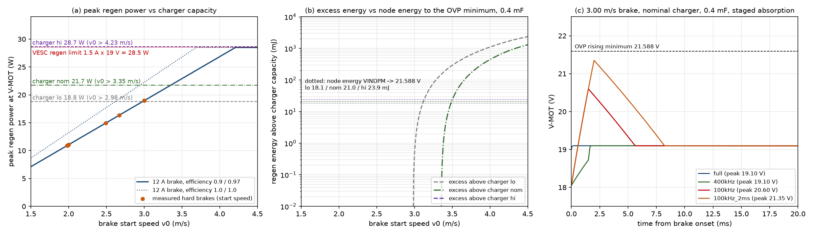

# Sim 6: regen power per hard brake against the charger capacity

**Date:** 2026-11-15. **Entry script:** `run.py` (miniforge Python; about 3 min). **Informs:** design document
(`docs/charger_bq25798_wiring_design_2026-11-05.md`) J.2 item 74, the operator ruling of 2026-11-15 that accepts the
U101 OVP dropout risk, and `../../LAYOUT_DECISIONS.md` D-93.

## 1. Purpose

Sim 2 (`../chopper/RESULTS.md` section 5.8) shows that U101 can trip early on a healthy board. The early trip needs
three conditions at the same time: a U101 with a low OVP threshold, the MB chopper at its high onset corner (H-hi, or
H-typ with pin leakage), and a regen input that exceeds the charger capacity. Sim 2 states the third condition as a
regen current of 1.1-1.2 A, or a brake above the charger capacity of 18.8-28.7 W (of the sim 2 brake set, the 18.9 W,
23 W and 30 W brakes). This simulation estimates the regen power that the measured hard brakes deliver to V-MOT, and
the brake start speed at which that power lifts V-MOT to the U101 OVP rising minimum.

## 2. Model and sources

This simulation is a mechanical motor model with a one-node energy balance on V-MOT. It contains no circuit simulation.
Table 1 lists every constant and its source.

*Table 1: model constants.*

| Quantity | Value | Source |
|---|---|---|
| Effective mass M_EFF | 3.5 kg | `tools/hil_plant_sim.py` line 331 |
| Force constant K_F | 0.7538 N/A | `tools/hil_plant_sim.py` line 332 |
| Coulomb drag, viscous drag | 2.00 N, 0.534 N s/m | `tools/hil_plant_sim.py` lines 333-334 |
| Phase resistance R_ph | 22.6 mOhm | `docs/VESC_MOTOR_INTEGRATION.md` section 2 |
| Gear and inverter efficiency | 0.9, 0.97 | `docs/reviews/charger_eval_2026-11-05/round2/regen_dynamics.md` section 1.2; TODO(verify) |
| Brake current | 12 A; 25 A in Part F | MOTOR_I_CMD_MAX and TRAP_I_ABS_MAX (`teensy_controller/teensy_controller.ino` lines 3649 and 5235) |
| VESC Battery Current Regen Max | 1.5 A | `docs/VESC_MOTOR_INTEGRATION.md` line 231 (SET 2026-08-16) |
| Measured events | 8 hard brakes, start and end speed | regen_dynamics.md section 1.1 table |
| Charger capacity (P_in, I clamp, VINDPM) | lo 18.8 W, 1.328 A, 19.38 V; nom 21.739 W, 1.70 A, 19.0 V; d310 21.76 W, 1.328 A, 19.0 V; hi 28.658 W, 1.70 A, 18.62 V | `../chopper/run.py` CHARGERS (lines 141-150), exact expressions |
| VINDPM loop gain | 10 A/V | `../chopper/RESULTS.md` section 3 item 7 (an assumption of sim 2) |
| OVP rising minimum | 21.588 V with pin leakage, 22.149 V without | `../efuse_decay/results/a_bands_corners.csv`; `../chopper/RESULTS.md` section 5.8 |
| V-MOT capacitance | 0.4 mF (C_VMOT_MIN) and 0.97 mF (HIL default) | `../chopper/RESULTS.md` section 3 item 2 |
| Staged absorption before T3 | H1 rise maximum 18.05 V; IINDPM 0.85 A (400 kHz) or 0.30 A (100 kHz fallback) for the 1.5 ms FR-07 latency; FC-image VINDPM 14.5 V | design document FR-41 r5 and the FC-window text before it (lines ~2698-2736); line 2648 |

The regen power at V-MOT is Equation 1, from regen_dynamics.md section 1.2:

P_e = eta_inv (eta_gear K_F I v - 1.5 I^2 R_ph)     (1)

The VESC limits its battery-side regen current to 1.5 A. Where Equation 1 exceeds 1.5 A times the node voltage, the
model lowers the motor current to the smaller root of Equation 1 at that power, and the braking force falls with it.
The speed follows M_EFF dv/dt = -(K_F I + 2.00 + 0.534 v). A brake is continuous from the start speed v0, without the
0.53 s VESC fault-stop gap that the measured events contain.

Two trip criteria are used:

- **Energy criterion (Parts A, B, D, F).** The charger absorbs its full capacity at VINDPM from the brake onset. Below
  that capacity, the VINDPM loop holds V-MOT at VINDPM, and no U101 OVP corner can trip. Above it, the excess energy
  E_x (the integral of P_e minus the capacity) charges the node. V-MOT reaches the OVP rising minimum only if E_x is at
  least the node energy of Equation 2. Start-speed thresholds come from a bisection to 1 mm/s.

  E_node = 0.5 C (V_OVP,min^2 - V_VINDPM^2)     (2)

- **Transient criterion (Part E).** The node voltage is integrated with the brake (1 us steps for 5 ms, then 10 us). The
  charger draws max(0, min(IINDPM(t), P_cap / V, 10 A/V x (V - VINDPM(t)))). In the staged modes the node starts at
  the 18.05 V H1 rise maximum with the brake already at its start-speed power. Until T3 lands, IINDPM is limited and
  VINDPM is the FC-image 14.5 V; after T3, the regen-image capacity and VINDPM apply. The start at 18.05 V is
  conservative: the node needs at least 0.74 ms to climb to H1 (design FR-41 item 2), and the ramp proceeds during that
  time. The staged phase applies to a brake that begins while the FC image is active (an FC-charge window).

## 3. Assumptions

1. Both criteria ignore the current that the chopper and the VESC housekeeping draw below the chopper onset, and the
   losses of D-BC-RG and U101. Each of these lowers the power that reaches the charger, so the criteria overstate the
   trip risk. The chopper is not modelled, so a V-MOT above the chopper onset in Part E is not physical; only the
   crossing of 21.588 V is used.
2. The criteria apply to the corners that sim 2 identifies as early-trip corners (H-hi with OVP lo or lo-leak, and H-typ
   with lo-leak). At the other corners the chopper conducts below the OVP threshold, and U101 trips only beyond the
   charger plus chopper capacity (sim 2 section 5.8.2).
3. The charger converts at no less than the lo capability. A charger that does not convert (CV taper near a full pack,
   EN_CHG 0, P5 LOW) absorbs nothing; sim 2 then trips U101 on a 18.9 W brake at every healthy chopper corner, even at
   OVP typical (`../chopper/results_power_brakes.csv`, charger "none"). That mode does not depend on the OVP divider.
4. The VESC keeps braking while V-MOT stays below its over-voltage cut. This is gate M-R3 / S0-R3, which has not been
   run on the bench.
5. The VESC regen limit of 1.5 A holds as configured. At the hi charger corner it caps the regen power at
   1.5 A x 18.62 V = 27.93 W, below the 28.658 W capacity, so the energy criterion cannot trip at the hi corner. Table 3
   gives the hi thresholds without the cap for comparison. The 12 A brakes reach the cap at 19 V (28.5 W) only from
   about 4.2 m/s.
6. The drive-cycle check (Part C) assumes ideal setpoint tracking on a 1 ms linear interpolation of the profile. The
   braking force is M_EFF a minus the drag, and the current is that force divided by K_F, capped at 12 A. Controller
   overshoot is not modelled.

## 4. Cases

- Part A: the 8 measured hard brakes and two reference steps (2 to 1 m/s, 3 to 1 m/s), 12 A.
- Part B: a 12 A brake from v0 = 1.5-4.5 m/s in 0.01 m/s steps; E_x against each charger corner; thresholds by
  bisection at 0.4 mF and 0.97 mF, with and without pin leakage, and without the VESC regen limit.
- Part C: the four drive cycles in `references/drive_cycles/`, at the nominal efficiencies and at efficiency 1.0.
- Part D: the efficiency sensitivity, eta_gear 0.8, 0.9 and 1.0 with eta_inv 0.97, and the bound eta_gear = eta_inv =
  1.0.
- Part E: the staged absorption before T3, modes "full", "400kHz" (0.85 A for 1.5 ms), "100kHz" (0.30 A for 1.5 ms)
  and "100kHz_2ms" (0.30 A for 2.0 ms, a sensitivity), at 0.4 mF and 0.97 mF and at efficiency 0.9 / 0.97 and 1.0 / 1.0.
- Part F: a 25 A brake (the State-98 'T' ramp limit) under the energy criterion.

## 5. Results

### 5.1 Measured hard brakes

Table 2 gives the regen power and energy of each measured brake under a continuous 12 A brake (`results_events.csv`).

*Table 2: measured hard brakes, continuous 12 A brake, nominal efficiencies.*

| Event | v0 -> v1 (m/s) | Brake time (s) | P peak / mean (W) | I at 19 V, peak / mean (A) | E at V-MOT (J) | E_x above charger lo (mJ) |
|---|---|---|---|---|---|---|
| ML0151 41.36 | 2.67 -> 1.55 | 0.322 | 16.35 / 11.89 | 0.860 / 0.626 | 3.830 | 0 |
| ML0157 47.30 | 3.00 -> 1.90 | 0.312 | 18.95 / 14.58 | 0.998 / 0.767 | 4.544 | 0.423 |
| ML0165 22.64 | 3.00 -> 2.38 | 0.174 | 18.95 / 16.50 | 0.998 / 0.868 | 2.868 | 0.423 |
| ML0165 28.55 | 2.49 -> 1.43 | 0.307 | 14.93 / 10.71 | 0.786 / 0.564 | 3.287 | 0 |
| ML0195 33.20 | 2.00 -> 0.99 | 0.298 | 11.06 / 7.04 | 0.582 / 0.371 | 2.102 | 0 |
| YP0166 21.97 | 3.00 -> 1.53 | 0.420 | 18.95 / 13.09 | 0.998 / 0.689 | 5.497 | 0.423 |
| YP0196 21.97 | 1.99 -> 1.00 | 0.293 | 10.98 / 7.04 | 0.578 / 0.371 | 2.060 | 0 |
| YP0198 21.98 | 1.98 -> 1.00 | 0.290 | 10.90 / 7.00 | 0.574 / 0.369 | 2.029 | 0 |
| Step 2 -> 1 | 2.00 -> 1.00 | 0.295 | 11.06 / 7.08 | 0.582 / 0.373 | 2.092 | 0 |
| Step 3 -> 1 | 3.00 -> 1.00 | 0.578 | 18.95 / 10.94 | 0.998 / 0.576 | 6.327 | 0.423 |

The peak power is set by the start speed: 11 W from 2 m/s and 19 W from 3 m/s. The model reproduces the 2.09 J and
6.32 J step energies of regen_dynamics.md. A whole hard brake delivers 2.0-5.5 J to V-MOT, which is 40-49 % of the
kinetic-energy drop. No measured brake exceeds the nominal charger capacity of 21.739 W. The three brakes from
3.00 m/s exceed the lo capacity of 18.8 W by 0.155 W for 5.4 ms, an excess energy of 0.423 mJ. That excess is 2.3 %
of the 18.09 mJ that lifts a 0.4 mF node from the lo VINDPM of 19.38 V to the 21.588 V OVP rising minimum.

### 5.2 Start-speed thresholds

Table 3 gives, per charger corner, the start speed above which the peak power exceeds the charger capacity, and the
start speed from which E_x reaches the node energy of Equation 2 (`summary.json`, `results_speed_sweep.csv`).

*Table 3: start-speed thresholds of a 12 A brake, energy criterion, nominal efficiencies.*

| Charger corner | P_cap (W) | P_e exceeds P_cap above (m/s) | E_node, 0.4 mF, 21.588 V (mJ) | Trip from (m/s): 0.4 mF leak / no leak; 0.97 mF leak / no leak | Without the VESC regen limit, 0.4 mF leak (m/s) |
|---|---|---|---|---|---|
| lo | 18.8 | 2.980 | 18.09 | 3.109 / 3.126; 3.181 / 3.207 | 3.109 |
| nom | 21.739 | 3.353 | 21.01 | 3.493 / 3.509; 3.571 / 3.595 | 3.493 |
| d310 | 21.76 | 3.355 | 21.01 | 3.496 / 3.511; 3.574 / 3.598 | 3.496 |
| hi | 28.658 | 4.229 | 23.87 | no trip (VESC limit 27.93 W) | 4.381 |

At the nominal efficiencies, an early trip under the energy criterion needs a 12 A brake from 3.11 m/s or faster at the
lo charger corner, and from 3.49 m/s or faster at the nominal charger. The measured brakes start at 3.00 m/s or below.

### 5.3 Efficiency sensitivity

The gear efficiency 0.9 and the inverter efficiency 0.97 are unverified. Table 4 gives the 3.00 m/s brake (ML0157) and
the trip start speed (energy criterion, 0.4 mF, leak corner) for other values (`results_efficiency.csv`).

*Table 4: efficiency sensitivity.*

| eta_gear / eta_inv | P peak from 3.00 m/s (W) | E_x of ML0157 above lo / nom (mJ) | Trip from, lo / nom (m/s); hi |
|---|---|---|---|
| 0.8 / 0.97 | 16.32 | 0 / 0 | 3.491 / 3.922; no trip |
| 0.9 / 0.97 | 18.95 | 0.423 / 0 | 3.109 / 3.493; no trip |
| 1.0 / 0.97 | 21.59 | 123.1 / 0 | 2.804 / 3.150; no trip |
| 1.0 / 1.0 | 22.25 | 183.6 / 4.08 | 2.738 / 3.073; no trip |

At efficiency 1.0 / 1.0 the 3.00 m/s brakes exceed the nominal capacity, but the 4.08 mJ excess is 19 % of the
21.01 mJ node energy, so they do not trip at the nominal charger under the energy criterion. At the lo charger corner
with a gear efficiency of 1.0, the 3.00 m/s brakes exceed the node energy by a factor of 6.8 and can trip U101 at the
early-trip corners. The lo corner is the design document H.7 row 1 capability (ICHG 2.50 A, pack 7.40 V, efficiency
0.93, ICHG -6.5 %).

### 5.4 Drive cycles

Table 5 gives the regen power of the four drive cycles under ideal tracking (`results_drive_cycles.csv`).

*Table 5: drive cycles under ideal setpoint tracking (1 ms grid).*

| Cycle | v max (m/s) | P peak, nominal (W) | Operating point at the peak | P peak, efficiency 1.0 (W) | E_x above charger lo, efficiency 1.0 (mJ) |
|---|---|---|---|---|---|
| RegenTest_decel_sweep | 3.50 | 17.71 | t = 160.1 s, 3.50 m/s, 8.80 A | 20.58 | 100.1 |
| RegenTest_v2_lowspeed | 2.00 | 11.05 | t = 130.9 s, 2.00 m/s, 12.0 A | 13.19 | 0 |
| UDDS_trimmed_3.5mps | 3.50 | 0 | no deceleration exceeds the drag | 0 | 0 |
| UDDS_trimmed_to_idle | 5.00 | 0 | no deceleration exceeds the drag | 0 | 0 |

The two UDDS cycles decelerate at 0.30 m/s^2 or less, which the drag alone provides, so they produce no regen. The
decel sweep commands decelerations of 0.5-3.0 m/s^2 from 3.50 m/s; four of them start with a braking force above the
drag. This lies outside the 3.00 m/s envelope of the measured brakes. Under ideal tracking its peak, 17.71 W, stays
below every charger corner at the nominal efficiencies; at efficiency 1.0 it exceeds the lo corner by 100.1 mJ. At
3.50 m/s, P_e exceeds 18.8 W above a brake current of about 9.4 A and 21.739 W above about 11.2 A, against the 8.80 A
of ideal tracking. Whether the drive law commands more than ideal tracking at the deceleration onset is not verified.

### 5.5 Staged absorption before T3

Table 6 gives the peak V-MOT of the 3.00 m/s brake and the trip start speed under the transient criterion
(`results_staged.csv`). The "full" rows reproduce the energy criterion of Table 3 to within 0.003 m/s.

*Table 6: staged absorption, 12 A brake, 21.588 V criterion.*

| Efficiency | C | Mode | Peak V-MOT from 3.00 m/s, lo / nom / hi (V) | Trip from, lo / nom / hi (m/s) |
|---|---|---|---|---|
| 0.9 / 0.97 | 0.4 mF | full | 19.53 / 19.10 / 18.72 | 3.107 / 3.490 / no trip |
| 0.9 / 0.97 | 0.4 mF | 400kHz | 19.50 / 19.10 / 18.72 | 3.114 / 3.488 / 4.331 |
| 0.9 / 0.97 | 0.4 mF | 100kHz | 20.63 / 20.60 / 20.60 | 3.069 / 3.416 / 3.725 |
| 0.9 / 0.97 | 0.4 mF | 100kHz_2ms | 21.37 / 21.35 / 21.35 | 3.026 / 3.135 / 3.135 |
| 0.9 / 0.97 | 0.97 mF | 100kHz | 19.48 / 19.16 / 19.16 | 3.184 / 3.555 / 4.417 |
| 0.9 / 0.97 | 0.97 mF | 100kHz_2ms | 19.52 / 19.51 / 19.51 | 3.177 / 3.537 / 4.383 |
| 1.0 / 1.0 | 0.4 mF | 400kHz | trip / 19.75 / 19.32 | 2.742 / 3.068 / 3.803 |
| 1.0 / 1.0 | 0.4 mF | 100kHz | trip / 21.57 / 21.18 | 2.700 / 3.002 / 3.268 |
| 1.0 / 1.0 | 0.4 mF | 100kHz_2ms | trip / 22.43 / 22.08 | 2.661 / 2.753 / 2.753 |
| 1.0 / 1.0 | 0.97 mF | 100kHz | trip / 19.60 / 19.42 | 2.808 / 3.131 / 3.882 |

At 400 kHz the staged phase moves the lo and nom thresholds by at most 0.007 m/s. In the 100 kHz degraded mode at
0.4 mF the 3.00 m/s brakes peak at 20.60-20.63 V, 0.96-0.99 V below the OVP minimum, and the thresholds fall to
3.07 m/s (lo), 3.42 m/s (nom) and 3.73 m/s (hi). If the 0.30 A phase lasts 2.0 ms instead of 1.5 ms, the 3.00 m/s
brakes reach 21.35-21.37 V, a margin of 0.22-0.24 V. At efficiency 1.0 / 1.0 the nominal-charger margin is 0.02 V in
the 100 kHz mode, and the 2.0 ms phase trips U101. The staged phase lets the hi corner trip although the VESC limit
blocks it under the energy criterion, because the node charges during the phase and the cap rises with the node
voltage. At 0.97 mF the staged phase moves the lo and nom thresholds by at most 0.03 m/s, and the 3.00 m/s brakes stay
at or below 19.52 V. The design document already counts the 100 kHz mode as a degraded mode in which a brake can reach
the VESC cut before T3 lands (FR-41 item 2, FR-20).

### 5.6 The 25 A braking ramp

The State-98 'T' trapezoid accepts braking peaks up to TRAP_I_ABS_MAX = 25 A; MOTOR_I_CMD_MAX = 12 A binds only the
drive law and the manual 'A' path. Table 7 gives the 25 A thresholds (`results_trap25A.csv`).

*Table 7: 25 A brake, energy criterion, nominal efficiencies, 0.4 mF, leak corner, VESC regen limit 1.5 A.*

| Charger corner | P_e exceeds P_cap above (m/s) | Trip from (m/s) |
|---|---|---|
| lo | 2.392 | 2.510 |
| nom | 2.571 | 2.699 |
| d310 | 2.572 | 2.700 |
| hi | 2.991 | no trip (VESC limit 27.93 W) |

A 25 A brake gives 20.58 W at 2.5 m/s and 28.80 W at 3.0 m/s before the VESC limit, so a 'T' braking ramp at the
early-trip corners trips U101 inside the measured speed envelope with the lo or nominal charger.

Figure 1 shows the peak power, the excess energy and the staged transient.

*Figure 1: (a) peak regen power at V-MOT of a 12 A brake against the start speed, at efficiency 0.9 / 0.97 (solid)
and 1.0 / 1.0 (dotted), with the 8 measured brakes, the lo, nom and hi charger capacities and the VESC regen limit at
19 V; (b) the regen energy above each charger capacity against the node energy (dotted) that lifts a 0.4 mF V-MOT from
VINDPM to 21.588 V, sweep 1.5-4.5 m/s (the hi curve is zero under the VESC limit); (c) V-MOT of the 3.00 m/s brake
with the nominal charger at 0.4 mF in the four absorption modes, first 20 ms of a 0.31 s brake.*

## 6. Conclusion against J.2 item 74

1. Within the measured brake envelope (12 A from 3.00 m/s or below), with the charger at its nominal capacity, no
   U101 OVP corner trips at any drivetrain efficiency up to 1.0, under the energy criterion and in the staged modes up
   to the 1.5 ms 100 kHz phase. At the lo charger corner, the margin depends on the unverified gear efficiency: the
   required node energy is 43 times the excess at 0.9, and the brakes trip at 1.0.
2. In the 100 kHz degraded mode at the 0.4 mF minimum capacitance, the margin of the 3.00 m/s brakes falls to
   0.96-0.99 V at the nominal efficiencies, and to 0.22-0.24 V if the staged phase lasts 2.0 ms. At efficiency 1.0 the
   nominal-charger margin is 0.02 V, and a 2.0 ms phase trips U101. At 0.97 mF the staged phase is immaterial.
3. Outside that envelope, a 12 A brake from 3.11 m/s (lo charger) or 3.49 m/s (nominal charger) can lift V-MOT to the
   OVP rising minimum at the early-trip corners. The RegenTest_decel_sweep cycle brakes from 3.50 m/s, and the 25 A 'T'
   ramp trips from 2.51-2.70 m/s. The VESC regen limit of 1.5 A blocks the hi charger corner under the energy
   criterion.
4. An early trip with a converting charger therefore needs a low-threshold U101 and the H-hi chopper corner (or H-typ
   with pin leakage), together with a brake whose power exceeds the charger capacity long enough: a 12 A brake from
   about 3.1-3.5 m/s or faster, a 25 A brake from about 2.5 m/s, or a 3.0 m/s brake in the 100 kHz degraded mode at
   minimum capacitance with a long staged phase or a high drivetrain efficiency. A charger that does not convert
   (assumption 3) trips U101 on ordinary brakes at any OVP corner.
5. The consequence depends on the VESC over-voltage cut:
   - With a cut at 23.4-25.2 V, the harvest of that brake is lost: at most its V-MOT energy, 2.0-5.5 J for the measured
     brakes and 9.2 J for a 12 A brake from 3.5 m/s to 1.0 m/s (`results_speed_sweep.csv`), before the charger
     efficiency. Sim 2 Table 5.4 shows that the residual harvest after a trip is near zero (2.0 J of a 1.2 A, 1.2 s
     brake at the H-hi / 22.19 V OVP-lo corner). Each cut also stops regen braking for the 0.5 s fault stop that sim 2
     assumes. Sim 2 gives chopper pulse stress only for cuts at 25.2-30 V: R-G 0.53-1.08 W against 1/16 W and Z-SNT
     0.57-0.84 W against 0.5 W for a few milliseconds (sim 2 section 5.4); it gives no stress figures for cuts below
     25.2 V.
   - Without a cut, V-MOT settles where the chopper absorbs the brake: 28.7 V at 18.9 W and 31.6 V at 23 W on H-hi
     (sim 2 Part D, charger none), with sustained overstress of R-G, Z-SNT, R-SHUNT and the BSP170P for the whole brake.
     V-MOT reaches 35 V and the RT1987 D-BC-RG OVP latches only at about 30 W (35.9 V on H-hi), which a 12 A brake
     reaches from about 4.4 m/s, above the 28.5 W VESC regen limit.

## 7. Limitations and confirming bench tests

- The gear efficiency, the inverter efficiency and R_ph are unmeasured (TODO(verify)); the speeds of ML0151-ML0165
  predate the fw v18 encoder fixes and are approximate.
- The charger capacity corners and the VINDPM loop gain are the sim 2 images; the nom and hi efficiencies are
  assumptions of sim 2. The 100 kHz staged phase length is an estimate from the design-document figures; its real
  length is TODO(calibrate: T-G-02d).
- The VESC regen limit is modelled as an instantaneous battery-current cap; the VESC current-loop response is not
  modelled. The cap protects the hi corner only while it stays set at 1.5 A.
- The model ignores the chopper, so Part E peaks above the chopper onset are not physical.
- Bench confirmation: the VESC `l_max_vin`, the fault-stop time and `inpVoltage` in a hard brake (sim 2 section 8
  item 3); a hard brake from 3.0-3.5 m/s with a converting charger, with V-MOT and the U101 output scoped, after the
  U-SNT repair; the peak brake current of the drive law on RegenTest_decel_sweep.

## 8. Check and corrections

Two independent checks of earlier versions of this report (2026-11-15) re-implemented the model and reviewed the
argument. The corrections are:

1. The nom and hi capacities are the exact `../chopper/run.py` expressions (21.739 W, 28.658 W), not the rounded
   21.7 W and 28.7 W, and the thresholds come from a 1 mm/s bisection, not a 0.05 m/s grid (**Superseded:** "from above
   3.15 m/s at the lo charger corner, and from above 3.50 m/s at the nominal charger").
2. The drive-cycle peaks are evaluated on a 1 ms grid (**Superseded:** "17.02 W ... t = 160.1 s, 3.35 m/s, 8.90 A";
   "9.68 W ... 1.83 m/s"; the 3.0 m/s^2 step starts at 3.50 m/s, not 3.35 m/s).
3. Part E (staged absorption before T3) and Part F (the 25 A 'T' ramp) are added, with assumption 3 (non-converting
   charger).
4. The no-cut consequence is restated: power-limited brakes settle at 28-32 V with chopper overstress, and the
   35 V / RT1987 latch applies only from about 30 W (**Superseded:** "Without a VESC cut, a trip takes V-MOT to 35 V or
   more and latches the D-BC-RG OVP (sim 2 section 5.2)"). The with-cut lost harvest is stated as the brake's own
   V-MOT energy (**Superseded:** "about 2.0 J of harvest instead of 26.4 J for a 1.2 s brake at the H-hi / OVP-lo
   corner"; the two figures are from different rows of sim 2 Table 5.4).
5. The excess above the lo corner lasts 5.4 ms (**Superseded:** "about 6 ms").
6. The VESC regen limit of 1.5 A is applied (**Superseded** assumption 5: "The VESC Battery Current Regen Max of 1.5 A
   does not limit the 12 A brakes"). It blocks the hi corner under the energy criterion (**Superseded:** hi thresholds
   4.381-4.489 m/s at 12 A and 3.128 m/s at 25 A).
7. Before T3 the charger uses the FC-image VINDPM of 14.5 V (design line 2648), not the regen-image VINDPM
   (**Superseded** Table 6 100 kHz rows: "20.97 / 20.84 / 20.74" V and "3.053 / 3.402 / 3.644" m/s, a margin of
   "0.62-0.85 V", and the statement that a 2.0 ms phase trips the lo corner from 3.00 m/s).
8. The chopper pulse stress is attributed to the 25.2-30 V cuts of sim 2, not to 23.4-25.2 V; YP0198 mean current 0.369 A
   (**Superseded:** 0.368 A); the margin ratio reads "the required node energy is 43 times the excess" (**Superseded:**
   "43 times the required node energy").
